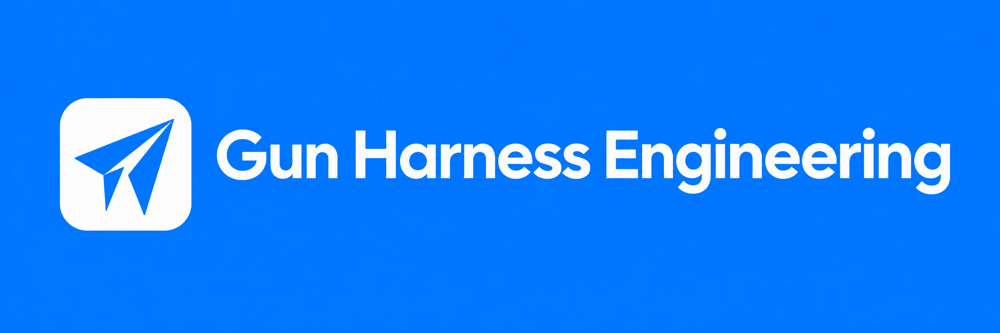
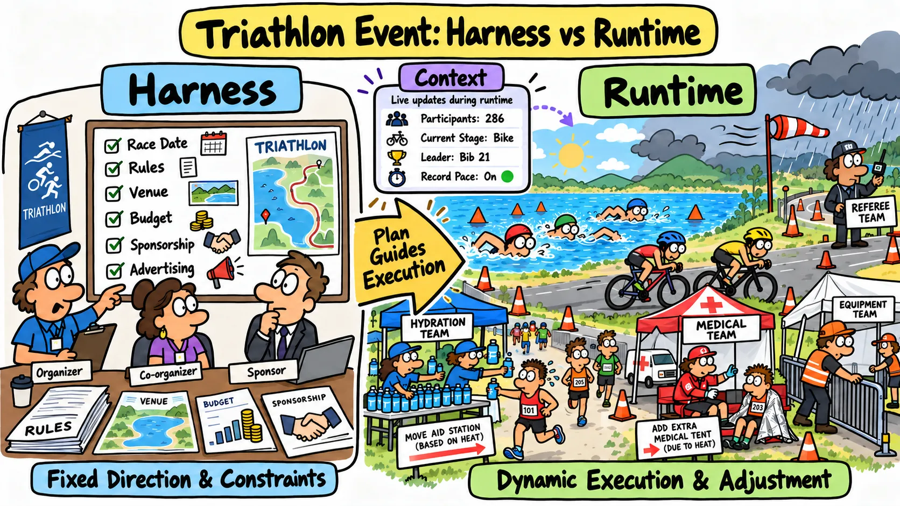
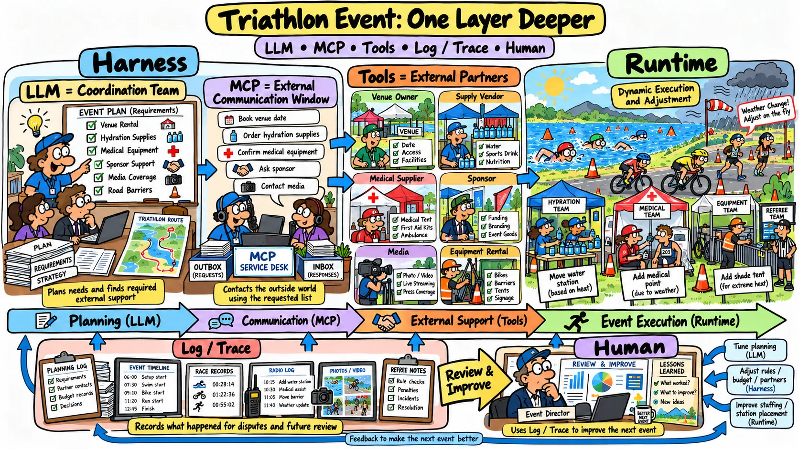
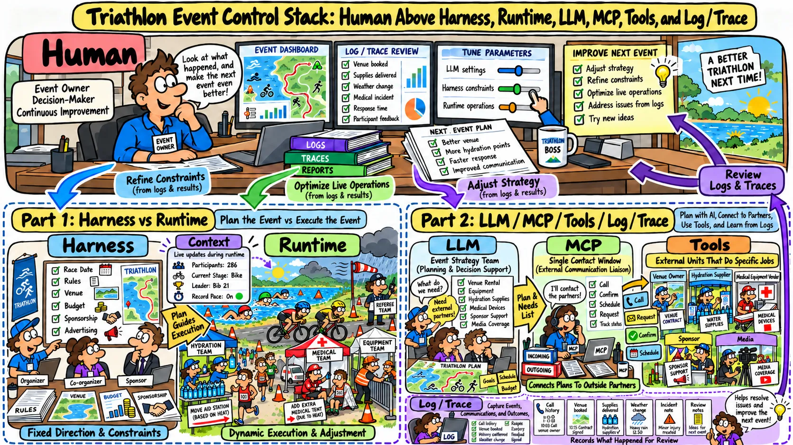
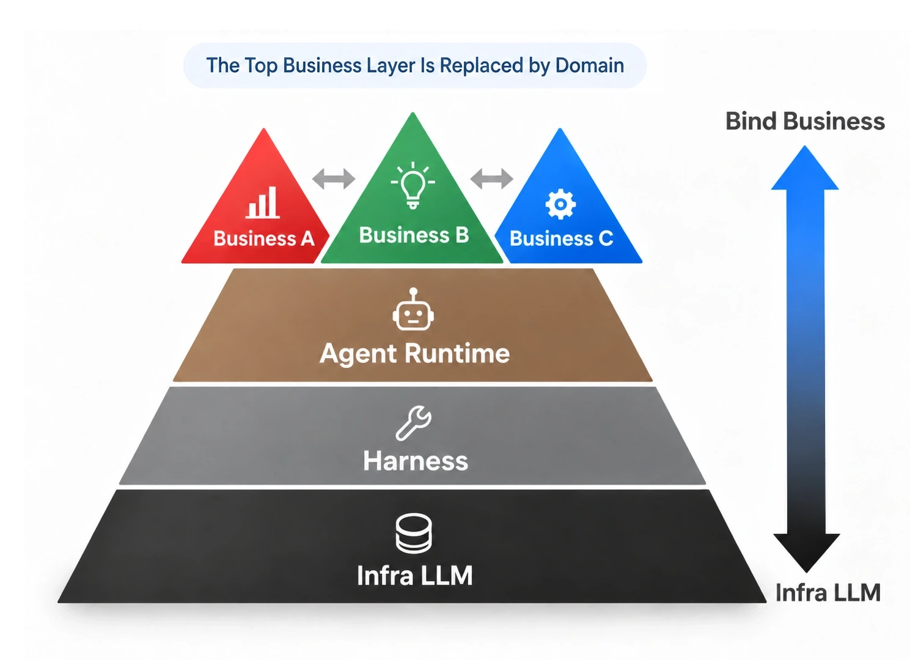

  

  <a href="./README.md">English</a> |
  <a href="./README-zh-TW.md">繁體中文</a> |
  <a href="./README-zh-CN.md">简体中文</a>

---

## Gun Harness 是什么?

这是一套讨论 AI Agent 在真实产品中受到约束、完成执行、故障恢复的知识库

- 这些内容起源自个人对于 [chat-gun](https://github.com/HsienW/chat-gun) 的实战加上对 [claude-code-best/claude-code](https://github.com/claude-code-best/claude-code) 的研究与思考。
- 本库不讨论各种以 Agent Infra 为出发点的 Harness 论文，而是聚焦 Harness 在业务落地中的两个核心问题
  - 从产品实践视角如何定位 Harness 的责任与能力
  - 业务落地时 Harness 跟 Runtime 的边界，以及各自负责什么任务

## 首先！不用技术名词，你能说清楚 Harness 跟 Runtime 是什么吗?

> 如果你回答不出来或答案有模糊点，这个库可以帮助你更清晰的区分两者

### 让我来回答: 我会用比赛来举例，例如: 一场铁人三项的比赛

#### Part1: Harness 跟 Runtime

  

- **Harness** = 主办单位负责规划赛事大方向的角色
  - 例如: 举办日期 / 比赛规则 / 筹借场地 / 资金 / 找赞助 等等有方向性且趋于固定的任务

- **Runtime** = 设备组 / 补给组 / 医疗组 等等是在比赛进行时，真正动态工作、灵活调整的角色
  - 例如: 比赛进行时，依照天气会调整补给点的多寡和位置 / 医疗组的站点 / 设备组的帐篷 等等这些都是进行时，灵活增删跟机动的

- **Context** = 比赛进行中不断更新的内容，因为内容随着时间一直再更新与增加，所以计分表 / 媒体报道 / 赛况转播 只会抓重点来说明
  - 例如: 多少人参赛 / 目前进行到哪个项目 / 当下谁领先 / 是否有破纪录 等等

  AI Agent 也相同道理，一旦上下文太长就需要压缩摘要跟记忆相似，对比起来就是在有限的播报时间内，只会报道前几名领先的选手信息而不会把全部参赛者的姓名都念一遍

#### Part2: 其余 Agent 能力

  

- **LLM** = 赛事主办单位中，担任本次比赛统筹的团队，负责规划构想，找出需要哪些协力外部单位的角色
  - 例如: 比赛设备是否要找额外协力单位 / 场地跟谁租借 / 设备怎么获取 / 是否赞助广告商支持

- **MCP** =  主办单位中统一对外的沟通窗口，负责按照统筹团队给出的所需清单联系外部的协力单位
  - 例如: 联系场地所有者 / 订好租借日期 / 通知采购补给品厂商 / 联系提供医疗设备厂商

- **Tool** = 比赛清单上写的每个外部协力单位
  - 例如: 补给品厂商 / 赞助商 / 采访媒体

- **Log / Trace** = 比赛举办过程的记录，用来检讨比赛争议或改进下一次比赛举行的材料
  - 例如: 裁判 / 摄影师 / 计时器

#### Part3: 人类负责的范围

  

- **Human** = 主办单位的老板，透过 Log / Trace 来观测跟控制以下角色，让下次比赛举办的更好。
  - 统筹团队(LLM) + 主办单位 (Harness) + 设备组/补给组/医疗组 (Runtime) + 比赛过程内容 (Context)
  - 协力单位(Tool)
  - 替换新的统筹团队(Change Model)
  - 执行别种类型的比赛(Change Business)

> 所以用白话来说可以理解为 Runtime 是在 Harness 的规划好的范围内运行 + 灵活调整的角色，而 Context 是内容，Tool 是额外能力
> 而人类使用 Harness + Runtime 来控制 LLM 和 Agent 满足不同的 Business 的操作

## 用技术名词来说，我所认知的 Harness 与 Runtime

- **Agent** = Harness + LLM 这是目前业界公认说法，在这基础上往下拆分，如下图:

  

图中由下而上可以看到四个部分 (最上层绑定的领域是跟随业务来替换的，越往下越是 Agent 的通用能力)

1. Infra: 这是属于模型范围，例如: GPT-5 / GPT-6 和 Claude Opus / Sonnet 等系列都是大众熟悉的模型。
2. Harness: 是模型的控制层，决定能力跟大方向的控制器，例如: 构建与编排层（Prompt / Workflow）、连接层（API / MCP 等协议、能力层（Skills / Tools） 都在这层。
3. Runtime: 是大方向已经被控制器定好之后，真正运行时的管控，例如: 沙箱环境、状态与记忆、重试机制、节流、权限治理、Trace 观测都在这。
4. Business: 是具体业务在前三层之上叠加不同 Domain 落地的范围，其实也是现在 FDE 在做的事，例如: 教育、金融、航空等等不同业务领域的 Agent 落地。

**因为 Business 强绑定业务、而 Infra 归属模型能力跟模型训练范畴，所以本库只会聚焦在以下两个的主线:**

- **Harness**： 产品如何决定 Agent 看见什么、可以使用哪些能力、行动如何取得授权，以及人如何介入、跟追踪路径。
- **Runtime**： 一次 Agent Run 如何推进状态、执行模型与工具、处理外部副作用、从失败恢复，并留下可供运营者检查的证据。

## 为什么建立这个知识库

Agent 架构常被写成一张组件清单：Prompt、Memory、Tool、Workflow、Tracing、Evaluation。这类清单没有回答谁拥有决策权、执行在哪里跨越信任边界，也没有说明工具其实已成功、回应却遗失时该怎么办。

本库从几个更接近实际运行的问题出发：

- 哪些责任属于 Harness，哪些属于 Runtime？
- 用户输入、历史记忆与外部数据冲突时，谁有较高权威？
- 谁可以批准一次会改变外部世界的行动？
- 工具失败如何回灌模型，又不破坏对话结构？
- 哪组识别码可以串起用户请求、Run、模型请求、工具调用与副作用？
- 程序崩溃后，哪些状态可以安全恢复？
- 哪些能力已经走过正式执行路径，哪些仍停在模块或规划？

## 知识库地图

~~~text
gun-harness-engineering/
├─ README.md
├─ README-zh-TW.md
├─ agent-harness/
│  ├─ foundations/
│  ├─ input-and-context/
│  ├─ behavior-and-capabilities/
│  ├─ action-governance/
│  └─ interaction-and-feedback/
└─ agent-runtime/
   ├─ foundations/
   ├─ execution-lifecycle/
   ├─ model-and-tool-execution/
   ├─ effects-and-recovery/
   └─ events-and-operations/
~~~

### Agent Harness

- Harness 是产品、模型、工具与 Runtime 之间的控制层。它规定 Agent 在什么条件下理解任务、选择能力并采取行动。
- 核心题目包括输入规范化、Context 组装、指令与能力配置、信任边界、工具风险、Permission、Human Approval、执行中输入、取消、追问与反馈。
- 阅读可从 [Agent Harness 总览](./agent-harness/README-zh-TW.md)开始。

| 分类 | 去阅读 |
|---|---|
| Foundations | [传送门](./agent-harness/foundations/README-zh-CN.md) |
| Input and Context | [传送门](./agent-harness/input-and-context/README-zh-CN.md) |
| Behavior and Capabilities | [传送门](./agent-harness/behavior-and-capabilities/README-zh-CN.md) |
| Action Governance | [传送门](./agent-harness/action-governance/README-zh-CN.md) |
| Interaction and Feedback | [传送门](./agent-harness/interaction-and-feedback/README-zh-CN.md) |

### Agent Runtime

- Runtime 是 Harness 使用的运行时核心，负责把一次 Agent Run 推进到合法的终止状态。
- 目前涵盖 Execution Identity、模型流式传输、工具调度、重试、错误回灌、Checkpoint、Interrupt、Resume、对话修复、Idempotency、Side-effect Ledger、Reconciliation、Compensation、Runtime Event、Tracing、Metrics 与上线门槛。
- 阅读可从 [Agent Runtime 总览](./agent-runtime/README-zh-TW.md)开始。

| 分类 | 去阅读 |
|---|---|
| Foundations | [传送门](./agent-runtime/foundations/README-zh-CN.md) |
| Execution Lifecycle | [传送门](./agent-runtime/execution-lifecycle/README-zh-CN.md) |
| Model and Tool Execution | [传送门](./agent-runtime/model-and-tool-execution/README-zh-CN.md) |
| Effects and Recovery | [传送门](./agent-runtime/effects-and-recovery/README-zh-CN.md) |
| Events and Operations | [传送门](./agent-runtime/events-and-operations/README-zh-CN.md) |

## 完整的 Harness 与 Runtime 交接流程

~~~text
產品接收互動
  → Harness 正規化輸入
  → Harness 組裝 Context、規則與能力
  → Runtime 執行模型與工具迴圈
  → Runtime 向 Harness 請求政策或人工決策
  → Runtime 產生訊息、事件與終止結果
  → Harness 顯示結果並承接下一次互動
~~~

这是责任边界，不是目录边界。真实程序可能把两边写在同一个模块里；判断时应追问的是，每个决策与状态转移究竟由谁持有。

## Engineering 标记

区分四种状态：

| 状态 | 意义 |
|---|---|
| 已观察 | 已在拆解的 Claude Code 程序路径中确认 |
| 已接入 | 已连上 Chat Gun 的正式执行路径 |
| 模块可用 | Primitive 或模块已存在，正式接线仍不完整 |
| 规划中 | 仍需实现与验证的设计方案 |

类别、Schema 或单元测试存在，不等于端到端 Runtime 能力已经成立。

## License

本项目采用 [MIT License](./LICENSE)。Copyright (c) 2026 Hsien Wei。
