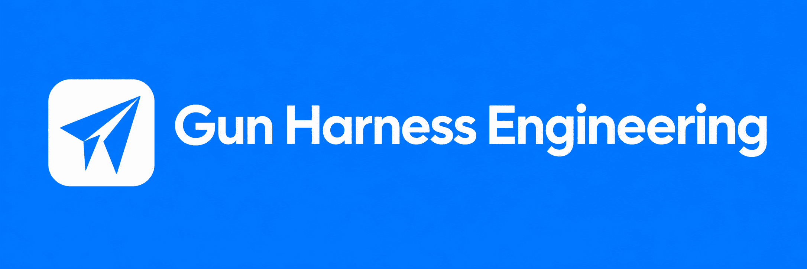
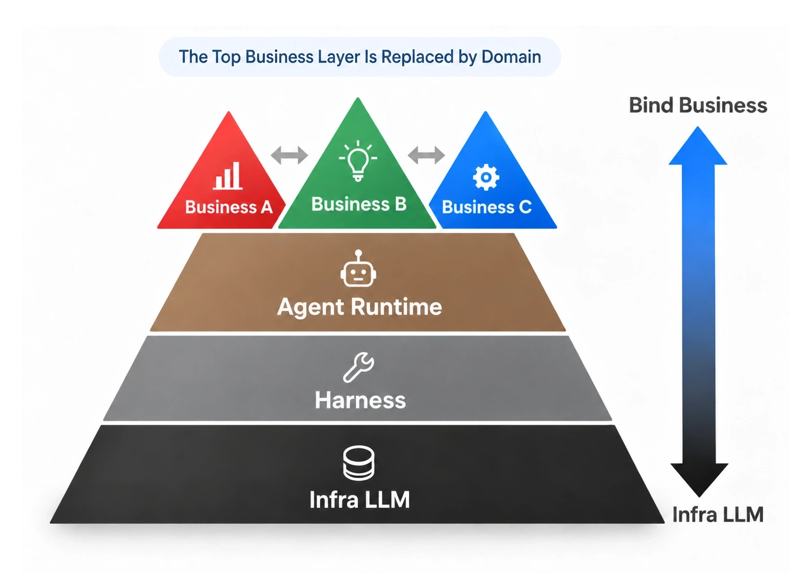

  

  <a href="./README.md">English</a> |
  <a href="./README-zh-TW.md">繁體中文</a> |
  <a href="./README-zh-CN.md">简体中文</a>

---

## What Is Gun Harness?

This is a knowledge base about how AI agents are constrained, carried through execution, and recovered from failure in real products.

- The content grew out of my hands-on work on [chat-gun](https://github.com/HsienW/chat-gun), together with my study of and reflection on [claude-code-best/claude-code](https://github.com/claude-code-best/claude-code).
- This repo does not survey Harness papers that take Agent Infra as their starting point. It focuses on two aspects of putting Harness into business use:
  - How product practice defines the responsibilities and capabilities of the Harness
  - Where the boundary between Harness and Runtime lies in business use, and which tasks each is responsible for

### First Things First: Without Technical Jargon, Can You Clearly Explain Harness and Runtime?

- If you cannot answer clearly or parts of your answer feel vague, read [this article](https://github.com/HsienW/ai-agent-coding-solution-kit/blob/master/agent-thoughts/ai-agent-basics/01-AI-Harness-Runtime-Jargon-Free.md) to help distinguish the two!

## Harness and Runtime from a Business Perspective

- **Agent** = Harness + LLM. This is the commonly accepted view in the industry today. Breaking that down further gives the figure below:

  

The figure shows four parts, from bottom to top (the top layer is swapped depending on the business; the lower you go, the more general the Agent capability):

1. Infra: The model layer. GPT-5 / GPT-6 and the Claude Opus / Sonnet series are familiar examples.
2. Harness: The control layer over the model, the controller that decides capabilities and overall direction. Examples: the composition and orchestration layer (Prompt / Workflow), the connection layer (protocols such as API / MCP), and the capability layer (Skills / Tools) all sit here.
3. Runtime: Once the controller has set the overall direction, Runtime governs what actually happens while the agent runs. Examples: sandbox environment, state and memory, retry, throttling, permission governance, and Trace observability all sit here.
4. Business: Where a specific business adds its own Domain on top of the first three layers. This is also what FDEs do today. Examples: agents deployed in education, finance, aviation, and other domains.

**Because Business is tied to specific domains, and Infra belongs to model capability and model training, this repo focuses only on the following two threads:**

- **Harness**: How the product decides what the Agent sees, which capabilities it can use, how its actions get authorized, and how humans step in and trace its path.
- **Runtime**: How a single Agent Run advances its state, executes the model and tools, handles external side effects, recovers from failure, and leaves evidence that operators can inspect.

## Why This Knowledge Base Exists

Agent architecture is often written up as a list of components: Prompt, Memory, Tool, Workflow, Tracing, Evaluation. A list like this does not answer who owns the decisions, where execution crosses a trust boundary, or what to do when a tool has actually succeeded but the response was lost.

This repo starts from questions closer to how agents actually run:

- Which responsibilities belong to the Harness, and which to the Runtime?
- When user input, historical memory, and external data conflict, who has higher authority?
- Who can approve an action that changes the outside world?
- How does a tool failure get fed back to the model without breaking the conversation structure?
- Which set of identifiers can link a user request, a Run, a model request, a tool call, and a side effect?
- After a process crashes, which state can be safely recovered?
- Which capabilities have gone through the official execution path, and which are still only modules or plans?

## Knowledge Base Map

~~~text
gun-harness-engineering/
├─ README.md
├─ README-zh-TW.md
├─ README-zh-CN.md
├─ agent-harness/
│  ├─ foundations/
│  ├─ input-and-context/
│  ├─ behavior-and-capabilities/
│  ├─ action-governance/
│  └─ interaction-and-feedback/
└─ agent-runtime/
   ├─ foundations/
   ├─ execution-lifecycle/
   ├─ model-and-tool-execution/
   ├─ effects-and-recovery/
   └─ events-and-operations/
~~~

### Agent Harness

- The Harness is the control layer between the product, the model, the tools, and the Runtime. It defines the conditions under which the Agent understands a task, chooses capabilities, and takes action.
- Core topics include input normalization, Context assembly, instruction and capability configuration, trust boundaries, tool risk, Permission, Human Approval, mid-run input, cancellation, follow-up questions, and feedback.
- Start with the [Agent Harness overview](./agent-harness/README.md).

| Category | Read |
|---|---|
| Foundations | [Portal](./agent-harness/foundations/README.md) |
| Input and Context | [Portal](./agent-harness/input-and-context/README.md) |
| Behavior and Capabilities | [Portal](./agent-harness/behavior-and-capabilities/README.md) |
| Action Governance | [Portal](./agent-harness/action-governance/README.md) |
| Interaction and Feedback | [Portal](./agent-harness/interaction-and-feedback/README.md) |

### Agent Runtime

- The Runtime is the execution core the Harness relies on. It is responsible for moving an Agent Run to a valid terminal state.
- Current coverage: Execution Identity, model streaming, tool scheduling, retry, error feedback to the model, Checkpoint, Interrupt, Resume, conversation repair, Idempotency, Side-effect Ledger, Reconciliation, Compensation, Runtime Event, Tracing, Metrics, and launch criteria.
- Start with the [Agent Runtime overview (Traditional Chinese)](./agent-runtime/README-zh-TW.md).

| Category | Read |
|---|---|
| Foundations | [Portal (Traditional Chinese)](./agent-runtime/foundations/README-zh-TW.md) |
| Execution Lifecycle | [Portal (Traditional Chinese)](./agent-runtime/execution-lifecycle/README-zh-TW.md) |
| Model and Tool Execution | [Portal (Traditional Chinese)](./agent-runtime/model-and-tool-execution/README-zh-TW.md) |
| Effects and Recovery | [Portal (Traditional Chinese)](./agent-runtime/effects-and-recovery/README-zh-TW.md) |
| Events and Operations | [Portal (Traditional Chinese)](./agent-runtime/events-and-operations/README-zh-TW.md) |

## The Full Harness and Runtime Handoff Flow

~~~text
Product receives an interaction
  → Harness normalizes the input
  → Harness assembles Context, rules, and capabilities
  → Runtime runs the model and tool loop
  → Runtime asks the Harness for a policy or human decision
  → Runtime produces messages, events, and a terminal result
  → Harness presents the result and picks up the next interaction
~~~

This describes a boundary of responsibility, not a directory boundary. In real code, both sides may live in the same module. What to ask when judging is who actually owns each decision and each state transition.

## Engineering Markers

Four states are distinguished:

| State | Meaning |
|---|---|
| Observed | Confirmed in the code paths of Claude Code that were taken apart |
| Integrated | Wired into Chat Gun's official execution path |
| Module available | The primitive or module exists, but the official wiring is still incomplete |
| Planned | A design that still needs to be implemented and verified |

The existence of a class, a Schema, or a unit test does not mean an end-to-end Runtime capability is in place.

## License

This project is licensed under the [MIT License](./LICENSE). Copyright (c) 2026 Hsien Wei.
