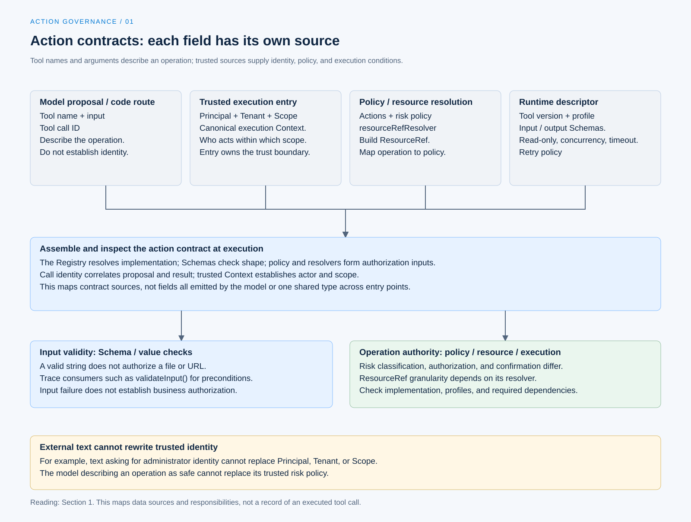

# 工具风险与行动契约

[English](./01-tool-risk-and-contracts.md) | [繁體中文](./01-tool-risk-and-contracts-zh-TW.md) | [简体中文](./01-tool-risk-and-contracts-zh-CN.md)

[回到导览](./README-zh-CN.md) · 下一篇：[授权身份与资源范围](./02-authorization-and-scope-zh-CN.md)

同样叫做文件工具，读取公开说明、覆写设置与搬移目录，会碰到不同资源，也有不同后果。模型知道工具名称与参数，仍不足以决定这次操作能否执行。程序需要能对回实现、资源与政策的行动契约。

本篇从 [Behavior and Capabilities](../behavior-and-capabilities/README-zh-CN.md) 的具体调用接续。Chat Gun 与第三方 Claude Code Best（CCB）的版本及查证范围见[本区导览](./README-zh-CN.md#来源与查证状态)；以下是固定版本的源代码追踪，未执行工具或验收测试。

## 1. 一次调用交付哪些条件

### 模型提案与可信数据

Chat Gun 的 [MCP 授权 Graph][graph] 从模型消息取出工具名称、调用识别与参数，形成待处理的调用。这些数据可以描述模型想做的事，却没有自行提供操作身份的权力。

| 数据 | 用途 | 应核对的来源 |
|---|---|---|
| Tool name、input | 定位工具与描述操作。 | 模型提案或程序路由，再经 Registry 与 Schema 检查。 |
| Tool call ID | 关联提案与工具结果。 | 该次调用及执行交接。 |
| Principal、Tenant、Scope | 决定谁在什么范围操作。 | 可信 execution Context 与入口组装。 |
| Action、ResourceRef | 把工具操作对回授权政策。 | 受信任政策与资源解析函数。 |
| Tool version、execution profile | 指定实现及执行条件。 | Runtime descriptor 与 profile Registry。 |

表格是阅读契约的方式，不表示模型响应已包含全部字段。某段外部文字要求「改用管理员身份」，也不能因此改写可信 Context。

### 描述要能对回执行接口

[Runtime descriptor 组装][descriptors] 把名称、版本、输入及输出 Schema、风险、只读属性、并行判断、timeout 与 retry policy 放在可查找的描述中。执行入口取得参数后，还要核对对应实现与条件。

这里的 Schema 处理数据形状。字符串符合类型，不代表其中的文件路径、网络目的地或业务操作已获准。

[开启 HTML 图解](../../assets/agent-harness/action-governance/01-tool-risk-and-contracts/01-contract-sources-en.html)

## 2. 风险政策如何描述工具

Chat Gun 的 [`ToolRiskPolicy`][risk] 保留以下字段：

- `toolName`：政策对应的工具。
- `riskTier`：`read`、`write`、`sensitive` 或 `communication`。
- `actions`：该政策宣告的操作。
- `requireConfirmation`：是否要求确认。
- `resourceRefResolver`：从参数与 Scope 建立资源参照。

### 分类如何影响确认

`classifyToolAction()` 先检查 action 是否列在政策内。未宣告的 action 返回拒绝；宣告后，以下任一条件成立便要求确认：

- `requireConfirmation` 为真。
- 风险层级是 `sensitive`。
- 风险层级是 `communication`。

因此，这份分类没有规定所有 `write` 都必须询问，也没有规定所有 `read` 都不可要求确认。实际安排取决于受信任政策，而非模型对操作风险的形容。

### 风险类别没有完成资源授权

分类结果会交给后续授权。即使某项读取不需确认，系统仍要处理租户、资源归属与可见范围。反过来，需要人工确认的操作也不能跳过基本权限检查。

## 3. 既有工具如何设置政策

[工具授权组装][composition] 为五个本地工具建立 `read` 政策：calculator、天气、天气预报、web fetch 与 web search。它们宣告 `tool:read`，默认不要求确认。

同一份组装也列出 MCP 的风险描述。例如 filesystem 的读取与列目录使用读取分类；`write_file`、`edit_file`、`create_directory` 与 `move_file` 则标成敏感操作，要求确认。

这是固定版本的分类，不能从工具名称自行延伸出未读取的部署能力：

- 本地 web fetch 虽标为读取，仍会连接到外部服务，需要 URL 与 egress 限制。
- MCP 风险描述存在，不等于 server、执行 profile 或隔离 runner 已可用。
- 工具层级的 ResourceRef 不一定描述每个文件或 URL；其解析粒度要另外检查。

## 4. 未注册工具是否一律拒绝

### 类别能力与实际设置

`ToolRiskRegistry` 的设置允许两种未注册工具默认：`read` 或 `deny`。只看到这个类别，不能宣称所有入口都默认拒绝。

追到 `createToolAuthorizationConfig()` 后，才能确认这条组装的选择：

| 设置 | 未注册工具默认 |
|---|---|
| production | `deny`。 |
| development，且明确启用 development read default | `read`。 |
| development，未启用上述选项 | `deny`。 |

`createRuntimeToolAuthorizationComposition()` 默认使用 production profile；development 的例外还受 `TOOL_AUTHORIZATION_DEVELOPMENT_READ_DEFAULT` 或注入设置控制。[设置位置见此][composition]。

### 另一个拒绝接点

[完整 dispatch pipeline][pipeline] 会查 Runtime descriptor。找不到时返回 `rejected_before_dispatch`，原因是 `UNREGISTERED_TOOL_DENIED`。这是该派送路径的检查，与风险 Registry 的可配置默认分属不同 consumer。

将两者混成「某个 allowlist」会失去重要信息：工具可能通过某一层，却在另一层因缺少必要契约而停止。

## 5. CCB 的契约在不同时机使用

CCB 的 [`Tool` 类型][ccb-tool] 定义输入 Schema、输入验证、Permission 检查、执行函数与并行安全判断。这些接口集中在工具对象上，使用时机仍然不同。

在 [`toolExecution.ts`][ccb-execution] 可追到：

1. 解析输入 Schema；不合法时形成错误工具结果。
2. 执行可选的 `validateInput()`，处理工具自己的值与前置条件。
3. 处理 Hook 与 Permission 决策，取得可用于后续调用的输入。
4. 只有 Permission 结果为 `allow`，才继续到实际 `tool.call()`。

这个流程包含 Hook 与输入调整，不能简写成每次都只执行一次工具内部的 `checkPermissions()`。具体资源限制仍由 Permission consumer 与工具实现共同决定。

## 6. 从契约缺口看失败

| 问题 | 可指出的返回位置 | 不能据此宣称的事 |
|---|---|---|
| Action 未在政策宣告 | 风险分类返回 `TOOL_ACTION_NOT_DECLARED`。 | 模型换一个说法便取得相同操作权。 |
| Runtime descriptor 不存在 | Pipeline 在派送前拒绝。 | 工具已尝试执行。 |
| 输入 Schema 不合法 | Pipeline 或 CCB 的输入验证分支。 | 业务条件已获准。 |
| 风险分类或资源解析无法完成 | 依 consumer 形成分类失败或授权不可用。 | 可以退回直接调用工具。 |

设计新工具时，应先说清楚 action 与资源如何解析，再决定是否询问、如何执行与留下哪些结果。若资源解析只返回整个工具的名称，后续文章就不能把它描述成已逐档授权。

下一篇会把这份行动契约交给可信身份、Scope 与 policy，追踪一次调用如何取得授权决策。

[graph]: https://github.com/HsienW/chat-gun/blob/92a5673003e4ac4ec09be8b1b350f42dbf4a5e69/backend/src/runtime/authorization/confirmation-graph.ts
[descriptors]: https://github.com/HsienW/chat-gun/blob/92a5673003e4ac4ec09be8b1b350f42dbf4a5e69/backend/src/tools/production-runtime-tool-descriptors.ts
[risk]: https://github.com/HsienW/chat-gun/blob/92a5673003e4ac4ec09be8b1b350f42dbf4a5e69/backend/src/runtime/authorization/tool-risk.ts
[composition]: https://github.com/HsienW/chat-gun/blob/92a5673003e4ac4ec09be8b1b350f42dbf4a5e69/backend/src/tools/authorization/tool-authorization.ts
[pipeline]: https://github.com/HsienW/chat-gun/blob/92a5673003e4ac4ec09be8b1b350f42dbf4a5e69/backend/src/runtime/tool-dispatch/pipeline.ts
[ccb-tool]: https://github.com/claude-code-best/claude-code/blob/77a7934e15d69da13879112ed7db695c9ee7a52a/src/Tool.ts
[ccb-execution]: https://github.com/claude-code-best/claude-code/blob/77a7934e15d69da13879112ed7db695c9ee7a52a/src/services/tools/toolExecution.ts
