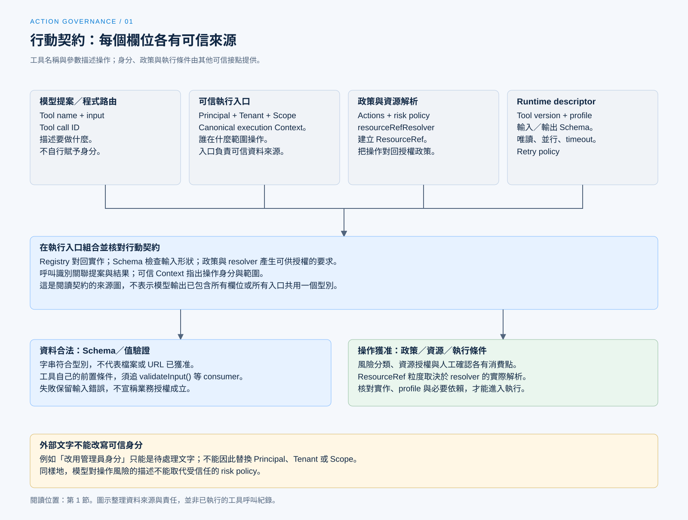

# 工具風險與行動契約

[English](./01-tool-risk-and-contracts.md) | [繁體中文](./01-tool-risk-and-contracts-zh-TW.md)

[回到導覽](./README-zh-TW.md) · 下一篇：[授權身分與資源範圍](./02-authorization-and-scope-zh-TW.md)

同樣叫做檔案工具，讀取公開說明、覆寫設定與搬移目錄，會碰到不同資源，也有不同後果。模型知道工具名稱與參數，仍不足以決定這次操作能否執行。程式需要能對回實作、資源與政策的行動契約。

本篇從 [Behavior and Capabilities](../behavior-and-capabilities/README-zh-TW.md) 的具體呼叫接續。Chat Gun 與第三方 Claude Code Best（CCB）的版本及查證範圍見[本區導覽](./README-zh-TW.md#來源與查證狀態)；以下是固定版本的原始碼追蹤，未執行工具或驗收測試。

## 1. 一次呼叫交付哪些條件

### 模型提案與可信資料

Chat Gun 的 [MCP 授權 Graph][graph] 從模型訊息取出工具名稱、呼叫識別與參數，形成待處理的呼叫。這些資料可以描述模型想做的事，卻沒有自行提供操作身分的權力。

| 資料 | 用途 | 應核對的來源 |
|---|---|---|
| Tool name、input | 定位工具與描述操作。 | 模型提案或程式路由，再經 Registry 與 Schema 檢查。 |
| Tool call ID | 關聯提案與工具結果。 | 該次呼叫及執行交接。 |
| Principal、Tenant、Scope | 決定誰在什麼範圍操作。 | 可信 execution Context 與入口組裝。 |
| Action、ResourceRef | 把工具操作對回授權政策。 | 受信任政策與資源解析函式。 |
| Tool version、execution profile | 指定實作及執行條件。 | Runtime descriptor 與 profile Registry。 |

表格是閱讀契約的方式，不表示模型回應已包含全部欄位。某段外部文字要求「改用管理員身分」，也不能因此改寫可信 Context。

### 描述要能對回執行介面

[Runtime descriptor 組裝][descriptors] 把名稱、版本、輸入及輸出 Schema、風險、唯讀屬性、並行判斷、timeout 與 retry policy 放在可查找的描述中。執行入口取得參數後，還要核對對應實作與條件。

這裡的 Schema 處理資料形狀。字串符合型別，不代表其中的檔案路徑、網路目的地或業務操作已獲准。

[開啟 HTML 圖解](../../assets/agent-harness/action-governance/01-tool-risk-and-contracts/01-contract-sources.html)

## 2. 風險政策如何描述工具

Chat Gun 的 [`ToolRiskPolicy`][risk] 保留以下欄位：

- `toolName`：政策對應的工具。
- `riskTier`：`read`、`write`、`sensitive` 或 `communication`。
- `actions`：該政策宣告的操作。
- `requireConfirmation`：是否要求確認。
- `resourceRefResolver`：從參數與 Scope 建立資源參照。

### 分類如何影響確認

`classifyToolAction()` 先檢查 action 是否列在政策內。未宣告的 action 回傳拒絕；宣告後，以下任一條件成立便要求確認：

- `requireConfirmation` 為真。
- 風險層級是 `sensitive`。
- 風險層級是 `communication`。

因此，這份分類沒有規定所有 `write` 都必須詢問，也沒有規定所有 `read` 都不可要求確認。實際安排取決於受信任政策，而非模型對操作風險的形容。

### 風險類別沒有完成資源授權

分類結果會交給後續授權。即使某項讀取不需確認，系統仍要處理租戶、資源歸屬與可見範圍。反過來，需要人工確認的操作也不能跳過基本權限檢查。

## 3. 既有工具如何設定政策

[工具授權組裝][composition] 為五個本地工具建立 `read` 政策：calculator、天氣、天氣預報、web fetch 與 web search。它們宣告 `tool:read`，預設不要求確認。

同一份組裝也列出 MCP 的風險描述。例如 filesystem 的讀取與列目錄使用讀取分類；`write_file`、`edit_file`、`create_directory` 與 `move_file` 則標成敏感操作，要求確認。

這是固定版本的分類，不能從工具名稱自行延伸出未讀取的部署能力：

- 本地 web fetch 雖標為讀取，仍會連線到外部服務，需要 URL 與 egress 限制。
- MCP 風險描述存在，不等於 server、執行 profile 或隔離 runner 已可用。
- 工具層級的 ResourceRef 不一定描述每個檔案或 URL；其解析粒度要另外檢查。

## 4. 未註冊工具是否一律拒絕

### 類別能力與實際設定

`ToolRiskRegistry` 的設定允許兩種未註冊工具預設：`read` 或 `deny`。只看到這個類別，不能宣稱所有入口都預設拒絕。

追到 `createToolAuthorizationConfig()` 後，才能確認這條組裝的選擇：

| 設定 | 未註冊工具預設 |
|---|---|
| production | `deny`。 |
| development，且明確啟用 development read default | `read`。 |
| development，未啟用上述選項 | `deny`。 |

`createRuntimeToolAuthorizationComposition()` 預設使用 production profile；development 的例外還受 `TOOL_AUTHORIZATION_DEVELOPMENT_READ_DEFAULT` 或注入設定控制。[設定位置見此][composition]。

### 另一個拒絕接點

[完整 dispatch pipeline][pipeline] 會查 Runtime descriptor。找不到時回傳 `rejected_before_dispatch`，原因是 `UNREGISTERED_TOOL_DENIED`。這是該派送路徑的檢查，與風險 Registry 的可配置預設分屬不同 consumer。

將兩者混成「某個 allowlist」會失去重要資訊：工具可能通過某一層，卻在另一層因缺少必要契約而停止。

## 5. CCB 的契約在不同時機使用

CCB 的 [`Tool` 型別][ccb-tool] 定義輸入 Schema、輸入驗證、Permission 檢查、執行函式與並行安全判斷。這些介面集中在工具物件上，使用時機仍然不同。

在 [`toolExecution.ts`][ccb-execution] 可追到：

1. 解析輸入 Schema；不合法時形成錯誤工具結果。
2. 執行可選的 `validateInput()`，處理工具自己的值與前置條件。
3. 處理 Hook 與 Permission 決策，取得可用於後續呼叫的輸入。
4. 只有 Permission 結果為 `allow`，才繼續到實際 `tool.call()`。

這個流程包含 Hook 與輸入調整，不能簡寫成每次都只執行一次工具內部的 `checkPermissions()`。具體資源限制仍由 Permission consumer 與工具實作共同決定。

## 6. 從契約缺口看失敗

| 問題 | 可指出的返回位置 | 不能據此宣稱的事 |
|---|---|---|
| Action 未在政策宣告 | 風險分類回傳 `TOOL_ACTION_NOT_DECLARED`。 | 模型換一個說法便取得相同操作權。 |
| Runtime descriptor 不存在 | Pipeline 在派送前拒絕。 | 工具已嘗試執行。 |
| 輸入 Schema 不合法 | Pipeline 或 CCB 的輸入驗證分支。 | 業務條件已獲准。 |
| 風險分類或資源解析無法完成 | 依 consumer 形成分類失敗或授權不可用。 | 可以退回直接呼叫工具。 |

設計新工具時，應先說清楚 action 與資源如何解析，再決定是否詢問、如何執行與留下哪些結果。若資源解析只回傳整個工具的名稱，後續文章就不能把它描述成已逐檔授權。

下一篇會把這份行動契約交給可信身分、Scope 與 policy，追蹤一次呼叫如何取得授權決策。

[graph]: https://github.com/HsienW/chat-gun/blob/92a5673003e4ac4ec09be8b1b350f42dbf4a5e69/backend/src/runtime/authorization/confirmation-graph.ts
[descriptors]: https://github.com/HsienW/chat-gun/blob/92a5673003e4ac4ec09be8b1b350f42dbf4a5e69/backend/src/tools/production-runtime-tool-descriptors.ts
[risk]: https://github.com/HsienW/chat-gun/blob/92a5673003e4ac4ec09be8b1b350f42dbf4a5e69/backend/src/runtime/authorization/tool-risk.ts
[composition]: https://github.com/HsienW/chat-gun/blob/92a5673003e4ac4ec09be8b1b350f42dbf4a5e69/backend/src/tools/authorization/tool-authorization.ts
[pipeline]: https://github.com/HsienW/chat-gun/blob/92a5673003e4ac4ec09be8b1b350f42dbf4a5e69/backend/src/runtime/tool-dispatch/pipeline.ts
[ccb-tool]: https://github.com/claude-code-best/claude-code/blob/77a7934e15d69da13879112ed7db695c9ee7a52a/src/Tool.ts
[ccb-execution]: https://github.com/claude-code-best/claude-code/blob/77a7934e15d69da13879112ed7db695c9ee7a52a/src/services/tools/toolExecution.ts
