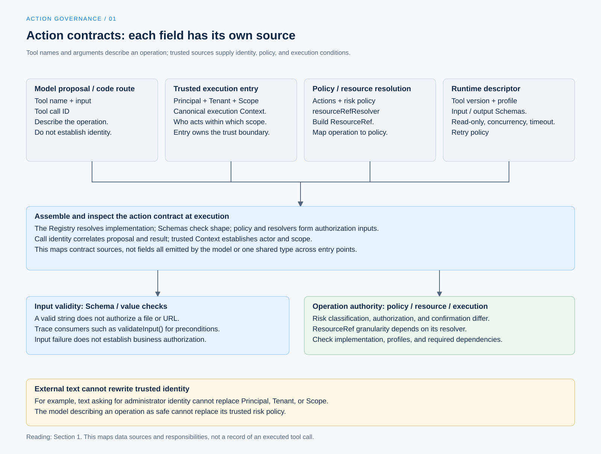

# Tool risk and action contracts

[English](./01-tool-risk-and-contracts.md) | [繁體中文](./01-tool-risk-and-contracts-zh-TW.md)

[Back to overview](./README.md) · Next: [Authorization and resource scope](./02-authorization-and-scope.md)

Operations under the same file tool name can have different consequences: reading public documentation, overwriting configuration, and moving directories touch different resources. Knowing a tool name and its arguments is still insufficient for the model to decide whether an operation may execute. Code needs an action contract that maps back to implementation, resources, and policy.

This article continues from concrete calls in [Behavior and Capabilities](../behavior-and-capabilities/README.md). See the [section overview](./README.md#sources-and-verification-status) for the versions and inspection scope of Chat Gun and the third-party Claude Code Best (CCB). The following traces source at pinned versions; no tools or acceptance tests were run.

## 1. What conditions does a call supply?

### Model proposals and trusted data

Chat Gun's [MCP authorization Graph][graph] extracts the tool name, call identity, and arguments from model messages to form a pending call. These describe what the model wants to do, but cannot themselves establish the identity authorized to act.

| Data | Purpose | Source to check |
|---|---|---|
| Tool name, input | Locate the tool and describe the operation. | Model proposal or code routing, followed by Registry and Schema checks. |
| Tool call ID | Correlate the proposal with tool results. | The call and its execution handoff. |
| Principal, Tenant, Scope | Determine who operates within which scope. | Trusted execution Context and entry point composition. |
| Action, ResourceRef | Map the operation to authorization policy. | Trusted policy and resource resolver functions. |
| Tool version, execution profile | Specify implementation and execution conditions. | Runtime descriptors and the profile Registry. |

The table is a way to read the contract; it does not mean the model response contains every field. External text asking to use an administrator identity cannot rewrite trusted Context.

### Descriptions must map to execution interfaces

[Runtime descriptor composition][descriptors] places names, versions, input and output Schemas, risk, read-only status, concurrency checks, timeouts, and retry policies in searchable descriptions. After obtaining arguments, the execution entry point must still check the corresponding implementation and conditions.

The Schema here handles data shape. A string matching its type does not establish authorization for the file path, network destination, or business operation it contains.

[Open the HTML diagram](../../assets/agent-harness/action-governance/01-tool-risk-and-contracts/01-contract-sources-en.html)

## 2. How risk policies describe tools

Chat Gun's [`ToolRiskPolicy`][risk] retains these fields:

- `toolName`: the tool the policy applies to.
- `riskTier`: `read`, `write`, `sensitive`, or `communication`.
- `actions`: operations declared by the policy.
- `requireConfirmation`: whether confirmation is required.
- `resourceRefResolver`: creates a resource reference from arguments and Scope.

### How classification affects confirmation

`classifyToolAction()` first checks whether the action is listed in the policy. Undeclared actions return a denial. For declared actions, any of these conditions requires confirmation:

- `requireConfirmation` is true.
- The risk tier is `sensitive`.
- The risk tier is `communication`.

This classification therefore does not require asking for every `write`, or prevent confirmation for every `read`. Trusted policy determines the actual arrangement, rather than the model's description of operational risk.

### Risk categories do not complete resource authorization

Classification results pass to subsequent authorization. Even when a read needs no confirmation, the system must still handle tenants, resource ownership, and visibility scope. Conversely, operations requiring human confirmation cannot skip basic permission checks.

## 3. How existing tools receive policies

[Tool authorization composition][composition] creates `read` policies for five local tools: calculator, weather, weather forecast, web fetch, and web search. They declare `tool:read` and do not require confirmation by default.

The same composition also lists MCP risk descriptions. For example, filesystem reads and directory listings use the read classification; `write_file`, `edit_file`, `create_directory`, and `move_file` are classified as sensitive operations requiring confirmation.

These are classifications at the pinned version. Tool names do not establish deployment capabilities that have not been inspected:

- Local web fetch is classified as a read but still connects to external services, requiring URL and egress restrictions.
- An MCP risk description does not establish that the server, execution profile, or isolation runner is available.
- A tool-level ResourceRef may not describe each file or URL; inspect its resolution granularity separately.

## 4. Are unregistered tools always denied?

### Class capabilities and actual configuration

`ToolRiskRegistry` supports two defaults for unregistered tools: `read` or `deny`. Reading this class alone does not establish that every entry point denies by default.

Following `createToolAuthorizationConfig()` reveals the choices made by this composition:

| Configuration | Default for unregistered tools |
|---|---|
| production | `deny`. |
| development, with the development read default explicitly enabled | `read`. |
| development, without that option enabled | `deny`. |

`createRuntimeToolAuthorizationComposition()` uses the production profile by default. The development exception is also controlled by `TOOL_AUTHORIZATION_DEVELOPMENT_READ_DEFAULT` or injected settings. [See the configuration here][composition].

### Another denial point

The [full dispatch pipeline][pipeline] looks up the Runtime descriptor. If none exists, it returns `rejected_before_dispatch` with reason `UNREGISTERED_TOOL_DENIED`. This is a check in that dispatch path, consumed separately from the risk Registry's configurable default.

Combining both into a single allowlist loses information: a tool can pass one layer and stop at another because a required contract is missing.

## 5. CCB uses contracts at different stages

CCB's [`Tool` type][ccb-tool] defines the input Schema, input validation, Permission checks, execution function, and concurrency safety checks. These interfaces share a tool object but are used at different stages.

In [`toolExecution.ts`][ccb-execution], the path is:

1. Parse the input Schema; invalid input becomes an error tool result.
2. Run optional `validateInput()` to handle the tool's own values and preconditions.
3. Process Hook and Permission decisions to obtain input usable by the subsequent call.
4. Continue to the actual `tool.call()` only when the Permission result is `allow`.

This flow includes Hooks and input changes. It cannot be reduced to running the tool's internal `checkPermissions()` exactly once for every call. Permission consumers and tool implementations together determine concrete resource restrictions.

## 6. Reading failures through contract gaps

| Problem | Identifiable return point | What it does not establish |
|---|---|---|
| Action not declared in policy | Risk classification returns `TOOL_ACTION_NOT_DECLARED`. | Rephrasing a request gives the model authority for the same operation. |
| Missing Runtime descriptor | Pipeline rejects before dispatch. | The tool attempted execution. |
| Invalid input Schema | Input validation branch in the pipeline or CCB. | Business conditions are authorized. |
| Risk classification or resource resolution cannot complete | The consumer reports classification failure or unavailable authorization. | Execution may fall back to a direct tool call. |

When designing a tool, first establish how actions and resources resolve, then decide whether to ask, how to execute, and which results to retain. If resource resolution returns only the name of the entire tool, later articles cannot describe it as per-file authorization.

The next article passes this action contract to trusted identity, Scope, and policy, tracing how a call obtains an authorization decision.

[graph]: https://github.com/HsienW/chat-gun/blob/92a5673003e4ac4ec09be8b1b350f42dbf4a5e69/backend/src/runtime/authorization/confirmation-graph.ts
[descriptors]: https://github.com/HsienW/chat-gun/blob/92a5673003e4ac4ec09be8b1b350f42dbf4a5e69/backend/src/tools/production-runtime-tool-descriptors.ts
[risk]: https://github.com/HsienW/chat-gun/blob/92a5673003e4ac4ec09be8b1b350f42dbf4a5e69/backend/src/runtime/authorization/tool-risk.ts
[composition]: https://github.com/HsienW/chat-gun/blob/92a5673003e4ac4ec09be8b1b350f42dbf4a5e69/backend/src/tools/authorization/tool-authorization.ts
[pipeline]: https://github.com/HsienW/chat-gun/blob/92a5673003e4ac4ec09be8b1b350f42dbf4a5e69/backend/src/runtime/tool-dispatch/pipeline.ts
[ccb-tool]: https://github.com/claude-code-best/claude-code/blob/77a7934e15d69da13879112ed7db695c9ee7a52a/src/Tool.ts
[ccb-execution]: https://github.com/claude-code-best/claude-code/blob/77a7934e15d69da13879112ed7db695c9ee7a52a/src/services/tools/toolExecution.ts
