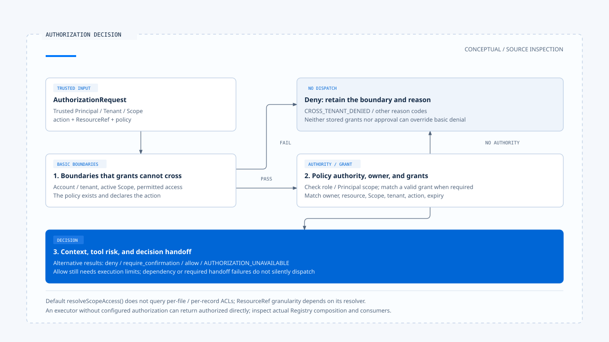

# 授权身份与资源范围

[English](./02-authorization-and-scope.md) | [繁體中文](./02-authorization-and-scope-zh-TW.md) | [简体中文](./02-authorization-and-scope-zh-CN.md)

[回到导览](./README-zh-CN.md) · 上一篇：[工具风险与行动契约](./01-tool-risk-and-contracts-zh-CN.md) · 下一篇：[人工确认与批准有效性](./03-human-confirmation-zh-CN.md)

「这个工具可以写文件」与「这位用户可以修改这个文件」是不同的判断。授权需要知道操作人、作用范围、资源与 action；模型参数只提供其中一部分。若这些字段的来源不明，后面再加一个确认窗口，也无法补回可信身份。

本篇依[固定版本与证据范围](./README-zh-CN.md#来源与查证状态)，对照 Chat Gun 的授权引擎与第三方 CCB 的 Permission consumer。以下描述源代码行为，未执行跨租户或部署验证。

## 1. 授权要求从哪里取得身份

### 工具参数不提供授权身份

[治理包装][governance] 从政策取得 action，以 `resourceRefResolver` 解析资源，再从执行 Context 取得 Principal 与 Scope，组成 `AuthorizationRequest`。若必要 Context 无法解析，这条路径返回 `AUTHORIZATION_UNAVAILABLE`。

数据各有来源：

- 工具参数描述操作目标与内容。
- 政策决定这个工具宣告哪些 action，以及如何建立资源参照。
- 执行入口负责提供可信的 Principal、Tenant 与 Scope。

`readExecutionContext()` 可以解析 canonical `execution_context`，也能沿兼容入口读取可信身份。[读取程序][execution-context] 本身并没有替任意请求做认证；谁可以建立并传入这份 Context，仍须由入口的信任边界保证。

### 开发身份是另一条路径

`readDevelopmentExecutionContext()` 会先移除传入 configurable 中的 canonical Context 与 `x-bff-` 字段，再使用 development 路径建立数据。production 与 development 的组装因此不能混为同一种身份证据。

## 2. 先检查不能由 grant 跨越的边界

Chat Gun 的 [`AuthorizationEngine`][authorization] 先检查基本边界，再查找匹配 grant。可直接指出的拒绝条件包括：

| 条件 | 原因码 |
|---|---|
| 资源账号与 Principal 账号不符，或 Principal／Scope 与资源租户不符 | `CROSS_TENANT_DENIED` |
| 缺少 active scope | `MISSING_ACTIVE_SCOPE` |
| 写入政策遇到非 writable Scope | `SCOPE_NOT_WRITABLE` |
| 读取政策遇到不可见 Scope | `SCOPE_NOT_VISIBLE` |
| 找不到政策，或政策未宣告 action | `ACTION_NOT_ALLOWED` |

这些边界先于 grant 匹配。引擎不会因数据库里有一笔 grant，就跳过前面的租户与基本范围条件。

## 3. Policy、owner 与 grant 如何配合

### Policy authority 与资源归属

基本边界通过后，引擎再检查：

1. 政策若设置角色或 Principal scope 条件，操作人是否符合。
2. 不符合时，是否有有效的匹配 grant。
3. 资源若有 `ownerScopeId`，是否与目前 Scope 相符；不相符时是否由 grant 支持。
4. Policy 的 Context 判断与工具风险，是否要求拒绝或确认。

若政策没有设置角色或 Principal scope 条件，`hasPolicyAuthority()` 直接成立。这是引擎的可配置语义，不能解读成每一条政策都额外要求某个管理员角色。

### Grant 必须仍有效且匹配

引擎核对 grant 的撤销与到期状态，以及资源、受授 Scope、Tenant 与 action。资源比对包含类型、识别、Tenant、account 及 owner Scope 等字段。[条件见授权引擎][authorization]。

授权因此不是「用户曾经同意过」这种单一事实。过去的 grant 是否适用，需要在目前要求上重新匹配。

[开启 HTML 图解](../../assets/agent-harness/action-governance/02-authorization-and-scope/02-authorization-decision-en.html)

## 4. 引擎可支持的范围与目前组装

### 默认组装没有查询逐笔资源 ACL

[工具授权组装][composition] 建立的 policy，主要从风险政策取得 actions 与 read／write access。它的 `resolveScopeAccess()` 在缺少 active scope 或 Tenant 不符时返回 `none`，其余情况返回 `writable`。

这个函数并没有在此查询每个文件或业务对象的 ACL。五个本地工具的资源解析也主要对应工具名称与当前 Scope，而不是把每个 URL 或文件路径都转成独立资源。

因此，正文可以说明这套引擎具有哪些检查与组装位置，不能直接宣称产品已对任意资源提供完整细粒度授权。若需要逐档、逐订单或逐笔数据控制，应指出对应 resolver、数据来源与实际 consumer。

### 可选 authorization 的影响

`GovernanceExecutor.authorizeTyped()` 在没有配置 authorization 时，会直接返回 authorized。相较之下，`loadAgentToolRuntime()` 会透过工具授权组装提供设置。[两个接点见治理包装][governance]与 [Registry][registry]。

所以「用了 governance wrapper」还不足以证明它连上这套身份政策。新增直接导入工具的入口时，必须核对它究竟使用哪个设置。

## 5. 决策如何进入后续流程

授权结果包含 decision ID、effect、原因码与建立时间，并可能指出匹配 policy 或 grant。治理包装另将要求、决策、policy version 与执行关联交给 DecisionStore。

| 结果 | 后续交接 |
|---|---|
| `deny` | 返回拒绝，不因模型已选工具而派送。 |
| `require_confirmation` | 建立可供等待与恢复的确认 descriptor；无法建立时返回不可用。 |
| `allow` | 取得授权结果；仍须通过工具执行限制。 |
| 授权依赖抛错 | 引擎或包装以 `AUTHORIZATION_UNAVAILABLE` 表达失败。 |

决策存储失败也可能让治理包装返回不可用。这会牺牲部分可用性，但能避免在无法完成必要决策交接时，悄悄进入未记录的执行。

## 6. CCB 的 Permission consumer

### 从规则走到工具判断

CCB 的 [`permissions.ts`][ccb-permissions] 包含整项工具规则与工具自己的 `checkPermissions()`。例如 `checkRuleBasedPermissions()` 会处理整项 deny、ask、工具内部判断，以及特定的安全检查；Bash sandbox 另有条件分支。

这套规则不是 Chat Gun 的 Principal／Tenant 类型，也不能只靠名称将两者视为同一种政策引擎。

### 执行点使用哪份决策

[`useCanUseTool()`][ccb-can-use] 消费 Permission 结果，可能依设置直接允许、拒绝，或进入互动确认。工具执行还会结合 Hook 决策；[`toolExecution.ts`][ccb-execution] 只有在最终结果为 `allow` 时，才继续实际调用。

这个交接可以用来检查一项操作是否经过 Permission，但不能单靠 Interactive 的行为推论 Headless／SDK 已使用相同接口取得批准。不同入口须追它们传入的 `canUseTool` 与对应设置。

## 7. 授权测试应追到哪里

设计检查可以从同一个调用改变一项可信条件，例如 Tenant、Scope 或 grant 到期时间，再核对决策与底层工具执行次数。只确认回复包含「拒绝」，无法排除工具早已执行的情况。

涉及资源范围时，还要确认 ResourceRef 的粒度：若它只识别 filesystem 工具，拒绝另一个文件路径的要求，不能由这个识别自然推出。这是验证方案，并非本轮已取得的执行结果。

下一篇会接着处理 `require_confirmation`：批准如何与指定调用绑定，以及等待之后究竟重做哪些检查。

[governance]: https://github.com/HsienW/chat-gun/blob/92a5673003e4ac4ec09be8b1b350f42dbf4a5e69/backend/src/platform/tool-governance.ts
[execution-context]: https://github.com/HsienW/chat-gun/blob/92a5673003e4ac4ec09be8b1b350f42dbf4a5e69/backend/src/runtime/execution-context/read-execution-context.ts
[authorization]: https://github.com/HsienW/chat-gun/blob/92a5673003e4ac4ec09be8b1b350f42dbf4a5e69/backend/src/runtime/authorization/authorization.ts
[composition]: https://github.com/HsienW/chat-gun/blob/92a5673003e4ac4ec09be8b1b350f42dbf4a5e69/backend/src/tools/authorization/tool-authorization.ts
[registry]: https://github.com/HsienW/chat-gun/blob/92a5673003e4ac4ec09be8b1b350f42dbf4a5e69/backend/src/tools/registry.ts
[ccb-permissions]: https://github.com/claude-code-best/claude-code/blob/77a7934e15d69da13879112ed7db695c9ee7a52a/src/utils/permissions/permissions.ts
[ccb-can-use]: https://github.com/claude-code-best/claude-code/blob/77a7934e15d69da13879112ed7db695c9ee7a52a/src/hooks/useCanUseTool.tsx
[ccb-execution]: https://github.com/claude-code-best/claude-code/blob/77a7934e15d69da13879112ed7db695c9ee7a52a/src/services/tools/toolExecution.ts
