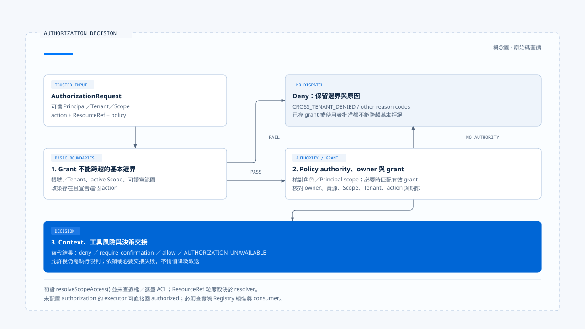

# 授權身分與資源範圍

[English](./02-authorization-and-scope.md) | [繁體中文](./02-authorization-and-scope-zh-TW.md)

[回到導覽](./README-zh-TW.md) · 上一篇：[工具風險與行動契約](./01-tool-risk-and-contracts-zh-TW.md) · 下一篇：[人工確認與批准有效性](./03-human-confirmation-zh-TW.md)

「這個工具可以寫檔」與「這位使用者可以修改這個檔案」是不同的判斷。授權需要知道操作人、作用範圍、資源與 action；模型參數只提供其中一部分。若這些欄位的來源不明，後面再加一個確認視窗，也無法補回可信身分。

本篇依[固定版本與證據範圍](./README-zh-TW.md#來源與查證狀態)，對照 Chat Gun 的授權引擎與第三方 CCB 的 Permission consumer。以下描述原始碼行為，未執行跨租戶或部署驗證。

## 1. 授權要求從哪裡取得身分

### 工具參數不提供授權身分

[治理包裝][governance] 從政策取得 action，以 `resourceRefResolver` 解析資源，再從執行 Context 取得 Principal 與 Scope，組成 `AuthorizationRequest`。若必要 Context 無法解析，這條路徑回傳 `AUTHORIZATION_UNAVAILABLE`。

資料各有來源：

- 工具參數描述操作目標與內容。
- 政策決定這個工具宣告哪些 action，以及如何建立資源參照。
- 執行入口負責提供可信的 Principal、Tenant 與 Scope。

`readExecutionContext()` 可以解析 canonical `execution_context`，也能沿相容入口讀取可信身分。[讀取程式][execution-context] 本身並沒有替任意請求做認證；誰可以建立並傳入這份 Context，仍須由入口的信任邊界保證。

### 開發身分是另一條路徑

`readDevelopmentExecutionContext()` 會先移除傳入 configurable 中的 canonical Context 與 `x-bff-` 欄位，再使用 development 路徑建立資料。production 與 development 的組裝因此不能混為同一種身分證據。

## 2. 先檢查不能由 grant 跨越的邊界

Chat Gun 的 [`AuthorizationEngine`][authorization] 先檢查基本邊界，再查找匹配 grant。可直接指出的拒絕條件包括：

| 條件 | 原因碼 |
|---|---|
| 資源帳號與 Principal 帳號不符，或 Principal／Scope 與資源租戶不符 | `CROSS_TENANT_DENIED` |
| 缺少 active scope | `MISSING_ACTIVE_SCOPE` |
| 寫入政策遇到非 writable Scope | `SCOPE_NOT_WRITABLE` |
| 讀取政策遇到不可見 Scope | `SCOPE_NOT_VISIBLE` |
| 找不到政策，或政策未宣告 action | `ACTION_NOT_ALLOWED` |

這些邊界先於 grant 匹配。引擎不會因資料庫裡有一筆 grant，就跳過前面的租戶與基本範圍條件。

## 3. Policy、owner 與 grant 如何配合

### Policy authority 與資源歸屬

基本邊界通過後，引擎再檢查：

1. 政策若設定角色或 Principal scope 條件，操作人是否符合。
2. 不符合時，是否有有效的匹配 grant。
3. 資源若有 `ownerScopeId`，是否與目前 Scope 相符；不相符時是否由 grant 支持。
4. Policy 的 Context 判斷與工具風險，是否要求拒絕或確認。

若政策沒有設定角色或 Principal scope 條件，`hasPolicyAuthority()` 直接成立。這是引擎的可配置語意，不能解讀成每一條政策都額外要求某個管理員角色。

### Grant 必須仍有效且匹配

引擎核對 grant 的撤銷與到期狀態，以及資源、受授 Scope、Tenant 與 action。資源比對包含型別、識別、Tenant、account 及 owner Scope 等欄位。[條件見授權引擎][authorization]。

授權因此不是「使用者曾經同意過」這種單一事實。過去的 grant 是否適用，需要在目前要求上重新匹配。

[開啟 HTML 圖解](../../assets/agent-harness/action-governance/02-authorization-and-scope/02-authorization-decision.html)

## 4. 引擎可支援的範圍與目前組裝

### 預設組裝沒有查詢逐筆資源 ACL

[工具授權組裝][composition] 建立的 policy，主要從風險政策取得 actions 與 read／write access。它的 `resolveScopeAccess()` 在缺少 active scope 或 Tenant 不符時回傳 `none`，其餘情況回傳 `writable`。

這個函式並沒有在此查詢每個檔案或業務物件的 ACL。五個本地工具的資源解析也主要對應工具名稱與當前 Scope，而不是把每個 URL 或檔案路徑都轉成獨立資源。

因此，正文可以說明這套引擎具有哪些檢查與組裝位置，不能直接宣稱產品已對任意資源提供完整細粒度授權。若需要逐檔、逐訂單或逐筆資料控制，應指出對應 resolver、資料來源與實際 consumer。

### 可選 authorization 的影響

`GovernanceExecutor.authorizeTyped()` 在沒有配置 authorization 時，會直接回傳 authorized。相較之下，`loadAgentToolRuntime()` 會透過工具授權組裝提供設定。[兩個接點見治理包裝][governance]與 [Registry][registry]。

所以「用了 governance wrapper」還不足以證明它連上這套身分政策。新增直接匯入工具的入口時，必須核對它究竟使用哪個設定。

## 5. 決策如何進入後續流程

授權結果包含 decision ID、effect、原因碼與建立時間，並可能指出匹配 policy 或 grant。治理包裝另將要求、決策、policy version 與執行關聯交給 DecisionStore。

| 結果 | 後續交接 |
|---|---|
| `deny` | 回傳拒絕，不因模型已選工具而派送。 |
| `require_confirmation` | 建立可供等待與恢復的確認 descriptor；無法建立時回傳不可用。 |
| `allow` | 取得授權結果；仍須通過工具執行限制。 |
| 授權依賴拋錯 | 引擎或包裝以 `AUTHORIZATION_UNAVAILABLE` 表達失敗。 |

決策儲存失敗也可能讓治理包裝返回不可用。這會犧牲部分可用性，但能避免在無法完成必要決策交接時，悄悄進入未記錄的執行。

## 6. CCB 的 Permission consumer

### 從規則走到工具判斷

CCB 的 [`permissions.ts`][ccb-permissions] 包含整項工具規則與工具自己的 `checkPermissions()`。例如 `checkRuleBasedPermissions()` 會處理整項 deny、ask、工具內部判斷，以及特定的安全檢查；Bash sandbox 另有條件分支。

這套規則不是 Chat Gun 的 Principal／Tenant 型別，也不能只靠名稱將兩者視為同一種政策引擎。

### 執行點使用哪份決策

[`useCanUseTool()`][ccb-can-use] 消費 Permission 結果，可能依設定直接允許、拒絕，或進入互動確認。工具執行還會結合 Hook 決策；[`toolExecution.ts`][ccb-execution] 只有在最終結果為 `allow` 時，才繼續實際呼叫。

這個交接可以用來檢查一項操作是否經過 Permission，但不能單靠 Interactive 的行為推論 Headless／SDK 已使用相同介面取得批准。不同入口須追它們傳入的 `canUseTool` 與對應設定。

## 7. 授權測試應追到哪裡

設計檢查可以從同一個呼叫改變一項可信條件，例如 Tenant、Scope 或 grant 到期時間，再核對決策與底層工具執行次數。只確認回覆包含「拒絕」，無法排除工具早已執行的情況。

涉及資源範圍時，還要確認 ResourceRef 的粒度：若它只識別 filesystem 工具，拒絕另一個檔案路徑的要求，不能由這個識別自然推出。這是驗證方案，並非本輪已取得的執行結果。

下一篇會接著處理 `require_confirmation`：批准如何與指定呼叫綁定，以及等待之後究竟重做哪些檢查。

[governance]: https://github.com/HsienW/chat-gun/blob/92a5673003e4ac4ec09be8b1b350f42dbf4a5e69/backend/src/platform/tool-governance.ts
[execution-context]: https://github.com/HsienW/chat-gun/blob/92a5673003e4ac4ec09be8b1b350f42dbf4a5e69/backend/src/runtime/execution-context/read-execution-context.ts
[authorization]: https://github.com/HsienW/chat-gun/blob/92a5673003e4ac4ec09be8b1b350f42dbf4a5e69/backend/src/runtime/authorization/authorization.ts
[composition]: https://github.com/HsienW/chat-gun/blob/92a5673003e4ac4ec09be8b1b350f42dbf4a5e69/backend/src/tools/authorization/tool-authorization.ts
[registry]: https://github.com/HsienW/chat-gun/blob/92a5673003e4ac4ec09be8b1b350f42dbf4a5e69/backend/src/tools/registry.ts
[ccb-permissions]: https://github.com/claude-code-best/claude-code/blob/77a7934e15d69da13879112ed7db695c9ee7a52a/src/utils/permissions/permissions.ts
[ccb-can-use]: https://github.com/claude-code-best/claude-code/blob/77a7934e15d69da13879112ed7db695c9ee7a52a/src/hooks/useCanUseTool.tsx
[ccb-execution]: https://github.com/claude-code-best/claude-code/blob/77a7934e15d69da13879112ed7db695c9ee7a52a/src/services/tools/toolExecution.ts
