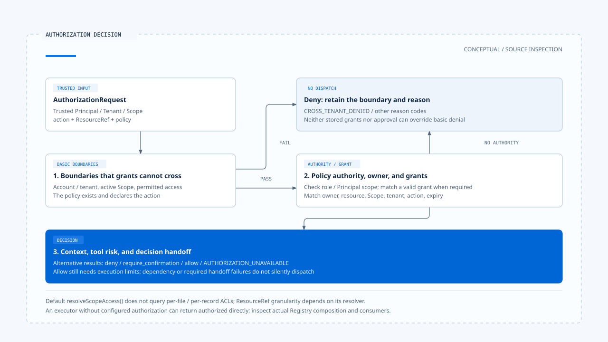

# Authorization and resource scope

[English](./02-authorization-and-scope.md) | [繁體中文](./02-authorization-and-scope-zh-TW.md)

[Back to overview](./README.md) · Previous: [Tool risk and action contracts](./01-tool-risk-and-contracts.md) · Next: [Human confirmation and approval validity](./03-human-confirmation.md)

A tool's ability to write files and a user's permission to modify a particular file are separate judgments. Authorization needs the actor, scope, resource, and action; model arguments supply only part of that information. If the sources of those fields are unclear, adding a confirmation dialog cannot recover a trusted identity.

Using the [pinned versions and evidence scope](./README.md#sources-and-verification-status), this article compares Chat Gun's authorization engine with the third-party CCB's Permission consumers. It describes source behavior without running cross-tenant or deployment verification.

## 1. Where authorization requests obtain identity

### Tool arguments do not supply authorization identity

The [governance wrapper][governance] obtains actions from policy, resolves resources with `resourceRefResolver`, and obtains Principal and Scope from execution Context to form an `AuthorizationRequest`. If required Context cannot be resolved, this path returns `AUTHORIZATION_UNAVAILABLE`.

The data has distinct sources:

- Tool arguments describe the operation's target and content.
- Policy determines which actions the tool declares and how resource references are created.
- The execution entry point supplies trusted Principal, Tenant, and Scope.

`readExecutionContext()` can parse canonical `execution_context` and read trusted identity through compatible entry points. The [reader][execution-context] does not itself authenticate arbitrary requests. The entry point's trust boundary must still establish who may create and pass this Context.

### Development identity follows another path

`readDevelopmentExecutionContext()` first removes canonical Context and `x-bff-` fields from the supplied configurable, then builds data through the development path. Production and development composition therefore cannot serve as the same kind of identity evidence.

## 2. Check boundaries that grants cannot cross

Chat Gun's [`AuthorizationEngine`][authorization] checks basic boundaries before looking for matching grants. Directly identifiable denial conditions include:

| Condition | Reason code |
|---|---|
| Resource account differs from Principal account, or Principal/Scope tenant differs from resource tenant | `CROSS_TENANT_DENIED` |
| Missing active scope | `MISSING_ACTIVE_SCOPE` |
| A write policy encounters a non-writable Scope | `SCOPE_NOT_WRITABLE` |
| A read policy encounters a non-visible Scope | `SCOPE_NOT_VISIBLE` |
| Policy is missing or does not declare the action | `ACTION_NOT_ALLOWED` |

These boundaries precede grant matching. The engine does not skip tenant and basic scope conditions simply because a grant exists in the database.

## 3. How policies, owners, and grants work together

### Policy authority and resource ownership

After the basic boundaries pass, the engine checks:

1. Whether the actor meets any role or Principal scope conditions set by policy.
2. If not, whether an effective matching grant exists.
3. Whether a resource's `ownerScopeId`, if present, matches the current Scope, and whether a grant supports a mismatch.
4. Whether policy Context evaluation and tool risk require denial or confirmation.

If policy sets no role or Principal scope conditions, `hasPolicyAuthority()` succeeds directly. This is configurable engine semantics; it does not mean every policy additionally requires an administrator role.

### Grants must remain valid and match

The engine checks grant revocation and expiry, along with resource, grantee Scope, Tenant, and action. Resource matching includes type, identity, Tenant, account, and owner Scope. [See the authorization engine conditions][authorization].

Authorization therefore involves more than the fact that a user once agreed. A past grant must be matched again against the current request to establish whether it applies.

[Open the HTML diagram](../../assets/agent-harness/action-governance/02-authorization-and-scope/02-authorization-decision-en.html)

## 4. Engine capabilities and current composition

### Default composition does not query per-resource ACLs

Policies created by [tool authorization composition][composition] mainly obtain actions and read/write access from risk policies. Its `resolveScopeAccess()` returns `none` when active scope is missing or Tenant differs, and `writable` otherwise.

This function does not query ACLs for each file or business object here. Resource resolution for the five local tools also mainly identifies the tool name and current Scope, rather than turning each URL or file path into a separate resource.

The article can therefore describe the engine's checks and composition points, but cannot claim the product already provides complete fine-grained authorization for arbitrary resources. Per-file, per-order, or per-record control requires identifying the corresponding resolver, data source, and actual consumer.

### The effect of optional authorization

`GovernanceExecutor.authorizeTyped()` returns authorized directly when authorization is not configured. By comparison, `loadAgentToolRuntime()` supplies configuration through tool authorization composition. [See the governance wrapper][governance] and [Registry][registry] for these two points.

Using a governance wrapper alone therefore does not prove that it connects to this identity policy. When adding an entry point that imports tools directly, check which configuration it actually uses.

## 5. How decisions enter subsequent flows

Authorization results include a decision ID, effect, reason code, and creation time, and may identify a matching policy or grant. The governance wrapper also passes the request, decision, policy version, and execution correlation to DecisionStore.

| Result | Subsequent handoff |
|---|---|
| `deny` | Return denial; model tool selection does not trigger dispatch. |
| `require_confirmation` | Create a confirmation descriptor for waiting and resumption; return unavailable if creation fails. |
| `allow` | Obtain authorization results; tool execution restrictions still apply. |
| An authorization dependency throws | The engine or wrapper reports failure as `AUTHORIZATION_UNAVAILABLE`. |

Decision persistence failure can also make the governance wrapper return unavailable. This trades some availability for avoiding silent, unrecorded execution when the required decision handoff cannot complete.

## 6. CCB Permission consumers

### From rules to tool decisions

CCB's [`permissions.ts`][ccb-permissions] includes whole-tool rules and tool-specific `checkPermissions()`. For example, `checkRuleBasedPermissions()` handles whole-tool deny and ask rules, internal tool checks, and specific safety checks; Bash sandboxing has additional conditional branches.

These rules are not Chat Gun's Principal/Tenant types. Similar names do not make the two systems the same policy engine.

### Which decision the execution point uses

[`useCanUseTool()`][ccb-can-use] consumes Permission results and may allow, deny, or enter interactive confirmation depending on configuration. Tool execution also incorporates Hook decisions. [`toolExecution.ts`][ccb-execution] proceeds to the actual call only when the final result is `allow`.

This handoff helps check whether an operation passed through Permission, but Interactive behavior alone does not establish that Headless/SDK uses the same interface to obtain approval. Trace the `canUseTool` and corresponding settings passed by each entry point.

## 7. How far authorization tests should trace

A verification design can change one trusted condition for the same call, such as Tenant, Scope, or grant expiry, then check the decision and underlying tool call count. A reply containing a denial does not rule out the tool having already executed.

For resource scope, also check ResourceRef granularity. If it identifies only the filesystem tool, that identity alone does not imply denial for another file path. This is a verification proposal, not an execution result obtained in this work.

The next article follows `require_confirmation`: how approval binds to a specified call, and which checks actually run again after waiting.

[governance]: https://github.com/HsienW/chat-gun/blob/92a5673003e4ac4ec09be8b1b350f42dbf4a5e69/backend/src/platform/tool-governance.ts
[execution-context]: https://github.com/HsienW/chat-gun/blob/92a5673003e4ac4ec09be8b1b350f42dbf4a5e69/backend/src/runtime/execution-context/read-execution-context.ts
[authorization]: https://github.com/HsienW/chat-gun/blob/92a5673003e4ac4ec09be8b1b350f42dbf4a5e69/backend/src/runtime/authorization/authorization.ts
[composition]: https://github.com/HsienW/chat-gun/blob/92a5673003e4ac4ec09be8b1b350f42dbf4a5e69/backend/src/tools/authorization/tool-authorization.ts
[registry]: https://github.com/HsienW/chat-gun/blob/92a5673003e4ac4ec09be8b1b350f42dbf4a5e69/backend/src/tools/registry.ts
[ccb-permissions]: https://github.com/claude-code-best/claude-code/blob/77a7934e15d69da13879112ed7db695c9ee7a52a/src/utils/permissions/permissions.ts
[ccb-can-use]: https://github.com/claude-code-best/claude-code/blob/77a7934e15d69da13879112ed7db695c9ee7a52a/src/hooks/useCanUseTool.tsx
[ccb-execution]: https://github.com/claude-code-best/claude-code/blob/77a7934e15d69da13879112ed7db695c9ee7a52a/src/services/tools/toolExecution.ts
