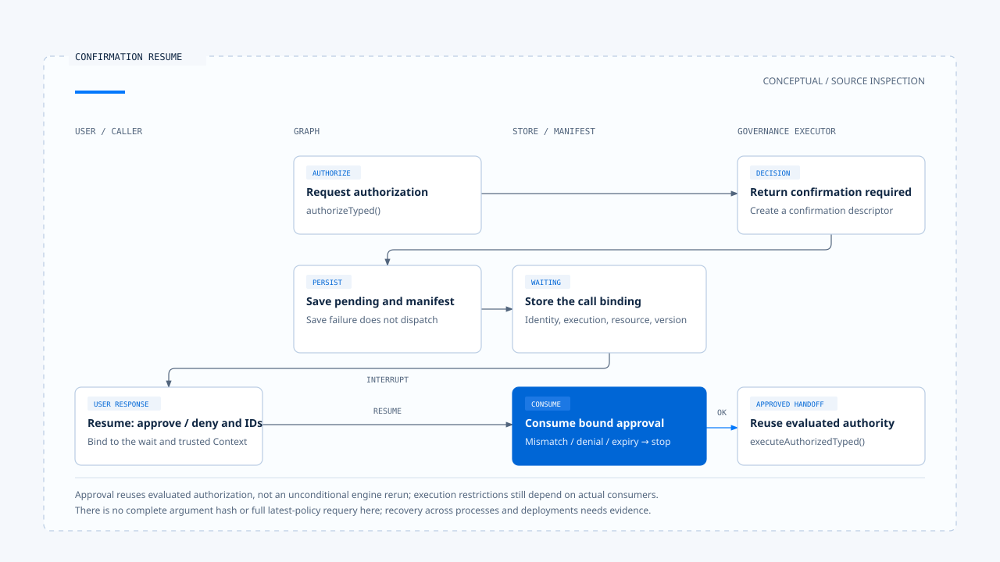

# 人工确认与批准有效性

[English](./03-human-confirmation.md) | [繁體中文](./03-human-confirmation-zh-TW.md) | [简体中文](./03-human-confirmation-zh-CN.md)

[回到导览](./README-zh-CN.md) · 上一篇：[授权身份与资源范围](./02-authorization-and-scope-zh-CN.md) · 下一篇：[受控派送与执行隔离](./04-governed-dispatch-and-isolation-zh-CN.md)

用户说「同意」时，系统仍要知道他同意的是哪一次工具调用。若等待期间换了 Run、操作人或资源，不能把同一句回答任意套到新的工作。人工确认要交付可检查的批准数据，才能交回执行器。

本篇依[固定版本与证据范围](./README-zh-CN.md#来源与查证状态)，追踪 Chat Gun 的确认 Store 与 Graph，并对照第三方 CCB 的互动 Permission。已读测试只作案例证据，未重新执行。

## 1. 哪些调用需要确认

在 Chat Gun 的[治理包装][governance]，授权引擎返回需要确认，或风险分类要求确认，都会进入相应分支。包装先记录决策，再透过 `onRequireConfirmation` 建立 descriptor；建立不了便返回授权不可用。

需要确认不表示基本权限尚未检查。前篇的租户、Scope 与政策拒绝，不能由用户在确认框按下同意而跨越。

确认也有使用成本。对高频低风险操作反覆询问，容易让批准变成机械动作；产品应让政策决定询问时机，并提供足以辨认这次操作的摘要。

## 2. 等待时保存哪些数据

### Descriptor 与显示 payload

[`createConfirmationRequiredDescriptor()`][confirmation] 建立带版本的确认数据，包含：

- decision ID、随机 approval ID 与到期时间。
- Request、Thread、Run、Task，以及存在时的 Step 与 Tool Call 识别。
- Scope、ResourceRef、policy version 与允许批准的 Principal 清单。
- 工具、action、资源类型摘要，以及可接受的恢复回应格式。

`toConfirmationInterruptPayload()` 提供较小的显示与恢复 payload。它没有把完整 execution Context 或工具原始参数全部交给确认界面。

这能限制传递数据，却也代表不能从摘要字段宣称接口已呈现完整修改差异。若用户应批准的是某段文件内容，还需要对应的显示与绑定设计。

### Graph 先保存，再等待

[`authorizationGate()`][graph] 取得 `confirmation_required` 后，依序保存 pending descriptor 与 confirmation interrupt manifest，才把 active call 和 pending authorization 放回状态。

后续确认节点会核对 manifest 的种类、Thread／Run／Task／Step、Scope、decision／approval 参照、回应 Schema 与 execution manifest 兼容性，再调用 `interrupt()`。保存失败或 manifest 不兼容，不会自然退回直接派送。

## 3. 恢复时核对批准绑定

### 先解析回应，再消费批准

恢复回应使用版本化的 `approve` 或 `deny`，带入 approval ID 与 decision ID。确认节点取得可信 execution Context，再交给 Store 的 `consume()`。

`hasMatchingBinding()` 检查批准识别、Run、Scope、Tenant 与允许批准者。它不接受只凭一段「用户已同意」的模型文字来完成恢复。

### PostgreSQL Store 的条件更新

`PgAuthorizationConfirmationStore` 使用带条件的 SQL 消费 pending 纪录，核对状态、期限、身份、资源与 policy version；同一段更新也交接 Permission decision 与 Task／Step 状态。

| 情况 | 程序处理 |
|---|---|
| 可信身份、Run 或 Scope 不符 | 在数据库消费前返回 binding mismatch。 |
| 符合到期条件 | 更新过期与对应拒绝状态，返回 `CONFIRMATION_TIMEOUT`。 |
| 有效批准 | 将 pending 改为 approved，返回消费结果。 |
| 明确拒绝 | 消费为 denied，保留取消确认的语义。 |
| 条件更新未取得纪录 | 返回 `CONFIRMATION_REPLAYED_OR_EXPIRED`。 |

最后一个原因码涵盖多种未匹配情况，不能只靠名称判定一定发生了恶意重播。实际诊断还要对照待确认纪录、绑定与时间。

## 4. 批准后是否重新授权

### 实际沿用的数据

确认消费成功后，Graph 更新 manifest 状态并保留 active call，接着到 `physicalDispatch()`。它调用治理执行器的 `executeAuthorizedTyped()`。

[治理包装][governance] 的这个方法以「授权已评估」进入执行；完整 [dispatch pipeline][pipeline] 也有相应的沿用授权结果路径。因此，不能把这段流程画成批准后无条件重跑整个授权引擎。

### 绑定不等于检查所有变更

Store 会核对所存的 resource 与 policy version，但所列版本的 descriptor 没有完整工具参数杂凑，Store 也没有在消费时自行查询「目前最新政策」的全套逻辑。

应分开陈述：

- 已有的实现：批准识别、可信身份、执行关联、期限与存储绑定检查。
- 仍需产品决定的保证：等待期间参数、资源内容或现行政策改变时，是否作废批准并重新判定。

若操作涉及敏感修改，设计上可以绑定参数摘要、资源版本与政策版本，并在派送前核对。这是扩展建议，不能当作目前流程已完成的效果。

[开启 HTML 图解](../../assets/agent-harness/action-governance/03-human-confirmation/03-confirmation-resume-en.html)

## 5. CCB 的互动确认如何不同

CCB 的 [`useCanUseTool()`][ccb-can-use] 消费 `allow`、`deny`、`ask` 等 Permission 结果。进入[互动 handler][ccb-interactive] 后，用户回应可包含调整后的输入与 Permission 更新，处理中也会观察 abort。

这套机制与 Chat Gun 的 PostgreSQL confirmation Store 有不同的状态及 consumer：

- CCB 可以把 `updatedInput` 交回后续工具执行；批准不一定只是一个布尔值。
- 某些 Permission 更新可供后续调用使用，作用范围须追持久化与规则 consumer。
- Coordinator、其他 Agent 入口与非互动模式另有分支，不能把单一 UI handler 套到全部路径。

在 [`toolExecution.ts`][ccb-execution]，最终非 `allow` 的结果会形成错误工具消息并返回。用户拒绝某项工具操作，不必然代表整个对话或任务都终止。

## 6. 测试支持到哪一层

[确认 Store 测试][confirmation-test] 定义了重复消费、过期、Principal／Scope／Run 绑定不符，以及存储资源与政策绑定不同的案例。查询是 mock，能看出测试要检查的条件，但不能代替真实 PostgreSQL 的竞态与交易验证。

[确认 Graph 测试][graph-test] 则用 `MemorySaver`、mock Store 与测试工具，断言中断前没有执行、同一 thread 恢复后执行一次，以及 pending 保存失败时不增加调用。

若要宣称批准能跨程序或部署恢复，还需补上实际 checkpointer、数据库、manifest 版本及故障窗口的证据。下一篇先处理批准之后仍要成立的派送与隔离条件。

[governance]: https://github.com/HsienW/chat-gun/blob/92a5673003e4ac4ec09be8b1b350f42dbf4a5e69/backend/src/platform/tool-governance.ts
[confirmation]: https://github.com/HsienW/chat-gun/blob/92a5673003e4ac4ec09be8b1b350f42dbf4a5e69/backend/src/runtime/authorization/confirmation.ts
[graph]: https://github.com/HsienW/chat-gun/blob/92a5673003e4ac4ec09be8b1b350f42dbf4a5e69/backend/src/runtime/authorization/confirmation-graph.ts
[pipeline]: https://github.com/HsienW/chat-gun/blob/92a5673003e4ac4ec09be8b1b350f42dbf4a5e69/backend/src/runtime/tool-dispatch/pipeline.ts
[ccb-can-use]: https://github.com/claude-code-best/claude-code/blob/77a7934e15d69da13879112ed7db695c9ee7a52a/src/hooks/useCanUseTool.tsx
[ccb-interactive]: https://github.com/claude-code-best/claude-code/blob/77a7934e15d69da13879112ed7db695c9ee7a52a/src/hooks/toolPermission/handlers/interactiveHandler.ts
[ccb-execution]: https://github.com/claude-code-best/claude-code/blob/77a7934e15d69da13879112ed7db695c9ee7a52a/src/services/tools/toolExecution.ts
[confirmation-test]: https://github.com/HsienW/chat-gun/blob/92a5673003e4ac4ec09be8b1b350f42dbf4a5e69/backend/src/runtime/authorization/confirmation.test.ts
[graph-test]: https://github.com/HsienW/chat-gun/blob/92a5673003e4ac4ec09be8b1b350f42dbf4a5e69/backend/src/runtime/authorization/confirmation-graph.test.ts
