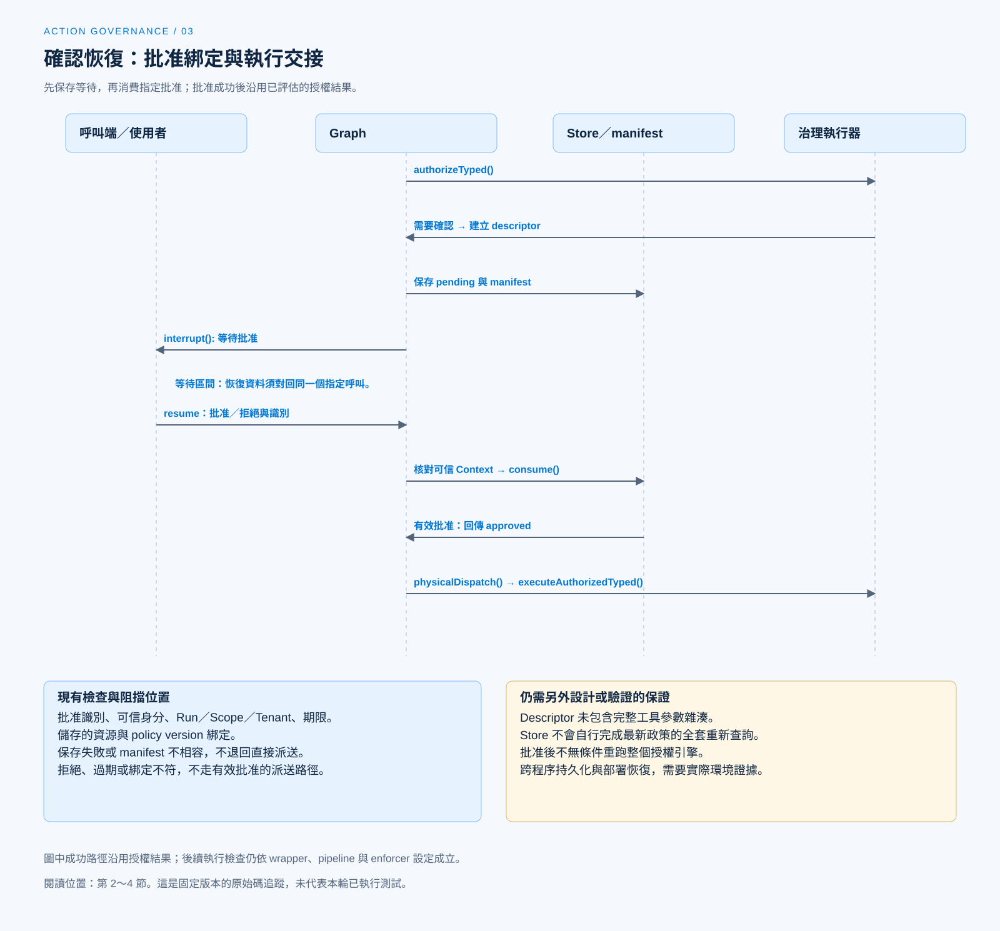

# 人工確認與批准有效性

[English](./03-human-confirmation.md) | [繁體中文](./03-human-confirmation-zh-TW.md)

[回到導覽](./README-zh-TW.md) · 上一篇：[授權身分與資源範圍](./02-authorization-and-scope-zh-TW.md) · 下一篇：[受控派送與執行隔離](./04-governed-dispatch-and-isolation-zh-TW.md)

使用者說「同意」時，系統仍要知道他同意的是哪一次工具呼叫。若等待期間換了 Run、操作人或資源，不能把同一句回答任意套到新的工作。人工確認要交付可檢查的批准資料，才能交回執行器。

本篇依[固定版本與證據範圍](./README-zh-TW.md#來源與查證狀態)，追蹤 Chat Gun 的確認 Store 與 Graph，並對照第三方 CCB 的互動 Permission。已讀測試只作案例證據，本輪未重新執行。

## 1. 哪些呼叫需要確認

在 Chat Gun 的[治理包裝][governance]，授權引擎回傳需要確認，或風險分類要求確認，都會進入相應分支。包裝先記錄決策，再透過 `onRequireConfirmation` 建立 descriptor；建立不了便回傳授權不可用。

需要確認不表示基本權限尚未檢查。前篇的租戶、Scope 與政策拒絕，不能由使用者在確認框按下同意而跨越。

確認也有使用成本。對高頻低風險操作反覆詢問，容易讓批准變成機械動作；產品應讓政策決定詢問時機，並提供足以辨認這次操作的摘要。

## 2. 等待時保存哪些資料

### Descriptor 與顯示 payload

[`createConfirmationRequiredDescriptor()`][confirmation] 建立帶版本的確認資料，包含：

- decision ID、隨機 approval ID 與到期時間。
- Request、Thread、Run、Task，以及存在時的 Step 與 Tool Call 識別。
- Scope、ResourceRef、policy version 與允許批准的 Principal 清單。
- 工具、action、資源型別摘要，以及可接受的恢復回應格式。

`toConfirmationInterruptPayload()` 提供較小的顯示與恢復 payload。它沒有把完整 execution Context 或工具原始參數全部交給確認介面。

這能限制傳遞資料，卻也代表不能從摘要欄位宣稱介面已呈現完整修改差異。若使用者應批准的是某段檔案內容，還需要對應的顯示與綁定設計。

### Graph 先保存，再等待

[`authorizationGate()`][graph] 取得 `confirmation_required` 後，依序保存 pending descriptor 與 confirmation interrupt manifest，才把 active call 和 pending authorization 放回狀態。

後續確認節點會核對 manifest 的種類、Thread／Run／Task／Step、Scope、decision／approval 參照、回應 Schema 與 execution manifest 相容性，再呼叫 `interrupt()`。保存失敗或 manifest 不相容，不會自然退回直接派送。

## 3. 恢復時核對批准綁定

### 先解析回應，再消費批准

恢復回應使用版本化的 `approve` 或 `deny`，帶入 approval ID 與 decision ID。確認節點取得可信 execution Context，再交給 Store 的 `consume()`。

`hasMatchingBinding()` 檢查批准識別、Run、Scope、Tenant 與允許批准者。它不接受只憑一段「使用者已同意」的模型文字來完成恢復。

### PostgreSQL Store 的條件更新

`PgAuthorizationConfirmationStore` 使用帶條件的 SQL 消費 pending 紀錄，核對狀態、期限、身分、資源與 policy version；同一段更新也交接 Permission decision 與 Task／Step 狀態。

| 情況 | 程式處理 |
|---|---|
| 可信身分、Run 或 Scope 不符 | 在資料庫消費前回傳 binding mismatch。 |
| 符合到期條件 | 更新過期與對應拒絕狀態，回傳 `CONFIRMATION_TIMEOUT`。 |
| 有效批准 | 將 pending 改為 approved，回傳消費結果。 |
| 明確拒絕 | 消費為 denied，保留取消確認的語意。 |
| 條件更新未取得紀錄 | 回傳 `CONFIRMATION_REPLAYED_OR_EXPIRED`。 |

最後一個原因碼涵蓋多種未匹配情況，不能只靠名稱判定一定發生了惡意重播。實際診斷還要對照待確認紀錄、綁定與時間。

## 4. 批准後是否重新授權

### 實際沿用的資料

確認消費成功後，Graph 更新 manifest 狀態並保留 active call，接著到 `physicalDispatch()`。它呼叫治理執行器的 `executeAuthorizedTyped()`。

[治理包裝][governance] 的這個方法以「授權已評估」進入執行；完整 [dispatch pipeline][pipeline] 也有相應的沿用授權結果路徑。因此，不能把這段流程畫成批准後無條件重跑整個授權引擎。

### 綁定不等於檢查所有變更

Store 會核對所存的 resource 與 policy version，但本輪所讀 descriptor 沒有完整工具參數雜湊，Store 也沒有在消費時自行查詢「目前最新政策」的全套邏輯。

應分開陳述：

- 已有的實作：批准識別、可信身分、執行關聯、期限與儲存綁定檢查。
- 仍需產品決定的保證：等待期間參數、資源內容或現行政策改變時，是否作廢批准並重新判定。

若操作涉及敏感修改，設計上可以綁定參數摘要、資源版本與政策版本，並在派送前核對。這是擴充建議，不能當作目前流程已完成的效果。

[開啟 HTML 圖解](../../assets/agent-harness/action-governance/03-human-confirmation/03-confirmation-resume.html)

## 5. CCB 的互動確認如何不同

CCB 的 [`useCanUseTool()`][ccb-can-use] 消費 `allow`、`deny`、`ask` 等 Permission 結果。進入[互動 handler][ccb-interactive] 後，使用者回應可包含調整後的輸入與 Permission 更新，處理中也會觀察 abort。

這套機制與 Chat Gun 的 PostgreSQL confirmation Store 有不同的狀態及 consumer：

- CCB 可以把 `updatedInput` 交回後續工具執行；批准不一定只是一個布林值。
- 某些 Permission 更新可供後續呼叫使用，作用範圍須追持久化與規則 consumer。
- Coordinator、其他 Agent 入口與非互動模式另有分支，不能把單一 UI handler 套到全部路徑。

在 [`toolExecution.ts`][ccb-execution]，最終非 `allow` 的結果會形成錯誤工具訊息並返回。使用者拒絕某項工具操作，不必然代表整個對話或任務都終止。

## 6. 測試支持到哪一層

[確認 Store 測試][confirmation-test] 定義了重複消費、過期、Principal／Scope／Run 綁定不符，以及儲存資源與政策綁定不同的案例。查詢是 mock，能看出測試要檢查的條件，但不能代替真實 PostgreSQL 的競態與交易驗證。

[確認 Graph 測試][graph-test] 則用 `MemorySaver`、mock Store 與測試工具，斷言中斷前沒有執行、同一 thread 恢復後執行一次，以及 pending 保存失敗時不增加呼叫。

若要宣稱批准能跨程序或部署恢復，還需補上實際 checkpointer、資料庫、manifest 版本及故障窗口的證據。第六篇會沿這份測試案例展開；下一篇先處理批准之後仍要成立的派送與隔離條件。

[governance]: https://github.com/HsienW/chat-gun/blob/92a5673003e4ac4ec09be8b1b350f42dbf4a5e69/backend/src/platform/tool-governance.ts
[confirmation]: https://github.com/HsienW/chat-gun/blob/92a5673003e4ac4ec09be8b1b350f42dbf4a5e69/backend/src/runtime/authorization/confirmation.ts
[graph]: https://github.com/HsienW/chat-gun/blob/92a5673003e4ac4ec09be8b1b350f42dbf4a5e69/backend/src/runtime/authorization/confirmation-graph.ts
[pipeline]: https://github.com/HsienW/chat-gun/blob/92a5673003e4ac4ec09be8b1b350f42dbf4a5e69/backend/src/runtime/tool-dispatch/pipeline.ts
[ccb-can-use]: https://github.com/claude-code-best/claude-code/blob/77a7934e15d69da13879112ed7db695c9ee7a52a/src/hooks/useCanUseTool.tsx
[ccb-interactive]: https://github.com/claude-code-best/claude-code/blob/77a7934e15d69da13879112ed7db695c9ee7a52a/src/hooks/toolPermission/handlers/interactiveHandler.ts
[ccb-execution]: https://github.com/claude-code-best/claude-code/blob/77a7934e15d69da13879112ed7db695c9ee7a52a/src/services/tools/toolExecution.ts
[confirmation-test]: https://github.com/HsienW/chat-gun/blob/92a5673003e4ac4ec09be8b1b350f42dbf4a5e69/backend/src/runtime/authorization/confirmation.test.ts
[graph-test]: https://github.com/HsienW/chat-gun/blob/92a5673003e4ac4ec09be8b1b350f42dbf4a5e69/backend/src/runtime/authorization/confirmation-graph.test.ts
