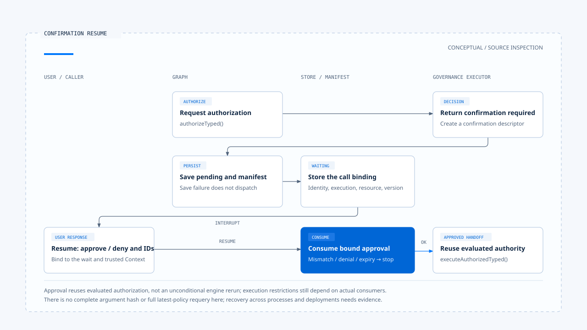

# Human confirmation and approval validity

[English](./03-human-confirmation.md) | [繁體中文](./03-human-confirmation-zh-TW.md)

[Back to overview](./README.md) · Previous: [Authorization and resource scope](./02-authorization-and-scope.md) · Next: [Governed dispatch and execution isolation](./04-governed-dispatch-and-isolation.md)

When a user agrees, the system must still know which tool call they approved. If the Run, actor, or resource changes while waiting, the same answer cannot be applied arbitrarily to new work. Human confirmation must supply inspectable approval data before handing control back to the executor.

Using the [pinned versions and evidence scope](./README.md#sources-and-verification-status), this article traces Chat Gun's confirmation Store and Graph and compares them with the third-party CCB's interactive Permission flow. Tests read here serve only as case evidence; they were not rerun during this work.

## 1. Which calls require confirmation?

In Chat Gun's [governance wrapper][governance], either an authorization engine result requiring confirmation or a risk classification requiring it enters the corresponding branch. The wrapper records the decision, then creates a descriptor through `onRequireConfirmation`. If creation fails, it returns authorization unavailable.

Requiring confirmation does not mean basic permissions remain unchecked. A user's approval in a dialog cannot cross the tenant, Scope, and policy denial boundaries described in the previous article.

Confirmation also costs user attention. Repeated prompts for frequent, low-risk operations can make approval mechanical. Product policy should determine when to ask, and the summary should let users identify the operation.

## 2. What is saved while waiting?

### Descriptor and display payload

[`createConfirmationRequiredDescriptor()`][confirmation] creates versioned confirmation data containing:

- Decision ID, random approval ID, and expiry time.
- Request, Thread, Run, and Task identities, plus Step and Tool Call identities when present.
- Scope, ResourceRef, policy version, and the list of Principals allowed to approve.
- A summary of the tool, action, and resource type, plus the accepted resume response format.

`toConfirmationInterruptPayload()` supplies a smaller display and resume payload. It does not pass the complete execution Context or all raw tool arguments to the confirmation interface.

This limits transferred data, but summary fields do not establish that the interface displays the full modification diff. If the user must approve particular file contents, corresponding presentation and binding designs are still required.

### The Graph saves before waiting

After receiving `confirmation_required`, [`authorizationGate()`][graph] saves the pending descriptor and confirmation interrupt manifest in order, then returns the active call and pending authorization to state.

The subsequent confirmation node checks manifest kind, Thread/Run/Task/Step, Scope, decision/approval references, response Schema, and execution manifest compatibility before calling `interrupt()`. Persistence failure or manifest incompatibility does not automatically fall back to direct dispatch.

## 3. Checking approval binding on resumption

### Parse the response before consuming approval

Resume responses use versioned `approve` or `deny` decisions with approval ID and decision ID. The confirmation node obtains trusted execution Context, then passes it to the Store's `consume()`.

`hasMatchingBinding()` checks approval identity, Run, Scope, Tenant, and allowed approvers. Model text merely saying that the user agreed is insufficient to resume.

### Conditional updates in the PostgreSQL Store

`PgAuthorizationConfirmationStore` consumes pending records through conditional SQL, checking status, expiry, identity, resource, and policy version. The same update also handles the Permission decision and Task/Step state handoff.

| Situation | Code behavior |
|---|---|
| Trusted identity, Run, or Scope mismatches | Return a binding mismatch before database consumption. |
| Expiry conditions match | Update expiry and the corresponding denial state, then return `CONFIRMATION_TIMEOUT`. |
| Valid approval | Change pending to approved and return the consumption result. |
| Explicit denial | Consume as denied, retaining confirmation cancellation semantics. |
| Conditional update finds no record | Return `CONFIRMATION_REPLAYED_OR_EXPIRED`. |

The final reason code covers several nonmatching conditions. Its name alone does not establish malicious replay. Diagnosis also requires the pending record, binding, and time.

## 4. Does approval trigger reauthorization?

### Data the flow actually reuses

After successful confirmation consumption, the Graph updates manifest status, retains the active call, and proceeds to `physicalDispatch()`. That node calls the governance executor's `executeAuthorizedTyped()`.

This method in the [governance wrapper][governance] enters execution with authorization already evaluated. The full [dispatch pipeline][pipeline] also has a corresponding path that reuses authorization results. The flow therefore cannot be drawn as unconditionally rerunning the entire authorization engine after approval.

### Binding does not check every change

The Store checks the saved resource and policy version. However, the descriptor inspected here has no complete tool-argument hash, and the Store does not itself implement a full check against the latest current policy during consumption.

State these separately:

- Existing implementation: approval identity, trusted identity, execution correlation, expiry, and stored binding checks.
- Guarantees the product must still decide: whether argument, resource-content, or current-policy changes during waiting invalidate approval and require reevaluation.

For sensitive changes, a design can bind an argument digest, resource version, and policy version, then check them before dispatch. This is an extension suggestion, not an effect already established by the current flow.

[Open the HTML diagram](../../assets/agent-harness/action-governance/03-human-confirmation/03-confirmation-resume-en.html)

## 5. How CCB interactive confirmation differs

CCB's [`useCanUseTool()`][ccb-can-use] consumes Permission results such as `allow`, `deny`, and `ask`. In the [interactive handler][ccb-interactive], user responses can include adjusted input and Permission updates, and processing also observes abort.

This mechanism has different state and consumers from Chat Gun's PostgreSQL confirmation Store:

- CCB can return `updatedInput` to subsequent tool execution; approval need not be a Boolean alone.
- Some Permission updates can apply to later calls. Trace persistence and rule consumers to establish their scope.
- Coordinator, other Agent entry points, and non-interactive modes have separate branches. One UI handler cannot represent every path.

In [`toolExecution.ts`][ccb-execution], a final result other than `allow` produces an error tool message and returns. A user denying a tool operation does not necessarily terminate the entire conversation or task.

## 6. What layer do the tests support?

The [confirmation Store tests][confirmation-test] define cases for repeated consumption, expiry, Principal/Scope/Run binding mismatches, and differences in stored resource and policy binding. Queries are mocked. They show the intended checks, but cannot replace real PostgreSQL concurrency and transaction verification.

The [confirmation Graph tests][graph-test] use `MemorySaver`, a mock Store, and a test tool to assert no execution before interruption, one execution after resuming on the same thread, and no additional call when saving pending data fails.

Claims of approval resumption across processes or deployments still require evidence for the actual checkpointer, database, manifest version, and failure windows. Article 06 expands this test case. The next article first covers the dispatch and isolation conditions that must still hold after approval.

[governance]: https://github.com/HsienW/chat-gun/blob/92a5673003e4ac4ec09be8b1b350f42dbf4a5e69/backend/src/platform/tool-governance.ts
[confirmation]: https://github.com/HsienW/chat-gun/blob/92a5673003e4ac4ec09be8b1b350f42dbf4a5e69/backend/src/runtime/authorization/confirmation.ts
[graph]: https://github.com/HsienW/chat-gun/blob/92a5673003e4ac4ec09be8b1b350f42dbf4a5e69/backend/src/runtime/authorization/confirmation-graph.ts
[pipeline]: https://github.com/HsienW/chat-gun/blob/92a5673003e4ac4ec09be8b1b350f42dbf4a5e69/backend/src/runtime/tool-dispatch/pipeline.ts
[ccb-can-use]: https://github.com/claude-code-best/claude-code/blob/77a7934e15d69da13879112ed7db695c9ee7a52a/src/hooks/useCanUseTool.tsx
[ccb-interactive]: https://github.com/claude-code-best/claude-code/blob/77a7934e15d69da13879112ed7db695c9ee7a52a/src/hooks/toolPermission/handlers/interactiveHandler.ts
[ccb-execution]: https://github.com/claude-code-best/claude-code/blob/77a7934e15d69da13879112ed7db695c9ee7a52a/src/services/tools/toolExecution.ts
[confirmation-test]: https://github.com/HsienW/chat-gun/blob/92a5673003e4ac4ec09be8b1b350f42dbf4a5e69/backend/src/runtime/authorization/confirmation.test.ts
[graph-test]: https://github.com/HsienW/chat-gun/blob/92a5673003e4ac4ec09be8b1b350f42dbf4a5e69/backend/src/runtime/authorization/confirmation-graph.test.ts
