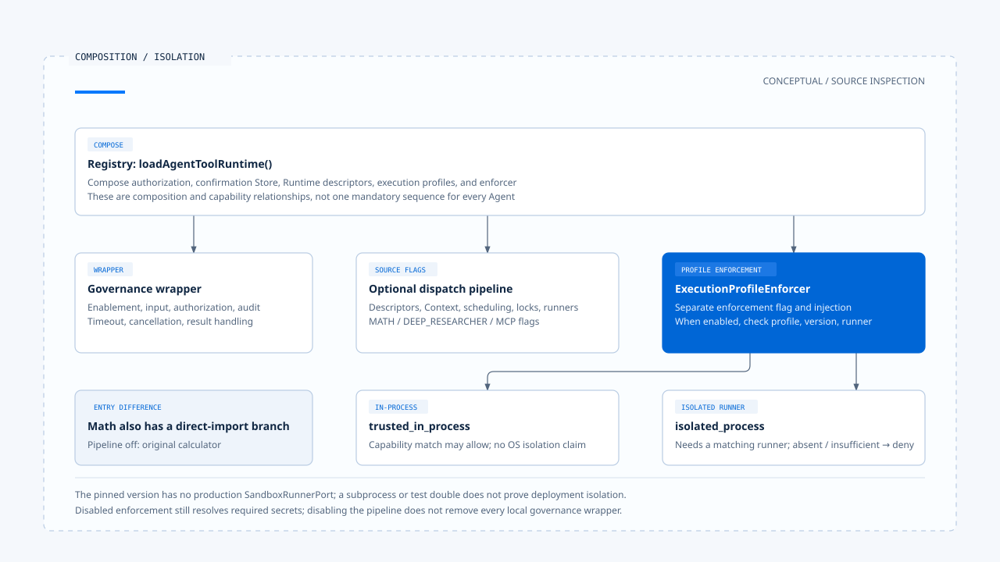

# 受控派送与执行隔离

[English](./04-governed-dispatch-and-isolation.md) | [繁體中文](./04-governed-dispatch-and-isolation-zh-TW.md) | [简体中文](./04-governed-dispatch-and-isolation-zh-CN.md)

[回到导览](./README-zh-CN.md) · 上一篇：[人工确认与批准有效性](./03-human-confirmation-zh-CN.md) · 下一篇：[重试与副作用处理](./05-retry-and-side-effects-zh-CN.md)

一项网络读取已获准，仍可能指向内网地址；一项文件操作已确认，执行它的程序仍可能看见不必要的目录。授权回答这次操作能否继续，派送与隔离则要限制它实际如何执行。

本篇依[固定版本与证据范围](./README-zh-CN.md#来源与查证状态)追踪 Chat Gun 的 Registry、governance wrapper 与 dispatch pipeline，再对照第三方 CCB 的工具调度。以下未执行隔离、网络或多实例测试。

## 1. 三种接点不要混成一层

### Registry 提供哪些组装

[`loadAgentToolRuntime()`][registry] 先建立授权、确认 Store、Runtime descriptor 与 execution profile，再建立 `ExecutionProfileEnforcer`，套用工具治理。完整 dispatch pipeline 则是另一个受来源开关控制的选项。

| 接点 | 主要责任 | 需要核对的条件 |
|---|---|---|
| Governance wrapper | 工具启用、输入大小、授权、timeout、取消、结果及 audit。 | 是否由 Registry 或等效组装提供必要设置。 |
| Runtime dispatch pipeline | Descriptor、执行 Context、调度、限流、锁、runner 与结构化结果。 | Agent 的 `source` 开关与必要依赖。 |
| ExecutionProfile enforcement | Profile 版本、runner capability、secret 与执行计划。 | Enforcer 是否注入，以及 enforcement 是否启用。 |

`TOOL_DISPATCH_PIPELINE_MATH_ENABLED`、`TOOL_DISPATCH_PIPELINE_DEEP_RESEARCHER_ENABLED` 与 `TOOL_DISPATCH_PIPELINE_MCP_ENABLED` 分别对应来源。关闭完整 pipeline，不会移除 Registry 原本套用的所有 wrapper；反过来，wrapper 存在也不能证明完整 pipeline 已建立。

### 直接导入工具是另一条路径

Math 的 `loadMathCalculatorTool()` 在相应 pipeline 关闭时，直接返回原本 calculator；启用时才从组装后的 Runtime 工具取得它。不能因 MCP Agent 使用授权 Graph，就把同样时序套到所有 Agent。

## 2. Pipeline 先确认能否开始派送

在 [`pipeline.ts`][pipeline]，具体调用先经过以下检查：

1. 查找 Runtime descriptor，验证输入 Schema。
2. 确认必要依赖与可授权的执行接口存在。
3. 依只读属性及 `isConcurrencySafe()` 判断调度分类。
4. 读取 canonical execution Context，要求 Step 与 Tool Call 识别。
5. 取得授权，或依调用路径沿用已评估的授权结果。
6. 若有 enforcer，核对 execution profile 及其执行条件。

这些检查可能提前返回。例如缺少 descriptor、依赖或 execution Context，会形成派送前拒绝。它们还没证明底层工具被调用。

已授权入口仍会做多项执行检查，但不等于再次执行全部 policy 判断。批准后重新授权的范围，已在[前篇](./03-human-confirmation-zh-CN.md)分开说明。

## 3. 调度、限流与锁各自保护什么

### 进程内的调度与限流

完整 pipeline 对限流结果可拒绝或等待，并在熔断器不允许时停止本次操作。[Scheduler][scheduler] 对可并行读取管理总容量与每个 Run 的容量；serial 类别使用自己的序列等待。

默认 Scheduler、rate limiter 与 circuit breaker 具有本地实现。它们的对象存在，不足以证明多个服务实例共用同一组容量与熔断状态；若需要全域限制，还要提供相应部署与协调方式。

### Step lock 与续租

[`createStepLock()`][lock] 有 Redis 与 Noop 两种选择：有 Redis 时使用带 owner 与 TTL 的锁；多实例模式却没有 Redis 时会抛出基础设施不可用，其他情况可使用 Noop。

[`ToolDispatchStepLockLease`][lease] 负责续租，续租失败会中止它传递的 signal。Pipeline 在事后观察到失败时，可将结果保留为 `ambiguous_after_dispatch`，而非宣称一定没有效果。

这把锁的识别是 Step。两个不同 Step 若操作同一份外部数据，不能仅凭这个锁就推论资源层冲突已被排除。

## 4. Profile 宣告与真正的隔离能力

### trusted 与 isolated 的不同

[`ExecutionProfile`][profile] 描述执行模式、文件系统、程序、资源、网络与输出等要求。Profile 的存在仍须配合可执行这些要求的 consumer。

- `trusted_in_process` 的 capability matching 直接允许，返回对应 execution mode；这条分支不证明所有 CPU、内存或文件系统条件都由 OS 强制隔离。
- `isolated_process` 需要 runner，并核对 execution mode、资源限制及依条件需要的其他隔离能力。缺少 runner 或能力不足时返回 typed deny。

固定版本的[安全文件][security-doc] 注明没有 production `SandboxRunnerPort` 实现；接口、测试替身与可供正式部署使用的 runner 应分开呈现。不能把一般 subprocess 启动当成已满足隔离契约。

### Enforcement 的开关

Registry 用 `TOOL_EXECUTION_PROFILE_ENFORCEMENT_ENABLED` 控制 enforcer。关闭时，`enforce()` 仍会处理必要的 secret 解析，再返回 disabled；它没有因此提供 isolated process 的保证。

启用时，流程检查 descriptor 的 profile 参照、版本与 runner 能力，再建立执行计划及安全证据。要判定某个环境能否执行 MCP，必须一起核对设置、注册与 runner。

[开启 HTML 图解](../../assets/agent-harness/action-governance/04-governed-dispatch-and-isolation/04-composition-and-isolation-en.html)

## 5. Secret 与 egress 的实际 consumer

### Secret reference 不是 credential value

[EnvironmentSecretBroker][secret] 依注册的 secret reference 查环境变数，验证名称、可用值与存在时的期限，再透过 Symbol 字段传递解析值。

这个实现接收 execution Context，但其 `resolve()` 没有使用该参数额外做逐 Principal 的 secret 授权。因此不能把接口的 Context 参数当成每次都已完成独立身份政策检查。

Symbol 传递能避免一般 JSON 序列化自然带出 credential，工具与其他 consumer 仍须避免把解析值复制到错误、Prompt 或 Log。安全证据应记录 reference，而非 secret value。

### 网络限制要走到连接

[`egress-policy.ts`][egress] 核对协定、目的地、port、内嵌 credential 与 DNS 结果，redirect 会重新检查。默认 transport 将核准 IP 用于实际连接，并保留预期 TLS server name。

这可以指出 URL 检查与 socket 的接线，但只适用于使用这条受控 transport 的调用。任意工具若自己采用另一个连接方式，不能直接继承这些保证；部署的网络隔离也需要另外验证。

## 6. Timeout 与取消不会撤回外部提交

[治理包装][governance] 结合调用端取消与 timeout，向工具传递 AbortSignal。派送前已取消可以直接返回；工具开始后能否停止，还取决于实现与外部服务是否处理 signal。

例如外部服务已接受写入，但本地在等待回应时超时，画面不能回报「没有写入」。当程序无法确认是否提交时，应保留效果不明的结果，交给回查与副作用处理。

工具内层 timeout、外层 wrapper timeout 与整项任务预算也可能不同。排查时应记录是哪一层先停止等待，以及底层是否仍在工作。

## 7. 对照 CCB 的并行批次

CCB 的 [`toolOrchestration.ts`][ccb-orchestration] 先解析输入，再调用工具的 `isConcurrencySafe()`。解析失败或判断抛错时，分类保守地视为不安全。

连续的安全调用可形成并行批次；其他调用依序处理。安全批次的 Context modifier 也有收集与套用顺序，不能只看工具返回先后就解释最终 Context。

这段分类没有额外把所有工具强制等同「只读才可并行」，也没有提供跨进程的资源锁。它与 Chat Gun 的只读条件、Step lock 及外部效果契约，应逐项对照。

派送条件成立后，下一个问题是结果如何分类。成功返回、确认尚未提交与效果不明，会导向不同的重试与完成陈述。

[registry]: https://github.com/HsienW/chat-gun/blob/92a5673003e4ac4ec09be8b1b350f42dbf4a5e69/backend/src/tools/registry.ts
[pipeline]: https://github.com/HsienW/chat-gun/blob/92a5673003e4ac4ec09be8b1b350f42dbf4a5e69/backend/src/runtime/tool-dispatch/pipeline.ts
[scheduler]: https://github.com/HsienW/chat-gun/blob/92a5673003e4ac4ec09be8b1b350f42dbf4a5e69/backend/src/runtime/tool-dispatch/scheduler.ts
[lock]: https://github.com/HsienW/chat-gun/blob/92a5673003e4ac4ec09be8b1b350f42dbf4a5e69/backend/src/runtime/lock/step-lock.ts
[lease]: https://github.com/HsienW/chat-gun/blob/92a5673003e4ac4ec09be8b1b350f42dbf4a5e69/backend/src/runtime/tool-dispatch/step-lock-lease.ts
[profile]: https://github.com/HsienW/chat-gun/blob/92a5673003e4ac4ec09be8b1b350f42dbf4a5e69/backend/src/runtime/tool-dispatch/execution-profile.ts
[security-doc]: https://github.com/HsienW/chat-gun/blob/92a5673003e4ac4ec09be8b1b350f42dbf4a5e69/docs/tool-security-isolation.md
[secret]: https://github.com/HsienW/chat-gun/blob/92a5673003e4ac4ec09be8b1b350f42dbf4a5e69/backend/src/runtime/tool-dispatch/secret-broker.ts
[egress]: https://github.com/HsienW/chat-gun/blob/92a5673003e4ac4ec09be8b1b350f42dbf4a5e69/backend/src/runtime/tool-dispatch/egress-policy.ts
[governance]: https://github.com/HsienW/chat-gun/blob/92a5673003e4ac4ec09be8b1b350f42dbf4a5e69/backend/src/platform/tool-governance.ts
[ccb-orchestration]: https://github.com/claude-code-best/claude-code/blob/77a7934e15d69da13879112ed7db695c9ee7a52a/src/services/tools/toolOrchestration.ts
