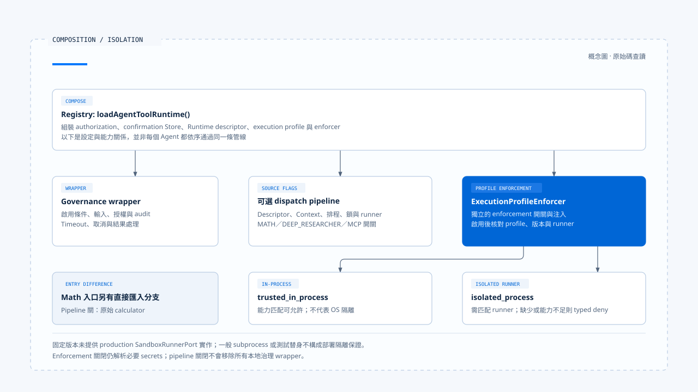

# 受控派送與執行隔離

[English](./04-governed-dispatch-and-isolation.md) | [繁體中文](./04-governed-dispatch-and-isolation-zh-TW.md)

[回到導覽](./README-zh-TW.md) · 上一篇：[人工確認與批准有效性](./03-human-confirmation-zh-TW.md) · 下一篇：[重試與副作用處理](./05-retry-and-side-effects-zh-TW.md)

一項網路讀取已獲准，仍可能指向內網位址；一項檔案操作已確認，執行它的程序仍可能看見不必要的目錄。授權回答這次操作能否繼續，派送與隔離則要限制它實際如何執行。

本篇依[固定版本與證據範圍](./README-zh-TW.md#來源與查證狀態)追蹤 Chat Gun 的 Registry、governance wrapper 與 dispatch pipeline，再對照第三方 CCB 的工具排程。以下未執行隔離、網路或多實例測試。

## 1. 三種接點不要混成一層

### Registry 提供哪些組裝

[`loadAgentToolRuntime()`][registry] 先建立授權、確認 Store、Runtime descriptor 與 execution profile，再建立 `ExecutionProfileEnforcer`，套用工具治理。完整 dispatch pipeline 則是另一個受來源開關控制的選項。

| 接點 | 主要責任 | 需要核對的條件 |
|---|---|---|
| Governance wrapper | 工具啟用、輸入大小、授權、timeout、取消、結果及 audit。 | 是否由 Registry 或等效組裝提供必要設定。 |
| Runtime dispatch pipeline | Descriptor、執行 Context、排程、限流、鎖、runner 與結構化結果。 | Agent 的 `source` 開關與必要依賴。 |
| ExecutionProfile enforcement | Profile 版本、runner capability、secret 與執行計畫。 | Enforcer 是否注入，以及 enforcement 是否啟用。 |

`TOOL_DISPATCH_PIPELINE_MATH_ENABLED`、`TOOL_DISPATCH_PIPELINE_DEEP_RESEARCHER_ENABLED` 與 `TOOL_DISPATCH_PIPELINE_MCP_ENABLED` 分別對應來源。關閉完整 pipeline，不會移除 Registry 原本套用的所有 wrapper；反過來，wrapper 存在也不能證明完整 pipeline 已建立。

### 直接匯入工具是另一條路徑

Math 的 `loadMathCalculatorTool()` 在相應 pipeline 關閉時，直接回傳原本 calculator；啟用時才從組裝後的 Runtime 工具取得它。不能因 MCP Agent 使用授權 Graph，就把同樣時序套到所有 Agent。

## 2. Pipeline 先確認能否開始派送

在 [`pipeline.ts`][pipeline]，具體呼叫先經過以下檢查：

1. 查找 Runtime descriptor，驗證輸入 Schema。
2. 確認必要依賴與可授權的執行介面存在。
3. 依唯讀屬性及 `isConcurrencySafe()` 判斷排程分類。
4. 讀取 canonical execution Context，要求 Step 與 Tool Call 識別。
5. 取得授權，或依呼叫路徑沿用已評估的授權結果。
6. 若有 enforcer，核對 execution profile 及其執行條件。

這些檢查可能提前返回。例如缺少 descriptor、依賴或 execution Context，會形成派送前拒絕。它們還沒證明底層工具被呼叫。

已授權入口仍會做多項執行檢查，但不等於再次執行全部 policy 判斷。批准後重新授權的範圍，已在[前篇](./03-human-confirmation-zh-TW.md)分開說明。

## 3. 排程、限流與鎖各自保護什麼

### 程序內的排程與限流

完整 pipeline 對限流結果可拒絕或等待，並在熔斷器不允許時停止本次操作。[Scheduler][scheduler] 對可並行讀取管理總容量與每個 Run 的容量；serial 類別使用自己的序列等待。

預設 Scheduler、rate limiter 與 circuit breaker 具有本地實作。它們的物件存在，不足以證明多個服務實例共用同一組容量與熔斷狀態；若需要全域限制，還要提供相應部署與協調方式。

### Step lock 與續租

[`createStepLock()`][lock] 有 Redis 與 Noop 兩種選擇：有 Redis 時使用帶 owner 與 TTL 的鎖；多實例模式卻沒有 Redis 時會拋出基礎設施不可用，其他情況可使用 Noop。

[`ToolDispatchStepLockLease`][lease] 負責續租，續租失敗會中止它傳遞的 signal。Pipeline 在事後觀察到失敗時，可將結果保留為 `ambiguous_after_dispatch`，而非宣稱一定沒有效果。

這把鎖的識別是 Step。兩個不同 Step 若操作同一份外部資料，不能僅憑這個鎖就推論資源層衝突已被排除。

## 4. Profile 宣告與真正的隔離能力

### trusted 與 isolated 的不同

[`ExecutionProfile`][profile] 描述執行模式、檔案系統、程序、資源、網路與輸出等要求。Profile 的存在仍須配合可執行這些要求的 consumer。

- `trusted_in_process` 的 capability matching 直接允許，回傳對應 execution mode；這條分支不證明所有 CPU、記憶體或檔案系統條件都由 OS 強制隔離。
- `isolated_process` 需要 runner，並核對 execution mode、資源限制及依條件需要的其他隔離能力。缺少 runner 或能力不足時回傳 typed deny。

固定版本的[安全文件][security-doc] 註明沒有 production `SandboxRunnerPort` 實作；介面、測試替身與可供正式部署使用的 runner 應分開呈現。不能把一般 subprocess 啟動當成已滿足隔離契約。

### Enforcement 的開關

Registry 用 `TOOL_EXECUTION_PROFILE_ENFORCEMENT_ENABLED` 控制 enforcer。關閉時，`enforce()` 仍會處理必要的 secret 解析，再回傳 disabled；它沒有因此提供 isolated process 的保證。

啟用時，流程檢查 descriptor 的 profile 參照、版本與 runner 能力，再建立執行計畫及安全證據。要判定某個環境能否執行 MCP，必須一起核對設定、註冊與 runner。

[開啟 HTML 圖解](../../assets/agent-harness/action-governance/04-governed-dispatch-and-isolation/04-composition-and-isolation.html)

## 5. Secret 與 egress 的實際 consumer

### Secret reference 不是 credential value

[EnvironmentSecretBroker][secret] 依註冊的 secret reference 查環境變數，驗證名稱、可用值與存在時的期限，再透過 Symbol 欄位傳遞解析值。

這個實作接收 execution Context，但其 `resolve()` 沒有使用該參數額外做逐 Principal 的 secret 授權。因此不能把介面的 Context 參數當成每次都已完成獨立身分政策檢查。

Symbol 傳遞能避免一般 JSON 序列化自然帶出 credential，工具與其他 consumer 仍須避免把解析值複製到錯誤、Prompt 或 Log。安全證據應記錄 reference，而非 secret value。

### 網路限制要走到連線

[`egress-policy.ts`][egress] 核對協定、目的地、port、內嵌 credential 與 DNS 結果，redirect 會重新檢查。預設 transport 將核准 IP 用於實際連線，並保留預期 TLS server name。

這可以指出 URL 檢查與 socket 的接線，但只適用於使用這條受控 transport 的呼叫。任意工具若自己採用另一個連線方式，不能直接繼承這些保證；部署的網路隔離也需要另外驗證。

## 6. Timeout 與取消不會撤回外部提交

[治理包裝][governance] 結合呼叫端取消與 timeout，向工具傳遞 AbortSignal。派送前已取消可以直接返回；工具開始後能否停止，還取決於實作與外部服務是否處理 signal。

例如外部服務已接受寫入，但本地在等待回應時逾時，畫面不能回報「沒有寫入」。當程式無法確認是否提交時，應保留效果不明的結果，交給回查與副作用處理。

工具內層 timeout、外層 wrapper timeout 與整項任務預算也可能不同。排查時應記錄是哪一層先停止等待，以及底層是否仍在工作。

## 7. 對照 CCB 的並行批次

CCB 的 [`toolOrchestration.ts`][ccb-orchestration] 先解析輸入，再呼叫工具的 `isConcurrencySafe()`。解析失敗或判斷拋錯時，分類保守地視為不安全。

連續的安全呼叫可形成並行批次；其他呼叫依序處理。安全批次的 Context modifier 也有收集與套用順序，不能只看工具回傳先後就解釋最終 Context。

這段分類沒有額外把所有工具強制等同「唯讀才可並行」，也沒有提供跨程序的資源鎖。它與 Chat Gun 的唯讀條件、Step lock 及外部效果契約，應逐項對照。

派送條件成立後，下一個問題是結果如何分類。成功回傳、確認尚未提交與效果不明，會導向不同的重試與完成陳述。

[registry]: https://github.com/HsienW/chat-gun/blob/92a5673003e4ac4ec09be8b1b350f42dbf4a5e69/backend/src/tools/registry.ts
[pipeline]: https://github.com/HsienW/chat-gun/blob/92a5673003e4ac4ec09be8b1b350f42dbf4a5e69/backend/src/runtime/tool-dispatch/pipeline.ts
[scheduler]: https://github.com/HsienW/chat-gun/blob/92a5673003e4ac4ec09be8b1b350f42dbf4a5e69/backend/src/runtime/tool-dispatch/scheduler.ts
[lock]: https://github.com/HsienW/chat-gun/blob/92a5673003e4ac4ec09be8b1b350f42dbf4a5e69/backend/src/runtime/lock/step-lock.ts
[lease]: https://github.com/HsienW/chat-gun/blob/92a5673003e4ac4ec09be8b1b350f42dbf4a5e69/backend/src/runtime/tool-dispatch/step-lock-lease.ts
[profile]: https://github.com/HsienW/chat-gun/blob/92a5673003e4ac4ec09be8b1b350f42dbf4a5e69/backend/src/runtime/tool-dispatch/execution-profile.ts
[security-doc]: https://github.com/HsienW/chat-gun/blob/92a5673003e4ac4ec09be8b1b350f42dbf4a5e69/docs/tool-security-isolation.md
[secret]: https://github.com/HsienW/chat-gun/blob/92a5673003e4ac4ec09be8b1b350f42dbf4a5e69/backend/src/runtime/tool-dispatch/secret-broker.ts
[egress]: https://github.com/HsienW/chat-gun/blob/92a5673003e4ac4ec09be8b1b350f42dbf4a5e69/backend/src/runtime/tool-dispatch/egress-policy.ts
[governance]: https://github.com/HsienW/chat-gun/blob/92a5673003e4ac4ec09be8b1b350f42dbf4a5e69/backend/src/platform/tool-governance.ts
[ccb-orchestration]: https://github.com/claude-code-best/claude-code/blob/77a7934e15d69da13879112ed7db695c9ee7a52a/src/services/tools/toolOrchestration.ts
