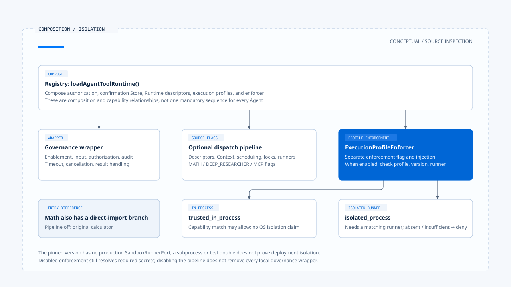

# Governed dispatch and execution isolation

[English](./04-governed-dispatch-and-isolation.md) | [繁體中文](./04-governed-dispatch-and-isolation-zh-TW.md)

[Back to overview](./README.md) · Previous: [Human confirmation and approval validity](./03-human-confirmation.md) · Next: [Retries and side effects](./05-retry-and-side-effects.md)

An authorized network read may still point to an internal address. A confirmed file operation may still run in a process that sees unnecessary directories. Authorization determines whether an operation may continue; dispatch and isolation must restrict how it actually executes.

Using the [pinned versions and evidence scope](./README.md#sources-and-verification-status), this article traces Chat Gun's Registry, governance wrapper, and dispatch pipeline, then compares the third-party CCB's tool scheduling. No isolation, network, or multi-instance tests were run.

## 1. Keep three integration points distinct

### What the Registry composes

[`loadAgentToolRuntime()`][registry] first creates authorization, the confirmation Store, Runtime descriptors, and execution profiles, then creates an `ExecutionProfileEnforcer` and applies tool governance. The full dispatch pipeline is a separate option controlled by source-specific flags.

| Integration point | Main responsibility | Conditions to check |
|---|---|---|
| Governance wrapper | Tool enablement, input size, authorization, timeout, cancellation, results, and audit. | Whether the Registry or equivalent composition supplies required configuration. |
| Runtime dispatch pipeline | Descriptors, execution Context, scheduling, rate limiting, locks, runners, and structured results. | Agent `source` flags and required dependencies. |
| ExecutionProfile enforcement | Profile versions, runner capabilities, secrets, and execution plans. | Whether the enforcer is injected and enforcement enabled. |

`TOOL_DISPATCH_PIPELINE_MATH_ENABLED`, `TOOL_DISPATCH_PIPELINE_DEEP_RESEARCHER_ENABLED`, and `TOOL_DISPATCH_PIPELINE_MCP_ENABLED` correspond to individual sources. Disabling the full pipeline does not remove all wrappers already applied by the Registry. Conversely, a wrapper's existence does not establish that the full pipeline was built.

### Direct tool imports follow another path

Math's `loadMathCalculatorTool()` returns the original calculator directly when its pipeline is disabled, and obtains it from composed Runtime tools only when enabled. MCP Agent authorization Graph usage does not establish the same sequence for every Agent.

## 2. The pipeline checks whether dispatch can start

In [`pipeline.ts`][pipeline], a concrete call passes through these checks:

1. Look up the Runtime descriptor and validate the input Schema.
2. Confirm required dependencies and an authorizable execution interface exist.
3. Classify scheduling using read-only status and `isConcurrencySafe()`.
4. Read canonical execution Context, requiring Step and Tool Call identities.
5. Obtain authorization or reuse already evaluated results according to the call path.
6. If an enforcer exists, check the execution profile and its execution conditions.

These checks can return early. Missing descriptors, dependencies, or execution Context, for example, produce rejection before dispatch. They do not establish that the underlying tool was called.

An already-authorized entry point still performs several execution checks, but does not necessarily repeat every policy evaluation. The [previous article](./03-human-confirmation.md) explains the scope of reauthorization after approval separately.

## 3. What scheduling, rate limiting, and locks protect

### Scheduling and rate limiting within a process

The full pipeline can reject or wait based on rate limiting results, and stops an operation when the circuit breaker disallows it. The [Scheduler][scheduler] manages total and per-Run capacity for concurrent reads; the serial class uses its own sequential wait.

Default Scheduler, rate limiter, and circuit breaker implementations are local. Their existence does not prove that multiple service instances share capacity and circuit state. Global limits require corresponding deployment and coordination arrangements.

### Step locks and lease renewal

[`createStepLock()`][lock] supports Redis and Noop choices. With Redis, it uses a lock carrying owner and TTL. Multi-instance mode without Redis throws infrastructure unavailable; other cases may use Noop.

[`ToolDispatchStepLockLease`][lease] handles renewal and aborts the signal it passes when renewal fails. If the pipeline observes failure afterward, it can retain `ambiguous_after_dispatch` rather than claim that no effect occurred.

This lock identifies a Step. If two different Steps operate on the same external data, the lock alone does not establish exclusion of resource-level conflicts.

## 4. Profile declarations and actual isolation capabilities

### Trusted and isolated modes differ

[`ExecutionProfile`][profile] describes requirements for execution mode, filesystem, processes, resources, network, and output. A profile still needs consumers capable of enforcing those requirements.

- Capability matching for `trusted_in_process` allows directly and returns the corresponding execution mode. This branch does not establish OS-enforced isolation for every CPU, memory, or filesystem condition.
- `isolated_process` requires a runner and checks execution mode, resource limits, and other isolation capabilities as applicable. A missing runner or insufficient capabilities returns a typed deny.

The [security documentation][security-doc] at the pinned version states that no production `SandboxRunnerPort` implementation exists. Distinguish interfaces, test doubles, and runners usable in production deployments. Starting an ordinary subprocess does not establish compliance with the isolation contract.

### The enforcement flag

The Registry controls the enforcer with `TOOL_EXECUTION_PROFILE_ENFORCEMENT_ENABLED`. When disabled, `enforce()` still resolves required secrets before returning disabled. It does not thereby provide isolated-process guarantees.

When enabled, the flow checks the descriptor's profile reference, version, and runner capabilities, then builds an execution plan and security evidence. Determining whether an environment can execute MCP requires checking configuration, registration, and runners together.

[Open the HTML diagram](../../assets/agent-harness/action-governance/04-governed-dispatch-and-isolation/04-composition-and-isolation-en.html)

## 5. Actual secret and egress consumers

### A secret reference is not a credential value

[EnvironmentSecretBroker][secret] looks up environment variables using registered secret references, validates names, available values, and expiry when present, then passes resolved values through Symbol fields.

This implementation accepts execution Context, but its `resolve()` does not use that parameter for additional per-Principal secret authorization. The interface's Context parameter therefore does not establish that a separate identity policy check occurs on every resolution.

Symbol transfer prevents ordinary JSON serialization from automatically including credentials. Tools and other consumers must still avoid copying resolved values into errors, Prompts, or Logs. Security evidence should record references rather than secret values.

### Network restrictions must reach the connection

[`egress-policy.ts`][egress] checks protocol, destination, port, embedded credentials, and DNS results, and rechecks redirects. The default transport uses the approved IP for the actual connection while retaining the expected TLS server name.

This identifies wiring between URL checks and sockets, but applies only to calls using that governed transport. A tool using another connection mechanism does not automatically inherit these guarantees. Deployment network isolation also requires separate verification.

## 6. Timeouts and cancellation do not undo external commits

The [governance wrapper][governance] combines caller cancellation with timeouts and passes an AbortSignal to tools. Cancellation before dispatch can return directly. Whether an already-started tool stops depends on its implementation and the external service's handling of the signal.

For example, if an external service has accepted a write but the local wait for its response times out, the interface cannot report that no write occurred. When code cannot determine whether a commit occurred, it should retain an uncertain outcome for reconciliation and side effect handling.

Inner tool timeouts, outer wrapper timeouts, and the overall task budget may also differ. Diagnosis should record which layer stopped waiting first and whether the underlying operation was still running.

## 7. Comparing CCB concurrent batches

CCB's [`toolOrchestration.ts`][ccb-orchestration] parses input before calling the tool's `isConcurrencySafe()`. Parsing failures or exceptions in that check conservatively classify the call as unsafe.

Consecutive safe calls can form concurrent batches; other calls run sequentially. Context modifiers from safe batches also have collection and application order. Tool return order alone cannot explain the final Context.

This classification does not additionally require all concurrent tools to be read-only, and does not supply cross-process resource locks. Compare it individually with Chat Gun's read-only conditions, Step locks, and external effect contracts.

Once dispatch conditions hold, the next question is how results are classified. Successful returns, confirmed non-commit, and uncertain effects lead to different retry decisions and completion statements.

[registry]: https://github.com/HsienW/chat-gun/blob/92a5673003e4ac4ec09be8b1b350f42dbf4a5e69/backend/src/tools/registry.ts
[pipeline]: https://github.com/HsienW/chat-gun/blob/92a5673003e4ac4ec09be8b1b350f42dbf4a5e69/backend/src/runtime/tool-dispatch/pipeline.ts
[scheduler]: https://github.com/HsienW/chat-gun/blob/92a5673003e4ac4ec09be8b1b350f42dbf4a5e69/backend/src/runtime/tool-dispatch/scheduler.ts
[lock]: https://github.com/HsienW/chat-gun/blob/92a5673003e4ac4ec09be8b1b350f42dbf4a5e69/backend/src/runtime/lock/step-lock.ts
[lease]: https://github.com/HsienW/chat-gun/blob/92a5673003e4ac4ec09be8b1b350f42dbf4a5e69/backend/src/runtime/tool-dispatch/step-lock-lease.ts
[profile]: https://github.com/HsienW/chat-gun/blob/92a5673003e4ac4ec09be8b1b350f42dbf4a5e69/backend/src/runtime/tool-dispatch/execution-profile.ts
[security-doc]: https://github.com/HsienW/chat-gun/blob/92a5673003e4ac4ec09be8b1b350f42dbf4a5e69/docs/tool-security-isolation.md
[secret]: https://github.com/HsienW/chat-gun/blob/92a5673003e4ac4ec09be8b1b350f42dbf4a5e69/backend/src/runtime/tool-dispatch/secret-broker.ts
[egress]: https://github.com/HsienW/chat-gun/blob/92a5673003e4ac4ec09be8b1b350f42dbf4a5e69/backend/src/runtime/tool-dispatch/egress-policy.ts
[governance]: https://github.com/HsienW/chat-gun/blob/92a5673003e4ac4ec09be8b1b350f42dbf4a5e69/backend/src/platform/tool-governance.ts
[ccb-orchestration]: https://github.com/claude-code-best/claude-code/blob/77a7934e15d69da13879112ed7db695c9ee7a52a/src/services/tools/toolOrchestration.ts
