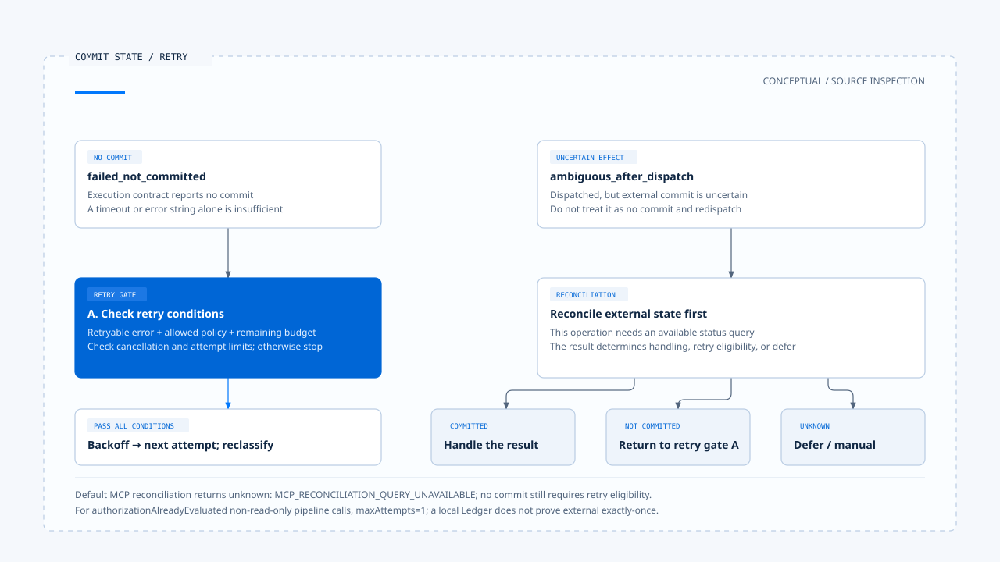
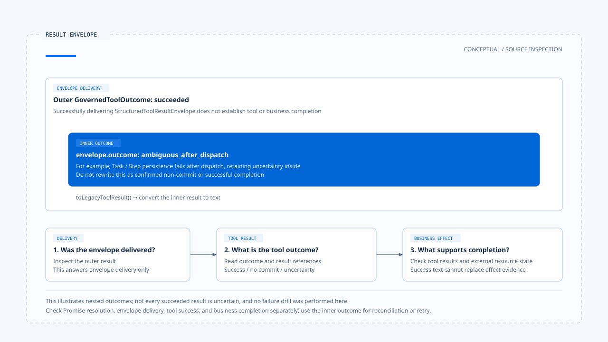

# 重试与副作用处理

[English](./05-retry-and-side-effects.md) | [繁體中文](./05-retry-and-side-effects-zh-TW.md) | [简体中文](./05-retry-and-side-effects-zh-CN.md)

[回到导览](./README-zh-CN.md) · 上一篇：[受控派送与执行隔离](./04-governed-dispatch-and-isolation-zh-CN.md) · 下一篇：[一次工具调用的治理流程](./06-case-governed-tool-call-zh-CN.md)

工具超时后再调用一次，对公开搜索可能只是多花成本，对寄信、付款或文件写入却可能重复产生效果。没有收到成功回应，不代表外部服务没有提交；重试需要依据操作状态，而非只看错误文字。

本篇依[固定版本与证据范围](./README-zh-CN.md#来源与查证状态)，追踪 Chat Gun 的 runner、Ledger、reconciler 与补偿接点。上述寄信与付款是说明副作用的例子，不代表此版本已提供这些正式工具；未执行外部提交或故障演练。

## 1. 哪一层正在重做

重复操作可能由不同层发起：

| 层次 | 重做的内容 | 需要保留的条件 |
|---|---|---|
| 模型循环 | 根据错误提出新的 Tool Call。 | 新提案与授权；不能拿旧批准任意套用。 |
| 工具执行 runner | 在同一执行契约中增加 attempt。 | 错误分类、retry policy、预算、取消及提交状态。 |
| Runtime 恢复或重播 | 重新进入既有 Step 或调用。 | 执行识别、既有纪录、参数一致性与结果可重用条件。 |

三者若各自重试，尝试次数会叠加。设计上应指定谁拥有预算与最终状态；不能只在每个函数都加入重试，就宣称任务更可靠。

## 2. 先分清 outcome 的语义

[`GovernedToolOutcome`][outcome] 区分以下结果：

| 类型 | 应保留的事实 |
|---|---|
| `succeeded` | 执行器返回成功结果，后续仍可有输出验证与持久化条件。 |
| `rejected_before_dispatch` | 派送前拒绝，不能说底层已执行。 |
| `denied_by_authorization` | 保留授权拒绝及 decision ID。 |
| `confirmation_required` | 尚有确认流程，不能视为已批准。 |
| `failed_not_committed` | 执行契约回报尚未提交的失败，再依政策决定是否重试。 |
| `ambiguous_after_dispatch` | 派送后无法确定效果，不能当作确定未提交。 |
| `cancelled` | 还需核对 `dispatchState`，分辨取消与派送的相对位置。 |

这些类型有用的前提，是工具与转接器能正确分类。若 Adapter 把所有 timeout 都标成未提交，runner 无法从名称还原外部事实。

## 3. 一次执行与一次业务效果

### 不同识别解决不同问题

[ToolExecutionRunner][runner] 对具 side-effect descriptor 的操作建立 replay key，并交给 Ledger 查找既有执行。它另外保存 request hash、业务效果识别及每次 attempt。

- Replay key 用于找同一执行身份的既有纪录。
- Request hash 用于检查相同身份下的输入是否冲突。
- Business effect key 由工具 descriptor 依输入与可信 Scope 推导，再杂凑。
- Attempt identity 记录同一执行中的各次尝试。

`identity.ts` 将部分实现委派给 `@gun-ai/harness-kernel`；retry budget 与错误分类的转接档也如此。`backend/package.json` 固定此处的包版本为 `0.1.0-alpha.2`。本篇已追到 host 调用与消费结果，未进一步审计套件内部的杂凑或预算演算法。[转接与依赖见此][identity]、[budget]、[package]。

### Ledger 与外部系统仍有边界

[`BusinessEffectLedger`][ledger] 分开描述执行状态与业务效果状态。Runner 在派送前准备纪录与取得执行资格，没有取得或 Ledger 不可用时，可以返回 deferred。

本地 Ledger 交易不能自行把第三方 HTTP 提交包成同一笔数据库交易。端到端避免重复，仍需要外部幂等键、可查询的操作识别，或明确的人工处理方式。

## 4. 哪些既有结果可以重用

Runner 查到既有 replay 纪录后，会先比对 request hash。不同时返回 `SIDE_EFFECT_REPLAY_CONFLICT`；纪录尚未 committed 时返回需要 reconciliation，而不是直接再派送一次。

已 committed 也要取得可解析的 result reference，再由结果政策核对重用条件。缺少结果参照或无法取回结果时，可以回报 `SIDE_EFFECT_COMMITTED_RESULT_UNAVAILABLE`。

这个结果保留了一个常被抹掉的差异：操作可能已完成，但现在拿不到足以回复的结果。重新执行来补回一段成功文字，可能反而造成第二次效果。

## 5. 允许重试的条件

### 明确未提交的失败

在 runner 的 side-effect 路径，`failed_not_committed` 需要同时符合错误可重试、policy 允许该类别，以及 retry budget 可继续，才等待 backoff 并进入下一次 attempt。等待期间也会处理取消。

只读路径有自己的循环。不能将它的处理方式套到所有写入工具，也不能省略有无 budget 的差别。

### 已授权非只读派送的限制

[Pipeline][pipeline] 在 `authorizationAlreadyEvaluated` 且 descriptor 非只读的分支，会将 retry policy 的 `maxAttempts` 设为 1。这是该调用方式的设置，不表示其他入口永远只尝试一次。

因此，看到 descriptor 有 retry policy，也不能立即推论批准后的敏感工具会自动多次派送。要沿 executor 的调用方式、runner 输入与当前预算核对。

## 6. 效果不明时先回查

[`decideReconciliationAction()`][reconciler] 的决策很直接：

- 回查为 `committed`：进入提交结果的处理。
- 回查为 `not_committed`，且允许重试：才选择 retry。
- 其他情况：defer。

Runner 还会处理回查缺少结果、状态转移失败与没有 reconciler 的情况。没有可用回查时，可保留未知状态并转向人工介入，而不是猜测外部尚未执行。

### MCP 默认回查的限制

[MCP descriptor 组装][descriptors] 对非只读工具提供 side-effect descriptor，但其默认 reconciler 返回 `unknown`，原因是 `MCP_RECONCILIATION_QUERY_UNAVAILABLE`。

这个接点存在，不代表产品已会查每种 MCP 外部操作的状态。若要让特定工具安全重试，需要补上该工具可用的回查能力与结果政策。

[开启 HTML 图解](../../assets/agent-harness/action-governance/05-retry-and-side-effects/05-commit-and-retry-en.html)

## 7. 补偿需要自己的动作与条件

[`SagaOrchestratorImpl`][saga] 对符合状态的 Task，沿已成功 Step 及已登记补偿动作的反向顺序处理。不可逆动作会记录需人工介入；补偿失败也保留失败状态与原因。

补偿并非数据自动回到原状：

- 删除已新增的数据，可能与还原被覆写内容需要不同工具。
- 已寄出的消息或已被外部使用的数据，不一定可以撤回。
- 补偿本身仍会改变资源，须具备自己的范围、权限与结果证据。

Pipeline 默认可建立空的 Compensation Registry，并提供 `compensate()` 接口。没有相应 action 注册与触发 consumer，不能因此宣称任务取消后会自动完成业务恢复。

## 8. 外层成功不一定是工具成功

[Pipeline][pipeline] 会把内层 outcome 放入 [StructuredToolResultEnvelope][envelope]，然后以外层 `succeeded` 返回 envelope。派送后 Task／Step 持久化失败时，内层还可能保留 `ambiguous_after_dispatch`。

消费端至少要核对：

1. 外层是否成功交付结果封套。
2. `envelope.outcome` 是否表示工具成功。
3. 回复中的业务完成陈述，是否有对应结果或外部状态证据。

`toLegacyToolResult()` 会依封套内层结果转成文字；只看最外层 Promise resolve 或某个 `succeeded` 标签，仍可能误报成功。

[开启 HTML 图解](../../assets/agent-harness/action-governance/05-retry-and-side-effects/05-result-envelope-en.html)

下一篇使用测试中的确认流程，将提案、批准与执行次数串回同一调用，再标出哪些副作用与部署问题尚未被该测试覆盖。

[outcome]: https://github.com/HsienW/chat-gun/blob/92a5673003e4ac4ec09be8b1b350f42dbf4a5e69/backend/src/runtime/side-effect/governed-outcome.ts
[runner]: https://github.com/HsienW/chat-gun/blob/92a5673003e4ac4ec09be8b1b350f42dbf4a5e69/backend/src/runtime/side-effect/tool-execution-runner.ts
[identity]: https://github.com/HsienW/chat-gun/blob/92a5673003e4ac4ec09be8b1b350f42dbf4a5e69/backend/src/runtime/side-effect/identity.ts
[ledger]: https://github.com/HsienW/chat-gun/blob/92a5673003e4ac4ec09be8b1b350f42dbf4a5e69/backend/src/runtime/side-effect/business-effect-ledger.ts
[pipeline]: https://github.com/HsienW/chat-gun/blob/92a5673003e4ac4ec09be8b1b350f42dbf4a5e69/backend/src/runtime/tool-dispatch/pipeline.ts
[reconciler]: https://github.com/HsienW/chat-gun/blob/92a5673003e4ac4ec09be8b1b350f42dbf4a5e69/backend/src/runtime/side-effect/reconciler.ts
[descriptors]: https://github.com/HsienW/chat-gun/blob/92a5673003e4ac4ec09be8b1b350f42dbf4a5e69/backend/src/tools/production-runtime-tool-descriptors.ts
[saga]: https://github.com/HsienW/chat-gun/blob/92a5673003e4ac4ec09be8b1b350f42dbf4a5e69/backend/src/runtime/compensation/saga-orchestrator.ts
[envelope]: https://github.com/HsienW/chat-gun/blob/92a5673003e4ac4ec09be8b1b350f42dbf4a5e69/backend/src/runtime/tool-dispatch/structured-tool-result.ts
