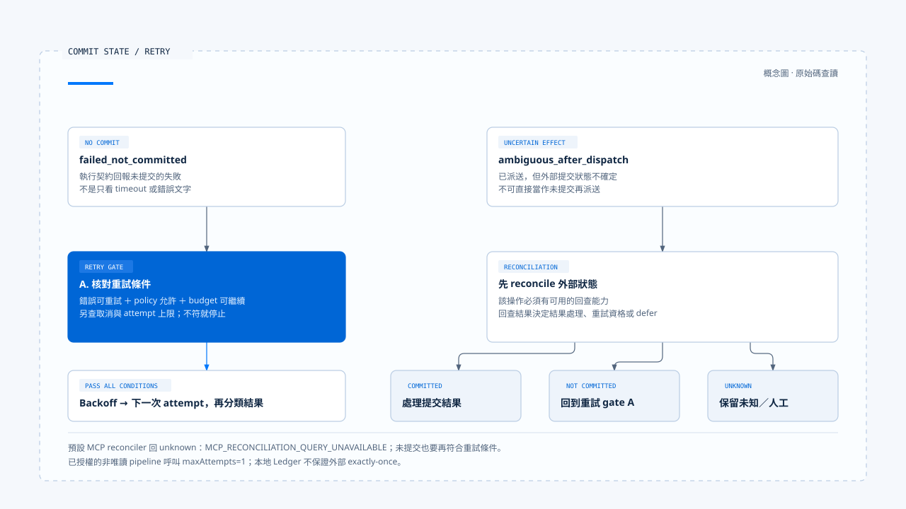
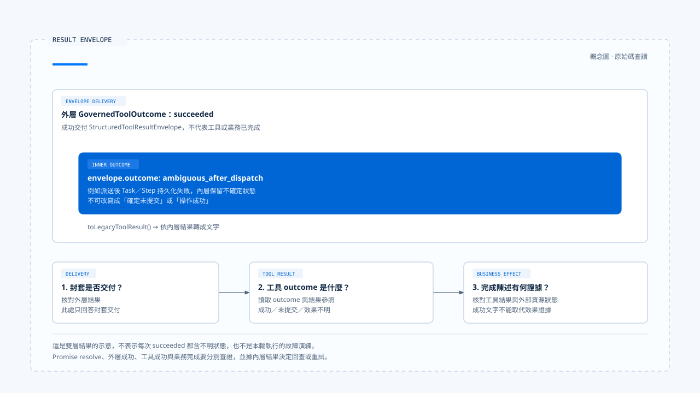

# 重試與副作用處理

[English](./05-retry-and-side-effects.md) | [繁體中文](./05-retry-and-side-effects-zh-TW.md)

[回到導覽](./README-zh-TW.md) · 上一篇：[受控派送與執行隔離](./04-governed-dispatch-and-isolation-zh-TW.md) · 下一篇：[一次工具呼叫的治理流程](./06-case-governed-tool-call-zh-TW.md)

工具逾時後再呼叫一次，對公開搜尋可能只是多花成本，對寄信、付款或檔案寫入卻可能重複產生效果。沒有收到成功回應，不代表外部服務沒有提交；重試需要依據操作狀態，而非只看錯誤文字。

本篇依[固定版本與證據範圍](./README-zh-TW.md#來源與查證狀態)，追蹤 Chat Gun 的 runner、Ledger、reconciler 與補償接點。上述寄信與付款是說明副作用的例子，不代表此版本已提供這些正式工具；本輪未執行外部提交或故障演練。

## 1. 哪一層正在重做

重複操作可能由不同層發起：

| 層次 | 重做的內容 | 需要保留的條件 |
|---|---|---|
| 模型迴圈 | 根據錯誤提出新的 Tool Call。 | 新提案與授權；不能拿舊批准任意套用。 |
| 工具執行 runner | 在同一執行契約中增加 attempt。 | 錯誤分類、retry policy、預算、取消及提交狀態。 |
| Runtime 恢復或重播 | 重新進入既有 Step 或呼叫。 | 執行識別、既有紀錄、參數一致性與結果可重用條件。 |

三者若各自重試，嘗試次數會疊加。設計上應指定誰擁有預算與最終狀態；不能只在每個函式都加入重試，就宣稱任務更可靠。

## 2. 先分清 outcome 的語意

[`GovernedToolOutcome`][outcome] 區分以下結果：

| 型別 | 應保留的事實 |
|---|---|
| `succeeded` | 執行器回傳成功結果，後續仍可有輸出驗證與持久化條件。 |
| `rejected_before_dispatch` | 派送前拒絕，不能說底層已執行。 |
| `denied_by_authorization` | 保留授權拒絕及 decision ID。 |
| `confirmation_required` | 尚有確認流程，不能視為已批准。 |
| `failed_not_committed` | 執行契約回報尚未提交的失敗，再依政策決定是否重試。 |
| `ambiguous_after_dispatch` | 派送後無法確定效果，不能當作確定未提交。 |
| `cancelled` | 還需核對 `dispatchState`，分辨取消與派送的相對位置。 |

這些型別有用的前提，是工具與轉接器能正確分類。若 Adapter 把所有 timeout 都標成未提交，runner 無法從名稱還原外部事實。

## 3. 一次執行與一次業務效果

### 不同識別解決不同問題

[ToolExecutionRunner][runner] 對具 side-effect descriptor 的操作建立 replay key，並交給 Ledger 查找既有執行。它另外保存 request hash、業務效果識別及每次 attempt。

- Replay key 用於找同一執行身分的既有紀錄。
- Request hash 用於檢查相同身分下的輸入是否衝突。
- Business effect key 由工具 descriptor 依輸入與可信 Scope 推導，再雜湊。
- Attempt identity 記錄同一執行中的各次嘗試。

`identity.ts` 將部分實作委派給 `@gun-ai/harness-kernel`；retry budget 與錯誤分類的轉接檔也如此。`backend/package.json` 固定此處的套件版本為 `0.1.0-alpha.2`。本篇已追到 host 呼叫與消費結果，未進一步審計套件內部的雜湊或預算演算法。[轉接與依賴見此][identity]、[budget]、[package]。

### Ledger 與外部系統仍有邊界

[`BusinessEffectLedger`][ledger] 分開描述執行狀態與業務效果狀態。Runner 在派送前準備紀錄與取得執行資格，沒有取得或 Ledger 不可用時，可以返回 deferred。

本地 Ledger 交易不能自行把第三方 HTTP 提交包成同一筆資料庫交易。端到端避免重複，仍需要外部冪等鍵、可查詢的操作識別，或明確的人工處理方式。

## 4. 哪些既有結果可以重用

Runner 查到既有 replay 紀錄後，會先比對 request hash。不同時回傳 `SIDE_EFFECT_REPLAY_CONFLICT`；紀錄尚未 committed 時回傳需要 reconciliation，而不是直接再派送一次。

已 committed 也要取得可解析的 result reference，再由結果政策核對重用條件。缺少結果參照或無法取回結果時，可以回報 `SIDE_EFFECT_COMMITTED_RESULT_UNAVAILABLE`。

這個結果保留了一個常被抹掉的差異：操作可能已完成，但現在拿不到足以回覆的結果。重新執行來補回一段成功文字，可能反而造成第二次效果。

## 5. 允許重試的條件

### 明確未提交的失敗

在 runner 的 side-effect 路徑，`failed_not_committed` 需要同時符合錯誤可重試、policy 允許該類別，以及 retry budget 可繼續，才等待 backoff 並進入下一次 attempt。等待期間也會處理取消。

唯讀路徑有自己的迴圈。不能將它的處理方式套到所有寫入工具，也不能省略有無 budget 的差別。

### 已授權非唯讀派送的限制

[Pipeline][pipeline] 在 `authorizationAlreadyEvaluated` 且 descriptor 非唯讀的分支，會將 retry policy 的 `maxAttempts` 設為 1。這是該呼叫方式的設定，不表示其他入口永遠只嘗試一次。

因此，看到 descriptor 有 retry policy，也不能立即推論批准後的敏感工具會自動多次派送。要沿 executor 的呼叫方式、runner 輸入與當前預算核對。

## 6. 效果不明時先回查

[`decideReconciliationAction()`][reconciler] 的決策很直接：

- 回查為 `committed`：進入提交結果的處理。
- 回查為 `not_committed`，且允許重試：才選擇 retry。
- 其他情況：defer。

Runner 還會處理回查缺少結果、狀態轉移失敗與沒有 reconciler 的情況。沒有可用回查時，可保留未知狀態並轉向人工介入，而不是猜測外部尚未執行。

### MCP 預設回查的限制

[MCP descriptor 組裝][descriptors] 對非唯讀工具提供 side-effect descriptor，但其預設 reconciler 回傳 `unknown`，原因是 `MCP_RECONCILIATION_QUERY_UNAVAILABLE`。

這個接點存在，不代表產品已會查每種 MCP 外部操作的狀態。若要讓特定工具安全重試，需要補上該工具可用的回查能力與結果政策。

[開啟 HTML 圖解](../../assets/agent-harness/action-governance/05-retry-and-side-effects/05-commit-and-retry.html)

## 7. 補償需要自己的動作與條件

[`SagaOrchestratorImpl`][saga] 對符合狀態的 Task，沿已成功 Step 及已登記補償動作的反向順序處理。不可逆動作會記錄需人工介入；補償失敗也保留失敗狀態與原因。

補償並非資料自動回到原狀：

- 刪除已新增的資料，可能與還原被覆寫內容需要不同工具。
- 已寄出的訊息或已被外部使用的資料，不一定可以撤回。
- 補償本身仍會改變資源，須具備自己的範圍、權限與結果證據。

Pipeline 預設可建立空的 Compensation Registry，並提供 `compensate()` 介面。沒有相應 action 註冊與觸發 consumer，不能因此宣稱任務取消後會自動完成業務回復。

## 8. 外層成功不一定是工具成功

[Pipeline][pipeline] 會把內層 outcome 放入 [StructuredToolResultEnvelope][envelope]，然後以外層 `succeeded` 回傳 envelope。派送後 Task／Step 持久化失敗時，內層還可能保留 `ambiguous_after_dispatch`。

消費端至少要核對：

1. 外層是否成功交付結果封套。
2. `envelope.outcome` 是否表示工具成功。
3. 回覆中的業務完成陳述，是否有對應結果或外部狀態證據。

`toLegacyToolResult()` 會依封套內層結果轉成文字；只看最外層 Promise resolve 或某個 `succeeded` 標籤，仍可能誤報成功。

[開啟 HTML 圖解](../../assets/agent-harness/action-governance/05-retry-and-side-effects/05-result-envelope.html)

下一篇使用測試中的確認流程，將提案、批准與執行次數串回同一呼叫，再標出哪些副作用與部署問題尚未被該測試覆蓋。

[outcome]: https://github.com/HsienW/chat-gun/blob/92a5673003e4ac4ec09be8b1b350f42dbf4a5e69/backend/src/runtime/side-effect/governed-outcome.ts
[runner]: https://github.com/HsienW/chat-gun/blob/92a5673003e4ac4ec09be8b1b350f42dbf4a5e69/backend/src/runtime/side-effect/tool-execution-runner.ts
[identity]: https://github.com/HsienW/chat-gun/blob/92a5673003e4ac4ec09be8b1b350f42dbf4a5e69/backend/src/runtime/side-effect/identity.ts
[ledger]: https://github.com/HsienW/chat-gun/blob/92a5673003e4ac4ec09be8b1b350f42dbf4a5e69/backend/src/runtime/side-effect/business-effect-ledger.ts
[pipeline]: https://github.com/HsienW/chat-gun/blob/92a5673003e4ac4ec09be8b1b350f42dbf4a5e69/backend/src/runtime/tool-dispatch/pipeline.ts
[reconciler]: https://github.com/HsienW/chat-gun/blob/92a5673003e4ac4ec09be8b1b350f42dbf4a5e69/backend/src/runtime/side-effect/reconciler.ts
[descriptors]: https://github.com/HsienW/chat-gun/blob/92a5673003e4ac4ec09be8b1b350f42dbf4a5e69/backend/src/tools/production-runtime-tool-descriptors.ts
[saga]: https://github.com/HsienW/chat-gun/blob/92a5673003e4ac4ec09be8b1b350f42dbf4a5e69/backend/src/runtime/compensation/saga-orchestrator.ts
[envelope]: https://github.com/HsienW/chat-gun/blob/92a5673003e4ac4ec09be8b1b350f42dbf4a5e69/backend/src/runtime/tool-dispatch/structured-tool-result.ts
