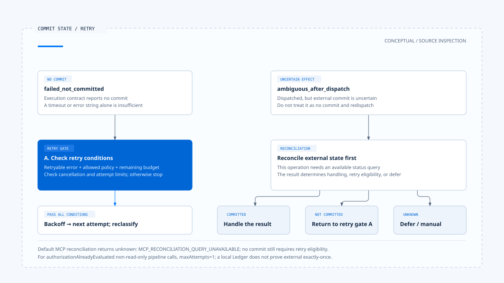
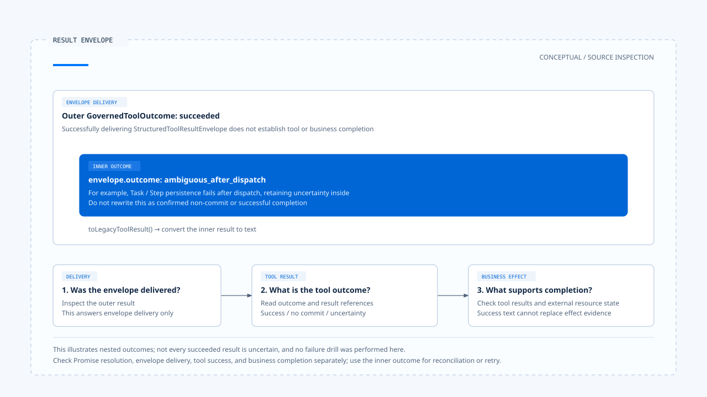

# Retries and side effects

[English](./05-retry-and-side-effects.md) | [繁體中文](./05-retry-and-side-effects-zh-TW.md)

[Back to overview](./README.md) · Previous: [Governed dispatch and execution isolation](./04-governed-dispatch-and-isolation.md) · Next: [A governed tool call](./06-case-governed-tool-call.md)

Calling a tool again after a timeout may only add cost for a public search, but can duplicate effects for email, payments, or file writes. Missing a success response does not mean the external service did not commit. Retries need operation state rather than error text alone.

Using the [pinned versions and evidence scope](./README.md#sources-and-verification-status), this article traces Chat Gun's runner, Ledger, reconciler, and compensation integration points. Email and payments above illustrate side effects; they do not establish production tools available in this version. No external commits or failure drills were performed during this work.

## 1. Which layer is repeating work?

Different layers can initiate repeated operations:

| Layer | Work repeated | Conditions to retain |
|---|---|---|
| Model loop | Propose a new Tool Call based on an error. | New proposal and authorization; old approval cannot be applied arbitrarily. |
| Tool execution runner | Add an attempt within the same execution contract. | Error classification, retry policy, budget, cancellation, and commit state. |
| Runtime recovery or replay | Reenter an existing Step or call. | Execution identity, existing records, argument consistency, and result reuse conditions. |

If all three retry independently, attempts accumulate. The design should assign ownership of the budget and final state. Adding retries to every function does not by itself establish a more reliable task.

## 2. Distinguish outcome semantics first

[`GovernedToolOutcome`][outcome] distinguishes these results:

| Type | Fact to retain |
|---|---|
| `succeeded` | The executor returned a successful result; output validation and persistence conditions may still follow. |
| `rejected_before_dispatch` | Rejected before dispatch; underlying execution cannot be claimed. |
| `denied_by_authorization` | Retains authorization denial and decision ID. |
| `confirmation_required` | Confirmation is still pending; approval cannot be assumed. |
| `failed_not_committed` | The execution contract reports failure without commit; policy then determines whether retry is allowed. |
| `ambiguous_after_dispatch` | Effects are uncertain after dispatch; non-commit cannot be assumed. |
| `cancelled` | Check `dispatchState` to distinguish cancellation before and after dispatch. |

These types are useful only if tools and adapters classify correctly. If an Adapter marks every timeout as not committed, the runner cannot reconstruct external facts from the label.

## 3. One execution and one business effect

### Different identities address different problems

For operations with a side-effect descriptor, [ToolExecutionRunner][runner] creates a replay key and asks the Ledger for existing executions. It separately retains request hashes, business effect identities, and each attempt.

- Replay keys locate existing records for the same execution identity.
- Request hashes check for conflicting input under the same identity.
- Business effect keys are derived by the tool descriptor from input and trusted Scope, then hashed.
- Attempt identities record individual attempts within the same execution.

`identity.ts` delegates part of its implementation to `@gun-ai/harness-kernel`; retry budget and error classification adapters do likewise. `backend/package.json` pins the package version here to `0.1.0-alpha.2`. This article follows host calls and consumed results without further auditing package-internal hashing or budget algorithms. [See the adapters and dependencies][identity], [budget], [package].

### The Ledger still has a boundary with external systems

[`BusinessEffectLedger`][ledger] describes execution state separately from business effect state. Before dispatch, the runner prepares records and acquires execution eligibility. If eligibility is not acquired or the Ledger is unavailable, it can return deferred.

A local Ledger transaction cannot itself include a third-party HTTP commit in the same database transaction. Avoiding duplicates end to end still requires external idempotency keys, queryable operation identities, or explicit manual handling.

## 4. Which existing results can be reused?

After finding an existing replay record, the runner first compares request hashes. A mismatch returns `SIDE_EFFECT_REPLAY_CONFLICT`. A record not yet committed returns a need for reconciliation rather than immediate redispatch.

Even a committed record requires a resolvable result reference, followed by result-policy checks for reuse. If the result reference is missing or the result cannot be retrieved, it can report `SIDE_EFFECT_COMMITTED_RESULT_UNAVAILABLE`.

This result preserves an often-erased distinction: the operation may be complete while a sufficient result for the reply is unavailable now. Reexecuting to recover a success message can instead create a second effect.

## 5. Conditions for retry

### Failures explicitly reported as not committed

In the runner's side-effect path, `failed_not_committed` requires a retryable error, policy permission for that category, and remaining retry budget before waiting for backoff and entering another attempt. Cancellation is also handled during the wait.

Read-only paths have their own loop. Their behavior cannot be applied to every write tool, and differences in budget availability cannot be omitted.

### Limits on authorized non-read-only dispatch

In the branch where `authorizationAlreadyEvaluated` is true and the descriptor is not read-only, the [pipeline][pipeline] sets the retry policy's `maxAttempts` to 1. This configures that invocation path; it does not mean every other entry point always attempts only once.

A descriptor having a retry policy therefore does not establish that an approved sensitive tool dispatches repeatedly automatically. Check the executor invocation path, runner input, and current budget.

## 6. Reconcile uncertain effects first

[`decideReconciliationAction()`][reconciler] makes these decisions:

- Reconciliation returns `committed`: proceed to committed-result handling.
- Reconciliation returns `not_committed` and retries are allowed: choose retry.
- Otherwise: defer.

The runner also handles reconciliation without results, state transition failures, and missing reconcilers. Without an available query, it can retain unknown state and turn to human intervention rather than guess that external execution never occurred.

### Limits of default MCP reconciliation

[MCP descriptor composition][descriptors] supplies side-effect descriptors for non-read-only tools, but its default reconciler returns `unknown` with reason `MCP_RECONCILIATION_QUERY_UNAVAILABLE`.

This integration point does not establish that the product can query the state of every external MCP operation. Safe retries for a specific tool require that tool's available reconciliation capability and result policy.

[Open the HTML diagram](../../assets/agent-harness/action-governance/05-retry-and-side-effects/05-commit-and-retry-en.html)

## 7. Compensation needs its own actions and conditions

For Tasks in eligible states, [`SagaOrchestratorImpl`][saga] processes successful Steps and registered compensation actions in reverse order. Irreversible actions record a need for human intervention; compensation failures also retain failure state and reasons.

Compensation does not automatically restore data to its original state:

- Deleting newly added data can require a different tool from restoring overwritten content.
- Messages already sent or data already used externally may not be retractable.
- Compensation itself changes resources and needs its own scope, permissions, and result evidence.

The pipeline can create an empty Compensation Registry by default and exposes `compensate()`. Without corresponding action registration and a triggering consumer, this does not establish automatic business recovery after task cancellation.

## 8. Outer success does not always mean tool success

The [pipeline][pipeline] puts the inner outcome into a [StructuredToolResultEnvelope][envelope], then returns the envelope with an outer `succeeded`. If Task/Step persistence fails after dispatch, the inner result may still retain `ambiguous_after_dispatch`.

Consumers should check at least:

1. Whether the outer result successfully delivered the envelope.
2. Whether `envelope.outcome` indicates tool success.
3. Whether business completion statements in the reply have corresponding results or external state evidence.

`toLegacyToolResult()` converts the envelope's inner result to text. Checking only the outermost Promise resolution or a `succeeded` label can still misreport success.

[Open the HTML diagram](../../assets/agent-harness/action-governance/05-retry-and-side-effects/05-result-envelope-en.html)

The next article uses the confirmation flow in a test to connect proposal, approval, and execution counts to the same call, then identifies side effect and deployment issues that the test does not cover.

[outcome]: https://github.com/HsienW/chat-gun/blob/92a5673003e4ac4ec09be8b1b350f42dbf4a5e69/backend/src/runtime/side-effect/governed-outcome.ts
[runner]: https://github.com/HsienW/chat-gun/blob/92a5673003e4ac4ec09be8b1b350f42dbf4a5e69/backend/src/runtime/side-effect/tool-execution-runner.ts
[identity]: https://github.com/HsienW/chat-gun/blob/92a5673003e4ac4ec09be8b1b350f42dbf4a5e69/backend/src/runtime/side-effect/identity.ts
[ledger]: https://github.com/HsienW/chat-gun/blob/92a5673003e4ac4ec09be8b1b350f42dbf4a5e69/backend/src/runtime/side-effect/business-effect-ledger.ts
[pipeline]: https://github.com/HsienW/chat-gun/blob/92a5673003e4ac4ec09be8b1b350f42dbf4a5e69/backend/src/runtime/tool-dispatch/pipeline.ts
[reconciler]: https://github.com/HsienW/chat-gun/blob/92a5673003e4ac4ec09be8b1b350f42dbf4a5e69/backend/src/runtime/side-effect/reconciler.ts
[descriptors]: https://github.com/HsienW/chat-gun/blob/92a5673003e4ac4ec09be8b1b350f42dbf4a5e69/backend/src/tools/production-runtime-tool-descriptors.ts
[saga]: https://github.com/HsienW/chat-gun/blob/92a5673003e4ac4ec09be8b1b350f42dbf4a5e69/backend/src/runtime/compensation/saga-orchestrator.ts
[envelope]: https://github.com/HsienW/chat-gun/blob/92a5673003e4ac4ec09be8b1b350f42dbf4a5e69/backend/src/runtime/tool-dispatch/structured-tool-result.ts
[budget]: https://github.com/HsienW/chat-gun/blob/92a5673003e4ac4ec09be8b1b350f42dbf4a5e69/backend/src/runtime/retry/retry-budget.ts
[package]: https://github.com/HsienW/chat-gun/blob/92a5673003e4ac4ec09be8b1b350f42dbf4a5e69/backend/package.json
