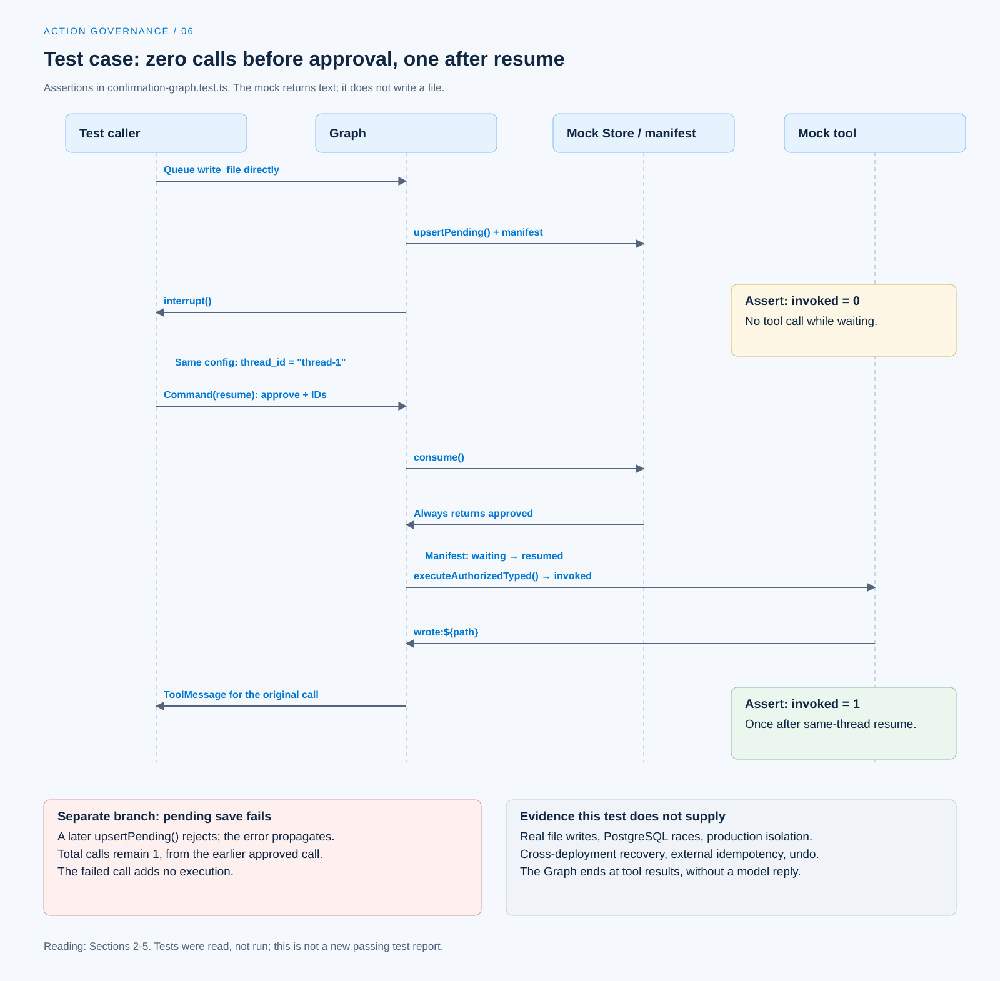

# 一次工具调用的治理流程

[English](./06-case-governed-tool-call.md) | [繁體中文](./06-case-governed-tool-call-zh-TW.md) | [简体中文](./06-case-governed-tool-call-zh-CN.md)

[回到导览](./README-zh-CN.md) · 上一篇：[重试与副作用处理](./05-retry-and-side-effects-zh-CN.md)

假设一个调用要执行 `write_file`，参数是 `{ path: "a.txt" }`。要说明「用户确认后才执行」，至少需要待确认状态、有效恢复数据，以及确认前后的底层调用次数。只有最后一段「已写入」的文字，无法说明中间发生了什么。

本篇沿 Chat Gun 的 [`confirmation-graph.test.ts`][graph-test] 阅读这条路径。这是测试代码定义的工具，实现只回传 `wrote:${path}`；它没有真的写入文件。源代码查读案例与固定版本源代码，没有执行测试、送出模型请求或取得正式部署纪录。来源范围见[本区导览](./README-zh-CN.md#来源与查证状态)。

## 1. 先交代案例的环境

### 测试工具与可信 Context

测试以 LangChain `tool()` 建立 `write_file`，输入 Schema 要求 `path` 为字符串。执行函数是 `vi.fn()`，因此可以断言调用次数。

它另外提供固定的 Request、Thread、Run、Task、Step 与 Tool Call 识别，以及 Principal、Tenant 与 Scope。这些是测试准备的 execution Context，不是模型自行输出的身份。

### 替身与验证边界

| 组件 | 测试中的安排 | 不能直接推论的事 |
|---|---|---|
| Tool | 返回 `wrote:${path}` 的 mock。 | 文件已写入或路径限制已验证。 |
| Authorization engine | Mock 返回需要确认的决策。 | 真实角色、grant 与租户政策通过。 |
| Confirmation Store | Mock 保存，consume 返回 approved。 | PostgreSQL 原子消费与期限判断已实际执行。 |
| Interrupt manifest repository | 在测试变数中保存并查找 manifest。 | 跨进程持久化与数据库竞态。 |
| Checkpointer | `MemorySaver`。 | 重启或跨部署恢复。 |

这个案例主要检查确认 Graph 的交接。授权引擎、Store 与隔离的其他条件，需要各自的证据。

## 2. 调用进入 gate，但还没执行

测试把 `write_file` 设为 `sensitive`，宣告 `tool:write`，并要求确认。其 ResourceRef 指向 `filesystem:write_file`；它没有把 `a.txt` 转成逐档授权资源。

测试直接把以下调用放进 queue，不先调用模型：

```json
{
  "toolName": "write_file",
  "toolCallId": "call-1",
  "input": {
    "path": "a.txt"
  }
}
```

[`authorizationGate()`][graph] 找到工具与治理执行器，调用 `authorizeTyped()`。治理包装取得需要确认的结果后，建立 descriptor；gate 保存 pending 数据与 interrupt manifest，并保留 active call。

若找不到可授权执行接口，这个节点改返回 `AUTHORIZATION_UNAVAILABLE` 的工具消息，不会直接派送。[治理包装与前置条件见此][governance]。

## 3. 在指定 thread 等待确认

测试 Graph 连接 gate、confirm 与 dispatch，并以 `thread_id: "thread-1"` 执行。确认节点核对 manifest 兼容性，再以 `interrupt()` 暂停。

测试源代码在这个时点断言：

- 返回一个 interrupt。
- `upsertPending()` 被调用一次。
- Manifest 的种类为 confirmation，状态为 waiting，并包含对应的 decision 与 approval 参照。
- 底层 `invoked` 尚未被调用。

这些断言指出了「尚未批准就不执行」应观察的位置。未重跑，不能把测试断言当成新产生的测试报告。

## 4. 恢复同一等待，再进入派送

### 使用 interrupt 中的识别

测试从 interrupt payload 取得 approval ID 与 decision ID，以同一份 config 送入 `Command` 的 resume：

```json
{
  "type": "tool_authorization_confirmation",
  "schemaVersion": "1.0",
  "approvalId": "<approvalId from interrupt>",
  "decisionId": "<decisionId from interrupt>",
  "decision": "approve"
}
```

这里的两个识别是示意占位符；实际测试使用前一返回中的值。任意文字「同意」不足以取代这份回应。

### 消费批准与执行一次

确认节点解析 resume，取得 execution Context，调用 Store 的 `consume()`。本案例的 mock 固定返回 approved，接着 Graph 要求 manifest 从 waiting 转为 resumed，保留 active call 并进入派送。

测试源代码接着断言：

- 恢复结果没有新的 interrupt。
- Pending 没有再次新增，consume 被调用一次。
- Manifest 透过 `transitionStatus()` 更新；测试另外断言其 `consume()` 没有被调用。
- 底层 `invoked` 共被调用一次。

`physicalDispatch()` 调用 `executeAuthorizedTyped()`，再将 outcome 转成关联原调用的 ToolMessage。该测试 Graph 到此结束，没有后续模型生成的完成回复。



[开启 HTML 图解](../../assets/agent-harness/action-governance/06-case-governed-tool-call/06-confirmation-case-swimlane-en.html)

## 5. 阻挡分支要看不同测试

### Pending 保存失败

同一份 Graph 测试最后让 `upsertPending()` 拒绝，再直接调用 gate。测试要求保存错误向外抛出，底层工具总次数仍维持一次。

这个断言的意思是：前面已批准的调用曾执行一次，后来保存失败的另一个调用没有增加执行。它不是「失败调用也执行了一次」。

### Store 的绑定与期限案例

[`confirmation.test.ts`][confirmation-test] 另有下列测试安排：

| 案例 | 原测试观察 | 范围限制 |
|---|---|---|
| 两次 consume | Mock 查询只允许一次取得 approved。 | 没有真实 PostgreSQL 的多连接竞态。 |
| 过期 | 返回 `CONFIRMATION_TIMEOUT` 并记录对应条件。 | Graph 恢复与工具未派送须另行整合验证。 |
| Principal／Scope／Run 不符 | 在消费 SQL 前拒绝。 | 身份来自测试 Context。 |
| 存储资源或 policy version 不符 | 条件查询未取得可消费纪录。 | 不是查询目前最新政策的完整测试。 |

明确 deny 的路径可在确认 Store 与 Graph 源代码追到；上述成功恢复案例没有把所有拒绝、过期与重播情境都跑过一遍。应逐一列出证据，避免将几份测试合称一个完整 E2E。

## 6. 如何对回正式 MCP Agent

[`mcp-agent.ts`][mcp] 使用同一个授权节点工厂，连接 `call_model`、`authorization_gate`、`authorization_confirmation` 与 `physical_dispatch`，再依剩余 queue 回到 gate 或模型。

正式入口与测试有几个差异：

- 模型是否提出工具，由实际 Provider 回应决定；测试直接放入 queue。
- 工具、授权及 Store 来自 [Registry 组装][registry]，不使用案例中固定 approved 的替身。
- 正式 Graph 调用 `builder.compile()`，其 checkpointer 由执行环境接续；不能套用测试中的 `MemorySaver` 推论部署持久化。
- MCP、完整 dispatch pipeline 与 profile enforcement 各有开关及必要依赖。

要把案例补成正式入口的执行实录，需记下版本、Graph、Provider、开关、可信 Context、实际提案、批准消费、底层执行次数，以及工具结果。需要文件效果时，还要检查实际资源。

## 7. 这个案例没有处理的提交窗口

假设真实工具已完成外部写入，但回应或后续持久化失败，批准流程成功也不能替我们判定外部状态。此时应使用[前篇](./05-retry-and-side-effects-zh-CN.md)的 outcome、Ledger 与回查条件，保留效果不明的可能。

本案例未使用真实文件工具、正式数据库、隔离 runner 或外部提交，因此不能支持端到端幂等、取消即还原，或故障后一定只执行一次的主张。

## 8. 对照其他产品时保留责任差异

[Foundations 的 README 修改案例](../foundations/05-one-turn-walkthrough-zh-CN.md) 描述完整任务的读文件、提案、批准与写入。CCB 的 [Permission 执行路径][ccb-execution] 可对照最终决策与工具调用的位置，但不能直接当成 Chat Gun 的 descriptor 或确认 Store。

本篇串起的是一个可查对的控制流程：先保存等待，再恢复指定批准，最后才进入工具执行。要声称任务已完成，还须把这些控制证据与真正的资源效果、工具结果及用户回复连起来。

[graph-test]: https://github.com/HsienW/chat-gun/blob/92a5673003e4ac4ec09be8b1b350f42dbf4a5e69/backend/src/runtime/authorization/confirmation-graph.test.ts
[graph]: https://github.com/HsienW/chat-gun/blob/92a5673003e4ac4ec09be8b1b350f42dbf4a5e69/backend/src/runtime/authorization/confirmation-graph.ts
[governance]: https://github.com/HsienW/chat-gun/blob/92a5673003e4ac4ec09be8b1b350f42dbf4a5e69/backend/src/platform/tool-governance.ts
[confirmation-test]: https://github.com/HsienW/chat-gun/blob/92a5673003e4ac4ec09be8b1b350f42dbf4a5e69/backend/src/runtime/authorization/confirmation.test.ts
[mcp]: https://github.com/HsienW/chat-gun/blob/92a5673003e4ac4ec09be8b1b350f42dbf4a5e69/backend/src/agents/mcp-agent.ts
[registry]: https://github.com/HsienW/chat-gun/blob/92a5673003e4ac4ec09be8b1b350f42dbf4a5e69/backend/src/tools/registry.ts
[ccb-execution]: https://github.com/claude-code-best/claude-code/blob/77a7934e15d69da13879112ed7db695c9ee7a52a/src/services/tools/toolExecution.ts
