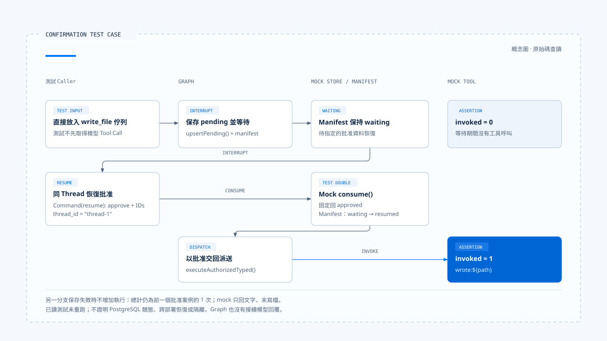

# 一次工具呼叫的治理流程

[English](./06-case-governed-tool-call.md) | [繁體中文](./06-case-governed-tool-call-zh-TW.md)

[回到導覽](./README-zh-TW.md) · 上一篇：[重試與副作用處理](./05-retry-and-side-effects-zh-TW.md)

假設一個呼叫要執行 `write_file`，參數是 `{ path: "a.txt" }`。要說明「使用者確認後才執行」，至少需要待確認狀態、有效恢復資料，以及確認前後的底層呼叫次數。只有最後一段「已寫入」的文字，無法說明中間發生了什麼。

本篇沿 Chat Gun 的 [`confirmation-graph.test.ts`][graph-test] 閱讀這條路徑。這是測試程式定義的工具，實作只回傳 `wrote:${path}`；它沒有真的寫入檔案。本輪查讀案例與固定版本原始碼，沒有執行測試、送出模型請求或取得正式部署紀錄。來源範圍見[本區導覽](./README-zh-TW.md#來源與查證狀態)。

## 1. 先交代案例的環境

### 測試工具與可信 Context

測試以 LangChain `tool()` 建立 `write_file`，輸入 Schema 要求 `path` 為字串。執行函式是 `vi.fn()`，因此可以斷言呼叫次數。

它另外提供固定的 Request、Thread、Run、Task、Step 與 Tool Call 識別，以及 Principal、Tenant 與 Scope。這些是測試準備的 execution Context，不是模型自行輸出的身分。

### 替身與驗證邊界

| 元件 | 測試中的安排 | 不能直接推論的事 |
|---|---|---|
| Tool | 回傳 `wrote:${path}` 的 mock。 | 檔案已寫入或路徑限制已驗證。 |
| Authorization engine | Mock 回傳需要確認的決策。 | 真實角色、grant 與租戶政策通過。 |
| Confirmation Store | Mock 保存，consume 回傳 approved。 | PostgreSQL 原子消費與期限判斷已實際執行。 |
| Interrupt manifest repository | 在測試變數中保存並查找 manifest。 | 跨程序持久化與資料庫競態。 |
| Checkpointer | `MemorySaver`。 | 重啟或跨部署恢復。 |

這個案例主要檢查確認 Graph 的交接。授權引擎、Store 與隔離的其他條件，需要各自的證據。

## 2. 呼叫進入 gate，但還沒執行

測試把 `write_file` 設為 `sensitive`，宣告 `tool:write`，並要求確認。其 ResourceRef 指向 `filesystem:write_file`；它沒有把 `a.txt` 轉成逐檔授權資源。

測試直接把以下呼叫放進 queue，不先呼叫模型：

```json
{
  "toolName": "write_file",
  "toolCallId": "call-1",
  "input": {
    "path": "a.txt"
  }
}
```

[`authorizationGate()`][graph] 找到工具與治理執行器，呼叫 `authorizeTyped()`。治理包裝取得需要確認的結果後，建立 descriptor；gate 保存 pending 資料與 interrupt manifest，並保留 active call。

若找不到可授權執行介面，這個節點改回傳 `AUTHORIZATION_UNAVAILABLE` 的工具訊息，不會直接派送。[治理包裝與前置條件見此][governance]。

## 3. 在指定 thread 等待確認

測試 Graph 連接 gate、confirm 與 dispatch，並以 `thread_id: "thread-1"` 執行。確認節點核對 manifest 相容性，再以 `interrupt()` 暫停。

測試原始碼在這個時點斷言：

- 回傳一個 interrupt。
- `upsertPending()` 被呼叫一次。
- Manifest 的種類為 confirmation，狀態為 waiting，並包含對應的 decision 與 approval 參照。
- 底層 `invoked` 尚未被呼叫。

這些斷言指出了「尚未批准就不執行」應觀察的位置。本輪沒有重跑，不能把預定斷言當成新產生的測試報告。

## 4. 恢復同一等待，再進入派送

### 使用 interrupt 中的識別

測試從 interrupt payload 取得 approval ID 與 decision ID，以同一份 config 送入 `Command` 的 resume：

```json
{
  "type": "tool_authorization_confirmation",
  "schemaVersion": "1.0",
  "approvalId": "<approvalId from interrupt>",
  "decisionId": "<decisionId from interrupt>",
  "decision": "approve"
}
```

這裡的兩個識別是示意佔位符；實際測試使用前一回傳中的值。任意文字「同意」不足以取代這份回應。

### 消費批准與執行一次

確認節點解析 resume，取得 execution Context，呼叫 Store 的 `consume()`。本案例的 mock 固定回傳 approved，接著 Graph 要求 manifest 從 waiting 轉為 resumed，保留 active call 並進入派送。

測試原始碼接著斷言：

- 恢復結果沒有新的 interrupt。
- Pending 沒有再次新增，consume 被呼叫一次。
- Manifest 透過 `transitionStatus()` 更新；測試另外斷言其 `consume()` 沒有被呼叫。
- 底層 `invoked` 共被呼叫一次。

`physicalDispatch()` 呼叫 `executeAuthorizedTyped()`，再將 outcome 轉成關聯原呼叫的 ToolMessage。該測試 Graph 到此結束，沒有後續模型生成的完成回覆。



[開啟 HTML 圖解](../../assets/agent-harness/action-governance/06-case-governed-tool-call/06-confirmation-case-swimlane.html)

## 5. 阻擋分支要看不同測試

### Pending 保存失敗

同一份 Graph 測試最後讓 `upsertPending()` 拒絕，再直接呼叫 gate。測試要求保存錯誤向外拋出，底層工具總次數仍維持一次。

這個斷言的意思是：前面已批准的呼叫曾執行一次，後來保存失敗的另一個呼叫沒有增加執行。它不是「失敗呼叫也執行了一次」。

### Store 的綁定與期限案例

[`confirmation.test.ts`][confirmation-test] 另有下列測試安排：

| 案例 | 原測試觀察 | 範圍限制 |
|---|---|---|
| 兩次 consume | Mock 查詢只允許一次取得 approved。 | 沒有真實 PostgreSQL 的多連線競態。 |
| 過期 | 返回 `CONFIRMATION_TIMEOUT` 並記錄對應條件。 | Graph 恢復與工具未派送須另行整合驗證。 |
| Principal／Scope／Run 不符 | 在消費 SQL 前拒絕。 | 身分來自測試 Context。 |
| 儲存資源或 policy version 不符 | 條件查詢未取得可消費紀錄。 | 不是查詢目前最新政策的完整測試。 |

明確 deny 的路徑可在確認 Store 與 Graph 原始碼追到；上述成功恢復案例沒有把所有拒絕、過期與重播情境都跑過一遍。應逐一列出證據，避免將幾份測試合稱一個完整 E2E。

## 6. 如何對回正式 MCP Agent

[`mcp-agent.ts`][mcp] 使用同一個授權節點工廠，連接 `call_model`、`authorization_gate`、`authorization_confirmation` 與 `physical_dispatch`，再依剩餘 queue 回到 gate 或模型。

正式入口與測試有幾個差異：

- 模型是否提出工具，由實際 Provider 回應決定；測試直接放入 queue。
- 工具、授權及 Store 來自 [Registry 組裝][registry]，不使用案例中固定 approved 的替身。
- 正式 Graph 呼叫 `builder.compile()`，其 checkpointer 由執行環境接續；不能套用測試中的 `MemorySaver` 推論部署持久化。
- MCP、完整 dispatch pipeline 與 profile enforcement 各有開關及必要依賴。

要把案例補成正式入口的執行實錄，需記下版本、Graph、Provider、開關、可信 Context、實際提案、批准消費、底層執行次數，以及工具結果。需要檔案效果時，還要檢查實際資源。

## 7. 這個案例沒有處理的提交窗口

假設真實工具已完成外部寫入，但回應或後續持久化失敗，批准流程成功也不能替我們判定外部狀態。此時應使用[前篇](./05-retry-and-side-effects-zh-TW.md)的 outcome、Ledger 與回查條件，保留效果不明的可能。

本案例未使用真實檔案工具、正式資料庫、隔離 runner 或外部提交，因此不能支持端到端冪等、取消即還原，或故障後一定只執行一次的主張。

## 8. 對照其他產品時保留責任差異

[Foundations 的 README 修改案例](../foundations/05-one-turn-walkthrough-zh-TW.md) 描述完整任務的讀檔、提案、批准與寫入。CCB 的 [Permission 執行路徑][ccb-execution] 可對照最終決策與工具呼叫的位置，但不能直接當成 Chat Gun 的 descriptor 或確認 Store。

本篇串起的是一個可查對的控制流程：先保存等待，再恢復指定批准，最後才進入工具執行。要聲稱任務已完成，還須把這些控制證據與真正的資源效果、工具結果及使用者回覆連起來。

[graph-test]: https://github.com/HsienW/chat-gun/blob/92a5673003e4ac4ec09be8b1b350f42dbf4a5e69/backend/src/runtime/authorization/confirmation-graph.test.ts
[graph]: https://github.com/HsienW/chat-gun/blob/92a5673003e4ac4ec09be8b1b350f42dbf4a5e69/backend/src/runtime/authorization/confirmation-graph.ts
[governance]: https://github.com/HsienW/chat-gun/blob/92a5673003e4ac4ec09be8b1b350f42dbf4a5e69/backend/src/platform/tool-governance.ts
[confirmation-test]: https://github.com/HsienW/chat-gun/blob/92a5673003e4ac4ec09be8b1b350f42dbf4a5e69/backend/src/runtime/authorization/confirmation.test.ts
[mcp]: https://github.com/HsienW/chat-gun/blob/92a5673003e4ac4ec09be8b1b350f42dbf4a5e69/backend/src/agents/mcp-agent.ts
[registry]: https://github.com/HsienW/chat-gun/blob/92a5673003e4ac4ec09be8b1b350f42dbf4a5e69/backend/src/tools/registry.ts
[ccb-execution]: https://github.com/claude-code-best/claude-code/blob/77a7934e15d69da13879112ed7db695c9ee7a52a/src/services/tools/toolExecution.ts
