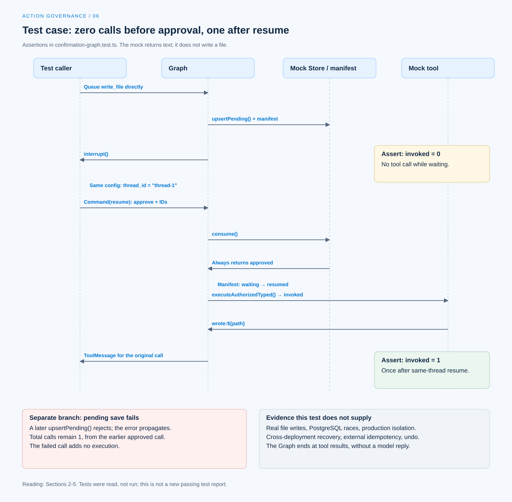

# A governed tool call

[English](./06-case-governed-tool-call.md) | [繁體中文](./06-case-governed-tool-call-zh-TW.md)

[Back to overview](./README.md) · Previous: [Retries and side effects](./05-retry-and-side-effects.md)

Suppose a call executes `write_file` with arguments `{ path: "a.txt" }`. Explaining that execution occurs only after user confirmation requires at least pending confirmation state, valid resume data, and underlying call counts before and after confirmation. A final message saying that the file was written cannot explain the intervening steps.

This article follows the path in Chat Gun's [`confirmation-graph.test.ts`][graph-test]. The test defines the tool, whose implementation only returns `wrote:${path}`; it does not actually write a file. This work inspected the case and source at the pinned version without running tests, sending model requests, or obtaining production deployment records. See the [section overview](./README.md#sources-and-verification-status) for source scope.

## 1. Establish the case environment

### Test tool and trusted Context

The test creates `write_file` with LangChain `tool()`, using an input Schema that requires a string `path`. Its execution function is `vi.fn()`, enabling call-count assertions.

It also supplies fixed Request, Thread, Run, Task, Step, and Tool Call identities, along with Principal, Tenant, and Scope. These form execution Context prepared by the test, not identity emitted by the model.

### Test doubles and verification boundaries

| Component | Test arrangement | What it does not establish |
|---|---|---|
| Tool | Mock returning `wrote:${path}`. | Actual file writes or verified path restrictions. |
| Authorization engine | Mock returning a decision requiring confirmation. | Real role, grant, and tenant policies passing. |
| Confirmation Store | Mock persistence; consume returns approved. | Actual PostgreSQL atomic consumption and expiry checks. |
| Interrupt manifest repository | Saves and finds manifests in test variables. | Cross-process persistence and database concurrency. |
| Checkpointer | `MemorySaver`. | Recovery after restart or across deployments. |

This case mainly checks the confirmation Graph handoff. Other conditions in the authorization engine, Store, and isolation need their own evidence.

## 2. The call enters the gate without executing yet

The test classifies `write_file` as `sensitive`, declares `tool:write`, and requires confirmation. Its ResourceRef points to `filesystem:write_file`; it does not turn `a.txt` into a per-file authorization resource.

The test places this call directly in the queue without first calling the model:

```json
{
  "toolName": "write_file",
  "toolCallId": "call-1",
  "input": {
    "path": "a.txt"
  }
}
```

[`authorizationGate()`][graph] finds the tool and governance executor and calls `authorizeTyped()`. After receiving a result requiring confirmation, the governance wrapper creates a descriptor. The gate saves pending data and the interrupt manifest and retains the active call.

If no authorizable execution interface exists, this node instead returns a tool message with `AUTHORIZATION_UNAVAILABLE`, without direct dispatch. [See the governance wrapper and preconditions][governance].

## 3. Wait for confirmation on the specified thread

The test Graph connects gate, confirm, and dispatch, and runs with `thread_id: "thread-1"`. The confirmation node checks manifest compatibility, then pauses with `interrupt()`.

At this point, the test source asserts:

- One interrupt is returned.
- `upsertPending()` was called once.
- The manifest kind is confirmation, its state is waiting, and it contains corresponding decision and approval references.
- The underlying `invoked` has not been called.

These assertions identify where to observe no execution before approval. They were not rerun during this work, so intended assertions cannot be presented as a newly generated test report.

## 4. Resume the same wait, then enter dispatch

### Use identities from the interrupt

The test obtains approval ID and decision ID from the interrupt payload, then passes this resume payload through `Command` with the same config:

```json
{
  "type": "tool_authorization_confirmation",
  "schemaVersion": "1.0",
  "approvalId": "<approvalId from interrupt>",
  "decisionId": "<decisionId from interrupt>",
  "decision": "approve"
}
```

The two identities here are illustrative placeholders; the actual test uses values from the preceding return. Arbitrary text expressing agreement cannot replace this response.

### Consume approval and execute once

The confirmation node parses resume data, obtains execution Context, and calls the Store's `consume()`. This case's mock always returns approved. The Graph then requests a manifest transition from waiting to resumed, retains the active call, and enters dispatch.

The test source then asserts:

- The resumed result contains no new interrupt.
- Pending data was not inserted again, and consume was called once.
- The manifest was updated through `transitionStatus()`; the test separately asserts that its `consume()` was not called.
- The underlying `invoked` was called once in total.

`physicalDispatch()` calls `executeAuthorizedTyped()`, then converts the outcome into a ToolMessage correlated with the original call. This test Graph ends there, without a subsequent model-generated completion reply.



[Open the HTML diagram](../../assets/agent-harness/action-governance/06-case-governed-tool-call/06-confirmation-case-swimlane-en.html)

## 5. Blocking branches require different tests

### Saving pending data fails

At the end of the same Graph test, `upsertPending()` is made to reject and the gate is called directly. The test requires the persistence error to propagate and the underlying tool's total call count to remain one.

This means the earlier approved call executed once, while the later call whose persistence failed added no execution. It does not mean the failed call also executed once.

### Store binding and expiry cases

[`confirmation.test.ts`][confirmation-test] separately defines these test arrangements:

| Case | Original test observation | Scope limit |
|---|---|---|
| Two consume calls | Mock queries permit obtaining approved only once. | No real PostgreSQL race across multiple connections. |
| Expiry | Returns `CONFIRMATION_TIMEOUT` and records corresponding conditions. | Graph resumption and absence of dispatch need separate integration verification. |
| Principal/Scope/Run mismatch | Rejected before consumption SQL. | Identity comes from test Context. |
| Stored resource or policy version mismatch | The conditional query finds no consumable record. | Not a complete test of querying the latest current policy. |

Explicit deny paths can be traced in confirmation Store and Graph source. The successful resumption case above does not exercise every denial, expiry, and replay scenario. List evidence individually rather than call several tests one complete E2E test.

## 6. Relating the case to the production MCP Agent

[`mcp-agent.ts`][mcp] uses the same authorization node factory to connect `call_model`, `authorization_gate`, `authorization_confirmation`, and `physical_dispatch`, then returns to the gate or model according to the remaining queue.

Production entry points differ from the test in several ways:

- Whether the model proposes a tool depends on actual Provider responses; the test inserts directly into the queue.
- Tools, authorization, and Stores come from [Registry composition][registry], rather than the case's always-approved doubles.
- The production Graph calls `builder.compile()`, with checkpointing supplied through the execution environment. The test's `MemorySaver` does not establish deployment persistence.
- MCP, the full dispatch pipeline, and profile enforcement have separate flags and required dependencies.

Turning this case into an execution record of a production entry point requires recording the version, Graph, Provider, flags, trusted Context, actual proposal, approval consumption, underlying execution count, and tool result. File effects also require inspecting the actual resource.

## 7. Commit windows this case does not handle

Suppose a real tool completes an external write but its response or subsequent persistence fails. A successful approval flow still cannot determine external state. Use the [previous article's](./05-retry-and-side-effects.md) outcomes, Ledger, and reconciliation conditions to retain the possibility of uncertain effects.

This case uses no real file tool, production database, isolation runner, or external commit. It therefore cannot support claims of end-to-end idempotency, cancellation restoring state, or execution guaranteed to occur only once after failure.

## 8. Retain responsibility differences across products

The [Foundations README-editing scenario](../foundations/05-one-turn-walkthrough.md) describes file reading, proposals, approval, and writing across a complete task. CCB's [Permission execution path][ccb-execution] provides a comparison for final decisions and tool calls, but cannot substitute for Chat Gun descriptors or its confirmation Store.

This article connects an inspectable control flow: save the wait, resume the specified approval, and only then enter tool execution. Claiming task completion still requires connecting that control evidence to actual resource effects, tool results, and the user-facing reply.

[graph-test]: https://github.com/HsienW/chat-gun/blob/92a5673003e4ac4ec09be8b1b350f42dbf4a5e69/backend/src/runtime/authorization/confirmation-graph.test.ts
[graph]: https://github.com/HsienW/chat-gun/blob/92a5673003e4ac4ec09be8b1b350f42dbf4a5e69/backend/src/runtime/authorization/confirmation-graph.ts
[governance]: https://github.com/HsienW/chat-gun/blob/92a5673003e4ac4ec09be8b1b350f42dbf4a5e69/backend/src/platform/tool-governance.ts
[confirmation-test]: https://github.com/HsienW/chat-gun/blob/92a5673003e4ac4ec09be8b1b350f42dbf4a5e69/backend/src/runtime/authorization/confirmation.test.ts
[mcp]: https://github.com/HsienW/chat-gun/blob/92a5673003e4ac4ec09be8b1b350f42dbf4a5e69/backend/src/agents/mcp-agent.ts
[registry]: https://github.com/HsienW/chat-gun/blob/92a5673003e4ac4ec09be8b1b350f42dbf4a5e69/backend/src/tools/registry.ts
[ccb-execution]: https://github.com/claude-code-best/claude-code/blob/77a7934e15d69da13879112ed7db695c9ee7a52a/src/services/tools/toolExecution.ts
