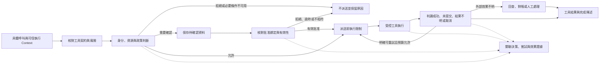

# Action Governance

[English](./README.md) | [繁體中文](./README-zh-TW.md) | [简体中文](./README-zh-CN.md)

本篇章接在 [Behavior and Capabilities](../behavior-and-capabilities/README-zh-CN.md) 之后。前区说明能力如何进入任务，以及由模型还是程序提出调用；本篇章从具体工具名称、参数与可信执行条件开始，追踪能否执行、何时需要确认，以及派送后如何交代结果。

## 阅读顺序

| 篇次 | 文章 | 要回答的问题 | 文件名 |
|---|---|---|---|
| 01 | [工具风险与行动契约](./01-tool-risk-and-contracts-zh-CN.md) | 同一个工具的不同操作，要交付哪些可检查的条件？ | `01-tool-risk-and-contracts-zh-CN.md` |
| 02 | [授权身份与资源范围](./02-authorization-and-scope-zh-CN.md) | 谁能对哪个资源执行这一次操作？ | `02-authorization-and-scope-zh-CN.md` |
| 03 | [人工确认与批准有效性](./03-human-confirmation-zh-CN.md) | 用户的一次同意，究竟批准了什么？ | `03-human-confirmation-zh-CN.md` |
| 04 | [受控派送与执行隔离](./04-governed-dispatch-and-isolation-zh-CN.md) | 获准之后，如何限制工具实际能做的事？ | `04-governed-dispatch-and-isolation-zh-CN.md` |
| 05 | [重试与副作用处理](./05-retry-and-side-effects-zh-CN.md) | 调用失败、超时或结果不明时，能否再做一次？ | `05-retry-and-side-effects-zh-CN.md` |
| 06 | [一次工具调用的治理流程](./06-case-governed-tool-call-zh-CN.md) | 提案、授权、确认、派送与结果，如何连回同一项任务？ | `06-case-governed-tool-call-zh-CN.md` |

## 架构与责任范围

下图是文章使用的概念模型。方块不是两个代码库共同使用的类型或完整执行时序；实现中的检查顺序、提前返回及开关条件，须由各篇对照具体 consumer。

本篇章与其他分类的分工如下：

- **Foundations** 提供 Harness／Runtime 责任与一般设计原则；本篇章展开具体调用的决策、派送及效果证据。
- **Input and Context** 处理材料来源与指令权威；外部文字即使诱导模型提出调用，也不能提供可信授权身份。
- **Behavior and Capabilities** 处理能力组装与候选范围；本篇章不重讲 loader、工具池合并或模型选工具的流程。
- **Interaction and Feedback** 将处理一般 Run ownership、generation、新输入、取消与回复评估。本篇章只保留批准交接，以及取消对单次工具效果的影响。

## 01. 工具风险与行动契约

### 文章范围

从一个具体工具调用开始，区分名称、输入 Schema、执行函数，以及治理需要的 action、resource、风险与执行条件。能力描述提供模型选择依据；行动契约还要让程序能检查这次操作。

预定段落：

1. Tool Call 交付哪些数据，哪些可信字段必须另由执行入口提供。
2. Chat Gun 的 `ToolRiskPolicy`：`riskTier`、`actions`、`requireConfirmation` 与 `resourceRefResolver`。
3. 读取、写入、敏感操作与对外沟通的分类，如何影响确认条件。
4. CCB `Tool` 的 Schema、`validateInput()`、`checkPermissions()`、`call()` 与并行安全判断，分别在哪里使用。
5. 未注册工具、未宣告 action、参数不合法及分类失败的返回方式。

### 写作与查证要求

- `ToolRiskRegistry` 支持未注册工具默认为 `read` 或 `deny`；不能把类别的可配置能力写成所有入口一律默认拒绝。正文须继续追到 Registry 的实际建构设置。
- 风险分类、输入合法与资源授权分开说明；`read` 不等于无风险，Schema 通过也不等于获准。
- 图解候选：同一工具描述如何对回输入契约、风险政策与执行接口。

主要来源：[G1][g-risk]、[G2][g-governance]、[C1][c-tool]、[C2][c-execution]。

## 02. 授权身份与资源范围

### 文章范围

从可信 Principal、Tenant、Scope 与 ResourceRef 组成授权要求，追踪 policy、grant、资源归属及 Context 条件如何形成决策。CCB 用来对照 Coding Agent 的 Permission consumer，不套用 Chat Gun 的身份类型。

预定段落：

1. 身份来自哪个可信入口；模型参数与外部内容不能自行宣告身份。
2. Chat Gun 的租户、账号、active scope 与读写范围检查。
3. Policy authority、资源 owner 与有效 grant 的关系。
4. `allow`、`deny`、`require_confirmation`，以及 `AUTHORIZATION_UNAVAILABLE` 的消费方式。
5. CCB 的 `hasPermissionsToUseTool()`、`useCanUseTool()` 与工具执行路径如何交接。
6. 决策与调用的关联：decision、policy version、resource 与执行识别。

### 写作与查证要求

- 比较跨租户、缺少 scope、过期或撤销 grant、必要授权依赖失败等分支；不把所有拒绝合并成一种工具错误。
- `GovernanceExecutor.authorizeTyped()` 在未配置 authorization 时有直接允许分支；必要政策是否存在，须由组装与入口证据确认。
- 图解候选：可信身份、资源与政策进入决策，和模型提供工具参数的不同来源。

主要来源：[G3][g-authorization]、[G2][g-governance]、[C3][c-permissions]、[C4][c-can-use-tool]。

## 03. 人工确认与批准有效性

### 文章范围

说明需要确认的调用如何保存、呈现与恢复，以及如何核对批准者、Run、Scope、决策识别及有效期限。一般对话中的「同意」与可被消费的批准数据应分开处理。

预定段落：

1. 何时进入 `confirmation_required`；确认不能扩大原有授权边界。
2. `ConfirmationRequiredDescriptor`、待确认数据与 interrupt manifest 的交接。
3. `approve`／`deny` resume payload，以及可信批准者与执行绑定。
4. 重复批准、超时、绑定不符与 manifest 不兼容的分支。
5. 批准后如何到达 `executeAuthorizedTyped()`；哪些检查会重做，哪些沿用前次决策。
6. CCB 的互动确认、用户调整输入与 Permission 更新，和 Chat Gun 的差异。

### 写作与查证要求

- `confirmation.ts` 的数据绑定与原子消费，可以作为实现追踪；参数杂凑、资源版本与最新政策的重新核对，须另外找 consumer，不能因 descriptor 有 `policyVersion` 就宣称全部成立。
- `executeAuthorizedTyped()` 有沿用授权结果的路径；将「等待后应重新判定」的设计建议与实际调用顺序分开。
- 不从内存 checkpointer 或 mock Store 推论跨进程持久化、正式数据库竞态或跨部署恢复已验证。
- 图解候选：待确认、有效批准、拒绝、过期与重播的状态及执行次数。

主要来源：[G4][g-confirmation]、[G5][g-confirmation-graph]、[G6][g-confirmation-test]、[G7][g-graph-test]、[C5][c-interactive]。

## 04. 受控派送与执行隔离

### 文章范围

从已获准的调用追到实际工具执行，分开说明治理包装、完整 dispatch pipeline 与 ExecutionProfile enforcement。获准使用工具，仍需核对工具可访问哪些程序、文件、网络与 secret。

预定段落：

1. Agent → Registry → governance wrapper → 可选 dispatch pipeline 的实际接线。
2. Descriptor、输入验证、必要依赖与 canonical execution Context。
3. Scheduler、rate limiter、circuit breaker 与 step lock 的不同职责。
4. `trusted_in_process`／`isolated_process`、profile 版本与 runner capability matching。
5. Secret reference 与 credential value、egress 决策与安全证据。
6. Timeout、AbortSignal、派送前取消与已开始外部 I/O 的差别。
7. CCB 依 `isConcurrencySafe()` 分批的对照，以及它不能单独提供的跨进程保证。

### 写作与查证要求

- 沿来源开关与实际 consumer 说明覆盖范围；不能把 pipeline 关闭写成所有治理都消失，也不能把 wrapper 存在写成隔离已启用。
- 固定版本的安全文件注明没有 production `SandboxRunnerPort`；正文需区分接口、测试 runner、部署 runner 与 enforcement 启用条件。
- 将只读、可并行与资源锁分开；单程序排序不等于多实例的资源互斥。
- 图解候选：授权、profile、secret／egress 与工具执行的交接，并标出拒绝出口。

主要来源：[G2][g-governance]、[G8][g-pipeline]、[G9][g-profile]、[G10][g-isolation-doc]、[C6][c-orchestration]。Registry 建构、scheduler、lock、egress 与 secret consumer 的补查结果已纳入第四篇。

## 05. 重试与副作用处理

### 文章范围

从「工具调用失败」拆出派送前拒绝、明确未提交、派送后效果不明及取消。再说明哪些证据允许重试，哪些情况需要回查、对账、补偿或人工介入。

预定段落：

1. 模型重新提案、工具重试与 Runtime 恢复的不同责任及预算。
2. `GovernedToolOutcome` 的成功、拒绝、未提交、效果不明与取消语义。
3. Execution attempt、replay key、request hash 与 business effect key 的用途。
4. Ledger 的准备、执行、提交及未知状态；本地纪录与外部提交的边界。
5. 结果重用、reconciliation 与允许重试的前提。
6. 补偿与人工介入；取消或重新执行不能自行还原已发生的效果。
7. Structured result envelope 与外层成功返回，为何还要检查内层 outcome。

### 写作与查证要求

- 不把 Ledger、锁或 replay key 的存在写成端到端 exactly-once；外部系统的幂等及查询能力仍须查证。
- `ambiguous_after_dispatch` 不直接导向重新派送；要指出可用的 reconcile consumer、其结果与预算。
- 核对已授权的非只读派送限制尝试次数的分支，不概括所有工具都使用相同 retry policy。
- 第五篇已补查 identity、retry budget、reconciler 与 compensation 的 host consumer；部分函数委派给固定版本的 `@gun-ai/harness-kernel`，套件内部演算法尚未进一步审计。
- 图解候选：外部已提交但回应遗失时，执行纪录、业务效果与回复如何分离。

主要来源：[G11][g-outcome]、[G12][g-runner]、[G13][g-ledger]、[G8][g-pipeline]、[G14][g-retry]。

## 06. 一次工具调用的治理流程

### 主案例与对照

采用 Chat Gun `confirmation-graph.test.ts` 的 `write_file` 测试情境，追踪可信 execution Context、敏感工具政策、待确认状态、同一 thread 恢复与底层工具调用次数。这是测试程序定义的工具与环境；不将它写成 Chat Gun 正式入口已提供的文件写入能力。

预定段落：

1. 列出固定版本、测试工具、Schema、policy、Store、checkpointer 与 mock 的范围。
2. 从具体调用进入 gate；在确认前核对底层工具尚未执行。
3. 恢复指定等待、消费批准，再追到 physical dispatch 与 ToolMessage。
4. 对照拒绝、过期、重播与错误绑定；每个分支注明原测试是否涵盖。
5. 将同一观察方式对回 MCP Agent 正式接线；未读取或未执行的部分标明缺口。
6. 另列派送后结果不明的故障情境，接回第五篇；不宣称确认测试已验证外部副作用幂等。
7. 对照 Foundations 的 README 修改案例与 CCB Permission consumer，保留产品与类型差异。

### 所需证据

| 主张 | 预计核对的证据 |
|---|---|
| 未批准前不执行 | 待确认状态、工具 mock 调用次数与 gate 返回。 |
| 批准对到指定调用 | Descriptor、resume、可信身份、Run／Scope、manifest 与消费结果。 |
| 拒绝或过期未派送 | 分支结果、底层调用次数，以及原测试覆盖范围。 |
| 工具实际产生效果 | 工具执行纪录与资源状态；mock 返回不能替代。 |
| 正式入口维持同样条件 | MCP Agent 接线、设置、数据库／runner 及相应整合或 E2E 证据。 |

图解候选：同一调用在 gate、等待、恢复、派送与结果之间的泳道图。若后续制图，沿用 SVG／HTML 及英文 `-en` 分档方式；目前只规划图意。

主要来源：[G7][g-graph-test]、[G6][g-confirmation-test]、[G5][g-confirmation-graph]，以及 [Foundations 任务案例](../foundations/05-one-turn-walkthrough-zh-CN.md)。第六篇已对照正式 MCP Agent、mock Store 与测试使用的 `MemorySaver`，并分开记录证据范围。

## 来源与查证状态

GUN-ATLAS v1.0（2026-10-12）提供定位；本篇章沿用前区的固定版本，避免混入浮动分支的新行为。规划与正文于 2026-10-23 透过 GitHub 查读所列程序与文件。用户指定的 session 文件未能定位，因此不将其内容列为已读证据；附件中的面试回答规则也不作为本篇章文章格式。

| 来源 | 固定版本 | 使用范围 |
|---|---|---|
| [Chat Gun](https://github.com/HsienW/chat-gun) | `92a5673003e4ac4ec09be8b1b350f42dbf4a5e69` | 行动契约、授权、确认、派送、隔离与副作用。 |
| [Claude Code Best](https://github.com/claude-code-best/claude-code) | `77a7934e15d69da13879112ed7db695c9ee7a52a` | 第三方 Coding Agent 的 Tool、Permission consumer、互动确认与工具调度。 |

本篇章的 CCB 指 Claude Code Best，不把它当成 Anthropic 官方现行实现。已读测试代表知道案例内容，未代表本轮执行通过；本轮没有执行 unit、integration、E2E、外部 MCP、真实 Provider、数据库竞态或部署故障演练。

### 主要来源索引

以下连结固定到上述 commit；正文新增的 consumer 另列于后方，各篇也提供直接来源连结。

| 索引 | 路径 | 本轮查读用途 |
|---|---|---|
| [G1][g-risk] | `backend/src/runtime/authorization/tool-risk.ts` | 风险、action 与未注册工具设置。 |
| [G2][g-governance] | `backend/src/platform/tool-governance.ts` | Authorization 组装、治理包装与 typed 执行交接。 |
| [G3][g-authorization] | `backend/src/runtime/authorization/authorization.ts` | 租户、Scope、grant 与决策条件。 |
| [G4][g-confirmation] | `backend/src/runtime/authorization/confirmation.ts` | Descriptor、批准绑定、期限与消费。 |
| [G5][g-confirmation-graph] | `backend/src/runtime/authorization/confirmation-graph.ts` | Gate、interrupt、恢复与派送。 |
| [G6][g-confirmation-test] | `backend/src/runtime/authorization/confirmation.test.ts` | Descriptor 与确认 Store 的测试案例。 |
| [G7][g-graph-test] | `backend/src/runtime/authorization/confirmation-graph.test.ts` | 测试工具、确认恢复与执行计数。 |
| [G8][g-pipeline] | `backend/src/runtime/tool-dispatch/pipeline.ts` | 派送前置条件、调度交接与结果 envelope。 |
| [G9][g-profile] | `backend/src/runtime/tool-dispatch/execution-profile.ts` | Profile、runner capability 与 secret 解析接点。 |
| [G10][g-isolation-doc] | `docs/tool-security-isolation.md` | 隔离与 egress 的文件范围及部署限制。 |
| [G11][g-outcome] | `backend/src/runtime/side-effect/governed-outcome.ts` | 失败、取消与派送状态的类型。 |
| [G12][g-runner] | `backend/src/runtime/side-effect/tool-execution-runner.ts` | 重试、结果重用与 reconciliation 交接。 |
| [G13][g-ledger] | `backend/src/runtime/side-effect/business-effect-ledger.ts` | 执行与业务效果状态、提交及补偿接口。 |
| [G14][g-retry] | `backend/src/runtime/retry/retry-policy.ts` | Retry policy 转接；预算与错误分类已追到 host consumer，套件内部实现未展开。 |
| [C1][c-tool] | `src/Tool.ts` | Tool 与 Permission 执行接口。 |
| [C2][c-execution] | `src/services/tools/toolExecution.ts` | 输入验证、Permission 决策与实际调用。 |
| [C3][c-permissions] | `src/utils/permissions/permissions.ts` | Permission 规则与决策入口。 |
| [C4][c-can-use-tool] | `src/hooks/useCanUseTool.tsx` | 可用工具的授权 consumer；副文件名为 `.tsx`。 |
| [C5][c-interactive] | `src/hooks/toolPermission/handlers/interactiveHandler.ts` | 确认、调整输入与 Permission 更新。 |
| [C6][c-orchestration] | `src/services/tools/toolOrchestration.ts` | 安全分类、批次并行与 Context 更新。 |

### 正文补查的 consumer

| 接点 | 查读重点 |
|---|---|
| [工具授权组装](https://github.com/HsienW/chat-gun/blob/92a5673003e4ac4ec09be8b1b350f42dbf4a5e69/backend/src/tools/authorization/tool-authorization.ts) | Production／development 默认、资源解析与 Scope access。 |
| [工具 Registry](https://github.com/HsienW/chat-gun/blob/92a5673003e4ac4ec09be8b1b350f42dbf4a5e69/backend/src/tools/registry.ts) | Wrapper、pipeline 与 enforcer 的开关及注入。 |
| [正式 MCP Agent](https://github.com/HsienW/chat-gun/blob/92a5673003e4ac4ec09be8b1b350f42dbf4a5e69/backend/src/agents/mcp-agent.ts) | 模型调用、授权节点与 Runtime 管理的执行交接。 |
| [Runtime descriptor](https://github.com/HsienW/chat-gun/blob/92a5673003e4ac4ec09be8b1b350f42dbf4a5e69/backend/src/tools/production-runtime-tool-descriptors.ts) | 本地 profile 与 MCP 默认 side-effect descriptor。 |
| [Execution Context 读取](https://github.com/HsienW/chat-gun/blob/92a5673003e4ac4ec09be8b1b350f42dbf4a5e69/backend/src/runtime/execution-context/read-execution-context.ts) | Canonical、development 与可信入口的边界。 |
| [Scheduler](https://github.com/HsienW/chat-gun/blob/92a5673003e4ac4ec09be8b1b350f42dbf4a5e69/backend/src/runtime/tool-dispatch/scheduler.ts) | 本地序列、读取容量与取消。 |
| [Step lock](https://github.com/HsienW/chat-gun/blob/92a5673003e4ac4ec09be8b1b350f42dbf4a5e69/backend/src/runtime/lock/step-lock.ts)、[lease](https://github.com/HsienW/chat-gun/blob/92a5673003e4ac4ec09be8b1b350f42dbf4a5e69/backend/src/runtime/tool-dispatch/step-lock-lease.ts) | Redis／Noop、TTL、owner 与续租失败。 |
| [Secret broker](https://github.com/HsienW/chat-gun/blob/92a5673003e4ac4ec09be8b1b350f42dbf4a5e69/backend/src/runtime/tool-dispatch/secret-broker.ts)、[egress](https://github.com/HsienW/chat-gun/blob/92a5673003e4ac4ec09be8b1b350f42dbf4a5e69/backend/src/runtime/tool-dispatch/egress-policy.ts) | 解析值传递、URL／DNS／redirect 与默认连接。 |
| [Identity](https://github.com/HsienW/chat-gun/blob/92a5673003e4ac4ec09be8b1b350f42dbf4a5e69/backend/src/runtime/side-effect/identity.ts)、[retry budget](https://github.com/HsienW/chat-gun/blob/92a5673003e4ac4ec09be8b1b350f42dbf4a5e69/backend/src/runtime/retry/retry-budget.ts) | Host 调用；部分实现委派给 harness 套件。 |
| [Reconciler](https://github.com/HsienW/chat-gun/blob/92a5673003e4ac4ec09be8b1b350f42dbf4a5e69/backend/src/runtime/side-effect/reconciler.ts)、[Saga](https://github.com/HsienW/chat-gun/blob/92a5673003e4ac4ec09be8b1b350f42dbf4a5e69/backend/src/runtime/compensation/saga-orchestrator.ts) | 回查分流、已登记补偿动作与人工介入。 |
| [结果 envelope](https://github.com/HsienW/chat-gun/blob/92a5673003e4ac4ec09be8b1b350f42dbf4a5e69/backend/src/runtime/tool-dispatch/structured-tool-result.ts) | 内层 outcome、执行关联与 legacy 文字转换。 |

## 文章状态与验证方式

依 01 → 02 → 03 → 04 → 05 → 06 阅读。每篇从可指出的程序路径说明，再补上设计判断与尚未验证的条件；第六篇使用前五篇已交代的契约。

- 开头列出案例与证据范围；正文以短段落、小节及有意义的子项目展开，沿用 Foundations 的阅读方式。
- 每项实现主张指出来源、consumer、开关与失败返回；未确认的重新授权、持久化或外部提交保证保留为待查项目。
- 至少保留一个不派送的分支；涉及副作用时，再区分未提交与效果不明。
- 将源代码、测试案例、测试实际执行与部署证据分开，不用成功回复代替中间控制证据。
- 英文翻译保留段落、清单、表格与技术名称；图解另保留可编辑的 SVG／HTML 原档。

[g-risk]: https://github.com/HsienW/chat-gun/blob/92a5673003e4ac4ec09be8b1b350f42dbf4a5e69/backend/src/runtime/authorization/tool-risk.ts
[g-governance]: https://github.com/HsienW/chat-gun/blob/92a5673003e4ac4ec09be8b1b350f42dbf4a5e69/backend/src/platform/tool-governance.ts
[g-authorization]: https://github.com/HsienW/chat-gun/blob/92a5673003e4ac4ec09be8b1b350f42dbf4a5e69/backend/src/runtime/authorization/authorization.ts
[g-confirmation]: https://github.com/HsienW/chat-gun/blob/92a5673003e4ac4ec09be8b1b350f42dbf4a5e69/backend/src/runtime/authorization/confirmation.ts
[g-confirmation-graph]: https://github.com/HsienW/chat-gun/blob/92a5673003e4ac4ec09be8b1b350f42dbf4a5e69/backend/src/runtime/authorization/confirmation-graph.ts
[g-confirmation-test]: https://github.com/HsienW/chat-gun/blob/92a5673003e4ac4ec09be8b1b350f42dbf4a5e69/backend/src/runtime/authorization/confirmation.test.ts
[g-graph-test]: https://github.com/HsienW/chat-gun/blob/92a5673003e4ac4ec09be8b1b350f42dbf4a5e69/backend/src/runtime/authorization/confirmation-graph.test.ts
[g-pipeline]: https://github.com/HsienW/chat-gun/blob/92a5673003e4ac4ec09be8b1b350f42dbf4a5e69/backend/src/runtime/tool-dispatch/pipeline.ts
[g-profile]: https://github.com/HsienW/chat-gun/blob/92a5673003e4ac4ec09be8b1b350f42dbf4a5e69/backend/src/runtime/tool-dispatch/execution-profile.ts
[g-isolation-doc]: https://github.com/HsienW/chat-gun/blob/92a5673003e4ac4ec09be8b1b350f42dbf4a5e69/docs/tool-security-isolation.md
[g-outcome]: https://github.com/HsienW/chat-gun/blob/92a5673003e4ac4ec09be8b1b350f42dbf4a5e69/backend/src/runtime/side-effect/governed-outcome.ts
[g-runner]: https://github.com/HsienW/chat-gun/blob/92a5673003e4ac4ec09be8b1b350f42dbf4a5e69/backend/src/runtime/side-effect/tool-execution-runner.ts
[g-ledger]: https://github.com/HsienW/chat-gun/blob/92a5673003e4ac4ec09be8b1b350f42dbf4a5e69/backend/src/runtime/side-effect/business-effect-ledger.ts
[g-retry]: https://github.com/HsienW/chat-gun/blob/92a5673003e4ac4ec09be8b1b350f42dbf4a5e69/backend/src/runtime/retry/retry-policy.ts
[c-tool]: https://github.com/claude-code-best/claude-code/blob/77a7934e15d69da13879112ed7db695c9ee7a52a/src/Tool.ts
[c-execution]: https://github.com/claude-code-best/claude-code/blob/77a7934e15d69da13879112ed7db695c9ee7a52a/src/services/tools/toolExecution.ts
[c-permissions]: https://github.com/claude-code-best/claude-code/blob/77a7934e15d69da13879112ed7db695c9ee7a52a/src/utils/permissions/permissions.ts
[c-can-use-tool]: https://github.com/claude-code-best/claude-code/blob/77a7934e15d69da13879112ed7db695c9ee7a52a/src/hooks/useCanUseTool.tsx
[c-interactive]: https://github.com/claude-code-best/claude-code/blob/77a7934e15d69da13879112ed7db695c9ee7a52a/src/hooks/toolPermission/handlers/interactiveHandler.ts
[c-orchestration]: https://github.com/claude-code-best/claude-code/blob/77a7934e15d69da13879112ed7db695c9ee7a52a/src/services/tools/toolOrchestration.ts
