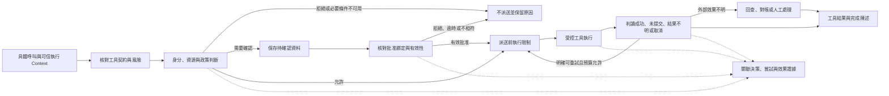

# Action Governance

[English](./README.md) | [繁體中文](./README-zh-TW.md)

本區接在 [Behavior and Capabilities](../behavior-and-capabilities/README-zh-TW.md) 之後。前區說明能力如何進入任務，以及由模型還是程式提出呼叫；本區從具體工具名稱、參數與可信執行條件開始，追蹤能否執行、何時需要確認，以及派送後如何交代結果。

六篇中英文正文初稿已完成，涵蓋具體呼叫的契約、授權、確認、派送與副作用處理。以下保留各篇範圍、查讀要求與圖解候選；英文版沿用相同編號與檔名主幹，移除 `-zh-TW`。各篇提供語言切換連結，[英文導覽](./README.md)連到對應英文版。

## 閱讀順序

| 篇次 | 文章 | 要回答的問題 | 正體中文檔名 |
|---|---|---|---|
| 01 | [工具風險與行動契約](./01-tool-risk-and-contracts-zh-TW.md) | 同一個工具的不同操作，要交付哪些可檢查的條件？ | `01-tool-risk-and-contracts-zh-TW.md` |
| 02 | [授權身分與資源範圍](./02-authorization-and-scope-zh-TW.md) | 誰能對哪個資源執行這一次操作？ | `02-authorization-and-scope-zh-TW.md` |
| 03 | [人工確認與批准有效性](./03-human-confirmation-zh-TW.md) | 使用者的一次同意，究竟批准了什麼？ | `03-human-confirmation-zh-TW.md` |
| 04 | [受控派送與執行隔離](./04-governed-dispatch-and-isolation-zh-TW.md) | 獲准之後，如何限制工具實際能做的事？ | `04-governed-dispatch-and-isolation-zh-TW.md` |
| 05 | [重試與副作用處理](./05-retry-and-side-effects-zh-TW.md) | 呼叫失敗、逾時或結果不明時，能否再做一次？ | `05-retry-and-side-effects-zh-TW.md` |
| 06 | [一次工具呼叫的治理流程](./06-case-governed-tool-call-zh-TW.md) | 提案、授權、確認、派送與結果，如何連回同一項任務？ | `06-case-governed-tool-call-zh-TW.md` |

## 架構與責任範圍

下圖是文章使用的概念模型。方塊不是兩個程式庫共同使用的型別或完整執行時序；實作中的檢查順序、提前返回及開關條件，須由各篇對照具體 consumer。

本區與其他分類的分工如下：

- **Foundations** 提供 Harness／Runtime 責任與一般設計原則；本區展開具體呼叫的決策、派送及效果證據。
- **Input and Context** 處理材料來源與指令權威；外部文字即使誘導模型提出呼叫，也不能提供可信授權身分。
- **Behavior and Capabilities** 處理能力組裝與候選範圍；本區不重講 loader、工具池合併或模型選工具的流程。
- **Interaction and Feedback** 將處理一般 Run ownership、generation、新輸入、取消與回覆評估。本區只保留批准交接，以及取消對單次工具效果的影響。

## 01. 工具風險與行動契約

### 文章範圍

從一個具體工具呼叫開始，區分名稱、輸入 Schema、執行函式，以及治理需要的 action、resource、風險與執行條件。能力描述提供模型選擇依據；行動契約還要讓程式能檢查這次操作。

預定段落：

1. Tool Call 交付哪些資料，哪些可信欄位必須另由執行入口提供。
2. Chat Gun 的 `ToolRiskPolicy`：`riskTier`、`actions`、`requireConfirmation` 與 `resourceRefResolver`。
3. 讀取、寫入、敏感操作與對外溝通的分類，如何影響確認條件。
4. CCB `Tool` 的 Schema、`validateInput()`、`checkPermissions()`、`call()` 與並行安全判斷，分別在哪裡使用。
5. 未註冊工具、未宣告 action、參數不合法及分類失敗的返回方式。

### 寫作與查證要求

- `ToolRiskRegistry` 支援未註冊工具預設為 `read` 或 `deny`；不能把類別的可配置能力寫成所有入口一律預設拒絕。正文須繼續追到 Registry 的實際建構設定。
- 風險分類、輸入合法與資源授權分開說明；`read` 不等於無風險，Schema 通過也不等於獲准。
- 圖解候選：同一工具描述如何對回輸入契約、風險政策與執行介面。

主要來源：[G1][g-risk]、[G2][g-governance]、[C1][c-tool]、[C2][c-execution]。

## 02. 授權身分與資源範圍

### 文章範圍

從可信 Principal、Tenant、Scope 與 ResourceRef 組成授權要求，追蹤 policy、grant、資源歸屬及 Context 條件如何形成決策。CCB 用來對照 Coding Agent 的 Permission consumer，不套用 Chat Gun 的身分型別。

預定段落：

1. 身分來自哪個可信入口；模型參數與外部內容不能自行宣告身分。
2. Chat Gun 的租戶、帳號、active scope 與讀寫範圍檢查。
3. Policy authority、資源 owner 與有效 grant 的關係。
4. `allow`、`deny`、`require_confirmation`，以及 `AUTHORIZATION_UNAVAILABLE` 的消費方式。
5. CCB 的 `hasPermissionsToUseTool()`、`useCanUseTool()` 與工具執行路徑如何交接。
6. 決策與呼叫的關聯：decision、policy version、resource 與執行識別。

### 寫作與查證要求

- 比較跨租戶、缺少 scope、過期或撤銷 grant、必要授權依賴失敗等分支；不把所有拒絕合併成一種工具錯誤。
- `GovernanceExecutor.authorizeTyped()` 在未配置 authorization 時有直接允許分支；必要政策是否存在，須由組裝與入口證據確認。
- 圖解候選：可信身分、資源與政策進入決策，和模型提供工具參數的不同來源。

主要來源：[G3][g-authorization]、[G2][g-governance]、[C3][c-permissions]、[C4][c-can-use-tool]。

## 03. 人工確認與批准有效性

### 文章範圍

說明需要確認的呼叫如何保存、呈現與恢復，以及如何核對批准者、Run、Scope、決策識別及有效期限。一般對話中的「同意」與可被消費的批准資料應分開處理。

預定段落：

1. 何時進入 `confirmation_required`；確認不能擴大原有授權邊界。
2. `ConfirmationRequiredDescriptor`、待確認資料與 interrupt manifest 的交接。
3. `approve`／`deny` resume payload，以及可信批准者與執行綁定。
4. 重複批准、逾時、綁定不符與 manifest 不相容的分支。
5. 批准後如何到達 `executeAuthorizedTyped()`；哪些檢查會重做，哪些沿用前次決策。
6. CCB 的互動確認、使用者調整輸入與 Permission 更新，和 Chat Gun 的差異。

### 寫作與查證要求

- `confirmation.ts` 的資料綁定與原子消費，可以作為實作追蹤；參數雜湊、資源版本與最新政策的重新核對，須另外找 consumer，不能因 descriptor 有 `policyVersion` 就宣稱全部成立。
- `executeAuthorizedTyped()` 有沿用授權結果的路徑；將「等待後應重新判定」的設計建議與實際呼叫順序分開。
- 不從記憶體 checkpointer 或 mock Store 推論跨程序持久化、正式資料庫競態或跨部署恢復已驗證。
- 圖解候選：待確認、有效批准、拒絕、過期與重播的狀態及執行次數。

主要來源：[G4][g-confirmation]、[G5][g-confirmation-graph]、[G6][g-confirmation-test]、[G7][g-graph-test]、[C5][c-interactive]。

## 04. 受控派送與執行隔離

### 文章範圍

從已獲准的呼叫追到實際工具執行，分開說明治理包裝、完整 dispatch pipeline 與 ExecutionProfile enforcement。獲准使用工具，仍需核對工具可存取哪些程序、檔案、網路與 secret。

預定段落：

1. Agent → Registry → governance wrapper → 可選 dispatch pipeline 的實際接線。
2. Descriptor、輸入驗證、必要依賴與 canonical execution Context。
3. Scheduler、rate limiter、circuit breaker 與 step lock 的不同職責。
4. `trusted_in_process`／`isolated_process`、profile 版本與 runner capability matching。
5. Secret reference 與 credential value、egress 決策與安全證據。
6. Timeout、AbortSignal、派送前取消與已開始外部 I/O 的差別。
7. CCB 依 `isConcurrencySafe()` 分批的對照，以及它不能單獨提供的跨程序保證。

### 寫作與查證要求

- 沿來源開關與實際 consumer 說明覆蓋範圍；不能把 pipeline 關閉寫成所有治理都消失，也不能把 wrapper 存在寫成隔離已啟用。
- 固定版本的安全文件註明沒有 production `SandboxRunnerPort`；正文需區分介面、測試 runner、部署 runner 與 enforcement 啟用條件。
- 將唯讀、可並行與資源鎖分開；單程序排序不等於多實例的資源互斥。
- 圖解候選：授權、profile、secret／egress 與工具執行的交接，並標出拒絕出口。

主要來源：[G2][g-governance]、[G8][g-pipeline]、[G9][g-profile]、[G10][g-isolation-doc]、[C6][c-orchestration]。Registry 建構、scheduler、lock、egress 與 secret consumer 的補查結果已納入第四篇。

## 05. 重試與副作用處理

### 文章範圍

從「工具呼叫失敗」拆出派送前拒絕、明確未提交、派送後效果不明及取消。再說明哪些證據允許重試，哪些情況需要回查、對帳、補償或人工介入。

預定段落：

1. 模型重新提案、工具重試與 Runtime 恢復的不同責任及預算。
2. `GovernedToolOutcome` 的成功、拒絕、未提交、效果不明與取消語意。
3. Execution attempt、replay key、request hash 與 business effect key 的用途。
4. Ledger 的準備、執行、提交及未知狀態；本地紀錄與外部提交的邊界。
5. 結果重用、reconciliation 與允許重試的前提。
6. 補償與人工介入；取消或重新執行不能自行還原已發生的效果。
7. Structured result envelope 與外層成功回傳，為何還要檢查內層 outcome。

### 寫作與查證要求

- 不把 Ledger、鎖或 replay key 的存在寫成端到端 exactly-once；外部系統的冪等及查詢能力仍須查證。
- `ambiguous_after_dispatch` 不直接導向重新派送；要指出可用的 reconcile consumer、其結果與預算。
- 核對已授權的非唯讀派送限制嘗試次數的分支，不概括所有工具都使用相同 retry policy。
- 第五篇已補查 identity、retry budget、reconciler 與 compensation 的 host consumer；部分函式委派給固定版本的 `@gun-ai/harness-kernel`，套件內部演算法尚未進一步審計。
- 圖解候選：外部已提交但回應遺失時，執行紀錄、業務效果與回覆如何分離。

主要來源：[G11][g-outcome]、[G12][g-runner]、[G13][g-ledger]、[G8][g-pipeline]、[G14][g-retry]。

## 06. 一次工具呼叫的治理流程

### 主案例與對照

採用 Chat Gun `confirmation-graph.test.ts` 的 `write_file` 測試情境，追蹤可信 execution Context、敏感工具政策、待確認狀態、同一 thread 恢復與底層工具呼叫次數。這是測試程式定義的工具與環境；不將它寫成 Chat Gun 正式入口已提供的檔案寫入能力。

預定段落：

1. 列出固定版本、測試工具、Schema、policy、Store、checkpointer 與 mock 的範圍。
2. 從具體呼叫進入 gate；在確認前核對底層工具尚未執行。
3. 恢復指定等待、消費批准，再追到 physical dispatch 與 ToolMessage。
4. 對照拒絕、過期、重播與錯誤綁定；每個分支註明原測試是否涵蓋。
5. 將同一觀察方式對回 MCP Agent 正式接線；未讀取或未執行的部分標明缺口。
6. 另列派送後結果不明的故障情境，接回第五篇；不宣稱確認測試已驗證外部副作用冪等。
7. 對照 Foundations 的 README 修改案例與 CCB Permission consumer，保留產品與型別差異。

### 所需證據

| 主張 | 預計核對的證據 |
|---|---|
| 未批准前不執行 | 待確認狀態、工具 mock 呼叫次數與 gate 返回。 |
| 批准對到指定呼叫 | Descriptor、resume、可信身分、Run／Scope、manifest 與消費結果。 |
| 拒絕或過期未派送 | 分支結果、底層呼叫次數，以及原測試覆蓋範圍。 |
| 工具實際產生效果 | 工具執行紀錄與資源狀態；mock 回傳不能替代。 |
| 正式入口維持同樣條件 | MCP Agent 接線、設定、資料庫／runner 及相應整合或 E2E 證據。 |

圖解候選：同一呼叫在 gate、等待、恢復、派送與結果之間的泳道圖。若後續製圖，沿用 SVG／HTML 及英文 `-en` 分檔方式；目前只規劃圖意。

主要來源：[G7][g-graph-test]、[G6][g-confirmation-test]、[G5][g-confirmation-graph]，以及 [Foundations 任務案例](../foundations/05-one-turn-walkthrough-zh-TW.md)。第六篇已對照正式 MCP Agent、mock Store 與測試使用的 `MemorySaver`，並分開記錄證據範圍。

## 來源與查證狀態

GUN-ATLAS v1.0（2026-10-12）提供定位；本區沿用前區的固定版本，避免混入浮動分支的新行為。規劃與正文於 2026-10-23 透過 GitHub 查讀所列程式與文件。使用者指定的 session 檔案未能定位，因此不將其內容列為已讀證據；附件中的面試回答規則也不作為本區文章格式。

| 來源 | 固定版本 | 使用範圍 |
|---|---|---|
| [Chat Gun](https://github.com/HsienW/chat-gun) | `92a5673003e4ac4ec09be8b1b350f42dbf4a5e69` | 行動契約、授權、確認、派送、隔離與副作用。 |
| [Claude Code Best](https://github.com/claude-code-best/claude-code) | `77a7934e15d69da13879112ed7db695c9ee7a52a` | 第三方 Coding Agent 的 Tool、Permission consumer、互動確認與工具排程。 |

本區的 CCB 指 Claude Code Best，不把它當成 Anthropic 官方現行實作。已讀測試代表知道案例內容，未代表本輪執行通過；本輪沒有執行 unit、integration、E2E、外部 MCP、真實 Provider、資料庫競態或部署故障演練。

### 主要來源索引

以下連結固定到上述 commit；正文新增的 consumer 另列於後方，各篇也提供直接來源連結。

| 索引 | 路徑 | 本輪查讀用途 |
|---|---|---|
| [G1][g-risk] | `backend/src/runtime/authorization/tool-risk.ts` | 風險、action 與未註冊工具設定。 |
| [G2][g-governance] | `backend/src/platform/tool-governance.ts` | Authorization 組裝、治理包裝與 typed 執行交接。 |
| [G3][g-authorization] | `backend/src/runtime/authorization/authorization.ts` | 租戶、Scope、grant 與決策條件。 |
| [G4][g-confirmation] | `backend/src/runtime/authorization/confirmation.ts` | Descriptor、批准綁定、期限與消費。 |
| [G5][g-confirmation-graph] | `backend/src/runtime/authorization/confirmation-graph.ts` | Gate、interrupt、恢復與派送。 |
| [G6][g-confirmation-test] | `backend/src/runtime/authorization/confirmation.test.ts` | Descriptor 與確認 Store 的測試案例。 |
| [G7][g-graph-test] | `backend/src/runtime/authorization/confirmation-graph.test.ts` | 測試工具、確認恢復與執行計數。 |
| [G8][g-pipeline] | `backend/src/runtime/tool-dispatch/pipeline.ts` | 派送前置條件、排程交接與結果 envelope。 |
| [G9][g-profile] | `backend/src/runtime/tool-dispatch/execution-profile.ts` | Profile、runner capability 與 secret 解析接點。 |
| [G10][g-isolation-doc] | `docs/tool-security-isolation.md` | 隔離與 egress 的文件範圍及部署限制。 |
| [G11][g-outcome] | `backend/src/runtime/side-effect/governed-outcome.ts` | 失敗、取消與派送狀態的型別。 |
| [G12][g-runner] | `backend/src/runtime/side-effect/tool-execution-runner.ts` | 重試、結果重用與 reconciliation 交接。 |
| [G13][g-ledger] | `backend/src/runtime/side-effect/business-effect-ledger.ts` | 執行與業務效果狀態、提交及補償介面。 |
| [G14][g-retry] | `backend/src/runtime/retry/retry-policy.ts` | Retry policy 轉接；預算與錯誤分類已追到 host consumer，套件內部實作未展開。 |
| [C1][c-tool] | `src/Tool.ts` | Tool 與 Permission 執行介面。 |
| [C2][c-execution] | `src/services/tools/toolExecution.ts` | 輸入驗證、Permission 決策與實際呼叫。 |
| [C3][c-permissions] | `src/utils/permissions/permissions.ts` | Permission 規則與決策入口。 |
| [C4][c-can-use-tool] | `src/hooks/useCanUseTool.tsx` | 可用工具的授權 consumer；副檔名為 `.tsx`。 |
| [C5][c-interactive] | `src/hooks/toolPermission/handlers/interactiveHandler.ts` | 確認、調整輸入與 Permission 更新。 |
| [C6][c-orchestration] | `src/services/tools/toolOrchestration.ts` | 安全分類、批次並行與 Context 更新。 |

### 正文補查的 consumer

| 接點 | 查讀重點 |
|---|---|
| [工具授權組裝](https://github.com/HsienW/chat-gun/blob/92a5673003e4ac4ec09be8b1b350f42dbf4a5e69/backend/src/tools/authorization/tool-authorization.ts) | Production／development 預設、資源解析與 Scope access。 |
| [工具 Registry](https://github.com/HsienW/chat-gun/blob/92a5673003e4ac4ec09be8b1b350f42dbf4a5e69/backend/src/tools/registry.ts) | Wrapper、pipeline 與 enforcer 的開關及注入。 |
| [正式 MCP Agent](https://github.com/HsienW/chat-gun/blob/92a5673003e4ac4ec09be8b1b350f42dbf4a5e69/backend/src/agents/mcp-agent.ts) | 模型呼叫、授權節點與 Runtime 管理的執行交接。 |
| [Runtime descriptor](https://github.com/HsienW/chat-gun/blob/92a5673003e4ac4ec09be8b1b350f42dbf4a5e69/backend/src/tools/production-runtime-tool-descriptors.ts) | 本地 profile 與 MCP 預設 side-effect descriptor。 |
| [Execution Context 讀取](https://github.com/HsienW/chat-gun/blob/92a5673003e4ac4ec09be8b1b350f42dbf4a5e69/backend/src/runtime/execution-context/read-execution-context.ts) | Canonical、development 與可信入口的邊界。 |
| [Scheduler](https://github.com/HsienW/chat-gun/blob/92a5673003e4ac4ec09be8b1b350f42dbf4a5e69/backend/src/runtime/tool-dispatch/scheduler.ts) | 本地序列、讀取容量與取消。 |
| [Step lock](https://github.com/HsienW/chat-gun/blob/92a5673003e4ac4ec09be8b1b350f42dbf4a5e69/backend/src/runtime/lock/step-lock.ts)、[lease](https://github.com/HsienW/chat-gun/blob/92a5673003e4ac4ec09be8b1b350f42dbf4a5e69/backend/src/runtime/tool-dispatch/step-lock-lease.ts) | Redis／Noop、TTL、owner 與續租失敗。 |
| [Secret broker](https://github.com/HsienW/chat-gun/blob/92a5673003e4ac4ec09be8b1b350f42dbf4a5e69/backend/src/runtime/tool-dispatch/secret-broker.ts)、[egress](https://github.com/HsienW/chat-gun/blob/92a5673003e4ac4ec09be8b1b350f42dbf4a5e69/backend/src/runtime/tool-dispatch/egress-policy.ts) | 解析值傳遞、URL／DNS／redirect 與預設連線。 |
| [Identity](https://github.com/HsienW/chat-gun/blob/92a5673003e4ac4ec09be8b1b350f42dbf4a5e69/backend/src/runtime/side-effect/identity.ts)、[retry budget](https://github.com/HsienW/chat-gun/blob/92a5673003e4ac4ec09be8b1b350f42dbf4a5e69/backend/src/runtime/retry/retry-budget.ts) | Host 呼叫；部分實作委派給 harness 套件。 |
| [Reconciler](https://github.com/HsienW/chat-gun/blob/92a5673003e4ac4ec09be8b1b350f42dbf4a5e69/backend/src/runtime/side-effect/reconciler.ts)、[Saga](https://github.com/HsienW/chat-gun/blob/92a5673003e4ac4ec09be8b1b350f42dbf4a5e69/backend/src/runtime/compensation/saga-orchestrator.ts) | 回查分流、已登記補償動作與人工介入。 |
| [結果 envelope](https://github.com/HsienW/chat-gun/blob/92a5673003e4ac4ec09be8b1b350f42dbf4a5e69/backend/src/runtime/tool-dispatch/structured-tool-result.ts) | 內層 outcome、執行關聯與 legacy 文字轉換。 |

## 文章狀態與驗證方式

依 01 → 02 → 03 → 04 → 05 → 06 閱讀。每篇從可指出的程式路徑說明，再補上設計判斷與尚未驗證的條件；第六篇使用前五篇已交代的契約。

- 開頭列出案例與證據範圍；正文以短段落、小節及有意義的子項目展開，沿用 Foundations 的閱讀方式。
- 每項實作主張指出來源、consumer、開關與失敗返回；未確認的重新授權、持久化或外部提交保證保留為待查項目。
- 至少保留一個不派送的分支；涉及副作用時，再區分未提交與效果不明。
- 將原始碼、測試案例、測試實際執行與部署證據分開，不用成功回覆代替中間控制證據。
- 英文翻譯保留段落、清單、表格與技術名稱；圖解另保留可編輯的 SVG／HTML 原檔。

[g-risk]: https://github.com/HsienW/chat-gun/blob/92a5673003e4ac4ec09be8b1b350f42dbf4a5e69/backend/src/runtime/authorization/tool-risk.ts
[g-governance]: https://github.com/HsienW/chat-gun/blob/92a5673003e4ac4ec09be8b1b350f42dbf4a5e69/backend/src/platform/tool-governance.ts
[g-authorization]: https://github.com/HsienW/chat-gun/blob/92a5673003e4ac4ec09be8b1b350f42dbf4a5e69/backend/src/runtime/authorization/authorization.ts
[g-confirmation]: https://github.com/HsienW/chat-gun/blob/92a5673003e4ac4ec09be8b1b350f42dbf4a5e69/backend/src/runtime/authorization/confirmation.ts
[g-confirmation-graph]: https://github.com/HsienW/chat-gun/blob/92a5673003e4ac4ec09be8b1b350f42dbf4a5e69/backend/src/runtime/authorization/confirmation-graph.ts
[g-confirmation-test]: https://github.com/HsienW/chat-gun/blob/92a5673003e4ac4ec09be8b1b350f42dbf4a5e69/backend/src/runtime/authorization/confirmation.test.ts
[g-graph-test]: https://github.com/HsienW/chat-gun/blob/92a5673003e4ac4ec09be8b1b350f42dbf4a5e69/backend/src/runtime/authorization/confirmation-graph.test.ts
[g-pipeline]: https://github.com/HsienW/chat-gun/blob/92a5673003e4ac4ec09be8b1b350f42dbf4a5e69/backend/src/runtime/tool-dispatch/pipeline.ts
[g-profile]: https://github.com/HsienW/chat-gun/blob/92a5673003e4ac4ec09be8b1b350f42dbf4a5e69/backend/src/runtime/tool-dispatch/execution-profile.ts
[g-isolation-doc]: https://github.com/HsienW/chat-gun/blob/92a5673003e4ac4ec09be8b1b350f42dbf4a5e69/docs/tool-security-isolation.md
[g-outcome]: https://github.com/HsienW/chat-gun/blob/92a5673003e4ac4ec09be8b1b350f42dbf4a5e69/backend/src/runtime/side-effect/governed-outcome.ts
[g-runner]: https://github.com/HsienW/chat-gun/blob/92a5673003e4ac4ec09be8b1b350f42dbf4a5e69/backend/src/runtime/side-effect/tool-execution-runner.ts
[g-ledger]: https://github.com/HsienW/chat-gun/blob/92a5673003e4ac4ec09be8b1b350f42dbf4a5e69/backend/src/runtime/side-effect/business-effect-ledger.ts
[g-retry]: https://github.com/HsienW/chat-gun/blob/92a5673003e4ac4ec09be8b1b350f42dbf4a5e69/backend/src/runtime/retry/retry-policy.ts
[c-tool]: https://github.com/claude-code-best/claude-code/blob/77a7934e15d69da13879112ed7db695c9ee7a52a/src/Tool.ts
[c-execution]: https://github.com/claude-code-best/claude-code/blob/77a7934e15d69da13879112ed7db695c9ee7a52a/src/services/tools/toolExecution.ts
[c-permissions]: https://github.com/claude-code-best/claude-code/blob/77a7934e15d69da13879112ed7db695c9ee7a52a/src/utils/permissions/permissions.ts
[c-can-use-tool]: https://github.com/claude-code-best/claude-code/blob/77a7934e15d69da13879112ed7db695c9ee7a52a/src/hooks/useCanUseTool.tsx
[c-interactive]: https://github.com/claude-code-best/claude-code/blob/77a7934e15d69da13879112ed7db695c9ee7a52a/src/hooks/toolPermission/handlers/interactiveHandler.ts
[c-orchestration]: https://github.com/claude-code-best/claude-code/blob/77a7934e15d69da13879112ed7db695c9ee7a52a/src/services/tools/toolOrchestration.ts
