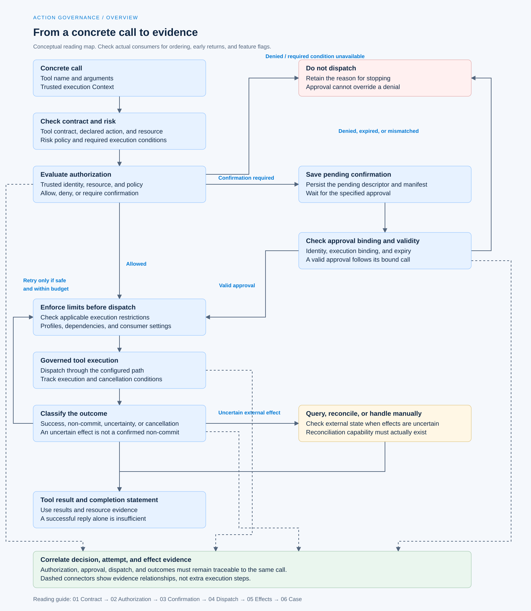

# Action Governance

[English](./README.md) | [繁體中文](./README-zh-TW.md)

This section follows [Behavior and Capabilities](../behavior-and-capabilities/README.md). The preceding section explains how capabilities enter a task and whether the model or code proposes a call. This section starts with a concrete tool name, arguments, and trusted execution conditions, then traces whether execution is allowed, when confirmation is required, and how results are accounted for after dispatch.

Six article drafts are available in English and Traditional Chinese, covering contracts, authorization, confirmation, dispatch, and side effects for concrete calls. The scope, inspection requirements, and diagram candidates for each article remain below. English filenames keep the same numbers and stems without `-zh-TW`.

## Reading order

| Number | Article | Question | English filename |
|---|---|---|---|
| 01 | [Tool risk and action contracts](./01-tool-risk-and-contracts.md) | What inspectable conditions must different operations of the same tool supply? | `01-tool-risk-and-contracts.md` |
| 02 | [Authorization and resource scope](./02-authorization-and-scope.md) | Who may perform this operation on this resource? | `02-authorization-and-scope.md` |
| 03 | [Human confirmation and approval validity](./03-human-confirmation.md) | What exactly does one user approval authorize? | `03-human-confirmation.md` |
| 04 | [Governed dispatch and execution isolation](./04-governed-dispatch-and-isolation.md) | After authorization, what restricts what a tool can actually do? | `04-governed-dispatch-and-isolation.md` |
| 05 | [Retries and side effects](./05-retry-and-side-effects.md) | Can a call be tried again after failure, timeout, or an uncertain result? | `05-retry-and-side-effects.md` |
| 06 | [A governed tool call](./06-case-governed-tool-call.md) | How do proposal, authorization, confirmation, dispatch, and results connect to the same task? | `06-case-governed-tool-call.md` |

## Architecture and responsibilities

The diagram is the conceptual model used by the articles. Its boxes are neither shared types in the two repositories nor a complete execution sequence. Each article must check the actual consumer for check ordering, early returns, and feature flags.

[Open the HTML diagram](../../assets/agent-harness/action-governance/00-action-governance-overview-en.html)

Responsibilities across sections:

- **Foundations** establishes Harness/Runtime responsibilities and general design principles. This section expands on decisions, dispatch, and effect evidence for concrete calls.
- **Input and Context** covers material sources and instruction authority. External text cannot supply a trusted authorization identity, even if it induces the model to propose a call.
- **Behavior and Capabilities** covers capability composition and candidate scope. This section does not repeat loaders, tool pool merging, or model tool selection.
- **Interaction and Feedback** will cover general Run ownership, generations, new input, cancellation, and reply evaluation. This section retains only the approval handoff and cancellation's effect on a single tool operation.

## 01. Tool risk and action contracts

### Article scope

Start with a concrete tool call and distinguish its name, input Schema, and execution function from the action, resource, risk, and execution conditions governance needs. Capability descriptions help the model choose; an action contract must also let code inspect this operation.

Planned sections:

1. What a Tool Call supplies, and which trusted fields the execution entry point must supply separately.
2. Chat Gun `ToolRiskPolicy`: `riskTier`, `actions`, `requireConfirmation`, and `resourceRefResolver`.
3. How read, write, sensitive-operation, and external-communication classifications affect confirmation conditions.
4. Where CCB uses the `Tool` Schema, `validateInput()`, `checkPermissions()`, `call()`, and concurrency safety checks.
5. Results for unregistered tools, undeclared actions, invalid arguments, and classification failures.

### Writing and verification requirements

- `ToolRiskRegistry` supports either `read` or `deny` as the default for unregistered tools. Its configurable behavior does not mean every entry point denies by default. Follow the Registry's actual construction settings in the article.
- Explain risk classification, input validity, and resource authorization separately. `read` does not mean risk-free, and passing a Schema does not mean authorization.
- Diagram candidate: map one tool description to its input contract, risk policy, and execution interface.

Main sources: [G1][g-risk], [G2][g-governance], [C1][c-tool], [C2][c-execution].

## 02. Authorization and resource scope

### Article scope

Build an authorization request from a trusted Principal, Tenant, Scope, and ResourceRef, then trace how policy, grants, resource ownership, and Context conditions form a decision. CCB provides a comparison for Coding Agent Permission consumers without adopting Chat Gun's identity types.

Planned sections:

1. Which trusted entry point supplies identity; model arguments and external content cannot declare it themselves.
2. Chat Gun checks for tenant, account, active scope, and read/write scope.
3. The relationship between policy authority, resource owner, and effective grants.
4. How consumers handle `allow`, `deny`, `require_confirmation`, and `AUTHORIZATION_UNAVAILABLE`.
5. The handoff between CCB `hasPermissionsToUseTool()`, `useCanUseTool()`, and tool execution paths.
6. Correlating decisions and calls through decision identity, policy version, resource, and execution identity.

### Writing and verification requirements

- Compare cross-tenant requests, missing scope, expired or revoked grants, and failures of required authorization dependencies. Do not collapse every denial into one tool error.
- `GovernanceExecutor.authorizeTyped()` has a direct allow branch when authorization is not configured. Assembly and entry point evidence must establish whether required policies exist.
- Diagram candidate: distinguish trusted identity, resource, and policy inputs to the decision from model-supplied tool arguments.

Main sources: [G3][g-authorization], [G2][g-governance], [C3][c-permissions], [C4][c-can-use-tool].

## 03. Human confirmation and approval validity

### Article scope

Explain how calls requiring confirmation are saved, presented, and resumed, and how the approver, Run, Scope, decision identity, and expiry are checked. Separate conversational agreement from approval data a consumer can use.

Planned sections:

1. When execution enters `confirmation_required`; confirmation cannot expand the existing authorization boundary.
2. The handoff between `ConfirmationRequiredDescriptor`, pending data, and the interrupt manifest.
3. `approve`/`deny` resume payloads, trusted approvers, and execution binding.
4. Branches for duplicate approvals, expiry, binding mismatches, and incompatible manifests.
5. How approval reaches `executeAuthorizedTyped()`; which checks run again and which reuse the previous decision.
6. How CCB interactive confirmation, user-adjusted input, and Permission updates differ from Chat Gun.

### Writing and verification requirements

- Trace data binding and atomic consumption in `confirmation.ts`. Parameter hashes, resource versions, and checks against the latest policy need separate consumers; a descriptor's `policyVersion` field does not establish all these guarantees.
- `executeAuthorizedTyped()` includes a path that reuses authorization results. Separate the recommendation to reevaluate after waiting from the actual call order.
- In-memory checkpointers and mock Stores do not establish verified cross-process persistence, production database concurrency, or recovery across deployments.
- Diagram candidate: pending, valid approval, denial, expiry, and replay states with execution counts.

Main sources: [G4][g-confirmation], [G5][g-confirmation-graph], [G6][g-confirmation-test], [G7][g-graph-test], [C5][c-interactive].

## 04. Governed dispatch and execution isolation

### Article scope

Follow an authorized call to actual tool execution, distinguishing governance wrappers, the full dispatch pipeline, and ExecutionProfile enforcement. Authorization to use a tool still requires checking which processes, files, networks, and secrets it may access.

Planned sections:

1. Actual wiring from Agent to Registry, governance wrapper, and optional dispatch pipeline.
2. Descriptors, input validation, required dependencies, and canonical execution Context.
3. The distinct responsibilities of the scheduler, rate limiter, circuit breaker, and step lock.
4. `trusted_in_process`/`isolated_process`, profile versions, and runner capability matching.
5. Secret references versus credential values, egress decisions, and security evidence.
6. Differences between timeout, AbortSignal, cancellation before dispatch, and external I/O that has already started.
7. CCB batching by `isConcurrencySafe()` and the cross-process guarantees that it cannot supply alone.

### Writing and verification requirements

- Explain coverage through source flags and actual consumers. Disabling the pipeline does not remove all governance; the existence of a wrapper does not establish enabled isolation.
- Security documentation at the pinned version states that no production `SandboxRunnerPort` exists. Distinguish interfaces, test runners, deployment runners, and conditions for enabling enforcement.
- Separate read-only classification, concurrency safety, and resource locks. Ordering within one process does not establish resource exclusion across instances.
- Diagram candidate: the handoff between authorization, profiles, secrets/egress, and tool execution, including denial exits.

Main sources: [G2][g-governance], [G8][g-pipeline], [G9][g-profile], [G10][g-isolation-doc], [C6][c-orchestration]. Article 04 includes the additional inspection of Registry construction, scheduling, locks, egress, and secret consumers.

## 05. Retries and side effects

### Article scope

Break tool call failure into rejection before dispatch, explicit non-commit, uncertain effects after dispatch, and cancellation. Explain which evidence permits retries and which cases require querying, reconciliation, compensation, or human intervention.

Planned sections:

1. Separate responsibilities and budgets for model reproposals, tool retries, and Runtime recovery.
2. `GovernedToolOutcome` semantics for success, denial, non-commit, uncertain effects, and cancellation.
3. Uses of execution attempts, replay keys, request hashes, and business effect keys.
4. Ledger preparation, execution, commit, and unknown states; the boundary between local records and external commits.
5. Prerequisites for result reuse, reconciliation, and retries.
6. Compensation and human intervention; cancellation or reexecution cannot itself undo effects that already occurred.
7. Why a structured result envelope still requires inspecting the inner outcome when the outer return reports success.

### Writing and verification requirements

- The existence of a Ledger, lock, or replay key does not establish end-to-end exactly-once behavior. External system idempotency and query capabilities still need verification.
- `ambiguous_after_dispatch` does not lead directly to redispatch. Identify the available reconcile consumer, its results, and its budget.
- Check branches that limit attempts for authorized non-read-only dispatch. Do not generalize one retry policy to every tool.
- Article 05 includes the host consumers for identity, retry budgets, reconciliation, and compensation. Some functions delegate to the pinned `@gun-ai/harness-kernel` package; its internal algorithms have not been audited further.
- Diagram candidate: separate execution records, business effects, and replies when an external commit succeeds but its response is lost.

Main sources: [G11][g-outcome], [G12][g-runner], [G13][g-ledger], [G8][g-pipeline], [G14][g-retry].

## 06. A governed tool call

### Main case and comparisons

Use the `write_file` scenario from Chat Gun `confirmation-graph.test.ts` to trace trusted execution Context, sensitive-tool policy, pending confirmation, resumption on the same thread, and underlying tool call counts. The test defines the tool and environment; it does not establish a file-writing capability at a Chat Gun production entry point.

Planned sections:

1. State the pinned version and the scope of the test tool, Schema, policy, Store, checkpointer, and mocks.
2. Enter the gate with a concrete call; check that the underlying tool has not executed before confirmation.
3. Resume the specified wait, consume approval, and follow physical dispatch through to the ToolMessage.
4. Compare denial, expiry, replay, and incorrect binding; state whether the original tests cover each branch.
5. Apply the same inspection approach to production MCP Agent wiring and identify unread or unexecuted parts.
6. Add a separate fault scenario for uncertain results after dispatch, connecting it to Article 05. Confirmation tests do not establish idempotency of external effects.
7. Compare the Foundations README-editing scenario and CCB Permission consumers while retaining differences in products and types.

### Required evidence

| Claim | Evidence to check |
|---|---|
| No execution before approval | Pending state, tool mock call count, and gate result. |
| Approval matches the specified call | Descriptor, resume payload, trusted identity, Run/Scope, manifest, and consumption result. |
| No dispatch after denial or expiry | Branch results, underlying call counts, and original test coverage. |
| The tool actually produces an effect | Tool execution records and resource state; mock returns cannot substitute. |
| Production entry points retain the same conditions | MCP Agent wiring, configuration, database/runner, and corresponding integration or E2E evidence. |

Diagram candidate: a swimlane diagram following the same call through gate, waiting, resumption, dispatch, and results. Future diagrams should retain separate SVG/HTML files and English `-en` variants. Only the diagram concept is planned here.

Main sources: [G7][g-graph-test], [G6][g-confirmation-test], [G5][g-confirmation-graph], and the [Foundations task walkthrough](../foundations/05-one-turn-walkthrough.md). Article 06 compares the production MCP Agent, mock Store, and test `MemorySaver`, recording their evidence scopes separately.

## Sources and verification status

GUN-ATLAS v1.0 (2026-10-12) supplied repository locations. This section uses the preceding section's pinned versions to avoid mixing in newer behavior from moving branches. The plan and articles draw on source and documents inspected through GitHub on 2026-10-23. The user-specified session file could not be located, so its contents are not recorded as inspected evidence. The attachment's interview-answer rules do not define this section's article format.

| Source | Pinned version | Scope |
|---|---|---|
| [Chat Gun](https://github.com/HsienW/chat-gun) | `92a5673003e4ac4ec09be8b1b350f42dbf4a5e69` | Action contracts, authorization, confirmation, dispatch, isolation, and side effects. |
| [Claude Code Best](https://github.com/claude-code-best/claude-code) | `77a7934e15d69da13879112ed7db695c9ee7a52a` | A third-party Coding Agent comparison for Tools, Permission consumers, interactive confirmation, and tool scheduling. |

CCB means Claude Code Best, not the current official Anthropic implementation. Reading a test establishes knowledge of its cases, not that it passed during this work. No unit, integration, E2E, external MCP, live Provider, database concurrency, or deployment failure tests were run.

### Main source index

The following links are pinned to the commits above. Additional consumers inspected for the articles follow this index; each article also provides direct source links.

| Index | Path | Inspection purpose |
|---|---|---|
| [G1][g-risk] | `backend/src/runtime/authorization/tool-risk.ts` | Risk, actions, and unregistered-tool settings. |
| [G2][g-governance] | `backend/src/platform/tool-governance.ts` | Authorization composition, governance wrappers, and typed execution handoff. |
| [G3][g-authorization] | `backend/src/runtime/authorization/authorization.ts` | Tenant, Scope, grants, and decision conditions. |
| [G4][g-confirmation] | `backend/src/runtime/authorization/confirmation.ts` | Descriptors, approval binding, expiry, and consumption. |
| [G5][g-confirmation-graph] | `backend/src/runtime/authorization/confirmation-graph.ts` | Gate, interrupt, resumption, and dispatch. |
| [G6][g-confirmation-test] | `backend/src/runtime/authorization/confirmation.test.ts` | Test cases for descriptors and the confirmation Store. |
| [G7][g-graph-test] | `backend/src/runtime/authorization/confirmation-graph.test.ts` | Test tools, confirmation resumption, and execution counts. |
| [G8][g-pipeline] | `backend/src/runtime/tool-dispatch/pipeline.ts` | Dispatch preconditions, scheduling handoff, and result envelopes. |
| [G9][g-profile] | `backend/src/runtime/tool-dispatch/execution-profile.ts` | Profiles, runner capabilities, and secret resolution handoff. |
| [G10][g-isolation-doc] | `docs/tool-security-isolation.md` | Documented isolation and egress scope, and deployment limits. |
| [G11][g-outcome] | `backend/src/runtime/side-effect/governed-outcome.ts` | Types for failure, cancellation, and dispatch states. |
| [G12][g-runner] | `backend/src/runtime/side-effect/tool-execution-runner.ts` | Retries, result reuse, and reconciliation handoff. |
| [G13][g-ledger] | `backend/src/runtime/side-effect/business-effect-ledger.ts` | Execution and business effect states, commit, and compensation interfaces. |
| [G14][g-retry] | `backend/src/runtime/retry/retry-policy.ts` | Retry policy adapters; budgets and error classification were traced to host consumers, without examining package internals. |
| [C1][c-tool] | `src/Tool.ts` | Tool and Permission execution interfaces. |
| [C2][c-execution] | `src/services/tools/toolExecution.ts` | Input validation, Permission decisions, and actual calls. |
| [C3][c-permissions] | `src/utils/permissions/permissions.ts` | Permission rules and decision entry points. |
| [C4][c-can-use-tool] | `src/hooks/useCanUseTool.tsx` | Authorization consumer for tool use; the extension is `.tsx`. |
| [C5][c-interactive] | `src/hooks/toolPermission/handlers/interactiveHandler.ts` | Confirmation, adjusted input, and Permission updates. |
| [C6][c-orchestration] | `src/services/tools/toolOrchestration.ts` | Safety classification, batch concurrency, and Context updates. |

### Additional consumers inspected for the articles

| Handoff | Inspection focus |
|---|---|
| [Tool authorization composition](https://github.com/HsienW/chat-gun/blob/92a5673003e4ac4ec09be8b1b350f42dbf4a5e69/backend/src/tools/authorization/tool-authorization.ts) | Production/development defaults, resource resolution, and Scope access. |
| [Tool Registry](https://github.com/HsienW/chat-gun/blob/92a5673003e4ac4ec09be8b1b350f42dbf4a5e69/backend/src/tools/registry.ts) | Wrapper, pipeline, and enforcer flags and injection. |
| [Production MCP Agent](https://github.com/HsienW/chat-gun/blob/92a5673003e4ac4ec09be8b1b350f42dbf4a5e69/backend/src/agents/mcp-agent.ts) | Model calls, authorization nodes, and Runtime-managed execution handoff. |
| [Runtime descriptor](https://github.com/HsienW/chat-gun/blob/92a5673003e4ac4ec09be8b1b350f42dbf4a5e69/backend/src/tools/production-runtime-tool-descriptors.ts) | Local profiles and default MCP side-effect descriptors. |
| [Execution Context reader](https://github.com/HsienW/chat-gun/blob/92a5673003e4ac4ec09be8b1b350f42dbf4a5e69/backend/src/runtime/execution-context/read-execution-context.ts) | Boundaries between canonical, development, and trusted entry points. |
| [Scheduler](https://github.com/HsienW/chat-gun/blob/92a5673003e4ac4ec09be8b1b350f42dbf4a5e69/backend/src/runtime/tool-dispatch/scheduler.ts) | Local serialization, read capacity, and cancellation. |
| [Step lock](https://github.com/HsienW/chat-gun/blob/92a5673003e4ac4ec09be8b1b350f42dbf4a5e69/backend/src/runtime/lock/step-lock.ts), [lease](https://github.com/HsienW/chat-gun/blob/92a5673003e4ac4ec09be8b1b350f42dbf4a5e69/backend/src/runtime/tool-dispatch/step-lock-lease.ts) | Redis/Noop, TTL, owner, and lease renewal failures. |
| [Secret broker](https://github.com/HsienW/chat-gun/blob/92a5673003e4ac4ec09be8b1b350f42dbf4a5e69/backend/src/runtime/tool-dispatch/secret-broker.ts), [egress](https://github.com/HsienW/chat-gun/blob/92a5673003e4ac4ec09be8b1b350f42dbf4a5e69/backend/src/runtime/tool-dispatch/egress-policy.ts) | Resolved value transfer, URL/DNS/redirect handling, and default connections. |
| [Identity](https://github.com/HsienW/chat-gun/blob/92a5673003e4ac4ec09be8b1b350f42dbf4a5e69/backend/src/runtime/side-effect/identity.ts), [retry budget](https://github.com/HsienW/chat-gun/blob/92a5673003e4ac4ec09be8b1b350f42dbf4a5e69/backend/src/runtime/retry/retry-budget.ts) | Host calls; some implementations delegate to harness packages. |
| [Reconciler](https://github.com/HsienW/chat-gun/blob/92a5673003e4ac4ec09be8b1b350f42dbf4a5e69/backend/src/runtime/side-effect/reconciler.ts), [Saga](https://github.com/HsienW/chat-gun/blob/92a5673003e4ac4ec09be8b1b350f42dbf4a5e69/backend/src/runtime/compensation/saga-orchestrator.ts) | Reconciliation routing, registered compensation actions, and human intervention. |
| [Result envelope](https://github.com/HsienW/chat-gun/blob/92a5673003e4ac4ec09be8b1b350f42dbf4a5e69/backend/src/runtime/tool-dispatch/structured-tool-result.ts) | Inner outcomes, execution correlation, and legacy text conversion. |

## Article status and verification approach

Read 01 → 02 → 03 → 04 → 05 → 06. Each article starts with identifiable code paths, then adds design judgments and unverified conditions. Article 06 uses the contracts established in the first five articles.

- State the case and evidence scope at the start. Develop the body through short paragraphs, subsections, and meaningful subitems, following the Foundations reading style.
- Identify the source, consumer, flags, and failure result for each implementation claim. Keep unconfirmed reauthorization, persistence, or external commit guarantees as open verification items.
- Retain at least one branch that does not dispatch. For side effects, also distinguish non-commit from uncertain effects.
- Separate source code, test cases, actual test execution, and deployment evidence. A successful reply does not replace evidence of the controls between input and result.
- English translations retain paragraphs, lists, tables, and technical names. Diagrams retain editable SVG/HTML source files.

[g-risk]: https://github.com/HsienW/chat-gun/blob/92a5673003e4ac4ec09be8b1b350f42dbf4a5e69/backend/src/runtime/authorization/tool-risk.ts
[g-governance]: https://github.com/HsienW/chat-gun/blob/92a5673003e4ac4ec09be8b1b350f42dbf4a5e69/backend/src/platform/tool-governance.ts
[g-authorization]: https://github.com/HsienW/chat-gun/blob/92a5673003e4ac4ec09be8b1b350f42dbf4a5e69/backend/src/runtime/authorization/authorization.ts
[g-confirmation]: https://github.com/HsienW/chat-gun/blob/92a5673003e4ac4ec09be8b1b350f42dbf4a5e69/backend/src/runtime/authorization/confirmation.ts
[g-confirmation-graph]: https://github.com/HsienW/chat-gun/blob/92a5673003e4ac4ec09be8b1b350f42dbf4a5e69/backend/src/runtime/authorization/confirmation-graph.ts
[g-confirmation-test]: https://github.com/HsienW/chat-gun/blob/92a5673003e4ac4ec09be8b1b350f42dbf4a5e69/backend/src/runtime/authorization/confirmation.test.ts
[g-graph-test]: https://github.com/HsienW/chat-gun/blob/92a5673003e4ac4ec09be8b1b350f42dbf4a5e69/backend/src/runtime/authorization/confirmation-graph.test.ts
[g-pipeline]: https://github.com/HsienW/chat-gun/blob/92a5673003e4ac4ec09be8b1b350f42dbf4a5e69/backend/src/runtime/tool-dispatch/pipeline.ts
[g-profile]: https://github.com/HsienW/chat-gun/blob/92a5673003e4ac4ec09be8b1b350f42dbf4a5e69/backend/src/runtime/tool-dispatch/execution-profile.ts
[g-isolation-doc]: https://github.com/HsienW/chat-gun/blob/92a5673003e4ac4ec09be8b1b350f42dbf4a5e69/docs/tool-security-isolation.md
[g-outcome]: https://github.com/HsienW/chat-gun/blob/92a5673003e4ac4ec09be8b1b350f42dbf4a5e69/backend/src/runtime/side-effect/governed-outcome.ts
[g-runner]: https://github.com/HsienW/chat-gun/blob/92a5673003e4ac4ec09be8b1b350f42dbf4a5e69/backend/src/runtime/side-effect/tool-execution-runner.ts
[g-ledger]: https://github.com/HsienW/chat-gun/blob/92a5673003e4ac4ec09be8b1b350f42dbf4a5e69/backend/src/runtime/side-effect/business-effect-ledger.ts
[g-retry]: https://github.com/HsienW/chat-gun/blob/92a5673003e4ac4ec09be8b1b350f42dbf4a5e69/backend/src/runtime/retry/retry-policy.ts
[c-tool]: https://github.com/claude-code-best/claude-code/blob/77a7934e15d69da13879112ed7db695c9ee7a52a/src/Tool.ts
[c-execution]: https://github.com/claude-code-best/claude-code/blob/77a7934e15d69da13879112ed7db695c9ee7a52a/src/services/tools/toolExecution.ts
[c-permissions]: https://github.com/claude-code-best/claude-code/blob/77a7934e15d69da13879112ed7db695c9ee7a52a/src/utils/permissions/permissions.ts
[c-can-use-tool]: https://github.com/claude-code-best/claude-code/blob/77a7934e15d69da13879112ed7db695c9ee7a52a/src/hooks/useCanUseTool.tsx
[c-interactive]: https://github.com/claude-code-best/claude-code/blob/77a7934e15d69da13879112ed7db695c9ee7a52a/src/hooks/toolPermission/handlers/interactiveHandler.ts
[c-orchestration]: https://github.com/claude-code-best/claude-code/blob/77a7934e15d69da13879112ed7db695c9ee7a52a/src/services/tools/toolOrchestration.ts
