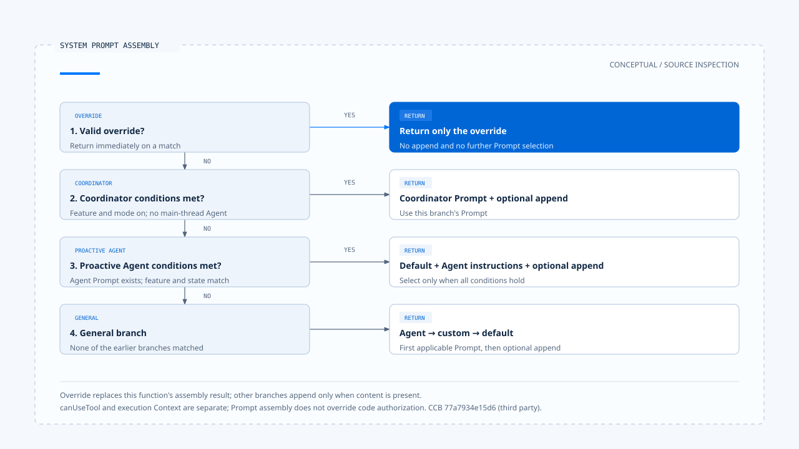

# 指令与行为

[English](./01-instructions-and-behavior.md) | [繁體中文](./01-instructions-and-behavior-zh-TW.md) | [简体中文](./01-instructions-and-behavior-zh-CN.md)

> 以下内容所提到的
> CCB 为 [claude-code-best](https://github.com/claude-code-best/claude-code) 的简称。
> Chat Gun 为 [chat-gun](https://github.com/HsienW/chat-gun)。

[回到导览](./README-zh-CN.md) · 下一篇：[能力组装](./02-capability-composition-zh-CN.md)

用户要求「先读取数据，再说明结果；没有执行就不要宣称成功」。产品可以把这句话放进 Prompt，也可以在回复前核对工具结果。两处都会影响行为，却提供不同的证据：前者说明模型收到什麽要求，后者才有机会确认回答是否符合已发生的操作。

本篇从规则来源走到模型输入，再对照程序中的检查位置。实现依 查读的 Chat Gun 与 Claude Code Best（CCB）固定版本撰写；版本及范围见[本区导览](./README-zh-CN.md#来源与证据范围)。CCB 是第三方项目，本文描述其源代码可观察的做法。

## 1. 规则需要来源与消费位置

同样是一段自然语言，产品设置、当前要求、Skill 内容与文件数据可能从不同入口进入任务。整理行为规则时，除了文字内容，还应记下谁提供它、适用到何时，以及哪个函数真正使用它。

| 来源 | 对行为的作用 | 需要核对的接点 |
|---|---|---|
| 产品或组织规则 | 定义角色、输出方式与产品限制。 | 设置加载、Prompt 组装与对应的程序检查。 |
| 项目规则 | 提供工作区惯例与特定任务要求。 | 搜索范围、工作区信任及送入模型的位置。 |
| 本次用户指令 | 定义目前要完成的工作与限制。 | 规范化结果、Current Task 与后续修订。 |
| Skill 或 Agent 定义 | 提供领域指令，并可能带入模型、工具规则或子任务设置。 | loader、触发检查与内容展开的 consumer。 |
| Memory、文件及工具输出 | 提供完成任务的材料。 | 来源标记与数据边界；内容中的命令不能自行取得更高权威。 |

表格是阅读架构的方法。具体产品的组装顺序仍要回到源代码；[Context 信任边界](../input-and-context/03-context-trust-boundary-zh-CN.md) 已说明来源权威，本篇接着追踪这些要求如何生效。把某段文字排在最后，也不足以证明它能覆盖所有产品政策。

## 2. CCB 如何组成有效 System Prompt

CCB 的 [`buildEffectiveSystemPrompt()`][ccb-system] 接收默认 Prompt、custom Prompt、Agent 定义与 append／override 设置，依条件选择组装方式。它没有把所有来源一律串接。

| 条件 | 函数返回的内容 |
|---|---|
| 有有效的 `overrideSystemPrompt` | 直接返回 override，不再进入其他组装分支。 |
| Coordinator 功能与模式启用，且没有 main-thread Agent 定义 | 使用 Coordinator Prompt，再接上存在的 append。 |
| 有 Agent Prompt，且指定的 proactive 功能及执行状态成立 | 默认 Prompt 加上 Agent 指令，再接上 append。 |
| 一般分支 | 优先使用 Agent Prompt，其次 custom Prompt，否则使用 default；最后接上 append。 |

这些分支只描述函数管理的 System Prompt。`override` 的名称并不表示它能改变程序端的文件权限、工具授权或其他执行政策。

在 [REPL 的查询路径][ccb-repl]，组装结果会存入 `toolUseContext.renderedSystemPrompt`，再以 `systemPrompt` 字段交给 `query()`。同一次调用还分别传入 `userContext`、`systemContext`、`canUseTool` 与工具执行 Context。项目数据和执行权限因此不能只靠这个 Prompt 函数解释；应追到它们各自的传入位置。

替换与追加也有维护成本。替换会让原本由 default 提供的行为要求不再出现在这份结果中；追加则可能保留彼此冲突的文字。修改组装策略后，应比较有效输入，而非只检查模板档是否仍存在。

## 3. Chat Gun 的规则由 Agent 入口消费

Chat Gun 的 [`prompts.ts`][gun-prompts] 为 Chatbot、Math、MCP 等用途准备不同规则。MCP Prompt 要求选用合适工具、对敏感操作保持谨慎，并要求没有工具结果时明确说明。这些文字可指出模型应遵循的行为，实际授权则由后续程序接点处理。

[MCP Agent][gun-mcp] 在 `callModel()` 内，依 `CONTEXT_ASSEMBLY_ENABLED_MCP` 选择两条输入路径：

- 启用时，将 `mcpSystemMessage`、消息与执行设置交给 `assembleMcpMessageContext()`。
- 关闭时，使用 `legacyMcpMessages()`，在消息前放入带有同一份政策文字的 system 消息。

[Context 整合程序][gun-context] 会把政策以 `system_policy` 来源交给组装器；MCP 的消息重建也会放入该政策，再加入保留的任务与对话单元。这让两条分支都有可指出的规则 consumer，但两者对历史材料的筛选方式仍须各自理解，不能因共用 Prompt 就视为完全等价。

Agent 名称也不能代替路径检查。[Math Agent][gun-math] 若成功抽取算式，会直接调用 calculator 并组成回复；只有未抽取到算式时，才进入使用 `mathSystemMessage` 的模型分支。对这条直接计算路径，程序决定工具与回复格式，不能把结果归因于模型遵循了 Math Prompt。

## 4. Skill 内容会带入哪些行为条件

CCB 的 [Skill frontmatter parser][ccb-loader] 会解析说明、`allowed-tools`、模型设置、`disable-model-invocation`、`user-invocable`、Hook 与 `context: fork` 等字段。这些字段由不同 consumer 使用；字段已被解析，只能先证明设置进入了数据结构。

例如 [SkillTool][ccb-skill] 的输入检查会确认 Skill 存在、允许模型触发，且属于 prompt 类型。一般的 inline 路径接着展开 Prompt Command，返回新增消息及 Context 修改器。指定 fork 的 Skill 则走另一条子任务执行分支。

其中 `allowedTools` 在 inline 结果的 `contextModifier` 内，会合并到 `toolPermissionContext.alwaysAllowRules.command`。这是该路径对 command allow 规则的更新，不能读成「只有清单内工具才存在」，也不能当成 sandbox 隔离保证。若要主张它如何影响具体资源的授权，还要追读 Permission consumer。

同样地，Skill 可以携带 Hook 设置，并不代表任意 Hook 都已执行。本篇确认到解析与 Skill 展开的交接位置；Hook 的触发时机、失败语义与阻挡效果，应以对应执行路径另行查证。

## 5. 一条要求可以有多个生效位置

以「只修改 README」为例，可以沿下表检查设计。表中的安排是设计建议，实际产品须提供相应接线与证据。

| 位置 | 可以做的工作 | 能支持的结论 |
|---|---|---|
| 有效指令 | 保留用户要求与任务范围。 | 模型收到了这项限制。 |
| 能力曝光 | 视任务提供所需能力，隐藏无关或不允许使用的工具。 | 当次候选集合受到了哪些限制。 |
| 具体调用检查 | 核对文件路径、操作身份、差异与批准范围。 | 某一次操作是否符合可检查的条件。 |
| 结果核对 | 比对工具结果与实际变更，再形成完成回复。 | 回复中的哪些陈述有证据。 |

回复语言等要求可能主要依赖模型遵循；资源范围则通常还有程序可检查的条件。设计文件应说清楚保证到哪一层，避免用一句 Prompt 规则涵盖未曾检查的结果。

对 Chat Gun，MCP Agent 的 Prompt、模型工具绑定及授权 Graph 都有各自的程序位置。工具曝光留给[第二篇](./02-capability-composition-zh-CN.md)；单次行动的批准与派送，则由 Action Governance 主题进一步展开。

## 6. 规则缺失与冲突如何处理

修改 Prompt 的风险常出在交接处：custom 设置替换了 default，选用 Skill 加载失败，或某份规则提到的工具根本没有进入本次集合。这些情况应分开呈现，因为修补方式不同。

CCB 的 `commands.ts` 对部分 Skill 加载错误会记录后继续使用其他来源；这只能支持它采用选用扩展降级的结论，不能据此推论任何必要行为规则都可以略过。[来源组装与错误处理见此][ccb-commands]。

对必要规则，较容易查证的设计是记录其来源、适用范围及组装分支；如果无法取得，明确决定中止或采用哪份替代政策。这是本节的设计要求，并非宣称 Chat Gun 已有一份完整的行为规则 manifest。

本篇完成的是从来源到有效指令的静态追踪，尚未执行冲突 Prompt 的模型测试。下一篇会把「要求使用什麽方法」接到真正可供任务使用的能力集合。

[ccb-system]: https://github.com/claude-code-best/claude-code/blob/77a7934e15d69da13879112ed7db695c9ee7a52a/src/utils/systemPrompt.ts
[ccb-repl]: https://github.com/claude-code-best/claude-code/blob/77a7934e15d69da13879112ed7db695c9ee7a52a/src/screens/REPL.tsx#L3499
[ccb-loader]: https://github.com/claude-code-best/claude-code/blob/77a7934e15d69da13879112ed7db695c9ee7a52a/src/skills/loadSkillsDir.ts#L185
[ccb-skill]: https://github.com/claude-code-best/claude-code/blob/77a7934e15d69da13879112ed7db695c9ee7a52a/packages/builtin-tools/src/tools/SkillTool/SkillTool.ts
[ccb-commands]: https://github.com/claude-code-best/claude-code/blob/77a7934e15d69da13879112ed7db695c9ee7a52a/src/commands.ts
[gun-prompts]: https://github.com/HsienW/chat-gun/blob/92a5673003e4ac4ec09be8b1b350f42dbf4a5e69/backend/src/prompts.ts
[gun-mcp]: https://github.com/HsienW/chat-gun/blob/92a5673003e4ac4ec09be8b1b350f42dbf4a5e69/backend/src/agents/mcp-agent.ts
[gun-context]: https://github.com/HsienW/chat-gun/blob/92a5673003e4ac4ec09be8b1b350f42dbf4a5e69/backend/src/agents/context-integration.ts
[gun-math]: https://github.com/HsienW/chat-gun/blob/92a5673003e4ac4ec09be8b1b350f42dbf4a5e69/backend/src/agents/math-agent.ts
