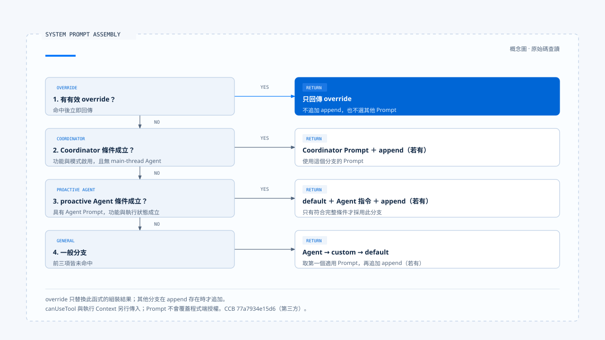

# 指令與行為

[English](./01-instructions-and-behavior.md) | [繁體中文](./01-instructions-and-behavior-zh-TW.md)

> 以下內容所提到的 
> CCR 為 [claude-code-best](https://github.com/claude-code-best/claude-code) 的簡稱。 
> Chat Gun 為 [chat-gun](https://github.com/HsienW/chat-gun)。

[回到導覽](./README-zh-TW.md) · 下一篇：[能力組裝](./02-capability-composition-zh-TW.md)

使用者要求「先讀取資料，再說明結果；沒有執行就不要宣稱成功」。產品可以把這句話放進 Prompt，也可以在回覆前核對工具結果。兩處都會影響行為，卻提供不同的證據：前者說明模型收到什麼要求，後者才有機會確認回答是否符合已發生的操作。

本篇從規則來源走到模型輸入，再對照程式中的檢查位置。實作依 查讀的 Chat Gun 與 Claude Code Best（CCB）固定版本撰寫；版本及範圍見[本區導覽](./README-zh-TW.md#來源與證據範圍)。CCB 是第三方專案，本文描述其原始碼可觀察的做法。

## 1. 規則需要來源與消費位置

同樣是一段自然語言，產品設定、當前要求、Skill 內容與檔案資料可能從不同入口進入任務。整理行為規則時，除了文字內容，還應記下誰提供它、適用到何時，以及哪個函式真正使用它。

| 來源 | 對行為的作用 | 需要核對的接點 |
|---|---|---|
| 產品或組織規則 | 定義角色、輸出方式與產品限制。 | 設定載入、Prompt 組裝與對應的程式檢查。 |
| 專案規則 | 提供工作區慣例與特定任務要求。 | 搜尋範圍、工作區信任及送入模型的位置。 |
| 本次使用者指令 | 定義目前要完成的工作與限制。 | 正規化結果、Current Task 與後續修訂。 |
| Skill 或 Agent 定義 | 提供領域指令，並可能帶入模型、工具規則或子任務設定。 | loader、觸發檢查與內容展開的 consumer。 |
| Memory、檔案及工具輸出 | 提供完成任務的材料。 | 來源標記與資料邊界；內容中的命令不能自行取得更高權威。 |

表格是閱讀架構的方法。具體產品的組裝順序仍要回到原始碼；[Context 信任邊界](../input-and-context/03-context-trust-boundary-zh-TW.md) 已說明來源權威，本篇接著追蹤這些要求如何生效。把某段文字排在最後，也不足以證明它能覆蓋所有產品政策。

## 2. CCB 如何組成有效 System Prompt

CCB 的 [`buildEffectiveSystemPrompt()`][ccb-system] 接收預設 Prompt、custom Prompt、Agent 定義與 append／override 設定，依條件選擇組裝方式。它沒有把所有來源一律串接。

| 條件 | 函式回傳的內容 |
|---|---|
| 有有效的 `overrideSystemPrompt` | 直接回傳 override，不再進入其他組裝分支。 |
| Coordinator 功能與模式啟用，且沒有 main-thread Agent 定義 | 使用 Coordinator Prompt，再接上存在的 append。 |
| 有 Agent Prompt，且指定的 proactive 功能及執行狀態成立 | 預設 Prompt 加上 Agent 指令，再接上 append。 |
| 一般分支 | 優先使用 Agent Prompt，其次 custom Prompt，否則使用 default；最後接上 append。 |

這些分支只描述函式管理的 System Prompt。`override` 的名稱並不表示它能改變程式端的檔案權限、工具授權或其他執行政策。

在 [REPL 的查詢路徑][ccb-repl]，組裝結果會存入 `toolUseContext.renderedSystemPrompt`，再以 `systemPrompt` 欄位交給 `query()`。同一次呼叫還分別傳入 `userContext`、`systemContext`、`canUseTool` 與工具執行 Context。專案資料和執行權限因此不能只靠這個 Prompt 函式解釋；應追到它們各自的傳入位置。

替換與追加也有維護成本。替換會讓原本由 default 提供的行為要求不再出現在這份結果中；追加則可能保留彼此衝突的文字。修改組裝策略後，應比較有效輸入，而非只檢查模板檔是否仍存在。

## 3. Chat Gun 的規則由 Agent 入口消費

Chat Gun 的 [`prompts.ts`][gun-prompts] 為 Chatbot、Math、MCP 等用途準備不同規則。MCP Prompt 要求選用合適工具、對敏感操作保持謹慎，並要求沒有工具結果時明確說明。這些文字可指出模型應遵循的行為，實際授權則由後續程式接點處理。

[MCP Agent][gun-mcp] 在 `callModel()` 內，依 `CONTEXT_ASSEMBLY_ENABLED_MCP` 選擇兩條輸入路徑：

- 啟用時，將 `mcpSystemMessage`、訊息與執行設定交給 `assembleMcpMessageContext()`。
- 關閉時，使用 `legacyMcpMessages()`，在訊息前放入帶有同一份政策文字的 system 訊息。

[Context 整合程式][gun-context] 會把政策以 `system_policy` 來源交給組裝器；MCP 的訊息重建也會放入該政策，再加入保留的任務與對話單元。這讓兩條分支都有可指出的規則 consumer，但兩者對歷史材料的篩選方式仍須各自理解，不能因共用 Prompt 就視為完全等價。

Agent 名稱也不能代替路徑檢查。[Math Agent][gun-math] 若成功抽取算式，會直接呼叫 calculator 並組成回覆；只有未抽取到算式時，才進入使用 `mathSystemMessage` 的模型分支。對這條直接計算路徑，程式決定工具與回覆格式，不能把結果歸因於模型遵循了 Math Prompt。

## 4. Skill 內容會帶入哪些行為條件

CCB 的 [Skill frontmatter parser][ccb-loader] 會解析說明、`allowed-tools`、模型設定、`disable-model-invocation`、`user-invocable`、Hook 與 `context: fork` 等欄位。這些欄位由不同 consumer 使用；欄位已被解析，只能先證明設定進入了資料結構。

例如 [SkillTool][ccb-skill] 的輸入檢查會確認 Skill 存在、允許模型觸發，且屬於 prompt 類型。一般的 inline 路徑接著展開 Prompt Command，回傳新增訊息及 Context 修改器。指定 fork 的 Skill 則走另一條子任務執行分支。

其中 `allowedTools` 在 inline 結果的 `contextModifier` 內，會合併到 `toolPermissionContext.alwaysAllowRules.command`。這是該路徑對 command allow 規則的更新，不能讀成「只有清單內工具才存在」，也不能當成 sandbox 隔離保證。若要主張它如何影響具體資源的授權，還要追讀 Permission consumer。

同樣地，Skill 可以攜帶 Hook 設定，並不代表任意 Hook 都已執行。本篇確認到解析與 Skill 展開的交接位置；Hook 的觸發時機、失敗語意與阻擋效果，應以對應執行路徑另行查證。

## 5. 一條要求可以有多個生效位置

以「只修改 README」為例，可以沿下表檢查設計。表中的安排是作者建議，實際產品須提供相應接線與證據。

| 位置 | 可以做的工作 | 能支持的結論 |
|---|---|---|
| 有效指令 | 保留使用者要求與任務範圍。 | 模型收到了這項限制。 |
| 能力曝光 | 視任務提供所需能力，隱藏無關或不允許使用的工具。 | 當次候選集合受到了哪些限制。 |
| 具體呼叫檢查 | 核對檔案路徑、操作身分、差異與批准範圍。 | 某一次操作是否符合可檢查的條件。 |
| 結果核對 | 比對工具結果與實際變更，再形成完成回覆。 | 回覆中的哪些陳述有證據。 |

回覆語言等要求可能主要依賴模型遵循；資源範圍則通常還有程式可檢查的條件。設計文件應說清楚保證到哪一層，避免用一句 Prompt 規則涵蓋未曾檢查的結果。

對 Chat Gun，MCP Agent 的 Prompt、模型工具綁定及授權 Graph 都有各自的程式位置。工具曝光留給[第二篇](./02-capability-composition-zh-TW.md)；單次行動的批准與派送，則由 Action Governance 主題進一步展開。

## 6. 規則缺失與衝突如何處理

修改 Prompt 的風險常出在交接處：custom 設定替換了 default，選用 Skill 載入失敗，或某份規則提到的工具根本沒有進入本次集合。這些情況應分開呈現，因為修補方式不同。

CCB 的 `commands.ts` 對部分 Skill 載入錯誤會記錄後繼續使用其他來源；這只能支持它採用選用擴充降級的結論，不能據此推論任何必要行為規則都可以略過。[來源組裝與錯誤處理見此][ccb-commands]。

對必要規則，較容易查證的設計是記錄其來源、適用範圍及組裝分支；如果無法取得，明確決定中止或採用哪份替代政策。這是本文提出的設計要求，並非宣稱 Chat Gun 已有一份完整的行為規則 manifest。

本篇完成的是從來源到有效指令的靜態追蹤，尚未執行衝突 Prompt 的模型測試。下一篇會把「要求使用什麼方法」接到真正可供任務使用的能力集合。

[ccb-system]: https://github.com/claude-code-best/claude-code/blob/77a7934e15d69da13879112ed7db695c9ee7a52a/src/utils/systemPrompt.ts
[ccb-repl]: https://github.com/claude-code-best/claude-code/blob/77a7934e15d69da13879112ed7db695c9ee7a52a/src/screens/REPL.tsx#L3499
[ccb-loader]: https://github.com/claude-code-best/claude-code/blob/77a7934e15d69da13879112ed7db695c9ee7a52a/src/skills/loadSkillsDir.ts#L185
[ccb-skill]: https://github.com/claude-code-best/claude-code/blob/77a7934e15d69da13879112ed7db695c9ee7a52a/packages/builtin-tools/src/tools/SkillTool/SkillTool.ts
[ccb-commands]: https://github.com/claude-code-best/claude-code/blob/77a7934e15d69da13879112ed7db695c9ee7a52a/src/commands.ts
[gun-prompts]: https://github.com/HsienW/chat-gun/blob/92a5673003e4ac4ec09be8b1b350f42dbf4a5e69/backend/src/prompts.ts
[gun-mcp]: https://github.com/HsienW/chat-gun/blob/92a5673003e4ac4ec09be8b1b350f42dbf4a5e69/backend/src/agents/mcp-agent.ts
[gun-context]: https://github.com/HsienW/chat-gun/blob/92a5673003e4ac4ec09be8b1b350f42dbf4a5e69/backend/src/agents/context-integration.ts
[gun-math]: https://github.com/HsienW/chat-gun/blob/92a5673003e4ac4ec09be8b1b350f42dbf4a5e69/backend/src/agents/math-agent.ts
