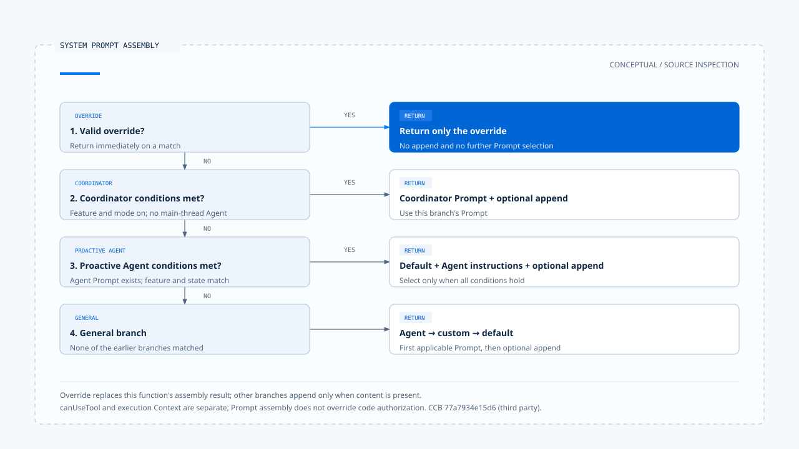

# Instructions and behavior

[English](./01-instructions-and-behavior.md) | [繁體中文](./01-instructions-and-behavior-zh-TW.md)

> In the following content:
> CCR is short for [claude-code-best](https://github.com/claude-code-best/claude-code).
> Chat Gun refers to [chat-gun](https://github.com/HsienW/chat-gun).

[Back to overview](./README.md) · Next: [Capability composition](./02-capability-composition.md)

The user asks, "Read the data before explaining the result; do not claim success without executing the operation." A product can put this sentence in a Prompt or check tool results before replying. Both affect behavior, but they provide different evidence: the former shows what the model was asked to do, while the latter offers a way to check whether the answer matches operations that actually occurred.

This article follows rules from their sources to model input, then compares the places where code checks them. The implementation discussion uses the pinned versions of Chat Gun and Claude Code Best (CCB) inspected on 2026-10-23; see the [section overview](./README.md#sources-and-evidence) for versions and scope. CCB is a third-party project, and this article describes behavior observable in its source.

## 1. Rules need a source and a consumer

Product settings, current requests, Skill content, and file data may all be natural language, but they can enter a task through different paths. When documenting behavior rules, record who supplied them, how long they apply, and which function actually uses them, as well as the text itself.

| Source | Effect on behavior | Integration points to check |
|---|---|---|
| Product or organization rules | Define roles, output conventions, and product restrictions. | Configuration loading, Prompt assembly, and corresponding code checks. |
| Project rules | Supply workspace conventions and task-specific requirements. | Search scope, workspace trust, and where the material enters model input. |
| Current user instructions | Define the work and restrictions for the current task. | Normalization results, the Current Task, and subsequent revisions. |
| Skill or Agent definitions | Supply domain instructions and possibly model settings, tool rules, or subtask configuration. | Loaders, invocation checks, and consumers of expanded content. |
| Memory, files, and tool output | Supply material for completing the task. | Source labels and data boundaries; commands within the content cannot grant themselves greater authority. |

The table provides a way to read the architecture. The assembly order of a specific product still requires checking its source; [Context trust boundary](../input-and-context/03-context-trust-boundary.md) explains source authority, and this article follows how those requirements take effect. Placing text last is also insufficient to prove that it can override every product policy.

## 2. How CCB builds the effective System Prompt

CCB's [`buildEffectiveSystemPrompt()`][ccb-system] accepts the default Prompt, custom Prompt, Agent definition, and append/override settings, then selects an assembly strategy according to conditions. It does not concatenate every source in all cases.

| Condition | Content returned by the function |
|---|---|
| A valid `overrideSystemPrompt` exists | Return the override directly without entering other assembly branches. |
| The Coordinator feature and mode are enabled, with no main-thread Agent definition | Use the Coordinator Prompt, followed by append if present. |
| An Agent Prompt exists, and the specified proactive feature and execution state are active | Combine the default Prompt and Agent instructions, followed by append. |
| General branch | Prefer the Agent Prompt, then the custom Prompt, otherwise the default; append additional content last. |

These branches describe only the System Prompt managed by this function. The name `override` does not mean it can change file permissions, tool authorization, or other execution policies enforced by code.

In the [REPL query path][ccb-repl], the assembled result is stored in `toolUseContext.renderedSystemPrompt`, then passed to `query()` through the `systemPrompt` field. The same call separately supplies `userContext`, `systemContext`, `canUseTool`, and the tool execution Context. Project data and execution permissions therefore cannot be explained through this Prompt function alone; follow where each is passed in.

Replacement and appending also have maintenance costs. Replacement removes behavior requirements originally supplied by the default from this result; appending may preserve conflicting text. After changing the assembly strategy, compare the effective input rather than merely checking that template files still exist.

## 3. Chat Gun's Agent entry points consume the rules

Chat Gun's [`prompts.ts`][gun-prompts] prepares different rules for Chatbot, Math, MCP, and other uses. The MCP Prompt asks the model to select suitable tools, handle sensitive operations cautiously, and state when tool results are unavailable. These instructions identify the expected model behavior; later code integration points handle actual authorization.

Inside `callModel()`, the [MCP Agent][gun-mcp] selects between two input paths according to `CONTEXT_ASSEMBLY_ENABLED_MCP`:

- When enabled, it passes `mcpSystemMessage`, messages, and execution settings to `assembleMcpMessageContext()`.
- When disabled, it uses `legacyMcpMessages()` to prepend a system message containing the same policy text.

The [Context integration code][gun-context] passes the policy to the assembler as the `system_policy` source; MCP message reconstruction also includes the policy before adding retained task and conversation units. Both branches therefore have identifiable rule consumers, but their filtering of historical material must be understood separately. Sharing a Prompt does not make them fully equivalent.

An Agent name also cannot replace path inspection. If the [Math Agent][gun-math] extracts an expression successfully, it calls the calculator directly and builds a reply; only when no expression is extracted does it enter the model branch that uses `mathSystemMessage`. On the direct calculation path, code selects the tool and reply format, so the result cannot be attributed to the model following the Math Prompt.

## 4. Which behavior conditions a Skill brings in

CCB's [Skill frontmatter parser][ccb-loader] parses fields including the description, `allowed-tools`, model settings, `disable-model-invocation`, `user-invocable`, Hooks, and `context: fork`. Different consumers use these fields; parsing a field initially proves only that the setting entered the data structure.

For example, [SkillTool][ccb-skill] checks that a Skill exists, allows model invocation, and is of the prompt type. The ordinary inline path then expands the Prompt Command and returns added messages and a Context modifier. A Skill configured for fork takes a separate subtask execution branch.

Within the inline result's `contextModifier`, `allowedTools` is merged into `toolPermissionContext.alwaysAllowRules.command`. This updates command allow rules on that path. It cannot be read as "only the listed tools exist" or treated as a sandbox isolation guarantee. Claims about its effect on authorization for specific resources require following the Permission consumer further.

Likewise, a Skill carrying Hook settings does not mean that any particular Hook has executed. This article confirms the handoff points for parsing and Skill expansion; Hook timing, failure semantics, and blocking effects require separate verification along the corresponding execution paths.

## 5. One requirement can take effect in several places

Use "modify only the README" to inspect a design through the following table. These arrangements are the author's recommendations; an actual product must provide the corresponding wiring and evidence.

| Location | Work it can perform | Conclusion it can support |
|---|---|---|
| Effective instructions | Preserve the user request and task scope. | The model received this restriction. |
| Capability exposure | Supply capabilities needed for the task and hide irrelevant or disallowed tools. | Which restrictions affected the candidate set for this request. |
| Concrete call checks | Check file paths, acting identity, differences, and approval scope. | Whether a particular operation meets inspectable conditions. |
| Result verification | Compare tool results with actual changes before forming a completion reply. | Which statements in the reply have supporting evidence. |

Requirements such as reply language may mainly depend on model compliance; resource scope usually also has conditions that code can check. Design documentation should state the level of guarantee provided, rather than using one Prompt rule to cover outcomes that were never checked.

In Chat Gun, the MCP Agent Prompt, model tool binding, and authorization Graph each have their own code locations. Tool exposure is covered in the [second article](./02-capability-composition.md); Action Governance expands approval and dispatch for individual actions.

## 6. Handling missing or conflicting rules

The risks of Prompt changes often appear at handoffs: a custom setting replaces the default, an optional Skill fails to load, or a tool named by a rule never enters the current set. Present these cases separately because their remedies differ.

CCB's `commands.ts` logs some Skill loading errors and continues with other sources. This supports the conclusion that optional extensions can degrade gracefully; it does not imply that any required behavior rule can be skipped. [See source composition and error handling here][ccb-commands].

For required rules, a design that is easier to verify records their source, scope, and assembly branch, and explicitly decides whether to stop or use a replacement policy when a rule is unavailable. This is a design requirement proposed by this article, not a claim that Chat Gun already has a complete behavior rule manifest.

This article completes a static trace from sources to effective instructions. Model tests with conflicting Prompts have not been run. The next article connects "which method to use" with the capabilities actually available to a task.

[ccb-system]: https://github.com/claude-code-best/claude-code/blob/77a7934e15d69da13879112ed7db695c9ee7a52a/src/utils/systemPrompt.ts
[ccb-repl]: https://github.com/claude-code-best/claude-code/blob/77a7934e15d69da13879112ed7db695c9ee7a52a/src/screens/REPL.tsx#L3499
[ccb-loader]: https://github.com/claude-code-best/claude-code/blob/77a7934e15d69da13879112ed7db695c9ee7a52a/src/skills/loadSkillsDir.ts#L185
[ccb-skill]: https://github.com/claude-code-best/claude-code/blob/77a7934e15d69da13879112ed7db695c9ee7a52a/packages/builtin-tools/src/tools/SkillTool/SkillTool.ts
[ccb-commands]: https://github.com/claude-code-best/claude-code/blob/77a7934e15d69da13879112ed7db695c9ee7a52a/src/commands.ts
[gun-prompts]: https://github.com/HsienW/chat-gun/blob/92a5673003e4ac4ec09be8b1b350f42dbf4a5e69/backend/src/prompts.ts
[gun-mcp]: https://github.com/HsienW/chat-gun/blob/92a5673003e4ac4ec09be8b1b350f42dbf4a5e69/backend/src/agents/mcp-agent.ts
[gun-context]: https://github.com/HsienW/chat-gun/blob/92a5673003e4ac4ec09be8b1b350f42dbf4a5e69/backend/src/agents/context-integration.ts
[gun-math]: https://github.com/HsienW/chat-gun/blob/92a5673003e4ac4ec09be8b1b350f42dbf4a5e69/backend/src/agents/math-agent.ts
