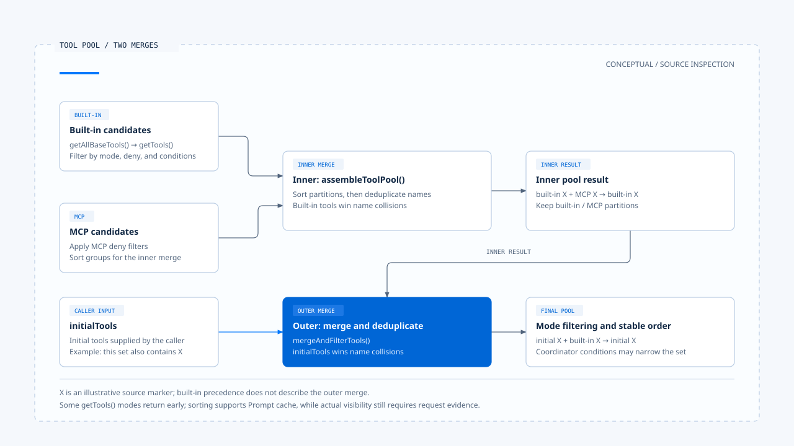
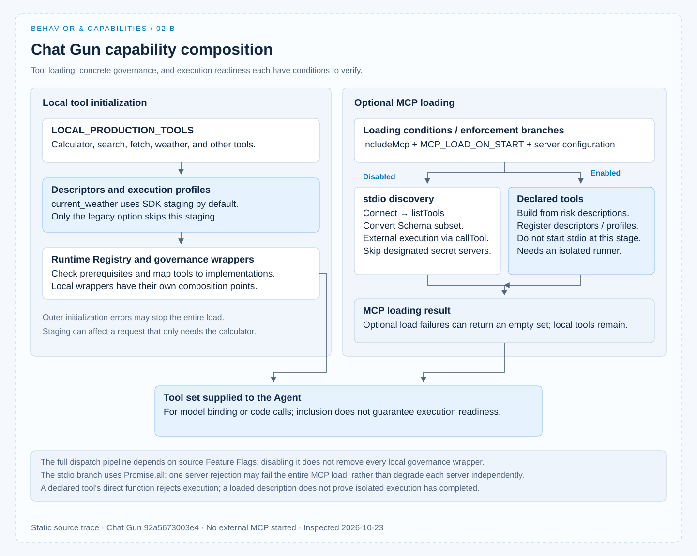

# 能力组装

[English](./02-capability-composition.md) | [繁體中文](./02-capability-composition-zh-TW.md) | [简体中文](./02-capability-composition-zh-CN.md)

> 以下内容所提到的
> CCR 为 [claude-code-best](https://github.com/claude-code-best/claude-code) 的简称。
> Chat Gun 为 [chat-gun](https://github.com/HsienW/chat-gun)。

[回到导览](./README-zh-CN.md) · 上一篇：[指令与行为](./01-instructions-and-behavior-zh-CN.md) · 下一篇：[能力选择](./03-capability-selection-zh-CN.md)

代码库里有一个工具，还需要经过发现、验证、组装及曝光，模型才可能使用它。工具被放进清单后，执行时仍可能缺少连接、身份或隔离环境。

本篇追踪能力如何进入任务，并指出加载完成与可执行之间还有哪些条件。

实现依 查读的 Chat Gun 与 CCB 固定版本撰写，详见[来源与证据范围](./README-zh-CN.md#来源与证据范围)。本轮采源代码查读，未启动外部 MCP 或执行整合测试。

## 1. 不同能力交付不同产物

Tool、Skill、Command、MCP、Plugin 与 Subagent 常一起出现在配置文件中，却不一定经过同一条执行路径。

| 项目 | 交付的主要内容 | 组装时要核对什麽 |
|---|---|---|
| Tool | 名称、描述、输入 Schema 与执行接口。 | 描述能否对回实现，以及输入与结果的契约。 |
| Skill | 可供搜索或触发的说明、指令内容及相关设置。 | 触发条件、内容展开、允许工具规则与作用范围。 |
| Command | host 动作，或展开成模型输入的 Prompt。 | 是直接在产品处理，还是需要进入模型调用。 |
| MCP | 外部 server 的能力发现、Schema 及协定转接。 | server 身份、连接、工具名称与执行条件。 |
| Plugin | 一组可加载的扩展来源。 | 实际加载了哪些 Skill、Command、Agent 或其他产物。 |
| Subagent | 子任务指令、能力范围与执行条件。 | 从父任务继承什麽、重新筛选什麽，以及结果如何返回。 |

这张表提供比较方式。接下来以 CCB 说明较完整的 Coding Agent 能力组装，再对照 Chat Gun 已可指出的 Tool 与 MCP 接点。

## 2. 先把描述对回执行接口

### CCB 的工具契约

CCB 的 [`Tool` 类型][ccb-tool] 同时定义以下接口：

- 输入 Schema。
- `isEnabled()` 与可选的输入验证。
- `checkPermissions()` 与 `call()`。

模型选择时需要的描述与程序执行时需要的检查，虽然放在同一个工具对象中，仍在不同时机使用。

### Chat Gun 的工具与 Runtime 描述

Chat Gun 的 [calculator][gun-calc] 以 LangChain `tool()` 定义名称、描述、`expression` 的 Zod Schema 与执行函数。

另由 [production descriptor 组装][gun-descriptors] 加上 Runtime 使用的数据：

- 版本、风险与只读属性。
- timeout 与 retry。
- execution profile 参照。

两者都可以追踪「这份描述最后由哪个接口执行」。Schema 只限制它所描述的输入：calculator 的 `expression` 是字串，这个类型本身不证明任意算式都安全；其内容检查、计算方法及执行环境还要另外核对。

## 3. CCB 的工具池有内外两层合并

### 内建候选与内层合并

在 [`src/tools.ts`][ccb-tools]，内建候选先经过以下处理：

1. `getAllBaseTools()` 建立受环境与功能条件影响的候选集合。
2. `getTools()` 处理 Simple／REPL 模式、整项工具的 deny 规则与 `isEnabled()` 等条件。

某些模式分支会提早返回，不能把一般分支的每个步骤套到所有模式。

`assembleToolPool()` 接着把内建工具与 MCP 工具合并。它对 MCP 套用 deny 筛选，分别排序两组，最后按名称去重；在这一层，同名项目保留内建工具。

### 外层合并与同名优先序

外层的 [`useMergedTools()`][ccb-merged] 还会调用 [`mergeAndFilterTools()`][ccb-pool]，把 `initialTools` 与刚组好的集合合并。这一层让 `initialTools` 在同名时优先，再依 Coordinator 模式进一步筛选。

两层的优先序应分开看：

- 内层同名时，保留内建工具。
- 外层同名时，保留 `initialTools`。

因此，「内建优先」是内层函数的规则，不能概括外层所有来源。

排序也有明确用途：此实现把内建与 MCP 保持为分区，以稳定 Prompt cache 的工具排列。它不是单纯为了画面整齐。若扩展了新的来源，去重、来源优先序与排序都需要一起检查。

## 4. Skill、Command 与子任务另有组装

### Command 来源与缓存

CCB 的 [`commands.ts`][ccb-commands] 汇整 bundled Skill、Skill 目录、Plugin、Workflow 与内建 Command 等来源。

`getCommands()` 取得缓存的加载结果后，再套用 availability 与 enablement 条件；动态发现的 Skill 也在这里合并。较外层的 Skill 清单函数另有缓存，不能从这个函数的重新筛选，推论所有使用位置都会立即刷新。

### Skill 清单与触发检查

Skill 的描述与实际触发，分别在两个位置检查：

- 给模型的清单会考虑 `disableModelInvocation`、Command 类型与说明字段。
- [SkillTool][ccb-skill] 收到实际调用时，会检查 Skill 是否存在、是否禁止模型触发，以及是否为 prompt 类型。

这让「清单上没有列出」与「收到名称后是否接受」各有可核对的位置。

### 子任务的能力解析

Subagent 需要重新解析能力范围。CCB 的 [`resolveAgentTools()`][ccb-agent] 以可用工具集合为基础，处理子 Agent 筛选、`disallowedTools`、明列工具或通配符，并返回有效与无效的项目。

这个结果仍须由 caller 使用；单看解析函数，不能宣称所有子任务都会以相同方式拒绝不合法设置。

本轮未在 Chat Gun 所查读的 Agent／Registry 路径确认与上述各 loader 对等的通用组装。正文因而以 CCB 解释这些能力的实现形式，再以 Chat Gun 的 Tool 与 MCP 路径做具体对照。

## 5. Chat Gun 从本地工具走到最终清单

### 本地工具与选用 MCP 的交接

Chat Gun 的 [Registry][gun-registry] 依下列步骤组装工具：

1. 由 `LOCAL_PRODUCTION_TOOLS` 取得本地工具。
2. 建立 execution profile 与 Runtime descriptor，套用治理包装。
3. 视设置加载 MCP。
4. 把本地与 MCP 工具交回 Agent，并记录工具加载信息。

图中是所读版本的组装概要。完整 dispatch pipeline 依 `source` 对应到以下开关：

- `TOOL_DISPATCH_PIPELINE_MATH_ENABLED`
- `TOOL_DISPATCH_PIPELINE_DEEP_RESEARCHER_ENABLED`
- `TOOL_DISPATCH_PIPELINE_MCP_ENABLED`

本地工具的治理包装另有自己的组装位置，不能把 pipeline 关闭说成所有治理都消失。

### current_weather 的 SDK 注册已接入

此版本的 Registry 对 `current_weather` 默认调用 [`stageCurrentWeatherSdkDescriptor()`][gun-sdk]；指定 `currentWeatherRegistration: "legacy"` 时才略过这次 staging。

Adapter 的处理顺序如下：

1. 比对 host 的工具名称、Schema、只读属性、风险政策、execution profile、egress 与 timeout／retry 条件。
2. 建立 manifest，交给 SDK 的 `registerTool()`。
3. 成功后检查 host 的 manifest 版本兼容性，并把确认后的部分字段放回 descriptor。

这段程序把宣告对回受信任的 host 条件；它不等于 SDK 已提供任意 sandbox runner，或整个部署已完成验收。

另外，staging 位在整批本地工具初始化期间。即使当次问题只需要 calculator，其他 descriptor 的初始化失败仍可能使 loader 无法完成。

## 6. MCP 的两种加载方式

选用 MCP 同时受 `includeMcp` 与 `MCP_LOAD_ON_START` 控制；server 设置和其他条件再由 [`mcp-loader.ts`][gun-loader] 判断。读这段程序时，必须区分两种方式。

| 分支 | 如何形成工具 | 还有哪些执行条件 |
|---|---|---|
| 未启用 execution profile enforcement | 透过 stdio client 连接，列出工具，转换 Schema，再以 `callTool()` 对应外部执行。 | server 可用性、治理与个别工具条件；需要 secret 的指定 server 会在此路径被略过并记录原因。 |
| 启用 enforcement | 由 server 的风险描述建立宣告工具，不在此阶段启动 stdio；之后注册 Runtime descriptor 与 profile。 | 隔离派送与 runner。宣告工具的直接函数会拒绝执行，必须走对应的隔离执行路径。 |

### Schema 转换的范围

- 隔离分支建立的宣告工具使用较宽的 record Schema，不能把它写成已取得外部 server 的完整细部参数约束。
- 一般发现分支的 `jsonSchemaToZod()` 只转换程序列出的子集，例如基本类型、properties、required、enum 与部分阵列条件。

没有处理的 JSON Schema 语义，需要另行验证。

MCP loader 会核对曝光名称，并建立默认拒绝未注册工具的风险 Registry。名称检查的范围是它收到的 MCP server 集合；本地与外部工具的完整冲突处理，仍要沿后续 Registry 注册与 caller 查证。

## 7. 加载失败会影响哪个范围

### 选用 MCP 加载失败

在 Chat Gun Registry，`loadOptionalMcpTools()` 会捕捉 MCP loader 的拒绝，记录警告并返回空集合；本地工具仍可继续组装。

一般 stdio 分支以 `Promise.all` 加载多个 server，其中一个拒绝可能使整次 MCP 加载失败。因此，不能将它描述成每个失败 server 都独立降级。[两层处理位置见 Registry][gun-registry]与 [loader][gun-loader]。

### 外层初始化失败与必要能力

这个选用 MCP fallback 不涵盖所有初始化错误。SDK staging、必要 descriptor 或其他前置条件在外层失败时，不能假设仍会取得本地工具清单。

产品若把某项能力视为必要条件，应在选用加载退回后再检查它是否存在，并向用户说明任务能完成到哪里。这是本文的设计建议；目前的「继续使用本地工具」记录，不能自行证明接口已向用户呈现降级状态。

能力组装完成后，接下来还要问：这份集合属于谁、适用到何时，以及由模型还是程序决定下一步。这些选择留到[下一篇](./03-capability-selection-zh-CN.md)。

[ccb-tool]: https://github.com/claude-code-best/claude-code/blob/77a7934e15d69da13879112ed7db695c9ee7a52a/src/Tool.ts
[ccb-tools]: https://github.com/claude-code-best/claude-code/blob/77a7934e15d69da13879112ed7db695c9ee7a52a/src/tools.ts
[ccb-merged]: https://github.com/claude-code-best/claude-code/blob/77a7934e15d69da13879112ed7db695c9ee7a52a/src/hooks/useMergedTools.ts
[ccb-pool]: https://github.com/claude-code-best/claude-code/blob/77a7934e15d69da13879112ed7db695c9ee7a52a/src/utils/toolPool.ts
[ccb-commands]: https://github.com/claude-code-best/claude-code/blob/77a7934e15d69da13879112ed7db695c9ee7a52a/src/commands.ts
[ccb-skill]: https://github.com/claude-code-best/claude-code/blob/77a7934e15d69da13879112ed7db695c9ee7a52a/packages/builtin-tools/src/tools/SkillTool/SkillTool.ts
[ccb-agent]: https://github.com/claude-code-best/claude-code/blob/77a7934e15d69da13879112ed7db695c9ee7a52a/packages/builtin-tools/src/tools/AgentTool/agentToolUtils.ts
[gun-calc]: https://github.com/HsienW/chat-gun/blob/92a5673003e4ac4ec09be8b1b350f42dbf4a5e69/backend/src/tools/calculator.ts
[gun-descriptors]: https://github.com/HsienW/chat-gun/blob/92a5673003e4ac4ec09be8b1b350f42dbf4a5e69/backend/src/tools/production-runtime-tool-descriptors.ts
[gun-registry]: https://github.com/HsienW/chat-gun/blob/92a5673003e4ac4ec09be8b1b350f42dbf4a5e69/backend/src/tools/registry.ts
[gun-sdk]: https://github.com/HsienW/chat-gun/blob/92a5673003e4ac4ec09be8b1b350f42dbf4a5e69/backend/src/tools/sdk/current-weather-manifest-adapter.ts
[gun-loader]: https://github.com/HsienW/chat-gun/blob/92a5673003e4ac4ec09be8b1b350f42dbf4a5e69/backend/src/tools/mcp-loader.ts
