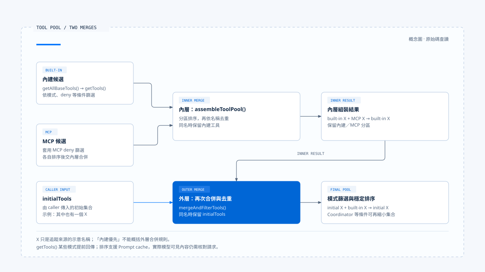
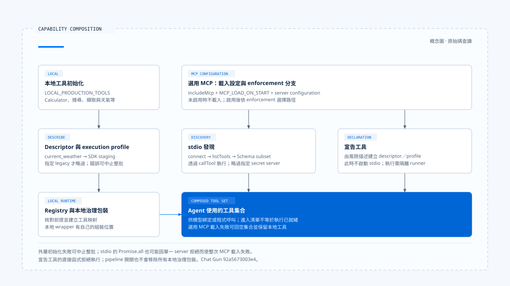

# 能力組裝

[English](./02-capability-composition.md) | [繁體中文](./02-capability-composition-zh-TW.md)

> 以下內容所提到的
> CCR 為 [claude-code-best](https://github.com/claude-code-best/claude-code) 的簡稱。
> Chat Gun 為 [chat-gun](https://github.com/HsienW/chat-gun)。

[回到導覽](./README-zh-TW.md) · 上一篇：[指令與行為](./01-instructions-and-behavior-zh-TW.md) · 下一篇：[能力選擇](./03-capability-selection-zh-TW.md)

程式庫裡有一個工具，還需要經過發現、驗證、組裝及曝光，模型才可能使用它。工具被放進清單後，執行時仍可能缺少連線、身分或隔離環境。

本篇追蹤能力如何進入任務，並指出載入完成與可執行之間還有哪些條件。

實作依 查讀的 Chat Gun 與 CCB 固定版本撰寫，詳見[來源與證據範圍](./README-zh-TW.md#來源與證據範圍)。本輪採原始碼查讀，未啟動外部 MCP 或執行整合測試。

## 1. 不同能力交付不同產物

Tool、Skill、Command、MCP、Plugin 與 Subagent 常一起出現在設定檔中，卻不一定經過同一條執行路徑。

| 項目 | 交付的主要內容 | 組裝時要核對什麼 |
|---|---|---|
| Tool | 名稱、描述、輸入 Schema 與執行介面。 | 描述能否對回實作，以及輸入與結果的契約。 |
| Skill | 可供搜尋或觸發的說明、指令內容及相關設定。 | 觸發條件、內容展開、允許工具規則與作用範圍。 |
| Command | host 動作，或展開成模型輸入的 Prompt。 | 是直接在產品處理，還是需要進入模型呼叫。 |
| MCP | 外部 server 的能力發現、Schema 及協定轉接。 | server 身分、連線、工具名稱與執行條件。 |
| Plugin | 一組可載入的擴充來源。 | 實際載入了哪些 Skill、Command、Agent 或其他產物。 |
| Subagent | 子任務指令、能力範圍與執行條件。 | 從父任務繼承什麼、重新篩選什麼，以及結果如何回傳。 |

這張表提供比較方式。接下來以 CCB 說明較完整的 Coding Agent 能力組裝，再對照 Chat Gun 已可指出的 Tool 與 MCP 接點。

## 2. 先把描述對回執行介面

### CCB 的工具契約

CCB 的 [`Tool` 型別][ccb-tool] 同時定義以下介面：

- 輸入 Schema。
- `isEnabled()` 與可選的輸入驗證。
- `checkPermissions()` 與 `call()`。

模型選擇時需要的描述與程式執行時需要的檢查，雖然放在同一個工具物件中，仍在不同時機使用。

### Chat Gun 的工具與 Runtime 描述

Chat Gun 的 [calculator][gun-calc] 以 LangChain `tool()` 定義名稱、描述、`expression` 的 Zod Schema 與執行函式。

另由 [production descriptor 組裝][gun-descriptors] 加上 Runtime 使用的資料：

- 版本、風險與唯讀屬性。
- timeout 與 retry。
- execution profile 參照。

兩者都可以追蹤「這份描述最後由哪個介面執行」。Schema 只限制它所描述的輸入：calculator 的 `expression` 是字串，這個型別本身不證明任意算式都安全；其內容檢查、計算方法及執行環境還要另外核對。

## 3. CCB 的工具池有內外兩層合併

### 內建候選與內層合併

在 [`src/tools.ts`][ccb-tools]，內建候選先經過以下處理：

1. `getAllBaseTools()` 建立受環境與功能條件影響的候選集合。
2. `getTools()` 處理 Simple／REPL 模式、整項工具的 deny 規則與 `isEnabled()` 等條件。

某些模式分支會提早回傳，不能把一般分支的每個步驟套到所有模式。

`assembleToolPool()` 接著把內建工具與 MCP 工具合併。它對 MCP 套用 deny 篩選，分別排序兩組，最後按名稱去重；在這一層，同名項目保留內建工具。

### 外層合併與同名優先序

外層的 [`useMergedTools()`][ccb-merged] 還會呼叫 [`mergeAndFilterTools()`][ccb-pool]，把 `initialTools` 與剛組好的集合合併。這一層讓 `initialTools` 在同名時優先，再依 Coordinator 模式進一步篩選。

兩層的優先序應分開看：

- 內層同名時，保留內建工具。
- 外層同名時，保留 `initialTools`。

因此，「內建優先」是內層函式的規則，不能概括外層所有來源。

排序也有明確用途：此實作把內建與 MCP 保持為分區，以穩定 Prompt cache 的工具排列。它不是單純為了畫面整齊。若擴充了新的來源，去重、來源優先序與排序都需要一起檢查。

## 4. Skill、Command 與子任務另有組裝

### Command 來源與快取

CCB 的 [`commands.ts`][ccb-commands] 彙整 bundled Skill、Skill 目錄、Plugin、Workflow 與內建 Command 等來源。

`getCommands()` 取得快取的載入結果後，再套用 availability 與 enablement 條件；動態發現的 Skill 也在這裡合併。較外層的 Skill 清單函式另有快取，不能從這個函式的重新篩選，推論所有使用位置都會立即刷新。

### Skill 清單與觸發檢查

Skill 的描述與實際觸發，分別在兩個位置檢查：

- 給模型的清單會考慮 `disableModelInvocation`、Command 類型與說明欄位。
- [SkillTool][ccb-skill] 收到實際呼叫時，會檢查 Skill 是否存在、是否禁止模型觸發，以及是否為 prompt 類型。

這讓「清單上沒有列出」與「收到名稱後是否接受」各有可核對的位置。

### 子任務的能力解析

Subagent 需要重新解析能力範圍。CCB 的 [`resolveAgentTools()`][ccb-agent] 以可用工具集合為基礎，處理子 Agent 篩選、`disallowedTools`、明列工具或萬用字元，並回傳有效與無效的項目。

這個結果仍須由 caller 使用；單看解析函式，不能宣稱所有子任務都會以相同方式拒絕不合法設定。

本輪未在 Chat Gun 所查讀的 Agent／Registry 路徑確認與上述各 loader 對等的通用組裝。正文因而以 CCB 解釋這些能力的實作形式，再以 Chat Gun 的 Tool 與 MCP 路徑做具體對照。

## 5. Chat Gun 從本地工具走到最終清單

### 本地工具與選用 MCP 的交接

Chat Gun 的 [Registry][gun-registry] 依下列步驟組裝工具：

1. 由 `LOCAL_PRODUCTION_TOOLS` 取得本地工具。
2. 建立 execution profile 與 Runtime descriptor，套用治理包裝。
3. 視設定載入 MCP。
4. 把本地與 MCP 工具交回 Agent，並記錄工具載入資訊。

圖中是所讀版本的組裝概要。完整 dispatch pipeline 依 `source` 對應到以下開關：

- `TOOL_DISPATCH_PIPELINE_MATH_ENABLED`
- `TOOL_DISPATCH_PIPELINE_DEEP_RESEARCHER_ENABLED`
- `TOOL_DISPATCH_PIPELINE_MCP_ENABLED`

本地工具的治理包裝另有自己的組裝位置，不能把 pipeline 關閉說成所有治理都消失。

### current_weather 的 SDK 註冊已接入

此版本的 Registry 對 `current_weather` 預設呼叫 [`stageCurrentWeatherSdkDescriptor()`][gun-sdk]；指定 `currentWeatherRegistration: "legacy"` 時才略過這次 staging。

Adapter 的處理順序如下：

1. 比對 host 的工具名稱、Schema、唯讀屬性、風險政策、execution profile、egress 與 timeout／retry 條件。
2. 建立 manifest，交給 SDK 的 `registerTool()`。
3. 成功後檢查 host 的 manifest 版本相容性，並把確認後的部分欄位放回 descriptor。

這段程式把宣告對回受信任的 host 條件；它不等於 SDK 已提供任意 sandbox runner，或整個部署已完成驗收。

另外，staging 位在整批本地工具初始化期間。即使當次問題只需要 calculator，其他 descriptor 的初始化失敗仍可能使 loader 無法完成。

## 6. MCP 的兩種載入方式

選用 MCP 同時受 `includeMcp` 與 `MCP_LOAD_ON_START` 控制；server 設定和其他條件再由 [`mcp-loader.ts`][gun-loader] 判斷。讀這段程式時，必須區分兩種方式。

| 分支 | 如何形成工具 | 還有哪些執行條件 |
|---|---|---|
| 未啟用 execution profile enforcement | 透過 stdio client 連線，列出工具，轉換 Schema，再以 `callTool()` 對應外部執行。 | server 可用性、治理與個別工具條件；需要 secret 的指定 server 會在此路徑被略過並記錄原因。 |
| 啟用 enforcement | 由 server 的風險描述建立宣告工具，不在此階段啟動 stdio；之後註冊 Runtime descriptor 與 profile。 | 隔離派送與 runner。宣告工具的直接函式會拒絕執行，必須走對應的隔離執行路徑。 |

### Schema 轉換的範圍

- 隔離分支建立的宣告工具使用較寬的 record Schema，不能把它寫成已取得外部 server 的完整細部參數約束。
- 一般發現分支的 `jsonSchemaToZod()` 只轉換程式列出的子集，例如基本型別、properties、required、enum 與部分陣列條件。

沒有處理的 JSON Schema 語意，需要另行驗證。

MCP loader 會核對曝光名稱，並建立預設拒絕未註冊工具的風險 Registry。名稱檢查的範圍是它收到的 MCP server 集合；本地與外部工具的完整衝突處理，仍要沿後續 Registry 註冊與 caller 查證。

## 7. 載入失敗會影響哪個範圍

### 選用 MCP 載入失敗

在 Chat Gun Registry，`loadOptionalMcpTools()` 會捕捉 MCP loader 的拒絕，記錄警告並回傳空集合；本地工具仍可繼續組裝。

一般 stdio 分支以 `Promise.all` 載入多個 server，其中一個拒絕可能使整次 MCP 載入失敗。因此，不能將它描述成每個失敗 server 都獨立降級。[兩層處理位置見 Registry][gun-registry]與 [loader][gun-loader]。

### 外層初始化失敗與必要能力

這個選用 MCP fallback 不涵蓋所有初始化錯誤。SDK staging、必要 descriptor 或其他前置條件在外層失敗時，不能假設仍會取得本地工具清單。

產品若把某項能力視為必要條件，應在選用載入退回後再檢查它是否存在，並向使用者說明任務能完成到哪裡。這是本文的設計建議；目前的「繼續使用本地工具」記錄，不能自行證明介面已向使用者呈現降級狀態。

能力組裝完成後，接下來還要問：這份集合屬於誰、適用到何時，以及由模型還是程式決定下一步。這些選擇留到[下一篇](./03-capability-selection-zh-TW.md)。

[ccb-tool]: https://github.com/claude-code-best/claude-code/blob/77a7934e15d69da13879112ed7db695c9ee7a52a/src/Tool.ts
[ccb-tools]: https://github.com/claude-code-best/claude-code/blob/77a7934e15d69da13879112ed7db695c9ee7a52a/src/tools.ts
[ccb-merged]: https://github.com/claude-code-best/claude-code/blob/77a7934e15d69da13879112ed7db695c9ee7a52a/src/hooks/useMergedTools.ts
[ccb-pool]: https://github.com/claude-code-best/claude-code/blob/77a7934e15d69da13879112ed7db695c9ee7a52a/src/utils/toolPool.ts
[ccb-commands]: https://github.com/claude-code-best/claude-code/blob/77a7934e15d69da13879112ed7db695c9ee7a52a/src/commands.ts
[ccb-skill]: https://github.com/claude-code-best/claude-code/blob/77a7934e15d69da13879112ed7db695c9ee7a52a/packages/builtin-tools/src/tools/SkillTool/SkillTool.ts
[ccb-agent]: https://github.com/claude-code-best/claude-code/blob/77a7934e15d69da13879112ed7db695c9ee7a52a/packages/builtin-tools/src/tools/AgentTool/agentToolUtils.ts
[gun-calc]: https://github.com/HsienW/chat-gun/blob/92a5673003e4ac4ec09be8b1b350f42dbf4a5e69/backend/src/tools/calculator.ts
[gun-descriptors]: https://github.com/HsienW/chat-gun/blob/92a5673003e4ac4ec09be8b1b350f42dbf4a5e69/backend/src/tools/production-runtime-tool-descriptors.ts
[gun-registry]: https://github.com/HsienW/chat-gun/blob/92a5673003e4ac4ec09be8b1b350f42dbf4a5e69/backend/src/tools/registry.ts
[gun-sdk]: https://github.com/HsienW/chat-gun/blob/92a5673003e4ac4ec09be8b1b350f42dbf4a5e69/backend/src/tools/sdk/current-weather-manifest-adapter.ts
[gun-loader]: https://github.com/HsienW/chat-gun/blob/92a5673003e4ac4ec09be8b1b350f42dbf4a5e69/backend/src/tools/mcp-loader.ts
