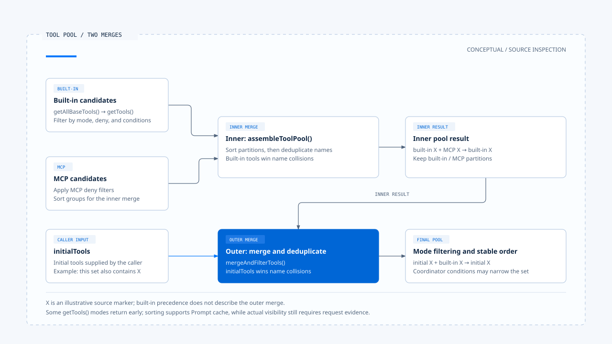
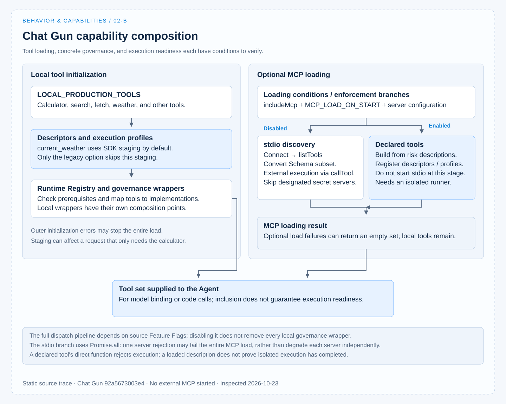

# Capability composition

[English](./02-capability-composition.md) | [繁體中文](./02-capability-composition-zh-TW.md)

> In the following content:
> CCR is short for [claude-code-best](https://github.com/claude-code-best/claude-code).
> Chat Gun refers to [chat-gun](https://github.com/HsienW/chat-gun).

[Back to overview](./README.md) · Previous: [Instructions and behavior](./01-instructions-and-behavior.md) · Next: [Capability selection](./03-capability-selection.md)

A tool in a codebase still needs discovery, validation, composition, and exposure before the model can use it. Even after a tool enters the list, execution may lack a connection, identity, or isolated environment.

This article traces how capabilities enter a task and identifies the conditions between successful loading and execution readiness.

The implementation discussion uses the pinned versions of Chat Gun and CCB; see [Sources and evidence](./README.md#sources-and-evidence). This work inspected source code without starting external MCP servers or running integration tests.

## 1. Different capabilities deliver different artifacts

Tools, Skills, Commands, MCP, Plugins, and Subagents often appear together in configuration, but they do not necessarily follow the same execution path.

| Item | Main content delivered | What to check during composition |
|---|---|---|
| Tool | Name, description, input Schema, and execution interface. | Whether the description maps to an implementation, and the input and result contracts. |
| Skill | A discoverable or invocable description, instructions, and related settings. | Invocation conditions, content expansion, tool allow rules, and scope. |
| Command | A host action, or a Prompt expanded into model input. | Whether the product handles it directly or it needs a model call. |
| MCP | Capability discovery, Schemas, and protocol adaptation for external servers. | Server identity, connections, tool names, and execution conditions. |
| Plugin | A set of loadable extension sources. | Which Skills, Commands, Agents, or other artifacts were actually loaded. |
| Subagent | Subtask instructions, capability scope, and execution conditions. | What it inherits from the parent, what it filters again, and how results return. |

This table provides a basis for comparison. The following sections use CCB to explain a more complete Coding Agent capability composition, then compare identifiable Tool and MCP integration points in Chat Gun.

## 2. Map descriptions back to execution interfaces

### CCB's tool contract

CCB's [`Tool` type][ccb-tool] defines these interfaces together:

- Input Schema.
- `isEnabled()` and optional input validation.
- `checkPermissions()` and `call()`.

The descriptions needed for model selection and the checks needed for code execution reside in the same tool object, but are used at different times.

### Chat Gun's tools and Runtime descriptions

Chat Gun's [calculator][gun-calc] uses LangChain `tool()` to define its name, description, Zod Schema for `expression`, and execution function.

The [production descriptor composition][gun-descriptors] adds data used by the Runtime:

- Version, risk, and read-only attributes.
- Timeout and retry settings.
- Execution profile references.

In both cases, it is possible to trace which interface ultimately executes the description. A Schema constrains only the input it describes: the calculator's `expression` is a string, but this type alone does not prove that arbitrary expressions are safe. Content checks, calculation methods, and the execution environment need separate inspection.

## 3. CCB merges its tool pool in two layers

### Built-in candidates and the inner merge

In [`src/tools.ts`][ccb-tools], built-in candidates first go through these steps:

1. `getAllBaseTools()` builds a candidate set affected by environment and feature conditions.
2. `getTools()` handles Simple/REPL modes, deny rules for entire tools, and conditions such as `isEnabled()`.

Some mode branches return early, so the general branch's steps cannot be applied to every mode.

`assembleToolPool()` then merges built-in and MCP tools. It applies deny filtering to MCP tools, sorts the two groups separately, and finally deduplicates by name; at this layer, the built-in tool wins a name collision.

### The outer merge and name precedence

The outer [`useMergedTools()`][ccb-merged] also calls [`mergeAndFilterTools()`][ccb-pool] to merge `initialTools` with the assembled set. At this layer, `initialTools` wins name collisions, followed by further filtering for Coordinator mode.

The precedence rules of the two layers should be read separately:

- The inner layer retains the built-in tool on a name collision.
- The outer layer retains `initialTools` on a name collision.

Thus, "built-in tools take precedence" is the inner function's rule and cannot be generalized to every source in the outer layer.

Sorting also has a specific purpose: the implementation keeps built-in and MCP tools partitioned to stabilize their order for the Prompt cache. It is not merely for visual tidiness. Adding a new source requires reviewing deduplication, source precedence, and sorting together.

## 4. Skills, Commands, and subtasks have separate composition paths

### Command sources and caching

CCB's [`commands.ts`][ccb-commands] gathers bundled Skills, Skill directories, Plugins, Workflows, built-in Commands, and other sources.

After retrieving cached loading results, `getCommands()` applies availability and enablement conditions; it also merges dynamically discovered Skills here. Outer Skill listing functions have their own caches, so this function's renewed filtering does not imply an immediate refresh at every consumer.

### Skill listings and invocation checks

Skill descriptions and actual invocation are checked in two places:

- The list supplied to the model considers `disableModelInvocation`, Command type, and description fields.
- On an actual call, [SkillTool][ccb-skill] checks whether the Skill exists, whether model invocation is prohibited, and whether it is of the prompt type.

This provides separate inspection points for "absent from the list" and "accepted after receiving the name."

### Resolving subtask capabilities

A Subagent needs its capability scope resolved again. CCB's [`resolveAgentTools()`][ccb-agent] starts with the available tool set, applies child Agent filtering, `disallowedTools`, explicit tool names or wildcards, and returns valid and invalid items.

The caller still has to use this result. The resolver alone cannot establish that every subtask rejects invalid configuration in the same way.

This inspection did not confirm generic composition equivalent to each of these loaders in the Chat Gun Agent/Registry paths examined. The article therefore uses CCB to explain their implementation forms and Chat Gun's Tool and MCP paths for concrete comparison.

## 5. Chat Gun: from local tools to the final list

### The handoff between local tools and optional MCP

Chat Gun's [Registry][gun-registry] composes tools through these steps:

1. Obtain local tools from `LOCAL_PRODUCTION_TOOLS`.
2. Build execution profiles and Runtime descriptors, and apply governance wrappers.
3. Load MCP according to configuration.
4. Return local and MCP tools to the Agent and record tool loading information.

The diagram summarizes composition in the inspected version. The full dispatch pipeline maps `source` to the following flags:

- `TOOL_DISPATCH_PIPELINE_MATH_ENABLED`
- `TOOL_DISPATCH_PIPELINE_DEEP_RESEARCHER_ENABLED`
- `TOOL_DISPATCH_PIPELINE_MCP_ENABLED`

Local tool governance wrappers have their own composition points. Disabling the pipeline cannot be described as removing all governance.

### SDK registration for current_weather is connected

In this version, the Registry calls [`stageCurrentWeatherSdkDescriptor()`][gun-sdk] for `current_weather` by default; only `currentWeatherRegistration: "legacy"` skips this staging step.

The adapter proceeds in this order:

1. Compare the host's tool name, Schema, read-only attributes, risk policy, execution profile, egress, and timeout/retry conditions.
2. Build a manifest and pass it to the SDK's `registerTool()`.
3. On success, check manifest version compatibility with the host and copy some confirmed fields back into the descriptor.

This code maps declarations back to trusted host conditions; it does not mean the SDK supplies an arbitrary sandbox runner or that the entire deployment has passed acceptance checks.

Staging also happens during initialization of the whole local tool set. Even if the current question needs only the calculator, another descriptor's initialization failure may prevent the loader from completing.

## 6. Two ways to load MCP

Optional MCP is controlled by both `includeMcp` and `MCP_LOAD_ON_START`; [`mcp-loader.ts`][gun-loader] then checks server configuration and other conditions. Distinguish two approaches when reading this code.

| Branch | How tools are formed | Remaining execution conditions |
|---|---|---|
| Execution profile enforcement disabled | Connect through a stdio client, list tools, convert Schemas, and map external execution through `callTool()`. | Server availability, governance, and individual tool conditions; designated servers requiring secrets are skipped on this path, with the reason recorded. |
| Enforcement enabled | Build declared tools from server risk descriptions without starting stdio at this stage; then register Runtime descriptors and profiles. | Isolated dispatch and a runner. The declared tool's direct function rejects execution, so it must follow the corresponding isolated execution path. |

### Scope of Schema conversion

- Declared tools on the isolated branch use a broad record Schema. They cannot be described as having obtained the external server's complete parameter constraints.
- The ordinary discovery branch's `jsonSchemaToZod()` converts only the subset listed in the code, such as basic types, properties, required, enum, and some array conditions.

JSON Schema semantics not handled by the conversion need separate validation.

The MCP loader checks exposed names and builds a risk Registry that denies unregistered tools by default. Name checks cover the set of MCP servers it receives; complete collision handling between local and external tools still requires tracing subsequent Registry registration and callers.

## 7. The scope affected by a loading failure

### Optional MCP loading failures

In Chat Gun's Registry, `loadOptionalMcpTools()` catches rejections from the MCP loader, logs a warning, and returns an empty set; local tool composition can continue.

The ordinary stdio branch loads multiple servers with `Promise.all`, so one rejection can fail the entire MCP load. It cannot therefore be described as independent degradation for each failed server. See the [Registry][gun-registry] and [loader][gun-loader] for these two handling layers.

### Outer initialization failures and required capabilities

The optional MCP fallback does not cover every initialization error. If SDK staging, required descriptors, or other prerequisites fail in the outer layer, a local tool list cannot be assumed to remain available.

If a product treats a capability as required, it should check for its presence after optional loading falls back and tell the user how much of the task remains possible. This is the article's design recommendation; the existing "continue with local tools" record alone cannot prove that the interface presents the degraded state to the user.

Once composition is complete, the next questions are who the set belongs to, how long it applies, and whether the model or code decides the next step. These choices are covered in the [next article](./03-capability-selection.md).

[ccb-tool]: https://github.com/claude-code-best/claude-code/blob/77a7934e15d69da13879112ed7db695c9ee7a52a/src/Tool.ts
[ccb-tools]: https://github.com/claude-code-best/claude-code/blob/77a7934e15d69da13879112ed7db695c9ee7a52a/src/tools.ts
[ccb-merged]: https://github.com/claude-code-best/claude-code/blob/77a7934e15d69da13879112ed7db695c9ee7a52a/src/hooks/useMergedTools.ts
[ccb-pool]: https://github.com/claude-code-best/claude-code/blob/77a7934e15d69da13879112ed7db695c9ee7a52a/src/utils/toolPool.ts
[ccb-commands]: https://github.com/claude-code-best/claude-code/blob/77a7934e15d69da13879112ed7db695c9ee7a52a/src/commands.ts
[ccb-skill]: https://github.com/claude-code-best/claude-code/blob/77a7934e15d69da13879112ed7db695c9ee7a52a/packages/builtin-tools/src/tools/SkillTool/SkillTool.ts
[ccb-agent]: https://github.com/claude-code-best/claude-code/blob/77a7934e15d69da13879112ed7db695c9ee7a52a/packages/builtin-tools/src/tools/AgentTool/agentToolUtils.ts
[gun-calc]: https://github.com/HsienW/chat-gun/blob/92a5673003e4ac4ec09be8b1b350f42dbf4a5e69/backend/src/tools/calculator.ts
[gun-descriptors]: https://github.com/HsienW/chat-gun/blob/92a5673003e4ac4ec09be8b1b350f42dbf4a5e69/backend/src/tools/production-runtime-tool-descriptors.ts
[gun-registry]: https://github.com/HsienW/chat-gun/blob/92a5673003e4ac4ec09be8b1b350f42dbf4a5e69/backend/src/tools/registry.ts
[gun-sdk]: https://github.com/HsienW/chat-gun/blob/92a5673003e4ac4ec09be8b1b350f42dbf4a5e69/backend/src/tools/sdk/current-weather-manifest-adapter.ts
[gun-loader]: https://github.com/HsienW/chat-gun/blob/92a5673003e4ac4ec09be8b1b350f42dbf4a5e69/backend/src/tools/mcp-loader.ts
