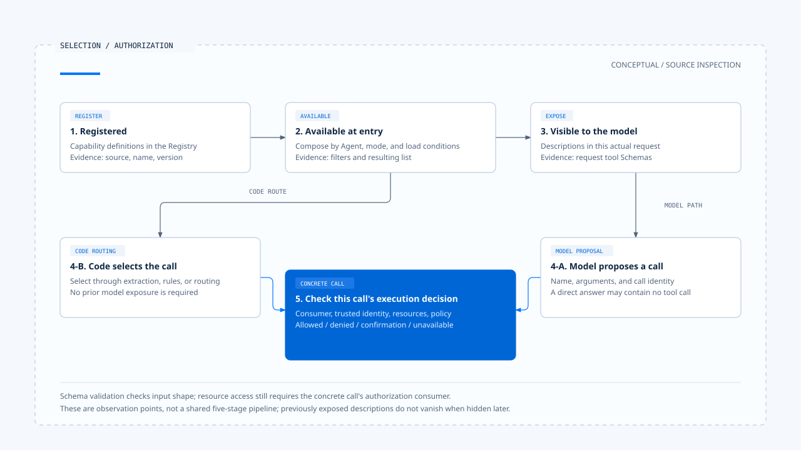

# 能力选择

[English](./03-capability-selection.md) | [繁體中文](./03-capability-selection-zh-TW.md) | [简体中文](./03-capability-selection-zh-CN.md)

> 以下内容所提到的
> CCB 为 [claude-code-best](https://github.com/claude-code-best/claude-code) 的简称。
> Chat Gun 为 [chat-gun](https://github.com/HsienW/chat-gun)。

[回到导览](./README-zh-CN.md) · 上一篇：[能力组装](./02-capability-composition-zh-CN.md) · 下一篇：[能力使用案例](./04-case-capability-use-zh-CN.md)

同一个 calculator，可以由模型提出 Tool Call，也可以由程序从输入抽取算式后直接调用。最后都得到数字，却不能用相同方式解释「谁选了工具」。

产品提供候选范围、程序决定路由、模型提出行动，以及系统允许执行，是可以分别查证的决策。

本篇依[导览所列的固定版本](./README-zh-CN.md#来源与证据范围)追踪 CCB 与 Chat Gun，重点放在候选集合与具体调用之间的交接。各段的程序行为来自本轮源代码查读，并非 live Provider 验收结果。

## 1. 在不同位置记录选择

| 观察位置 | 可以问的问题 | 所需证据 |
|---|---|---|
| 已注册 | 产品能找到哪些能力定义？ | Registry、版本与来源。 |
| 入口可用 | 当前 Agent、模式或环境保留哪些能力？ | 筛选条件、加载结果与 consumer。 |
| 模型可见 | 这次模型请求实际带入哪些描述？ | 当次请求的工具 Schema 或其他能力描述。 |
| 提出调用 | 是模型选择，还是程序直接决定？ | 模型 Tool Call 或程序路由分支。 |
| 取得执行决策 | 这次调用是否符合身份、资源与政策条件？ | 具体调用的治理结果。 |

这些位置不一定由五个独立模块实现。例如：

- 同一个 deny 规则可以参与曝光筛选，也可以在执行时再次检查。
- 同一个工具池可能经 API 转接后，才形成请求描述。

因此，产品内部有一份工具阵列，仍不足以重建模型实际看见的内容。

## 2. CCB 先缩小可用工具池

### 候选集合与参数权限

CCB 的 [`getTools()`][ccb-tools] 会依模式、整项工具的 deny 规则与 enablement 组装可用工具。例如一般的 Simple 模式会挑选 Bash、Read、Edit，而 REPL 或 Coordinator 的条件可能改变该集合。

这是模式分支的实现，不能概括成「所有 Simple 请求固定只有三个工具」。

`assembleToolPool()` 对 MCP 也套用 deny 筛选；外层 [`mergeAndFilterTools()`][ccb-pool] 再依 Coordinator 模式缩小集合。

- 候选筛选发生在模型提出具体参数之前，回答的是哪些工具可以进入候选范围。
- 带有文件或参数条件的权限判断，仍需到具体调用的位置核对。

### 子任务的范围还要重新解析

[`resolveAgentTools()`][ccb-agent] 从可用工具开始处理子 Agent 的限制：

1. `disallowedTools` 先排除指定工具。
2. 如果 `tools` 未设置或只含 `*`，返回已经过前面筛选的集合。
3. 若列出具体工具，逐项解析并区分 `validTools`、`invalidTools` 与 `resolvedTools`。

所以通配符的意义取决于传入集合与先前的筛选。无效名称出现在返回数据中，也不代表 caller 必然中止整个任务，必须再看其处理方式。

### fork 继承的筛选

CCB 的 fork 路径另有 [`filterParentToolsForFork()`][ccb-fork]，用来在继承父工具时排除共同禁用项目。

一般 Agent 定义解析与 fork 继承是不同的程序路径，完整的委派保证需要逐条追 consumer。

## 3. Skill 的可见与可触发分开检查

### 呈现设置与模型触发设置

CCB [Skill 设置解析][ccb-loader] 分别保留两个字段：

- `user-invocable`：与用户端的呈现设置有关。
- `disable-model-invocation`：会进入模型触发的检查。

两个字段不能只用「启用或关闭 Skill」概括。

### 描述清单与实际请求

- [`getSkillToolCommands()`][ccb-commands] 筛选 prompt 类型、模型触发设置与说明条件，形成供模型使用的清单。
- [SkillTool 的 `validateInput()`][ccb-skill] 收到名称后，拒绝不存在、禁止模型触发或类型不合的 Command。

这是两个不同的观察点：一个决定描述清单，一个决定实际请求是否被接受。

当 Skill 展开后更新 command allow 规则，能力条件可能随 Context 改变；若指定 fork，也会改走子任务。要理解这次选择的范围，需要记录它使用的是展开前、展开后还是子任务自己的工具集合。

## 4. Chat Gun 有模型选择与程序直接路由

### MCP Agent 把工具交给模型

Chat Gun 的 [MCP Agent][gun-mcp] 在模块初始化时调用 `loadAgentToolRuntime("mcp_agent", { includeMcp: true })`。

每次进入 `callModel()`，它依序处理：

1. 建立用途为 `tool` 的模型。
2. 将工具交给 `bindTools(tools)`。
3. 送出模型输入。

模型响应后，Graph 依调用内容分流：

- 有 `tool_calls`：进入 `authorization_gate`。
- 没有调用：`shouldContinue()` 将流程导向结束。

Prompt 虽要求适时使用工具，程序仍保留模型直接回答的分支。要声称某次答案使用了 calculator，必须取得那次调用与结果。

### Math Agent 可以直接选 calculator

在 [Math Agent][gun-math] 的 `callModel()` 中，算式抽取与后续分支如下：

1. 取得最新用户消息，找出符合模式且带数字的候选片段。
2. 选最长的一段作为算式。
3. 若存在算式，直接调用 `mathCalculatorTool.invoke()`，并以模板返回结果；这一分支不先调用模型。

没有抽取到算式时，它才组装 Math Prompt 并调用模型。这种简单路由可以省去一次模型选择，但抽取方式不等同完整自然语言理解；输入中有多个算式或数字片段时，还需要具体案例检查选中了什麽。

### source 与每租户工具筛选的差别

[Registry][gun-registry] 的 `source` 用来查对应的 dispatch pipeline Feature Flag。本轮函数没有依每次请求的 Principal 或 Tenant 缩小本地工具集合。

这不等于整个产品没有身份治理；它只限定了在此函数能观察到的能力曝光行为。

未知 `source` 会使这个 pipeline 开关判断为关闭，不能因此推出「未知 Agent 没有任何工具」。如果产品需要每租户的可见能力清单，应另外指出筛选入口、可信身份来源与传到模型的结果。

## 5. Provider 兼容性也是前置条件

### gateway 的能力宣告

[Chat Gun gateway][gun-gateway] 使用 `capabilitiesForProvider()` 宣告能力，并在相关路径调用 `assertProviderCapability()`。例如：

- 所读版本将 `ccr` 宣告为不支持 Tool Calling。
- OpenAI-compatible／Qwen 的工具绑定路径会建立 Schema 对照与工具描述。

这些是该 gateway 版本的宣告及转接方式，不能用来概括外部 Provider 的全部产品能力。实际端点还可能因模型、设置或返回格式而失败。只检查 `bindTools` 方法存在，也不足以证明任意端点已能完成工具往返。

### 回应解码与模型切换

模型响应的解码同样会缩小可接受的调用。这个 gateway 的相关分支会核对工具名称是否能对到 Schema，并验证参数；找不到 Schema 或验证失败会形成解码诊断。

这些检查处理协定与输入有效性，资源是否获准仍由后续授权决策负责。

若要换用模型或 fallback，应重新核对工具绑定、结构化输出、Context 容量及任务所需能力。这是选择流程应维护的前提；某个 Provider 支持文字回答，不代表它能接续原本需要工具调用的任务。

## 6. 能力清单有生命周期

### 加载结果与刷新时机

- CCB 的部分能力来源有缓存，Command 层还有重新筛选与清除缓存的接口。
- Chat Gun MCP Agent 在模块初始化时持有加载结果，后续模型回合使用这份 `tools`。

两者都需要从实际 consumer 判定刷新时机，不能只因来源已更新就假设本次执行已套用。

政策或连接可能在任务途中改变。已出现在模型输入中的工具描述，不会因之后隐藏清单就从模型记忆中消失。因此，当模型提出调用时，程序仍需确认名称、版本与当前执行条件。

### 能力快照的记录建议

为了追踪这类差异，产品可以在证据中记录：

- 能力集合的识别与组装时间。
- Agent／模式与来源版本。
- 模型请求关联。

这是本文提出的设计建议；本轮未确认 Chat Gun 已汇出包含所有这些字段的能力快照。

## 7. 交给行动治理的单位是具体调用

[MCP Agent 的授权节点][gun-auth] 会从模型调用中取得工具名称与参数，再找对应工具及治理执行器。若无法取得可授权的执行接口，该路径返回 `AUTHORIZATION_UNAVAILABLE`；它不会只凭模型提出一个名称就派送。

能力选择交付了候选范围与提案，逐次治理则接着核对可信执行身份、资源及批准等条件。下一篇把这些位置放回同一个计算案例，对照模型选工具和程序直接调用的证据。

[ccb-tools]: https://github.com/claude-code-best/claude-code/blob/77a7934e15d69da13879112ed7db695c9ee7a52a/src/tools.ts
[ccb-pool]: https://github.com/claude-code-best/claude-code/blob/77a7934e15d69da13879112ed7db695c9ee7a52a/src/utils/toolPool.ts
[ccb-agent]: https://github.com/claude-code-best/claude-code/blob/77a7934e15d69da13879112ed7db695c9ee7a52a/packages/builtin-tools/src/tools/AgentTool/agentToolUtils.ts
[ccb-fork]: https://github.com/claude-code-best/claude-code/blob/77a7934e15d69da13879112ed7db695c9ee7a52a/src/utils/agentToolFilter.ts
[ccb-loader]: https://github.com/claude-code-best/claude-code/blob/77a7934e15d69da13879112ed7db695c9ee7a52a/src/skills/loadSkillsDir.ts#L185
[ccb-commands]: https://github.com/claude-code-best/claude-code/blob/77a7934e15d69da13879112ed7db695c9ee7a52a/src/commands.ts
[ccb-skill]: https://github.com/claude-code-best/claude-code/blob/77a7934e15d69da13879112ed7db695c9ee7a52a/packages/builtin-tools/src/tools/SkillTool/SkillTool.ts
[gun-mcp]: https://github.com/HsienW/chat-gun/blob/92a5673003e4ac4ec09be8b1b350f42dbf4a5e69/backend/src/agents/mcp-agent.ts
[gun-math]: https://github.com/HsienW/chat-gun/blob/92a5673003e4ac4ec09be8b1b350f42dbf4a5e69/backend/src/agents/math-agent.ts
[gun-registry]: https://github.com/HsienW/chat-gun/blob/92a5673003e4ac4ec09be8b1b350f42dbf4a5e69/backend/src/tools/registry.ts
[gun-gateway]: https://github.com/HsienW/chat-gun/blob/92a5673003e4ac4ec09be8b1b350f42dbf4a5e69/backend/src/platform/llm-gateway.ts
[gun-auth]: https://github.com/HsienW/chat-gun/blob/92a5673003e4ac4ec09be8b1b350f42dbf4a5e69/backend/src/runtime/authorization/confirmation-graph.ts
