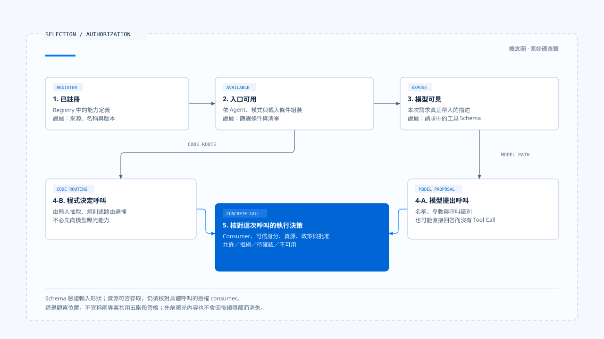

# 能力選擇

[English](./03-capability-selection.md) | [繁體中文](./03-capability-selection-zh-TW.md)

> 以下內容所提到的
> CCR 為 [claude-code-best](https://github.com/claude-code-best/claude-code) 的簡稱。
> Chat Gun 為 [chat-gun](https://github.com/HsienW/chat-gun)。

[回到導覽](./README-zh-TW.md) · 上一篇：[能力組裝](./02-capability-composition-zh-TW.md) · 下一篇：[能力使用案例](./04-case-capability-use-zh-TW.md)

同一個 calculator，可以由模型提出 Tool Call，也可以由程式從輸入抽取算式後直接呼叫。最後都得到數字，卻不能用相同方式解釋「誰選了工具」。

產品提供候選範圍、程式決定路由、模型提出行動，以及系統允許執行，是可以分別查證的決策。

本篇依[導覽所列的固定版本](./README-zh-TW.md#來源與證據範圍)追蹤 CCB 與 Chat Gun，重點放在候選集合與具體呼叫之間的交接。各段的程式行為來自本輪原始碼查讀，並非 live Provider 驗收結果。

## 1. 在不同位置記錄選擇

| 觀察位置 | 可以問的問題 | 所需證據 |
|---|---|---|
| 已註冊 | 產品能找到哪些能力定義？ | Registry、版本與來源。 |
| 入口可用 | 當前 Agent、模式或環境保留哪些能力？ | 篩選條件、載入結果與 consumer。 |
| 模型可見 | 這次模型請求實際帶入哪些描述？ | 當次請求的工具 Schema 或其他能力描述。 |
| 提出呼叫 | 是模型選擇，還是程式直接決定？ | 模型 Tool Call 或程式路由分支。 |
| 取得執行決策 | 這次呼叫是否符合身分、資源與政策條件？ | 具體呼叫的治理結果。 |

這些位置不一定由五個獨立模組實作。例如：

- 同一個 deny 規則可以參與曝光篩選，也可以在執行時再次檢查。
- 同一個工具池可能經 API 轉接後，才形成請求描述。

因此，產品內部有一份工具陣列，仍不足以重建模型實際看見的內容。

## 2. CCB 先縮小可用工具池

### 候選集合與參數權限

CCB 的 [`getTools()`][ccb-tools] 會依模式、整項工具的 deny 規則與 enablement 組裝可用工具。例如一般的 Simple 模式會挑選 Bash、Read、Edit，而 REPL 或 Coordinator 的條件可能改變該集合。

這是模式分支的實作，不能概括成「所有 Simple 請求固定只有三個工具」。

`assembleToolPool()` 對 MCP 也套用 deny 篩選；外層 [`mergeAndFilterTools()`][ccb-pool] 再依 Coordinator 模式縮小集合。

- 候選篩選發生在模型提出具體參數之前，回答的是哪些工具可以進入候選範圍。
- 帶有檔案或參數條件的權限判斷，仍需到具體呼叫的位置核對。

### 子任務的範圍還要重新解析

[`resolveAgentTools()`][ccb-agent] 從可用工具開始處理子 Agent 的限制：

1. `disallowedTools` 先排除指定工具。
2. 如果 `tools` 未設定或只含 `*`，回傳已經過前面篩選的集合。
3. 若列出具體工具，逐項解析並區分 `validTools`、`invalidTools` 與 `resolvedTools`。

所以萬用字元的意義取決於傳入集合與先前的篩選。無效名稱出現在回傳資料中，也不代表 caller 必然中止整個任務，必須再看其處理方式。

### fork 繼承的篩選

CCB 的 fork 路徑另有 [`filterParentToolsForFork()`][ccb-fork]，用來在繼承父工具時排除共同禁用項目。

一般 Agent 定義解析與 fork 繼承是不同的程式路徑，完整的委派保證需要逐條追 consumer。

## 3. Skill 的可見與可觸發分開檢查

### 呈現設定與模型觸發設定

CCB [Skill 設定解析][ccb-loader] 分別保留兩個欄位：

- `user-invocable`：與使用者端的呈現設定有關。
- `disable-model-invocation`：會進入模型觸發的檢查。

兩個欄位不能只用「啟用或關閉 Skill」概括。

### 描述清單與實際請求

- [`getSkillToolCommands()`][ccb-commands] 篩選 prompt 類型、模型觸發設定與說明條件，形成供模型使用的清單。
- [SkillTool 的 `validateInput()`][ccb-skill] 收到名稱後，拒絕不存在、禁止模型觸發或類型不合的 Command。

這是兩個不同的觀察點：一個決定描述清單，一個決定實際請求是否被接受。

當 Skill 展開後更新 command allow 規則，能力條件可能隨 Context 改變；若指定 fork，也會改走子任務。要理解這次選擇的範圍，需要記錄它使用的是展開前、展開後還是子任務自己的工具集合。

## 4. Chat Gun 有模型選擇與程式直接路由

### MCP Agent 把工具交給模型

Chat Gun 的 [MCP Agent][gun-mcp] 在模組初始化時呼叫 `loadAgentToolRuntime("mcp_agent", { includeMcp: true })`。

每次進入 `callModel()`，它依序處理：

1. 建立用途為 `tool` 的模型。
2. 將工具交給 `bindTools(tools)`。
3. 送出模型輸入。

模型回應後，Graph 依呼叫內容分流：

- 有 `tool_calls`：進入 `authorization_gate`。
- 沒有呼叫：`shouldContinue()` 將流程導向結束。

Prompt 雖要求適時使用工具，程式仍保留模型直接回答的分支。要聲稱某次答案使用了 calculator，必須取得那次呼叫與結果。

### Math Agent 可以直接選 calculator

在 [Math Agent][gun-math] 的 `callModel()` 中，算式抽取與後續分支如下：

1. 取得最新使用者訊息，找出符合模式且帶數字的候選片段。
2. 選最長的一段作為算式。
3. 若存在算式，直接呼叫 `mathCalculatorTool.invoke()`，並以模板回傳結果；這一分支不先呼叫模型。

沒有抽取到算式時，它才組裝 Math Prompt 並呼叫模型。這種簡單路由可以省去一次模型選擇，但抽取方式不等同完整自然語言理解；輸入中有多個算式或數字片段時，還需要具體案例檢查選中了什麼。

### source 與每租戶工具篩選的差別

[Registry][gun-registry] 的 `source` 用來查對應的 dispatch pipeline Feature Flag。本輪函式沒有依每次請求的 Principal 或 Tenant 縮小本地工具集合。

這不等於整個產品沒有身分治理；它只限定了在此函式能觀察到的能力曝光行為。

未知 `source` 會使這個 pipeline 開關判斷為關閉，不能因此推出「未知 Agent 沒有任何工具」。如果產品需要每租戶的可見能力清單，應另外指出篩選入口、可信身分來源與傳到模型的結果。

## 5. Provider 相容性也是前置條件

### gateway 的能力宣告

[Chat Gun gateway][gun-gateway] 使用 `capabilitiesForProvider()` 宣告能力，並在相關路徑呼叫 `assertProviderCapability()`。例如：

- 所讀版本將 `ccr` 宣告為不支援 Tool Calling。
- OpenAI-compatible／Qwen 的工具綁定路徑會建立 Schema 對照與工具描述。

這些是該 gateway 版本的宣告及轉接方式，不能用來概括外部 Provider 的全部產品能力。實際端點還可能因模型、設定或回傳格式而失敗。只檢查 `bindTools` 方法存在，也不足以證明任意端點已能完成工具往返。

### 回應解碼與模型切換

模型回應的解碼同樣會縮小可接受的呼叫。這個 gateway 的相關分支會核對工具名稱是否能對到 Schema，並驗證參數；找不到 Schema 或驗證失敗會形成解碼診斷。

這些檢查處理協定與輸入有效性，資源是否獲准仍由後續授權決策負責。

若要換用模型或 fallback，應重新核對工具綁定、結構化輸出、Context 容量及任務所需能力。這是選擇流程應維護的前提；某個 Provider 支援文字回答，不代表它能接續原本需要工具呼叫的任務。

## 6. 能力清單有生命週期

### 載入結果與刷新時機

- CCB 的部分能力來源有快取，Command 層還有重新篩選與清除快取的介面。
- Chat Gun MCP Agent 在模組初始化時持有載入結果，後續模型回合使用這份 `tools`。

兩者都需要從實際 consumer 判定刷新時機，不能只因來源已更新就假設本次執行已套用。

政策或連線可能在任務途中改變。已出現在模型輸入中的工具描述，不會因之後隱藏清單就從模型記憶中消失。因此，當模型提出呼叫時，程式仍需確認名稱、版本與當前執行條件。

### 能力快照的記錄建議

為了追蹤這類差異，產品可以在證據中記錄：

- 能力集合的識別與組裝時間。
- Agent／模式與來源版本。
- 模型請求關聯。

這是本文提出的設計建議；本輪未確認 Chat Gun 已匯出包含所有這些欄位的能力快照。

## 7. 交給行動治理的單位是具體呼叫

[MCP Agent 的授權節點][gun-auth] 會從模型呼叫中取得工具名稱與參數，再找對應工具及治理執行器。若無法取得可授權的執行介面，該路徑回傳 `AUTHORIZATION_UNAVAILABLE`；它不會只憑模型提出一個名稱就派送。

能力選擇交付了候選範圍與提案，逐次治理則接著核對可信執行身分、資源及批准等條件。下一篇把這些位置放回同一個計算案例，對照模型選工具和程式直接呼叫的證據。

[ccb-tools]: https://github.com/claude-code-best/claude-code/blob/77a7934e15d69da13879112ed7db695c9ee7a52a/src/tools.ts
[ccb-pool]: https://github.com/claude-code-best/claude-code/blob/77a7934e15d69da13879112ed7db695c9ee7a52a/src/utils/toolPool.ts
[ccb-agent]: https://github.com/claude-code-best/claude-code/blob/77a7934e15d69da13879112ed7db695c9ee7a52a/packages/builtin-tools/src/tools/AgentTool/agentToolUtils.ts
[ccb-fork]: https://github.com/claude-code-best/claude-code/blob/77a7934e15d69da13879112ed7db695c9ee7a52a/src/utils/agentToolFilter.ts
[ccb-loader]: https://github.com/claude-code-best/claude-code/blob/77a7934e15d69da13879112ed7db695c9ee7a52a/src/skills/loadSkillsDir.ts#L185
[ccb-commands]: https://github.com/claude-code-best/claude-code/blob/77a7934e15d69da13879112ed7db695c9ee7a52a/src/commands.ts
[ccb-skill]: https://github.com/claude-code-best/claude-code/blob/77a7934e15d69da13879112ed7db695c9ee7a52a/packages/builtin-tools/src/tools/SkillTool/SkillTool.ts
[gun-mcp]: https://github.com/HsienW/chat-gun/blob/92a5673003e4ac4ec09be8b1b350f42dbf4a5e69/backend/src/agents/mcp-agent.ts
[gun-math]: https://github.com/HsienW/chat-gun/blob/92a5673003e4ac4ec09be8b1b350f42dbf4a5e69/backend/src/agents/math-agent.ts
[gun-registry]: https://github.com/HsienW/chat-gun/blob/92a5673003e4ac4ec09be8b1b350f42dbf4a5e69/backend/src/tools/registry.ts
[gun-gateway]: https://github.com/HsienW/chat-gun/blob/92a5673003e4ac4ec09be8b1b350f42dbf4a5e69/backend/src/platform/llm-gateway.ts
[gun-auth]: https://github.com/HsienW/chat-gun/blob/92a5673003e4ac4ec09be8b1b350f42dbf4a5e69/backend/src/runtime/authorization/confirmation-graph.ts
