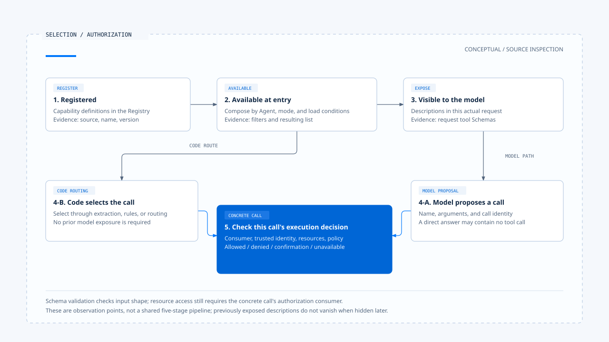

# Capability selection

[English](./03-capability-selection.md) | [繁體中文](./03-capability-selection-zh-TW.md)

> In the following content:
> CCR is short for [claude-code-best](https://github.com/claude-code-best/claude-code).
> Chat Gun refers to [chat-gun](https://github.com/HsienW/chat-gun).

[Back to overview](./README.md) · Previous: [Capability composition](./02-capability-composition.md) · Next: [A capability use case](./04-case-capability-use.md)

The same calculator can be called after the model proposes a Tool Call, or directly by code after extracting an expression from the input. Both can produce a number, but they require different explanations of "who selected the tool."

The product supplying candidates, code choosing a route, the model proposing an action, and the system permitting execution are decisions that can be verified separately.

This article follows CCB and Chat Gun at the [pinned versions listed in the overview](./README.md#sources-and-evidence), focusing on the handoff from candidate sets to concrete calls. The code behavior described here comes from this source inspection, not live Provider acceptance testing.

## 1. Record selection at different observation points

| Observation point | Question to ask | Evidence needed |
|---|---|---|
| Registered | Which capability definitions can the product find? | Registry, version, and source. |
| Available at the entry point | Which capabilities does the current Agent, mode, or environment retain? | Filtering conditions, loading results, and consumers. |
| Visible to the model | Which descriptions were actually included in this model request? | Tool Schemas or other capability descriptions in that request. |
| Call proposed | Did the model select it, or did code decide directly? | A model Tool Call or a code routing branch. |
| Execution decision obtained | Does this call meet identity, resource, and policy conditions? | The governance result for the concrete call. |

These points do not necessarily correspond to five separate modules. For example:

- The same deny rule can participate in exposure filtering and be checked again during execution.
- A tool pool may pass through API adaptation before becoming a request description.

An internal tool array is therefore insufficient to reconstruct what the model actually saw.

## 2. CCB first narrows the available tool pool

### Candidate sets and permissions on arguments

CCB's [`getTools()`][ccb-tools] composes available tools according to mode, deny rules for entire tools, and enablement. For example, the ordinary Simple mode selects Bash, Read, and Edit, while REPL or Coordinator conditions can change that set.

This is the implementation of mode branches; it cannot be generalized to "every Simple request always has exactly three tools."

`assembleToolPool()` also applies deny filtering to MCP; the outer [`mergeAndFilterTools()`][ccb-pool] further narrows the set for Coordinator mode.

- Candidate filtering happens before the model proposes concrete arguments and determines which tools can enter the candidate set.
- Permission decisions with file or argument conditions still need inspection at the concrete call.

### Subtask scope must be resolved again

[`resolveAgentTools()`][ccb-agent] starts from available tools to process child Agent restrictions:

1. `disallowedTools` first excludes specified tools.
2. If `tools` is unset or contains only `*`, return the set already filtered by the preceding steps.
3. If concrete tools are listed, resolve them individually and distinguish `validTools`, `invalidTools`, and `resolvedTools`.

The wildcard's meaning therefore depends on the input set and prior filtering. Invalid names in the returned data also do not mean that the caller necessarily aborts the whole task; its handling must be checked further.

### Filtering fork inheritance

CCB's fork path separately uses [`filterParentToolsForFork()`][ccb-fork] to exclude commonly disabled items when inheriting parent tools.

Ordinary Agent definition resolution and fork inheritance follow different code paths. A complete delegation guarantee requires tracing each consumer.

## 3. Check Skill visibility and invocation separately

### Presentation and model invocation settings

CCB's [Skill configuration parser][ccb-loader] retains two separate fields:

- `user-invocable`: relates to presentation settings on the user side.
- `disable-model-invocation`: participates in model invocation checks.

These fields cannot be reduced to a single "enable or disable Skill" setting.

### Description lists and actual requests

- [`getSkillToolCommands()`][ccb-commands] filters prompt type, model invocation settings, and description conditions to form the list supplied to the model.
- On receiving a name, [SkillTool's `validateInput()`][ccb-skill] rejects Commands that do not exist, prohibit model invocation, or have an incompatible type.

These are two observation points: one determines the description list, and the other determines whether an actual request is accepted.

When Skill expansion updates command allow rules, capability conditions may change with Context; specifying fork also switches to a subtask. Understanding the scope of a selection requires recording whether it uses the tool set before expansion, after expansion, or in the subtask itself.

## 4. Chat Gun supports model selection and direct code routing

### The MCP Agent gives tools to the model

Chat Gun's [MCP Agent][gun-mcp] calls `loadAgentToolRuntime("mcp_agent", { includeMcp: true })` during module initialization.

Each time it enters `callModel()`, it proceeds in order:

1. Create a model for the `tool` purpose.
2. Pass tools to `bindTools(tools)`.
3. Send the model input.

After the model responds, the Graph branches according to the calls:

- With `tool_calls`: enter `authorization_gate`.
- Without calls: `shouldContinue()` routes the flow to completion.

Although the Prompt asks for tools when appropriate, code retains a branch where the model answers directly. Claiming that an answer used the calculator requires obtaining that call and its result.

### The Math Agent can select the calculator directly

In the [Math Agent's][gun-math] `callModel()`, expression extraction and subsequent branching work as follows:

1. Get the latest user message and find candidate fragments that match the pattern and contain digits.
2. Select the longest fragment as the expression.
3. If an expression exists, call `mathCalculatorTool.invoke()` directly and return the result through a template; this branch does not call the model first.

Only when no expression is extracted does it assemble the Math Prompt and call the model. This simple route can save a model selection step, but extraction is not full natural language understanding; inputs with multiple expressions or numeric fragments need concrete cases to check what was selected.

### How source differs from tool filtering per tenant

The [Registry's][gun-registry] `source` looks up the corresponding dispatch pipeline Feature Flag. The inspected function does not narrow the local tool set according to each request's Principal or Tenant.

This does not mean the entire product lacks identity governance; it limits only what can be observed about capability exposure in this function.

An unknown `source` makes this pipeline flag evaluate to disabled. It does not imply that "an unknown Agent has no tools." If a product requires visible capability lists per tenant, it should separately identify the filtering entry point, trusted identity source, and resulting content passed to the model.

## 5. Provider compatibility is also a prerequisite

### The gateway's capability declarations

The [Chat Gun gateway][gun-gateway] declares capabilities with `capabilitiesForProvider()` and calls `assertProviderCapability()` on relevant paths. For example:

- The inspected version declares `ccr` as not supporting Tool Calling.
- The OpenAI-compatible/Qwen tool binding path builds Schema mappings and tool descriptions.

These declarations and adaptations belong to that gateway version and cannot describe an external Provider's entire product capabilities. An actual endpoint can still fail because of its model, configuration, or response format. Checking that a `bindTools` method exists is also insufficient to prove that an arbitrary endpoint can complete a tool round trip.

### Response decoding and model switching

Decoding the model response also narrows acceptable calls. Relevant gateway branches check whether the tool name maps to a Schema and validate arguments; a missing Schema or failed validation produces decoding diagnostics.

These checks handle protocol and input validity. Subsequent authorization decisions still determine whether resource access is permitted.

Switching models or using a fallback should trigger renewed checks of tool binding, structured output, Context capacity, and capabilities required by the task. These are prerequisites the selection flow should maintain; a Provider's support for text answers does not mean it can continue a task that requires tool calls.

## 6. Capability lists have a lifecycle

### Loading results and refresh timing

- Some CCB capability sources are cached, and the Command layer also provides interfaces for renewed filtering and cache clearing.
- The Chat Gun MCP Agent holds loading results from module initialization and uses that `tools` set in later model rounds.

In both cases, refresh timing must be established from the actual consumer. A source update alone does not mean the current execution has applied it.

Policies or connections can change during a task. A tool description already included in model input does not disappear from the model's memory when a list is hidden later. When the model proposes a call, code must therefore still check the name, version, and current execution conditions.

### Recommendations for capability snapshots

To trace these differences, a product can record the following as evidence:

- Capability set identity and composition time.
- Agent/mode and source version.
- Model request correlation.

This is a design recommendation proposed by this article; this inspection did not confirm that Chat Gun exports capability snapshots containing all these fields.

## 7. A concrete call is the unit handed to action governance

The [MCP Agent authorization node][gun-auth] extracts the tool name and arguments from the model call, then finds the corresponding tool and governance executor. If no interface supporting authorization is available, the path returns `AUTHORIZATION_UNAVAILABLE`; it does not dispatch merely because the model proposed a name.

Capability selection delivers candidates and proposals; governance for each call then checks trusted execution identity, resources, approval, and related conditions. The next article places these observation points in one calculation case, comparing evidence for model selection and direct code calls.

[ccb-tools]: https://github.com/claude-code-best/claude-code/blob/77a7934e15d69da13879112ed7db695c9ee7a52a/src/tools.ts
[ccb-pool]: https://github.com/claude-code-best/claude-code/blob/77a7934e15d69da13879112ed7db695c9ee7a52a/src/utils/toolPool.ts
[ccb-agent]: https://github.com/claude-code-best/claude-code/blob/77a7934e15d69da13879112ed7db695c9ee7a52a/packages/builtin-tools/src/tools/AgentTool/agentToolUtils.ts
[ccb-fork]: https://github.com/claude-code-best/claude-code/blob/77a7934e15d69da13879112ed7db695c9ee7a52a/src/utils/agentToolFilter.ts
[ccb-loader]: https://github.com/claude-code-best/claude-code/blob/77a7934e15d69da13879112ed7db695c9ee7a52a/src/skills/loadSkillsDir.ts#L185
[ccb-commands]: https://github.com/claude-code-best/claude-code/blob/77a7934e15d69da13879112ed7db695c9ee7a52a/src/commands.ts
[ccb-skill]: https://github.com/claude-code-best/claude-code/blob/77a7934e15d69da13879112ed7db695c9ee7a52a/packages/builtin-tools/src/tools/SkillTool/SkillTool.ts
[gun-mcp]: https://github.com/HsienW/chat-gun/blob/92a5673003e4ac4ec09be8b1b350f42dbf4a5e69/backend/src/agents/mcp-agent.ts
[gun-math]: https://github.com/HsienW/chat-gun/blob/92a5673003e4ac4ec09be8b1b350f42dbf4a5e69/backend/src/agents/math-agent.ts
[gun-registry]: https://github.com/HsienW/chat-gun/blob/92a5673003e4ac4ec09be8b1b350f42dbf4a5e69/backend/src/tools/registry.ts
[gun-gateway]: https://github.com/HsienW/chat-gun/blob/92a5673003e4ac4ec09be8b1b350f42dbf4a5e69/backend/src/platform/llm-gateway.ts
[gun-auth]: https://github.com/HsienW/chat-gun/blob/92a5673003e4ac4ec09be8b1b350f42dbf4a5e69/backend/src/runtime/authorization/confirmation-graph.ts
