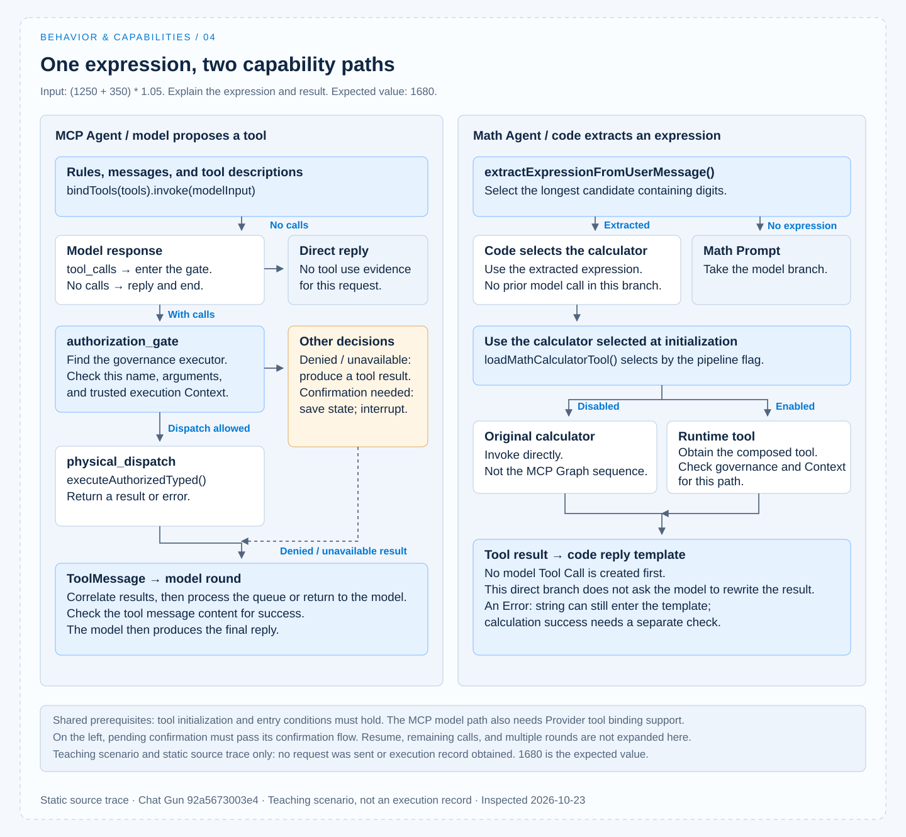

# 能力使用案例

[English](./04-case-capability-use.md) | [繁體中文](./04-case-capability-use-zh-TW.md) | [简体中文](./04-case-capability-use-zh-CN.md)

> 以下内容所提到的
> CCR 为 [claude-code-best](https://github.com/claude-code-best/claude-code) 的简称。
> Chat Gun 为 [chat-gun](https://github.com/HsienW/chat-gun)。

[回到导览](./README-zh-CN.md) · 上一篇：[能力选择](./03-capability-selection-zh-CN.md)

> 计算 `(1250 + 350) * 1.05`，说明计算式与结果。

把这项要求分别送进 Chat Gun 的 `mcp_agent` 与 `math_agent`，可以观察两种能力使用方式：

- MCP Agent 让模型提出工具调用。
- Math Agent 可能在程序抽取算式后直接使用 calculator。

两者即使回复相同数字，也需要不同证据才能解释完成过程。

本篇是按固定版本源代码展开的教学情境，尚未送出这笔请求、调用 live 模型或取得真实执行记录。

算式的预期值为 `1680`，文中的提案只用来说明数据形状；不把预期值或示意输入当成已执行结果。版本与查证范围见[本区导览](./README-zh-CN.md#来源与证据范围)。

## 1. 请求之前，工具已经在组装

### 模块初始化与工具集合

[MCP Agent][gun-mcp] 的模块初始化会调用 `loadAgentToolRuntime("mcp_agent", { includeMcp: true })`。因此，这项问题还没到达模型，产品可能已经组好本地工具、descriptor、execution profile 与选用 MCP。

[本地集合][gun-descriptors] 包含 calculator、web search、web fetch 与天气工具。Registry 没有因本题只需要计算，就在这条加载路径自动排除其他本地工具。要判断模型当次真正看见的内容，仍须在工具绑定与请求转接的边界记录清单。

### 初始化失败与案例前提

此版本还会默认为 `current_weather` 做 SDK descriptor staging。若该初始化条件不成立，`loadAgentToolRuntime()` 可能在返回清单之前就失败，即使本题没有要查天气。

选用 MCP 的加载错误另有回退成本地集合的处理；两种失败范围应分开看。[接线见 Registry][gun-registry]。

案例要成立，需先确定：

- 选用的 Graph 可启动，工具集合可取得。
- 执行 Context 符合入口条件。
- Provider 能接受工具绑定。

若取得的是降级集合，也要记录这项事实。

## 2. 行为要求与工具契约一起进入模型回合

### 模型输入与 calculator 契约

MCP Agent 使用 [`mcpSystemMessage`][gun-prompts] 指导工具使用及结果陈述。依 Context 开关，它选择组装过的 MCP messages 或 legacy messages，接着调用 `llm.bindTools(tools).invoke(modelInput)`。

[Calculator 的契约][gun-calc] 接受 `expression` 字串。执行函数先检查字符，再规范化支持的数学名称，进行计算并返回字串；它也可能返回以 `Error:` 开头的错误文字。

这份 Schema 允许描述算式，并未替模型决定一定要选 calculator，也不保证任意字串都有可接受的计算结果。

### 模型响应的两种走法

因此，模型响应至少需要保留两种可能：

- 提出工具调用：核对工具名称、参数与调用识别，再交给治理。
- 直接回复：Graph 的 `shouldContinue()` 会依没有 `tool_calls` 的分支结束；答案可能包含数字，但缺少本次工具使用的证据。

### 工具提案的示意参数

若模型提出 calculator，概念上的参数可写成下例。这不是实际模型输出；真实的调用识别与格式须从该次 Provider 回应取得。

```json
{
  "name": "calculator_tool",
  "args": {
    "expression": "(1250 + 350) * 1.05"
  }
}
```

## 3. 模型提案先到授权节点

### 授权输入与控制分支

有 `tool_calls` 时，MCP Agent 进入 `authorization_gate`。[授权 Graph][gun-auth] 从调用队列取出工具，寻找对应治理执行器，并以该次参数及执行设置要求授权。

| 分支 | 程序如何继续 | 此时不能宣称的结果 |
|---|---|---|
| 找不到可授权的执行接口 | 产生带 `AUTHORIZATION_UNAVAILABLE` 的工具结果消息。 | 工具已被执行。 |
| 授权拒绝 | 返回相应拒绝结果，处理剩余调用或返回模型。 | 任务要求已因模型同意而获准。 |
| 需要确认 | 保存待确认数据与中断 manifest，进入确认流程。 | 已经完成实际派送。 |
| 可以继续派送 | 保留 active call，前往 `physical_dispatch`。 | 计算一定成功。 |

表格说明的是节点的控制分支。是否需要人工确认，取决于实际身份、工具与政策；不能因示例只算一个数字，就省略核对治理结果。

### 能力曝光与行动授权的交接

- 模型从候选清单提出名称与参数。
- 程序用受信任的执行数据，决定这次操作如何继续。

授权契约与人工批准的细节留给 Action Governance 主题展开。

## 4. 工具结果如何回到模型

### 派送与结果关联

`physical_dispatch` 透过治理执行器的 `executeAuthorizedTyped()` 执行 active call，后续依 outcome 处理：

- 成功 outcome 转成结果内容。
- 其他 outcome 转成对应错误信息。

结果再以 `ToolMessage` 关联回原调用。Graph 接着处理队列或回到模型回合。[实现见此][gun-auth]。

### 回复前的证据核对

对这笔算式，应核对实际传入值、calculator 的执行次数与返回内容，再与最终回答对照。

- 只看到「1680」，不能证明使用了 calculator。
- 只看到工具消息，也不能判定计算成功；结果可能带错误文字或治理失败信息。

若要说「使用工具确认结果为 1680」，至少需要能对回本次请求的调用与成功结果。这是完成回复应满足的证据条件，并非本轮已取得的执行数据。

## 5. Math Agent 的同一需求走另一条路

### 程序抽取与直接计算

[Math Agent][gun-math] 的 `callModel()` 依下列方式处理输入：

1. 调用 `extractExpressionFromUserMessage()`，从最新用户消息的候选片段中，选出带数字且最长的一段。
2. 若抽取到这笔算式，直接调用 `mathCalculatorTool.invoke()`。
3. 把结果套入回复模板。

这个分支不先建立模型响应，也没有模型产生的 Tool Call。`mathSystemMessage` 的模型分支只会在没有抽取到算式时使用。把「Math Prompt 要求优先计算」当作工具被选中的原因，会略过真正决定路由的程序。

### 两个入口的差异

两个入口的差异可整理如下：

| 位置 | MCP Agent | Math Agent 的直接计算分支 |
|---|---|---|
| 谁决定要调用 calculator | 模型提出；本题是否实际提出仍待执行。 | 程序抽取算式后决定。 |
| 模型是否先看见能力描述 | 使用 `bindTools(tools)` 绑定工具。 | 此分支没有先调用模型。 |
| 具体工具参数来源 | 模型提案，经相关解码与后续检查。 | 抽取后的算式字串。 |
| 主要治理交接 | Graph 的 gate／confirmation／dispatch 节点。 | 取决于 `loadMathCalculatorTool()` 选到的工具及相关开关。 |
| 结果呈现 | 工具结果回到模型，再由模型回复。 | 程序直接套用回复模板。 |

### pipeline 开关与回复边界

[Registry 的 `loadMathCalculatorTool()`][gun-registry] 依 Math dispatch pipeline 开关选择工具：

- 关闭时，返回原本的 calculator。
- 启用时，从组装过的 Runtime 工具中取得它。

Math Graph 的 execution Context instrumentation 也受该开关影响，不能把 MCP Graph 的授权时序原样套在 Math 路径上。

这里还有一个回复边界：若 calculator 返回 `Error:` 字串，直接计算分支目前会把该字串放进既有模板。实际计算是否成功，仍要检查结果内容；有一则完成格式的回复，不足以证明成功。

### 条件流程对照



图中保留条件分支，表示实现可采取的走法；它不是一次成功执行的时序纪录。

## 6. 用失败情境检查前提

这个例子不需要外部数据，仍可能在不同位置失败。每个结果应对回它发生的阶段。

| 失败位置 | 本次应检查的内容 |
|---|---|
| SDK 或本地 descriptor 初始化 | Agent 是否在工具集合返回前就停止；不要套用只处理选用 MCP 的 fallback 结论。 |
| 选用 MCP 加载 | 是否记录警告、是否只剩本地能力，以及该状态是否呈现给用户。 |
| Provider 工具绑定或回应解码 | 是否符合 gateway 的能力宣告、工具名称与 Schema；尚未取得合法 Tool Call 时不能宣称已派送。 |
| 授权或必要身份缺失 | 保留具体拒绝或不可用状态，确认 calculator 尚未被实际调用。 |
| 计算内容错误 | 核对工具返回的错误内容，避免沿用成功叙述。 |
| 工具结果与最终回复不一致 | 对照原始结果、关联调用与回答，确认模型没有把失败重写为成功。 |

[`llm-gateway.ts`][gun-gateway] 的工具解码包含名称与参数 Schema 检查；这些前置条件可以阻止部分无效提案进入后续流程。它们仍不能证明本次模型必然选对工具，或外部端点已完成 live 验证。

## 7. 哪些证据已存在，哪些还要取得

### 已查读的测试案例

目前查读的 [`mcp-agent.tool-calling.test.ts`][gun-test] 建立测试 calculator、mock HTTP 响应与 `ToolNode`，涵盖以下案例：

- 工具调用返回后，下一次模型输入带有对应 `tool_call_id` 的工具消息。
- 不完整参数导致解码错误，且测试执行函数没有被调用。

这些测试源代码说明了测试要覆盖的边界。它们没有启动正式 MCP 授权 Graph、外部 MCP server 或真实 Provider。本轮也没有重跑，因此本文记为「测试案例已查读、执行未验证」。

### 执行实录仍需取得的证据

若要把本文改成执行实录，需要取得：

- 固定版本、Graph、Provider／model 与影响路径的开关。
- 当次有效指令、模型请求工具描述及工具加载状态。
- 真实 Tool Call 或 Math 直接路由的参数。
- 治理结果、实际派送次数与关联 Tool Result。
- 最终回复，以及它和预期算式结果的对照。

### CCB 对照与判读范围

CCB 的对照材料已在[能力组装](./02-capability-composition-zh-CN.md)与[能力选择](./03-capability-selection-zh-CN.md)展开：

- [工具池][ccb-tools]限制候选集合。
- [子 Agent 工具解析][ccb-agent]处理委派范围。

可以沿相同观察位置比较不同产品，但不把 CCB 的 Tool 类型、Permission Context 或子任务机制套作 Chat Gun 的既有契约。

这个案例留下的是可核对的两条程序路径：一条让模型提出工具，另一条由程序直接选择。真正的完成纪录，还要把每次决策与实际效果连回同一项任务。

[gun-mcp]: https://github.com/HsienW/chat-gun/blob/92a5673003e4ac4ec09be8b1b350f42dbf4a5e69/backend/src/agents/mcp-agent.ts
[gun-descriptors]: https://github.com/HsienW/chat-gun/blob/92a5673003e4ac4ec09be8b1b350f42dbf4a5e69/backend/src/tools/production-runtime-tool-descriptors.ts
[gun-registry]: https://github.com/HsienW/chat-gun/blob/92a5673003e4ac4ec09be8b1b350f42dbf4a5e69/backend/src/tools/registry.ts
[gun-prompts]: https://github.com/HsienW/chat-gun/blob/92a5673003e4ac4ec09be8b1b350f42dbf4a5e69/backend/src/prompts.ts
[gun-calc]: https://github.com/HsienW/chat-gun/blob/92a5673003e4ac4ec09be8b1b350f42dbf4a5e69/backend/src/tools/calculator.ts
[gun-auth]: https://github.com/HsienW/chat-gun/blob/92a5673003e4ac4ec09be8b1b350f42dbf4a5e69/backend/src/runtime/authorization/confirmation-graph.ts
[gun-math]: https://github.com/HsienW/chat-gun/blob/92a5673003e4ac4ec09be8b1b350f42dbf4a5e69/backend/src/agents/math-agent.ts
[gun-gateway]: https://github.com/HsienW/chat-gun/blob/92a5673003e4ac4ec09be8b1b350f42dbf4a5e69/backend/src/platform/llm-gateway.ts
[gun-test]: https://github.com/HsienW/chat-gun/blob/92a5673003e4ac4ec09be8b1b350f42dbf4a5e69/backend/src/agents/mcp-agent.tool-calling.test.ts
[ccb-tools]: https://github.com/claude-code-best/claude-code/blob/77a7934e15d69da13879112ed7db695c9ee7a52a/src/tools.ts
[ccb-agent]: https://github.com/claude-code-best/claude-code/blob/77a7934e15d69da13879112ed7db695c9ee7a52a/packages/builtin-tools/src/tools/AgentTool/agentToolUtils.ts
