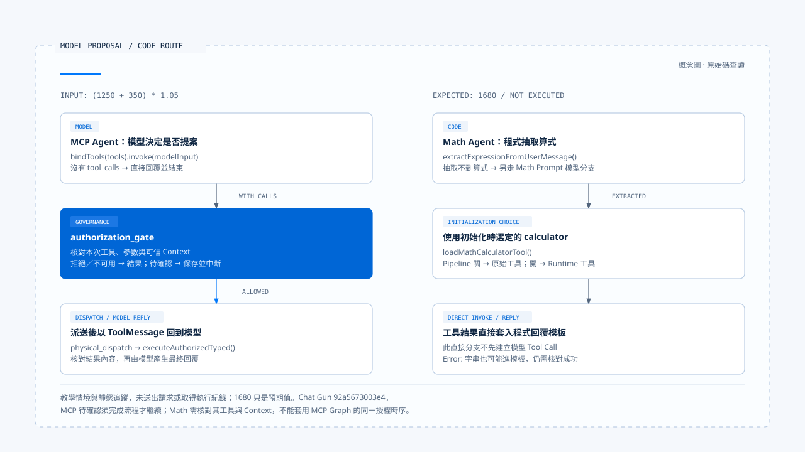

# 能力使用案例

[English](./04-case-capability-use.md) | [繁體中文](./04-case-capability-use-zh-TW.md)

> 以下內容所提到的
> CCR 為 [claude-code-best](https://github.com/claude-code-best/claude-code) 的簡稱。
> Chat Gun 為 [chat-gun](https://github.com/HsienW/chat-gun)。

[回到導覽](./README-zh-TW.md) · 上一篇：[能力選擇](./03-capability-selection-zh-TW.md)

> 計算 `(1250 + 350) * 1.05`，說明計算式與結果。

把這項要求分別送進 Chat Gun 的 `mcp_agent` 與 `math_agent`，可以觀察兩種能力使用方式：

- MCP Agent 讓模型提出工具呼叫。
- Math Agent 可能在程式抽取算式後直接使用 calculator。

兩者即使回覆相同數字，也需要不同證據才能解釋完成過程。

本篇是按固定版本原始碼展開的教學情境，尚未送出這筆請求、呼叫 live 模型或取得真實執行記錄。

算式的預期值為 `1680`，文中的提案只用來說明資料形狀；不把預期值或示意輸入當成已執行結果。版本與查證範圍見[本區導覽](./README-zh-TW.md#來源與證據範圍)。

## 1. 請求之前，工具已經在組裝

### 模組初始化與工具集合

[MCP Agent][gun-mcp] 的模組初始化會呼叫 `loadAgentToolRuntime("mcp_agent", { includeMcp: true })`。因此，這項問題還沒到達模型，產品可能已經組好本地工具、descriptor、execution profile 與選用 MCP。

[本地集合][gun-descriptors] 包含 calculator、web search、web fetch 與天氣工具。Registry 沒有因本題只需要計算，就在這條載入路徑自動排除其他本地工具。要判斷模型當次真正看見的內容，仍須在工具綁定與請求轉接的邊界記錄清單。

### 初始化失敗與案例前提

此版本還會預設為 `current_weather` 做 SDK descriptor staging。若該初始化條件不成立，`loadAgentToolRuntime()` 可能在回傳清單之前就失敗，即使本題沒有要查天氣。

選用 MCP 的載入錯誤另有回退成本地集合的處理；兩種失敗範圍應分開看。[接線見 Registry][gun-registry]。

案例要成立，需先確定：

- 選用的 Graph 可啟動，工具集合可取得。
- 執行 Context 符合入口條件。
- Provider 能接受工具綁定。

若取得的是降級集合，也要記錄這項事實。

## 2. 行為要求與工具契約一起進入模型回合

### 模型輸入與 calculator 契約

MCP Agent 使用 [`mcpSystemMessage`][gun-prompts] 指導工具使用及結果陳述。依 Context 開關，它選擇組裝過的 MCP messages 或 legacy messages，接著呼叫 `llm.bindTools(tools).invoke(modelInput)`。

[Calculator 的契約][gun-calc] 接受 `expression` 字串。執行函式先檢查字元，再正規化支援的數學名稱，進行計算並回傳字串；它也可能回傳以 `Error:` 開頭的錯誤文字。

這份 Schema 允許描述算式，並未替模型決定一定要選 calculator，也不保證任意字串都有可接受的計算結果。

### 模型回應的兩種走法

因此，模型回應至少需要保留兩種可能：

- 提出工具呼叫：核對工具名稱、參數與呼叫識別，再交給治理。
- 直接回覆：Graph 的 `shouldContinue()` 會依沒有 `tool_calls` 的分支結束；答案可能包含數字，但缺少本次工具使用的證據。

### 工具提案的示意參數

若模型提出 calculator，概念上的參數可寫成下例。這不是實際模型輸出；真實的呼叫識別與格式須從該次 Provider 回應取得。

```json
{
  "name": "calculator_tool",
  "args": {
    "expression": "(1250 + 350) * 1.05"
  }
}
```

## 3. 模型提案先到授權節點

### 授權輸入與控制分支

有 `tool_calls` 時，MCP Agent 進入 `authorization_gate`。[授權 Graph][gun-auth] 從呼叫佇列取出工具，尋找對應治理執行器，並以該次參數及執行設定要求授權。

| 分支 | 程式如何繼續 | 此時不能宣稱的結果 |
|---|---|---|
| 找不到可授權的執行介面 | 產生帶 `AUTHORIZATION_UNAVAILABLE` 的工具結果訊息。 | 工具已被執行。 |
| 授權拒絕 | 回傳相應拒絕結果，處理剩餘呼叫或返回模型。 | 任務要求已因模型同意而獲准。 |
| 需要確認 | 保存待確認資料與中斷 manifest，進入確認流程。 | 已經完成實際派送。 |
| 可以繼續派送 | 保留 active call，前往 `physical_dispatch`。 | 計算一定成功。 |

表格說明的是節點的控制分支。是否需要人工確認，取決於實際身分、工具與政策；不能因示例只算一個數字，就省略核對治理結果。

### 能力曝光與行動授權的交接

- 模型從候選清單提出名稱與參數。
- 程式用受信任的執行資料，決定這次操作如何繼續。

授權契約與人工批准的細節留給 Action Governance 主題展開。

## 4. 工具結果如何回到模型

### 派送與結果關聯

`physical_dispatch` 透過治理執行器的 `executeAuthorizedTyped()` 執行 active call，後續依 outcome 處理：

- 成功 outcome 轉成結果內容。
- 其他 outcome 轉成對應錯誤資訊。

結果再以 `ToolMessage` 關聯回原呼叫。Graph 接著處理佇列或回到模型回合。[實作見此][gun-auth]。

### 回覆前的證據核對

對這筆算式，應核對實際傳入值、calculator 的執行次數與回傳內容，再與最終回答對照。

- 只看到「1680」，不能證明使用了 calculator。
- 只看到工具訊息，也不能判定計算成功；結果可能帶錯誤文字或治理失敗資訊。

若要說「使用工具確認結果為 1680」，至少需要能對回本次請求的呼叫與成功結果。這是完成回覆應滿足的證據條件，並非本輪已取得的執行資料。

## 5. Math Agent 的同一需求走另一條路

### 程式抽取與直接計算

[Math Agent][gun-math] 的 `callModel()` 依下列方式處理輸入：

1. 呼叫 `extractExpressionFromUserMessage()`，從最新使用者訊息的候選片段中，選出帶數字且最長的一段。
2. 若抽取到這筆算式，直接呼叫 `mathCalculatorTool.invoke()`。
3. 把結果套入回覆模板。

這個分支不先建立模型回應，也沒有模型產生的 Tool Call。`mathSystemMessage` 的模型分支只會在沒有抽取到算式時使用。把「Math Prompt 要求優先計算」當作工具被選中的原因，會略過真正決定路由的程式。

### 兩個入口的差異

兩個入口的差異可整理如下：

| 位置 | MCP Agent | Math Agent 的直接計算分支 |
|---|---|---|
| 誰決定要呼叫 calculator | 模型提出；本題是否實際提出仍待執行。 | 程式抽取算式後決定。 |
| 模型是否先看見能力描述 | 使用 `bindTools(tools)` 綁定工具。 | 此分支沒有先呼叫模型。 |
| 具體工具參數來源 | 模型提案，經相關解碼與後續檢查。 | 抽取後的算式字串。 |
| 主要治理交接 | Graph 的 gate／confirmation／dispatch 節點。 | 取決於 `loadMathCalculatorTool()` 選到的工具及相關開關。 |
| 結果呈現 | 工具結果回到模型，再由模型回覆。 | 程式直接套用回覆模板。 |

### pipeline 開關與回覆邊界

[Registry 的 `loadMathCalculatorTool()`][gun-registry] 依 Math dispatch pipeline 開關選擇工具：

- 關閉時，回傳原本的 calculator。
- 啟用時，從組裝過的 Runtime 工具中取得它。

Math Graph 的 execution Context instrumentation 也受該開關影響，不能把 MCP Graph 的授權時序原樣套在 Math 路徑上。

這裡還有一個回覆邊界：若 calculator 回傳 `Error:` 字串，直接計算分支目前會把該字串放進既有模板。實際計算是否成功，仍要檢查結果內容；有一則完成格式的回覆，不足以證明成功。

### 條件流程對照



圖中保留條件分支，表示實作可採取的走法；它不是一次成功執行的時序紀錄。

## 6. 用失敗情境檢查前提

這個例子不需要外部資料，仍可能在不同位置失敗。每個結果應對回它發生的階段。

| 失敗位置 | 本次應檢查的內容 |
|---|---|
| SDK 或本地 descriptor 初始化 | Agent 是否在工具集合回傳前就停止；不要套用只處理選用 MCP 的 fallback 結論。 |
| 選用 MCP 載入 | 是否記錄警告、是否只剩本地能力，以及該狀態是否呈現給使用者。 |
| Provider 工具綁定或回應解碼 | 是否符合 gateway 的能力宣告、工具名稱與 Schema；尚未取得合法 Tool Call 時不能宣稱已派送。 |
| 授權或必要身分缺失 | 保留具體拒絕或不可用狀態，確認 calculator 尚未被實際呼叫。 |
| 計算內容錯誤 | 核對工具回傳的錯誤內容，避免沿用成功敘述。 |
| 工具結果與最終回覆不一致 | 對照原始結果、關聯呼叫與回答，確認模型沒有把失敗重寫為成功。 |

[`llm-gateway.ts`][gun-gateway] 的工具解碼包含名稱與參數 Schema 檢查；這些前置條件可以阻止部分無效提案進入後續流程。它們仍不能證明本次模型必然選對工具，或外部端點已完成 live 驗證。

## 7. 哪些證據已存在，哪些還要取得

### 已查讀的測試案例

目前查讀的 [`mcp-agent.tool-calling.test.ts`][gun-test] 建立測試 calculator、mock HTTP 回應與 `ToolNode`，涵蓋以下案例：

- 工具呼叫回傳後，下一次模型輸入帶有對應 `tool_call_id` 的工具訊息。
- 不完整參數導致解碼錯誤，且測試執行函式沒有被呼叫。

這些測試原始碼說明了測試要覆蓋的邊界。它們沒有啟動正式 MCP 授權 Graph、外部 MCP server 或真實 Provider。本輪也沒有重跑，因此本文記為「測試案例已查讀、執行未驗證」。

### 執行實錄仍需取得的證據

若要把本文改成執行實錄，需要取得：

- 固定版本、Graph、Provider／model 與影響路徑的開關。
- 當次有效指令、模型請求工具描述及工具載入狀態。
- 真實 Tool Call 或 Math 直接路由的參數。
- 治理結果、實際派送次數與關聯 Tool Result。
- 最終回覆，以及它和預期算式結果的對照。

### CCB 對照與判讀範圍

CCB 的對照材料已在[能力組裝](./02-capability-composition-zh-TW.md)與[能力選擇](./03-capability-selection-zh-TW.md)展開：

- [工具池][ccb-tools]限制候選集合。
- [子 Agent 工具解析][ccb-agent]處理委派範圍。

可以沿相同觀察位置比較不同產品，但不把 CCB 的 Tool 型別、Permission Context 或子任務機制套作 Chat Gun 的既有契約。

這個案例留下的是可核對的兩條程式路徑：一條讓模型提出工具，另一條由程式直接選擇。真正的完成紀錄，還要把每次決策與實際效果連回同一項任務。

[gun-mcp]: https://github.com/HsienW/chat-gun/blob/92a5673003e4ac4ec09be8b1b350f42dbf4a5e69/backend/src/agents/mcp-agent.ts
[gun-descriptors]: https://github.com/HsienW/chat-gun/blob/92a5673003e4ac4ec09be8b1b350f42dbf4a5e69/backend/src/tools/production-runtime-tool-descriptors.ts
[gun-registry]: https://github.com/HsienW/chat-gun/blob/92a5673003e4ac4ec09be8b1b350f42dbf4a5e69/backend/src/tools/registry.ts
[gun-prompts]: https://github.com/HsienW/chat-gun/blob/92a5673003e4ac4ec09be8b1b350f42dbf4a5e69/backend/src/prompts.ts
[gun-calc]: https://github.com/HsienW/chat-gun/blob/92a5673003e4ac4ec09be8b1b350f42dbf4a5e69/backend/src/tools/calculator.ts
[gun-auth]: https://github.com/HsienW/chat-gun/blob/92a5673003e4ac4ec09be8b1b350f42dbf4a5e69/backend/src/runtime/authorization/confirmation-graph.ts
[gun-math]: https://github.com/HsienW/chat-gun/blob/92a5673003e4ac4ec09be8b1b350f42dbf4a5e69/backend/src/agents/math-agent.ts
[gun-gateway]: https://github.com/HsienW/chat-gun/blob/92a5673003e4ac4ec09be8b1b350f42dbf4a5e69/backend/src/platform/llm-gateway.ts
[gun-test]: https://github.com/HsienW/chat-gun/blob/92a5673003e4ac4ec09be8b1b350f42dbf4a5e69/backend/src/agents/mcp-agent.tool-calling.test.ts
[ccb-tools]: https://github.com/claude-code-best/claude-code/blob/77a7934e15d69da13879112ed7db695c9ee7a52a/src/tools.ts
[ccb-agent]: https://github.com/claude-code-best/claude-code/blob/77a7934e15d69da13879112ed7db695c9ee7a52a/packages/builtin-tools/src/tools/AgentTool/agentToolUtils.ts
