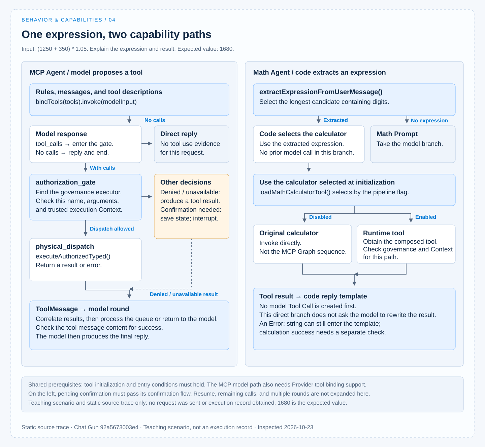

# A capability use case

1. CCR is short for [claude-code-best](https://github.com/claude-code-best/claude-code).
2. Chat Gun refers to [chat-gun](https://github.com/HsienW/chat-gun).

[English](./04-case-capability-use.md) | [繁體中文](./04-case-capability-use-zh-TW.md)

[Back to overview](./README.md) · Previous: [Capability selection](./03-capability-selection.md)

> Calculate `(1250 + 350) * 1.05` and explain the expression and result.

Sending this request to Chat Gun's `mcp_agent` and `math_agent` provides two ways to observe capability use:

- The MCP Agent lets the model propose tool calls.
- The Math Agent may use the calculator directly after code extracts an expression.

Even if both return the same number, different evidence is needed to explain how they completed the task.

This is a teaching scenario developed from the pinned source version. The request has not been sent, a live model has not been called, and no actual execution record has been obtained.

The expression's expected value is `1680`, and the proposals in this article illustrate data shapes only; expected values and example inputs are not treated as executed results. See the [section overview](./README.md#sources-and-evidence) for versions and verification scope.

## 1. Tools are composed before the request

### Module initialization and the tool set

The [MCP Agent][gun-mcp] calls `loadAgentToolRuntime("mcp_agent", { includeMcp: true })` during module initialization. Before the question reaches the model, the product may therefore already have composed local tools, descriptors, execution profiles, and optional MCP.

The [local set][gun-descriptors] includes the calculator, web search, web fetch, and weather tools. This Registry loading path does not automatically exclude other local tools because the question only needs calculation. Determining what the model actually saw still requires recording the list at the tool binding and request adaptation boundaries.

### Initialization failures and case prerequisites

This version also performs SDK descriptor staging for `current_weather` by default. If initialization conditions are not met, `loadAgentToolRuntime()` may fail before returning the list, even though this question does not ask about weather.

Optional MCP loading errors have separate handling that falls back to the local set; distinguish the scopes of these two failures. [See the Registry wiring][gun-registry].

For the case to hold, first confirm that:

- The selected Graph can start and the tool set can be obtained.
- The execution Context meets entry conditions.
- The Provider accepts tool binding.

If the resulting set is degraded, record that fact too.

## 2. Behavior requirements and tool contracts enter the model round together

### Model input and the calculator contract

The MCP Agent uses [`mcpSystemMessage`][gun-prompts] to guide tool use and statements about results. According to the Context flag, it selects assembled MCP messages or legacy messages, then calls `llm.bindTools(tools).invoke(modelInput)`.

The [calculator contract][gun-calc] accepts an `expression` string. The execution function checks characters, normalizes supported mathematical names, calculates, and returns a string; it may also return error text beginning with `Error:`.

This Schema allows an expression to be described. It neither decides that the model must select the calculator nor guarantees an acceptable calculation result for an arbitrary string.

### Two paths for the model response

At least two possible model responses must therefore remain:

- Propose a tool call: check the tool name, arguments, and call identity, then hand it to governance.
- Reply directly: the Graph's `shouldContinue()` ends the flow on the branch without `tool_calls`; the answer may contain a number but lacks evidence of tool use for this request.

### Illustrative tool proposal arguments

If the model proposes the calculator, the conceptual arguments can be written as follows. This is not actual model output; the real call identity and format must come from that Provider response.

```json
{
  "name": "calculator_tool",
  "args": {
    "expression": "(1250 + 350) * 1.05"
  }
}
```

## 3. The model proposal reaches authorization first

### Authorization input and control branches

When `tool_calls` exists, the MCP Agent enters `authorization_gate`. The [authorization Graph][gun-auth] takes a tool from the call queue, finds its governance executor, and requests authorization using the call's arguments and execution settings.

| Branch | How code continues | What cannot yet be claimed |
|---|---|---|
| No interface supporting authorization can be found | Produce a tool result message containing `AUTHORIZATION_UNAVAILABLE`. | The tool has executed. |
| Authorization denied | Return the corresponding denial result, process remaining calls, or return to the model. | The task request is authorized because the model agreed. |
| Confirmation required | Save pending confirmation data and an interruption manifest, then enter the confirmation flow. | Physical dispatch has completed. |
| Dispatch can proceed | Retain the active call and move to `physical_dispatch`. | The calculation is certain to succeed. |

The table describes the node's control branches. Whether human confirmation is required depends on the actual identity, tool, and policy; a simple numeric example does not justify skipping the governance result check.

### The handoff from capability exposure to action authorization

- The model proposes a name and arguments from the candidate list.
- Code uses trusted execution data to decide how this operation proceeds.

Authorization contracts and human approval are expanded in the Action Governance topic.

## 4. How tool results return to the model

### Dispatch and result correlation

`physical_dispatch` executes the active call through the governance executor's `executeAuthorizedTyped()`, then handles the outcome:

- A successful outcome becomes result content.
- Other outcomes become corresponding error information.

The result is then correlated with the original call through `ToolMessage`. The Graph continues processing the queue or returns to the model round. [See the implementation here][gun-auth].

### Evidence checks before replying

For this expression, check the actual input, calculator execution count, and returned content, then compare them with the final answer.

- Seeing only "1680" cannot prove that the calculator was used.
- Seeing only a tool message cannot establish calculation success; the result may contain error text or governance failure information.

To say "the result was confirmed as 1680 using a tool," at least a call and successful result traceable to this request are needed. This is an evidence requirement for a completion reply, not execution data obtained in this work.

## 5. The Math Agent takes a different route for the same request

### Code extraction and direct calculation

The [Math Agent's][gun-math] `callModel()` handles input as follows:

1. Call `extractExpressionFromUserMessage()` and select the longest fragment containing digits from candidates in the latest user message.
2. If this expression is extracted, call `mathCalculatorTool.invoke()` directly.
3. Insert the result into the reply template.

This branch does not first create a model response and has no model-generated Tool Call. The model branch using `mathSystemMessage` runs only when no expression is extracted. Attributing tool selection to "the Math Prompt asks for calculation first" skips the code that actually chooses the route.

### Differences between the two entry points

The differences can be summarized as follows:

| Location | MCP Agent | Math Agent direct calculation branch |
|---|---|---|
| Who decides to call the calculator | The model proposes it; whether it does so for this question remains to be tested. | Code decides after extracting the expression. |
| Whether the model first sees capability descriptions | Tools are bound with `bindTools(tools)`. | This branch does not call the model first. |
| Source of concrete tool arguments | A model proposal, followed by relevant decoding and checks. | The extracted expression string. |
| Main governance handoff | Graph gate/confirmation/dispatch nodes. | Depends on the tool selected by `loadMathCalculatorTool()` and related flags. |
| Result presentation | Tool results return to the model, which then replies. | Code directly applies the reply template. |

### Pipeline flags and reply boundaries

The [Registry's `loadMathCalculatorTool()`][gun-registry] selects the tool according to the Math dispatch pipeline flag:

- When disabled, return the original calculator.
- When enabled, obtain it from the composed Runtime tools.

The Math Graph's execution Context instrumentation is also affected by this flag. The MCP Graph authorization sequence cannot be applied unchanged to the Math path.

There is also a reply boundary: if the calculator returns an `Error:` string, the direct calculation branch currently inserts it into the existing template. Whether calculation succeeded still requires checking the result content; a reply in completion format is insufficient to prove success.

### Comparing conditional flows



The diagram retains conditional branches to show paths the implementation can take; it is not a sequence record of a successful execution.

## 6. Use failure scenarios to check prerequisites

This example requires no external data but can still fail at different points. Each result should be tied to the stage where it occurred.

| Failure location | What to check for this request |
|---|---|
| SDK or local descriptor initialization | Whether the Agent stops before returning the tool set; do not apply fallback conclusions limited to optional MCP. |
| Optional MCP loading | Whether warnings were recorded, only local capabilities remain, and that state is presented to the user. |
| Provider tool binding or response decoding | Whether the gateway capability declaration, tool name, and Schema are satisfied; dispatch cannot be claimed before a valid Tool Call is obtained. |
| Authorization or required identity missing | Preserve the concrete denial or unavailable state and confirm that the calculator has not actually been called. |
| Calculation content error | Check error content returned by the tool and avoid retaining success statements. |
| Tool results and final reply disagree | Compare the raw result, correlated call, and reply to check that the model has not rewritten failure as success. |

Tool decoding in [`llm-gateway.ts`][gun-gateway] includes name and argument Schema checks; these prerequisites can stop some invalid proposals from proceeding. They still cannot prove that the model will select the correct tool for this request or that an external endpoint has passed live verification.

## 7. Which evidence exists and what remains to be obtained

### Test cases inspected

The inspected [`mcp-agent.tool-calling.test.ts`][gun-test] creates a test calculator, mock HTTP responses, and a `ToolNode`, covering these cases:

- After a tool call returns, the next model input contains a tool message with the corresponding `tool_call_id`.
- Incomplete arguments cause a decoding error, and the test execution function is not called.

These test sources describe the intended coverage boundaries. They do not start the production MCP authorization Graph, external MCP servers, or a real Provider. They were not rerun in this work, so the article records them as "test cases inspected; execution unverified."

### Evidence still needed for an execution record

Turning this article into an execution record requires:

- The pinned version, Graph, Provider/model, and flags affecting the path.
- Effective instructions, model request tool descriptions, and tool loading state for the request.
- Actual Tool Call arguments or parameters from Math's direct route.
- Governance results, physical dispatch count, and correlated Tool Results.
- The final reply and its comparison with the expected expression result.

### CCB comparison and interpretation scope

The CCB comparison is developed in [Capability composition](./02-capability-composition.md) and [Capability selection](./03-capability-selection.md):

- The [tool pool][ccb-tools] restricts the candidate set.
- [Child Agent tool resolution][ccb-agent] handles delegation scope.

Different products can be compared at the same observation points without treating CCB's Tool type, Permission Context, or subtask mechanisms as existing Chat Gun contracts.

This case leaves two inspectable code paths: one lets the model propose a tool, while the other selects it directly in code. A real completion record still needs to connect each decision and actual effect to the same task.

[gun-mcp]: https://github.com/HsienW/chat-gun/blob/92a5673003e4ac4ec09be8b1b350f42dbf4a5e69/backend/src/agents/mcp-agent.ts
[gun-descriptors]: https://github.com/HsienW/chat-gun/blob/92a5673003e4ac4ec09be8b1b350f42dbf4a5e69/backend/src/tools/production-runtime-tool-descriptors.ts
[gun-registry]: https://github.com/HsienW/chat-gun/blob/92a5673003e4ac4ec09be8b1b350f42dbf4a5e69/backend/src/tools/registry.ts
[gun-prompts]: https://github.com/HsienW/chat-gun/blob/92a5673003e4ac4ec09be8b1b350f42dbf4a5e69/backend/src/prompts.ts
[gun-calc]: https://github.com/HsienW/chat-gun/blob/92a5673003e4ac4ec09be8b1b350f42dbf4a5e69/backend/src/tools/calculator.ts
[gun-auth]: https://github.com/HsienW/chat-gun/blob/92a5673003e4ac4ec09be8b1b350f42dbf4a5e69/backend/src/runtime/authorization/confirmation-graph.ts
[gun-math]: https://github.com/HsienW/chat-gun/blob/92a5673003e4ac4ec09be8b1b350f42dbf4a5e69/backend/src/agents/math-agent.ts
[gun-gateway]: https://github.com/HsienW/chat-gun/blob/92a5673003e4ac4ec09be8b1b350f42dbf4a5e69/backend/src/platform/llm-gateway.ts
[gun-test]: https://github.com/HsienW/chat-gun/blob/92a5673003e4ac4ec09be8b1b350f42dbf4a5e69/backend/src/agents/mcp-agent.tool-calling.test.ts
[ccb-tools]: https://github.com/claude-code-best/claude-code/blob/77a7934e15d69da13879112ed7db695c9ee7a52a/src/tools.ts
[ccb-agent]: https://github.com/claude-code-best/claude-code/blob/77a7934e15d69da13879112ed7db695c9ee7a52a/packages/builtin-tools/src/tools/AgentTool/agentToolUtils.ts
