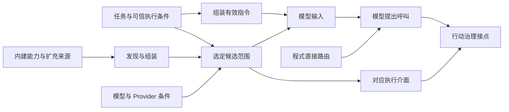

# Behavior and Capabilities

[English](./README.md) | [繁體中文](./README-zh-TW.md) | [简体中文](./README-zh-CN.md)

本区接在 [Input and Context](../input-and-context/README-zh-CN.md) 之后，说明 Harness 如何组装有效行为指令、建立能力集合，以及如何把候选能力交给模型或程序路由。四篇中英文正文初稿已完成；最后一篇以源代码追踪计算任务，保留模型与工具执行尚未验证的范围。

## 阅读顺序

| 文章 | 要回答的问题 | 主要实现对照 |
|---|---|---|
| [01. 指令与行为](./01-instructions-and-behavior-zh-CN.md) | 哪些规则成为有效指令，在哪里改变行为？ | CCB 的 Prompt 替换与追加、Skill Context 修改；Chat Gun 的 Agent Prompt 与消费入口。 |
| [02. 能力组装](./02-capability-composition-zh-CN.md) | 宣告与扩展如何形成可供任务使用的能力？ | CCB 工具池及 Skill／Command 组装；Chat Gun Registry、MCP 与 SDK descriptor staging。 |
| [03. 能力选择](./03-capability-selection-zh-CN.md) | 谁缩小候选范围，谁决定下一个行动？ | CCB 模式与子 Agent 工具范围；Chat Gun 模型绑定、程序路由与 Provider 条件。 |
| [04. 能力使用案例](./04-case-capability-use-zh-CN.md) | 同一需求如何经过两种能力使用路径？ | Chat Gun MCP Agent 的模型提案，与 Math Agent 的直接 calculator 调用。 |

英文正文沿用相同编号与主干并移除 `-zh-TW`；各篇提供语言切换连结，[英文导览](./README.md)连到对应英文版。

## 架构与责任范围

下图整理四篇使用的说明模型；方块不是既有程序的同名类型，也不表示 Chat Gun 已实现每一个来源或条件。

Input and Context 处理输入、来源、权威与容量；本区接着追踪有效指令与能力条件。当模型或程序提出具体工具名称与参数后，Action Governance 再展开资源授权、批准、重试与副作用控制。能力清单的生命周期也会影响执行中政策，但取消与恢复状态机留给 Interaction and Feedback。

本区依来源分别说明 Tool、Skill、Command、MCP、Plugin 与 Subagent。它们交付的描述、指令与执行接口不同；共同的阅读方法是找到来源、组装条件、consumer 与失败结果。

## 来源与证据范围

GUN-ATLAS v1.0 提供代码库定位与代码锚点。本轮透过 GitHub 重新查读两个指定来源，取得分支当时指向的 commit，后续程序连结固定到下列版本。

| 代号 | 代码库与查读分支 | 固定版本 | 用途 |
|---|---|---|---|
| GUN | [HsienW/chat-gun](https://github.com/HsienW/chat-gun)，`master` | [`92a5673003e4ac4ec09be8b1b350f42dbf4a5e69`](https://github.com/HsienW/chat-gun/commit/92a5673003e4ac4ec09be8b1b350f42dbf4a5e69) | Agent 入口、工具组装、治理交接与 Provider 转接。 |
| CCB | [claude-code-best/claude-code](https://github.com/claude-code-best/claude-code)，`main` | [`77a7934e15d69da13879112ed7db695c9ee7a52a`](https://github.com/claude-code-best/claude-code/commit/77a7934e15d69da13879112ed7db695c9ee7a52a) | 第三方 Coding Agent 的 Prompt、工具池、Skill／Command 与子任务能力对照。 |

本文中的 CCB 指附件所列的 Claude Code Best。它不是 Anthropic 官方代码库，文中不以它推论目前官方产品的全部行为。附件提供的「已查阅」状态也不直接延用成本轮的测试结果；正文以重新查读的程序为准。

本轮已确认源代码及所列的 consumer 调用，未执行两库的 unit、integration、E2E 或 live Provider／MCP 测试。文中提及测试时，只说明已读到的案例与边界；部署开关、真实 runner、模型选择及执行效果仍需相应证据。作者提出的快照、必要能力检查与回复核对方式，均作为设计建议。

### 主要代码索引

| 主题 | GUN | CCB |
|---|---|---|
| 行为指令 | [`prompts.ts`](https://github.com/HsienW/chat-gun/blob/92a5673003e4ac4ec09be8b1b350f42dbf4a5e69/backend/src/prompts.ts)、[Context 整合](https://github.com/HsienW/chat-gun/blob/92a5673003e4ac4ec09be8b1b350f42dbf4a5e69/backend/src/agents/context-integration.ts) | [有效 System Prompt](https://github.com/claude-code-best/claude-code/blob/77a7934e15d69da13879112ed7db695c9ee7a52a/src/utils/systemPrompt.ts)、[REPL consumer](https://github.com/claude-code-best/claude-code/blob/77a7934e15d69da13879112ed7db695c9ee7a52a/src/screens/REPL.tsx#L3499) |
| 工具描述与组装 | [Registry](https://github.com/HsienW/chat-gun/blob/92a5673003e4ac4ec09be8b1b350f42dbf4a5e69/backend/src/tools/registry.ts)、[production descriptors](https://github.com/HsienW/chat-gun/blob/92a5673003e4ac4ec09be8b1b350f42dbf4a5e69/backend/src/tools/production-runtime-tool-descriptors.ts) | [Tool 类型](https://github.com/claude-code-best/claude-code/blob/77a7934e15d69da13879112ed7db695c9ee7a52a/src/Tool.ts)、[工具池](https://github.com/claude-code-best/claude-code/blob/77a7934e15d69da13879112ed7db695c9ee7a52a/src/tools.ts)、[外层合并](https://github.com/claude-code-best/claude-code/blob/77a7934e15d69da13879112ed7db695c9ee7a52a/src/utils/toolPool.ts) |
| MCP 与 SDK | [MCP loader](https://github.com/HsienW/chat-gun/blob/92a5673003e4ac4ec09be8b1b350f42dbf4a5e69/backend/src/tools/mcp-loader.ts)、[weather SDK adapter](https://github.com/HsienW/chat-gun/blob/92a5673003e4ac4ec09be8b1b350f42dbf4a5e69/backend/src/tools/sdk/current-weather-manifest-adapter.ts) | [工具池的 MCP 合并](https://github.com/claude-code-best/claude-code/blob/77a7934e15d69da13879112ed7db695c9ee7a52a/src/tools.ts) |
| Skill／Command | 本轮所查 Agent／Registry 路径未确认对等的通用 loader。 | [Command 组装](https://github.com/claude-code-best/claude-code/blob/77a7934e15d69da13879112ed7db695c9ee7a52a/src/commands.ts)、[Skill 设置解析](https://github.com/claude-code-best/claude-code/blob/77a7934e15d69da13879112ed7db695c9ee7a52a/src/skills/loadSkillsDir.ts)、[SkillTool](https://github.com/claude-code-best/claude-code/blob/77a7934e15d69da13879112ed7db695c9ee7a52a/packages/builtin-tools/src/tools/SkillTool/SkillTool.ts) |
| 子任务能力范围 | 本轮未确认与 CCB 对等的通用 Subagent 组装。 | [工具解析](https://github.com/claude-code-best/claude-code/blob/77a7934e15d69da13879112ed7db695c9ee7a52a/packages/builtin-tools/src/tools/AgentTool/agentToolUtils.ts)、[fork 继承筛选](https://github.com/claude-code-best/claude-code/blob/77a7934e15d69da13879112ed7db695c9ee7a52a/src/utils/agentToolFilter.ts) |
| 选择与执行交接 | [MCP Agent](https://github.com/HsienW/chat-gun/blob/92a5673003e4ac4ec09be8b1b350f42dbf4a5e69/backend/src/agents/mcp-agent.ts)、[Math Agent](https://github.com/HsienW/chat-gun/blob/92a5673003e4ac4ec09be8b1b350f42dbf4a5e69/backend/src/agents/math-agent.ts)、[Gateway](https://github.com/HsienW/chat-gun/blob/92a5673003e4ac4ec09be8b1b350f42dbf4a5e69/backend/src/platform/llm-gateway.ts)、[授权 Graph](https://github.com/HsienW/chat-gun/blob/92a5673003e4ac4ec09be8b1b350f42dbf4a5e69/backend/src/runtime/authorization/confirmation-graph.ts) | [主入口工具合并](https://github.com/claude-code-best/claude-code/blob/77a7934e15d69da13879112ed7db695c9ee7a52a/src/hooks/useMergedTools.ts)、[Skill 触发](https://github.com/claude-code-best/claude-code/blob/77a7934e15d69da13879112ed7db695c9ee7a52a/packages/builtin-tools/src/tools/SkillTool/SkillTool.ts) |

### 这些路径支持的具体差异

- CCB 的 Prompt 组装有替换、追加与条件分支；REPL 将结果与其他 Context、工具决策接口分开交给 query。
- CCB 的内层工具池与外层 `initialTools` 合并具有不同同名优先序；Skill 的 `allowed-tools` 在所读 inline 路径加入 command allow 规则。
- Chat Gun 的 Registry 在此版本默认执行 `current_weather` SDK descriptor staging，并可用 `legacy` 注册选项略过。
- Chat Gun 的 `source` 在 Registry 中选择 dispatch pipeline 开关；该函数未显示逐次 Principal／Tenant 的本地工具曝光筛选。
- MCP Agent 在模块初始化时取得工具，再交给模型；Math Agent 可由程序直接抽取算式并调用 calculator，且其 pipeline 开关会影响取得的工具及 Context instrumentation。

第四篇已把这些差异放回同一项任务。若要将教学情境补成实录，需取得该版本与设置下的模型请求、实际提案、治理结果、工具效果及最终回复，不能用一段成功答案取代中间证据。
