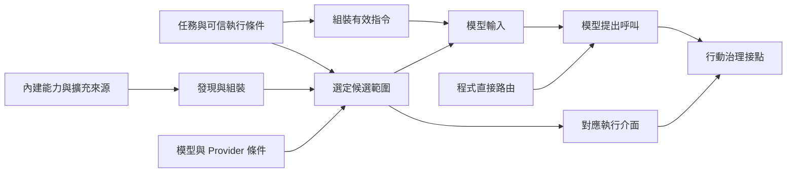

# Behavior and Capabilities

[English](./README.md) | [繁體中文](./README-zh-TW.md)

本區接在 [Input and Context](../input-and-context/README-zh-TW.md) 之後，說明 Harness 如何組裝有效行為指令、建立能力集合，以及如何把候選能力交給模型或程式路由。四篇中英文正文初稿已完成；最後一篇以原始碼追蹤計算任務，保留模型與工具執行尚未驗證的範圍。

## 閱讀順序

| 文章 | 要回答的問題 | 主要實作對照 |
|---|---|---|
| [01. 指令與行為](./01-instructions-and-behavior-zh-TW.md) | 哪些規則成為有效指令，在哪裡改變行為？ | CCB 的 Prompt 替換與追加、Skill Context 修改；Chat Gun 的 Agent Prompt 與消費入口。 |
| [02. 能力組裝](./02-capability-composition-zh-TW.md) | 宣告與擴充如何形成可供任務使用的能力？ | CCB 工具池及 Skill／Command 組裝；Chat Gun Registry、MCP 與 SDK descriptor staging。 |
| [03. 能力選擇](./03-capability-selection-zh-TW.md) | 誰縮小候選範圍，誰決定下一個行動？ | CCB 模式與子 Agent 工具範圍；Chat Gun 模型綁定、程式路由與 Provider 條件。 |
| [04. 能力使用案例](./04-case-capability-use-zh-TW.md) | 同一需求如何經過兩種能力使用路徑？ | Chat Gun MCP Agent 的模型提案，與 Math Agent 的直接 calculator 呼叫。 |

英文正文沿用相同編號與主幹並移除 `-zh-TW`；各篇提供語言切換連結，[英文導覽](./README.md)連到對應英文版。

## 架構與責任範圍

下圖整理四篇使用的說明模型；方塊不是既有程式的同名型別，也不表示 Chat Gun 已實作每一個來源或條件。

Input and Context 處理輸入、來源、權威與容量；本區接著追蹤有效指令與能力條件。當模型或程式提出具體工具名稱與參數後，Action Governance 再展開資源授權、批准、重試與副作用控制。能力清單的生命週期也會影響執行中政策，但取消與恢復狀態機留給 Interaction and Feedback。

本區依來源分別說明 Tool、Skill、Command、MCP、Plugin 與 Subagent。它們交付的描述、指令與執行介面不同；共同的閱讀方法是找到來源、組裝條件、consumer 與失敗結果。

## 來源與證據範圍

GUN-ATLAS v1.0 提供程式庫定位與代碼錨點。本輪透過 GitHub 重新查讀兩個指定來源，取得分支當時指向的 commit，後續程式連結固定到下列版本。

| 代號 | 程式庫與查讀分支 | 固定版本 | 用途 |
|---|---|---|---|
| GUN | [HsienW/chat-gun](https://github.com/HsienW/chat-gun)，`master` | [`92a5673003e4ac4ec09be8b1b350f42dbf4a5e69`](https://github.com/HsienW/chat-gun/commit/92a5673003e4ac4ec09be8b1b350f42dbf4a5e69) | Agent 入口、工具組裝、治理交接與 Provider 轉接。 |
| CCB | [claude-code-best/claude-code](https://github.com/claude-code-best/claude-code)，`main` | [`77a7934e15d69da13879112ed7db695c9ee7a52a`](https://github.com/claude-code-best/claude-code/commit/77a7934e15d69da13879112ed7db695c9ee7a52a) | 第三方 Coding Agent 的 Prompt、工具池、Skill／Command 與子任務能力對照。 |

本文中的 CCB 指附件所列的 Claude Code Best。它不是 Anthropic 官方程式庫，文中不以它推論目前官方產品的全部行為。附件提供的「已查閱」狀態也不直接延用成本輪的測試結果；正文以重新查讀的程式為準。

本輪已確認原始碼及所列的 consumer 呼叫，未執行兩庫的 unit、integration、E2E 或 live Provider／MCP 測試。文中提及測試時，只說明已讀到的案例與邊界；部署開關、真實 runner、模型選擇及執行效果仍需相應證據。作者提出的快照、必要能力檢查與回覆核對方式，均作為設計建議。

### 主要代碼索引

| 主題 | GUN | CCB |
|---|---|---|
| 行為指令 | [`prompts.ts`](https://github.com/HsienW/chat-gun/blob/92a5673003e4ac4ec09be8b1b350f42dbf4a5e69/backend/src/prompts.ts)、[Context 整合](https://github.com/HsienW/chat-gun/blob/92a5673003e4ac4ec09be8b1b350f42dbf4a5e69/backend/src/agents/context-integration.ts) | [有效 System Prompt](https://github.com/claude-code-best/claude-code/blob/77a7934e15d69da13879112ed7db695c9ee7a52a/src/utils/systemPrompt.ts)、[REPL consumer](https://github.com/claude-code-best/claude-code/blob/77a7934e15d69da13879112ed7db695c9ee7a52a/src/screens/REPL.tsx#L3499) |
| 工具描述與組裝 | [Registry](https://github.com/HsienW/chat-gun/blob/92a5673003e4ac4ec09be8b1b350f42dbf4a5e69/backend/src/tools/registry.ts)、[production descriptors](https://github.com/HsienW/chat-gun/blob/92a5673003e4ac4ec09be8b1b350f42dbf4a5e69/backend/src/tools/production-runtime-tool-descriptors.ts) | [Tool 型別](https://github.com/claude-code-best/claude-code/blob/77a7934e15d69da13879112ed7db695c9ee7a52a/src/Tool.ts)、[工具池](https://github.com/claude-code-best/claude-code/blob/77a7934e15d69da13879112ed7db695c9ee7a52a/src/tools.ts)、[外層合併](https://github.com/claude-code-best/claude-code/blob/77a7934e15d69da13879112ed7db695c9ee7a52a/src/utils/toolPool.ts) |
| MCP 與 SDK | [MCP loader](https://github.com/HsienW/chat-gun/blob/92a5673003e4ac4ec09be8b1b350f42dbf4a5e69/backend/src/tools/mcp-loader.ts)、[weather SDK adapter](https://github.com/HsienW/chat-gun/blob/92a5673003e4ac4ec09be8b1b350f42dbf4a5e69/backend/src/tools/sdk/current-weather-manifest-adapter.ts) | [工具池的 MCP 合併](https://github.com/claude-code-best/claude-code/blob/77a7934e15d69da13879112ed7db695c9ee7a52a/src/tools.ts) |
| Skill／Command | 本輪所查 Agent／Registry 路徑未確認對等的通用 loader。 | [Command 組裝](https://github.com/claude-code-best/claude-code/blob/77a7934e15d69da13879112ed7db695c9ee7a52a/src/commands.ts)、[Skill 設定解析](https://github.com/claude-code-best/claude-code/blob/77a7934e15d69da13879112ed7db695c9ee7a52a/src/skills/loadSkillsDir.ts)、[SkillTool](https://github.com/claude-code-best/claude-code/blob/77a7934e15d69da13879112ed7db695c9ee7a52a/packages/builtin-tools/src/tools/SkillTool/SkillTool.ts) |
| 子任務能力範圍 | 本輪未確認與 CCB 對等的通用 Subagent 組裝。 | [工具解析](https://github.com/claude-code-best/claude-code/blob/77a7934e15d69da13879112ed7db695c9ee7a52a/packages/builtin-tools/src/tools/AgentTool/agentToolUtils.ts)、[fork 繼承篩選](https://github.com/claude-code-best/claude-code/blob/77a7934e15d69da13879112ed7db695c9ee7a52a/src/utils/agentToolFilter.ts) |
| 選擇與執行交接 | [MCP Agent](https://github.com/HsienW/chat-gun/blob/92a5673003e4ac4ec09be8b1b350f42dbf4a5e69/backend/src/agents/mcp-agent.ts)、[Math Agent](https://github.com/HsienW/chat-gun/blob/92a5673003e4ac4ec09be8b1b350f42dbf4a5e69/backend/src/agents/math-agent.ts)、[Gateway](https://github.com/HsienW/chat-gun/blob/92a5673003e4ac4ec09be8b1b350f42dbf4a5e69/backend/src/platform/llm-gateway.ts)、[授權 Graph](https://github.com/HsienW/chat-gun/blob/92a5673003e4ac4ec09be8b1b350f42dbf4a5e69/backend/src/runtime/authorization/confirmation-graph.ts) | [主入口工具合併](https://github.com/claude-code-best/claude-code/blob/77a7934e15d69da13879112ed7db695c9ee7a52a/src/hooks/useMergedTools.ts)、[Skill 觸發](https://github.com/claude-code-best/claude-code/blob/77a7934e15d69da13879112ed7db695c9ee7a52a/packages/builtin-tools/src/tools/SkillTool/SkillTool.ts) |

### 這些路徑支持的具體差異

- CCB 的 Prompt 組裝有替換、追加與條件分支；REPL 將結果與其他 Context、工具決策介面分開交給 query。
- CCB 的內層工具池與外層 `initialTools` 合併具有不同同名優先序；Skill 的 `allowed-tools` 在所讀 inline 路徑加入 command allow 規則。
- Chat Gun 的 Registry 在此版本預設執行 `current_weather` SDK descriptor staging，並可用 `legacy` 註冊選項略過。
- Chat Gun 的 `source` 在 Registry 中選擇 dispatch pipeline 開關；該函式未顯示逐次 Principal／Tenant 的本地工具曝光篩選。
- MCP Agent 在模組初始化時取得工具，再交給模型；Math Agent 可由程式直接抽取算式並呼叫 calculator，且其 pipeline 開關會影響取得的工具及 Context instrumentation。

第四篇已把這些差異放回同一項任務。若要將教學情境補成實錄，需取得該版本與設定下的模型請求、實際提案、治理結果、工具效果及最終回覆，不能用一段成功答案取代中間證據。
