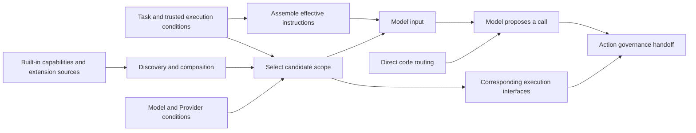

# Behavior and Capabilities

[English](./README.md) | [繁體中文](./README-zh-TW.md)

This section follows [Input and Context](../input-and-context/README.md). It explains how the Harness assembles effective behavior instructions, builds a capability set, and hands candidates to the model or code routing. Four article drafts are available in English and Traditional Chinese. The final article traces a calculation task through source code and identifies the model and tool execution behavior that remains unverified.

## Reading order

| Article | Question | Main implementation comparisons |
|---|---|---|
| [01. Instructions and behavior](./01-instructions-and-behavior.md) | Which rules become effective instructions, and where do they change behavior? | CCB Prompt replacement and appending, and Skill Context changes; Chat Gun Agent Prompts and the entry points that consume them. |
| [02. Capability composition](./02-capability-composition.md) | How do declarations and extensions become capabilities available to a task? | CCB tool pools and Skill/Command composition; Chat Gun Registry, MCP, and SDK descriptor staging. |
| [03. Capability selection](./03-capability-selection.md) | Who narrows the candidate set, and who decides the next action? | CCB modes and child Agent tool scope; Chat Gun model binding, code routing, and Provider conditions. |
| [04. A capability use case](./04-case-capability-use.md) | How does the same request pass through two capability use paths? | Chat Gun MCP Agent model proposals and the Math Agent's direct calculator calls. |

English article filenames keep the same numbers and stems without `-zh-TW`. Each article provides language links, and [this English guide](./README.md) links to the corresponding English articles.

## Architecture and responsibilities

The diagram summarizes the explanatory model used across the four articles. Its boxes are not identically named types in the code, and do not imply that Chat Gun implements every source or condition.

Input and Context covers inputs, sources, authority, and budget. This section then follows effective instructions and capability conditions. Once the model or code proposes a concrete tool name and arguments, Action Governance expands on resource authorization, approval, retries, and side effect controls. The capability list lifecycle also affects policy during execution; cancellation and recovery state machines belong to Interaction and Feedback.

This section discusses Tools, Skills, Commands, MCP, Plugins, and Subagents by source. They supply different descriptions, instructions, and execution interfaces. For each, identify the source, composition conditions, consumer, and failure result.

## Sources and evidence

GUN-ATLAS v1.0 supplied repository locations and code anchors. This inspection revisited both sources through GitHub and recorded the commits their branches pointed to. Source links use the following pinned versions.

| Alias | Repository and inspected branch | Pinned version | Purpose |
|---|---|---|---|
| GUN | [HsienW/chat-gun](https://github.com/HsienW/chat-gun), `master` | [`92a5673003e4ac4ec09be8b1b350f42dbf4a5e69`](https://github.com/HsienW/chat-gun/commit/92a5673003e4ac4ec09be8b1b350f42dbf4a5e69) | Agent entry points, tool composition, governance handoff, and Provider adapters. |
| CCB | [claude-code-best/claude-code](https://github.com/claude-code-best/claude-code), `main` | [`77a7934e15d69da13879112ed7db695c9ee7a52a`](https://github.com/claude-code-best/claude-code/commit/77a7934e15d69da13879112ed7db695c9ee7a52a) | A third-party Coding Agent comparison for Prompts, tool pools, Skills/Commands, and subtask capabilities. |

CCB means Claude Code Best, the repository listed in the attachment. It is not an official Anthropic repository, and its code does not establish all behavior of the current official product. The attachment's inspected status is not treated as a test result from this work; the articles rely on the source inspected again here.

This work inspected source code and the listed consumer calls without running unit, integration, E2E, or live Provider/MCP tests for either repository. Test discussions describe only the cases and boundaries read in code. Deployment flags, real runners, model selection, and execution effects still require corresponding evidence. Snapshots, required-capability checks, and reply checks proposed by the author are design suggestions.

### Main code index

| Topic | GUN | CCB |
|---|---|---|
| Behavior instructions | [`prompts.ts`](https://github.com/HsienW/chat-gun/blob/92a5673003e4ac4ec09be8b1b350f42dbf4a5e69/backend/src/prompts.ts)、[Context integration](https://github.com/HsienW/chat-gun/blob/92a5673003e4ac4ec09be8b1b350f42dbf4a5e69/backend/src/agents/context-integration.ts) | [Effective System Prompt](https://github.com/claude-code-best/claude-code/blob/77a7934e15d69da13879112ed7db695c9ee7a52a/src/utils/systemPrompt.ts)、[REPL consumer](https://github.com/claude-code-best/claude-code/blob/77a7934e15d69da13879112ed7db695c9ee7a52a/src/screens/REPL.tsx#L3499) |
| Tool descriptions and composition | [Registry](https://github.com/HsienW/chat-gun/blob/92a5673003e4ac4ec09be8b1b350f42dbf4a5e69/backend/src/tools/registry.ts)、[production descriptors](https://github.com/HsienW/chat-gun/blob/92a5673003e4ac4ec09be8b1b350f42dbf4a5e69/backend/src/tools/production-runtime-tool-descriptors.ts) | [Tool type](https://github.com/claude-code-best/claude-code/blob/77a7934e15d69da13879112ed7db695c9ee7a52a/src/Tool.ts)、[Tool pool](https://github.com/claude-code-best/claude-code/blob/77a7934e15d69da13879112ed7db695c9ee7a52a/src/tools.ts)、[Outer merge](https://github.com/claude-code-best/claude-code/blob/77a7934e15d69da13879112ed7db695c9ee7a52a/src/utils/toolPool.ts) |
| MCP and SDK | [MCP loader](https://github.com/HsienW/chat-gun/blob/92a5673003e4ac4ec09be8b1b350f42dbf4a5e69/backend/src/tools/mcp-loader.ts)、[weather SDK adapter](https://github.com/HsienW/chat-gun/blob/92a5673003e4ac4ec09be8b1b350f42dbf4a5e69/backend/src/tools/sdk/current-weather-manifest-adapter.ts) | [MCP merge in the tool pool](https://github.com/claude-code-best/claude-code/blob/77a7934e15d69da13879112ed7db695c9ee7a52a/src/tools.ts) |
| Skill/Command | No equivalent general loader was confirmed in the inspected Agent/Registry paths. | [Command composition](https://github.com/claude-code-best/claude-code/blob/77a7934e15d69da13879112ed7db695c9ee7a52a/src/commands.ts)、[Skill configuration parsing](https://github.com/claude-code-best/claude-code/blob/77a7934e15d69da13879112ed7db695c9ee7a52a/src/skills/loadSkillsDir.ts)、[SkillTool](https://github.com/claude-code-best/claude-code/blob/77a7934e15d69da13879112ed7db695c9ee7a52a/packages/builtin-tools/src/tools/SkillTool/SkillTool.ts) |
| Subtask capability scope | No general Subagent composition equivalent to CCB was confirmed in this inspection. | [Tool resolution](https://github.com/claude-code-best/claude-code/blob/77a7934e15d69da13879112ed7db695c9ee7a52a/packages/builtin-tools/src/tools/AgentTool/agentToolUtils.ts)、[Fork inheritance filtering](https://github.com/claude-code-best/claude-code/blob/77a7934e15d69da13879112ed7db695c9ee7a52a/src/utils/agentToolFilter.ts) |
| Selection and execution handoff | [MCP Agent](https://github.com/HsienW/chat-gun/blob/92a5673003e4ac4ec09be8b1b350f42dbf4a5e69/backend/src/agents/mcp-agent.ts)、[Math Agent](https://github.com/HsienW/chat-gun/blob/92a5673003e4ac4ec09be8b1b350f42dbf4a5e69/backend/src/agents/math-agent.ts)、[Gateway](https://github.com/HsienW/chat-gun/blob/92a5673003e4ac4ec09be8b1b350f42dbf4a5e69/backend/src/platform/llm-gateway.ts)、[Authorization Graph](https://github.com/HsienW/chat-gun/blob/92a5673003e4ac4ec09be8b1b350f42dbf4a5e69/backend/src/runtime/authorization/confirmation-graph.ts) | [Main entry point tool merge](https://github.com/claude-code-best/claude-code/blob/77a7934e15d69da13879112ed7db695c9ee7a52a/src/hooks/useMergedTools.ts)、[Skill invocation](https://github.com/claude-code-best/claude-code/blob/77a7934e15d69da13879112ed7db695c9ee7a52a/packages/builtin-tools/src/tools/SkillTool/SkillTool.ts) |

### Specific differences supported by these paths

- CCB Prompt assembly includes replacement, appending, and conditional branches. The REPL passes the result to query separately from other Context and tool decision interfaces.
- CCB uses different precedence for duplicate names in its inner tool pool and outer `initialTools` merge. Skill `allowed-tools` adds command allow rules in the inspected inline path.
- In this version, the Chat Gun Registry performs `current_weather` SDK descriptor staging by default; the `legacy` registration option can skip it.
- Chat Gun uses `source` in the Registry to select dispatch pipeline flags. That function does not show per-request Principal/Tenant filtering of local tool visibility.
- The MCP Agent obtains tools during module initialization and passes them to the model. The Math Agent can extract an expression in code and call the calculator directly; its pipeline flags affect both the tools obtained and Context instrumentation.

Article 04 applies these differences to the same task. Turning that teaching scenario into an execution record requires the model request, actual proposal, governance result, tool effects, and final reply for that version and configuration. A successful answer cannot replace the evidence between those steps.
