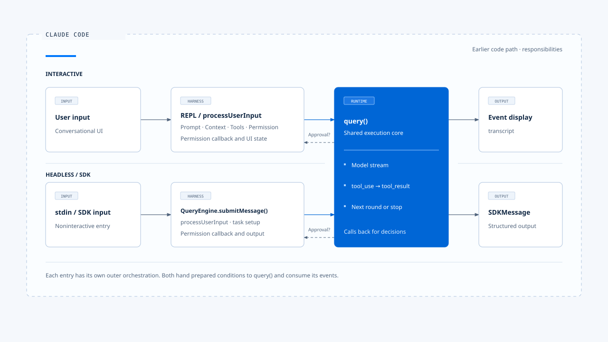
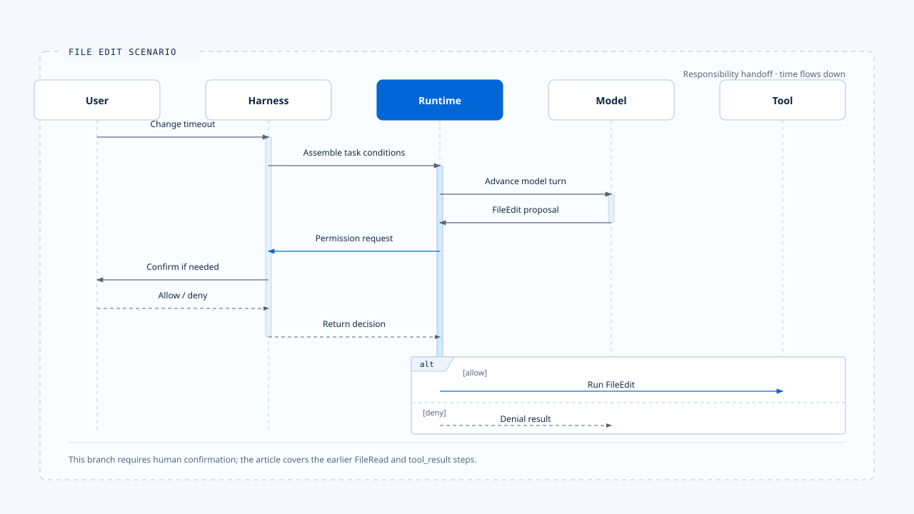

# 实际落地的 Agent Harness 是什麽?

[English](./01-what-is-agent-harness.md) | [繁體中文](./01-what-is-agent-harness-zh-TW.md) | [简体中文](./01-what-is-agent-harness-zh-CN.md)

> 以下内容所提到的
> CCB 为 [claude-code-best](https://github.com/claude-code-best/claude-code) 的简称。
> Chat Gun 为 [chat-gun](https://github.com/HsienW/chat-gun)。

- 我认为 Agent Harness 是产品放在模型与真实世界之间的控制层
  - 它整理用户输入
  - 决定模型此刻能看见哪些数据
  - 可以使用哪些能力
  - 采取行动前要经过哪些检查
  - 也规定用户如何在执行中补充、取消或批准操作

> 这个定义关心的是「责任」，不要求项目里一定存在名为 Harness 的 class、package 或目录。
> 对比在 CCB 的相关责任是分散在启动组装、REPL、QueryEngine、输入处理、Prompt、Tool registry、Permission。
> 显示层；把这些文件逐一列出，只能得到组件表。沿着一次任务追踪「谁做决定」，才看得到 Harness。

## Harness 位于哪里

一个具备 Agent 能力的产品可以先用三层理解：

- 产品层: 承接终端、账号、业务流程与用户体验。
- Harness: 把产品意图转成一次可执行且受治理的 Agent 任务。
- Runtime: 接手之后，负责让该任务实际运转到完成、取消或失败。

这三层可能写在同一个程序里。分层的用途是厘清决策权与状态所有权，而非要求每层都成为独立服务。

## Harness 持有的五个决策面

### 1. 输入

**Harness 先判断「用户到底提交了什麽」:**

一段输入可能同时含有文字、附件、图片、IDE selection、Slash Command 或对既有任务的补充。这些来源需先被辨识、验证并转成一致的输入契约，Runtime 才知道该开始新任务、延续旧任务，或只执行本地命令。
Claude Code 的 processUserInput 会处理一般消息、附件与命令分流。Interactive 与 Headless 模式的入口不同，但两者都必须先完成这层转换，才把数据送入核心 Agent loop。

### 2. 上下文 (Context)

**Harness 决定「这一轮要让模型知道什麽」:**

上下文 (Context) 不只包含历史消息，也可能包括 System Prompt、项目指令、目前目录、文件内容、记忆、Tool Result 与用户附件。Harness 需要处理来源权威、优先序、Token 预算与压缩策略。
这项责任会直接改变模型行为。相同模型与相同问题，在不同 Context 组装下可能选择不同工具、忽略不同限制，甚至理解成不同任务。

### 3. 行为与能力

**Harness 决定「Agent 被允许考虑哪些做法」:**

System Prompt 与项目规则描述行为；Tool、Skill、MCP、Command 与 Subagent 定义可用能力。能力是否出现在模型面前，也是一项政策决定。某个 Tool 已经实现，不代表每个 Agent、模式与用户都应看见它。
Claude Code 会依启动模式、设置、Feature Gate、身份、目录信任与 Permission mode 组装能力。Chat Gun 面对的则是 C 端业务工具、租户资源与不同 Agent Graph。产品不同，控制问题相同：能力必须在进入模型与进入执行器之前受到约束。

### 4. 行动治理

**Harness 决定「模型提出的行动能否真的执行」:**

模型可以提出 FileEdit、Shell、退款或通知等工具调用；执行权仍由系统持有。Harness 应根据 Tool 风险、作用资源、Principal、Scope、Policy 与用户批准作出决策，再把结果交回 Runtime。
因此，Tool 对模型可见与本次 Tool Call 获准是两个不同问题。前者属于能力配置，后者属于特定行动的授权。

### 5. 互动与反馈

**Harness 决定「执行期间，人与 Agent 如何继续对话」:**

用户可能在任务执行中补充条件、要求取消、送出第二个问题，或回复一项人工确认。Harness 必须决定这笔输入属于目前 Run、下一个 Run，还是应取代正在执行的工作。
任务结束后，Harness 还要把 Runtime 事件转成用户看得懂的进度、错误与结果。评估数据也从这里形成，用来检查既有约束是否真的改善行为。

## 对比在 Claude Code 看见责任边界

在分析的 Claude Code Best（CCB）中，Interactive 与 Headless／SDK 并未共用同一个外层编排器：

两条路径最后都把准备好的执行数据交给 query()

> query() 与内部 query loop 负责模型串流、解析 tool_use、执行工具、回填 tool_result，然后决定继续下一轮或结束。

这提供了一条可操作的分界:
1. Harness 组装执行条件
2. Runtime 执行 Agent loop，再由 Harness 消费消息与事件

Runtime 执行期间仍可能调用 Harness 提供的接口。例如工具准备执行时，Runtime 透过 Permission callback 请求决策；Interactive Harness 可以显示确认窗口，Headless Harness 则可以把请求交给 SDK host。Runtime 不需要知道决策来自 TUI、远端服务或预先设置的政策，只需遵守返回结果。
由此可见，Harness 与 Runtime 的交接不是单向函数调用，而是一组双向契约：执行输入向内流，政策决策在需要时回应，消息与事件再向外流。

## 落地场景: 以一个文件修改当范例

**假设用户输入：「把 src/app.ts 的 timeout 改成 30 秒。」**

Harness 先完成以下工作：

1. 将文字与 IDE Context 转成标准输入。
2. 组装项目规则、对话历史与目前工作目录。
3. 提供 FileRead 与 FileEdit 等本次可用工具。
4. 设置 FileEdit 的 Permission policy。
5. 把以上数据交给 Runtime。

Runtime 开始模型与工具循环：
1. 模型先提出 FileRead，Runtime 执行后把内容回灌
2. 模型接着提出 FileEdit。到了修改动作，Runtime 调用 Harness 提供的 Permission 接口
   - 若政策规则允许，Runtime 执行 FileEdit，再让模型整理结果
   - 若需要人工确认，Harness 显示操作内容并等待用户 ? 若用户拒绝，Harness 返回拒绝决策，Runtime 将拒绝结果放回对话，让模型改用其他方法或说明无法继续。

这个场景中，**模型提出候选行动**，再者**Harness 持有行动条件与决策权**，最后**Runtime 持有执行顺序与状态转移**。三者各自负责一段不同的问题。

## 从前述的 Coding Agent 的范例延伸到 Chat Gun 的开发经验

场景落地的类型:
1. Coding Agent 的外部世界主要是文件、Shell、Git、MCP 与开发环境。
2. Chat Gun 这类 C 端任务 Agent 会接触账号、租户数据、搜索服务与未来的业务操作。
   - 当 Tool 只读取天气时，Harness 需要决定位置与隐私数据如何进入 Context
   - 当 Tool 会退款、预约或发送通知时，Harness 还需要判断 Principal、Resource Scope、风险等级与批准条件。

Runtime 承接问题的类型：
1. 工具是否可以并行、超时后能否重试
2. 外部操作已成功但回应遗失时如何回查
3. 程序崩溃后能否安全恢复、是否有副作用

以上的分工让同一套 Harness 定义可以跨越 Coding Agent 与业务型 Agent，同时保留各自的风险模型。

## 如何判断一个系统是否有完整 Harness

可以沿一次真实任务问七个问题：

1. 哪些输入形式可以进入 Agent，谁负责验证与规范化？
2. 哪些数据会进入模型，来源冲突时如何排序？
3. 本次任务能看见哪些能力，由谁配置？
4. 模型提出行动后，由谁决定允许、拒绝或请人确认？
5. 用户在执行中再次输入时，如何判断归属？
6. Runtime 以什麽消息与事件契约返回结果？
7. 如何证明上述政策确实存在于正式执行路径？

> 前六题描述控制面，第七题要求落地证据。
> 若规则只写在 Prompt、文件或一个没有接线的模组里，它仍只是设计材料，尚未成为产品的 Harness 行为。

## 场景角色的概念的责任

| 概念 | 在本知识库中的责任 |
|---|---|
| Agent Product | 提供用户体验、账号、业务流程与产品政策 |
| Agent Harness | 组装任务条件，约束 Agent 的认知、能力、行动与互动 |
| Agent Runtime | 执行 Run 生命周期、模型与工具循环、状态转移及恢复 |
| Agent Framework | 提供 Graph、Message、Tool、Checkpoint 等开发原语 |
| System Prompt | Harness 使用的一种行为控制材料 |
| Tool Runtime | Runtime 中负责 Tool 验证、调度、执行与结果处理的部分 |
| Evaluation | 检查 Harness 规则与 Runtime 行为是否产生预期结果 |

- 框架可以承载 Harness，也可以承载 Runtime；但采用 LangGraph、LangChain 或自制 loop，并不会自动回答产品的输入权威、能力范围与授权政策。

## 责任边界

- 这套定义适合会让模型自主选择步骤、调用工具，并可能接受执行中介入的 Agent 产品。单次文字补全也有 Prompt 与输入处理，但若没有能力选择、行动治理或持续执行状态，使用完整 Harness 模型的收益有限。
- Harness 也无法替代领域授权系统。它可以在 Tool dispatch 前调用授权服务并执行决策，不能自行宣告某个用户拥有退款、医疗数据或企业资源的权限。

## Harness 的定义

- Harness 在 Agent Product 中负责组装输入、Context、行为规则与能力，治理模型提出的行动，并承接人与 Runtime 互动的控制层。
- Harness 在工程线索中，每项规则都应找到决策者、执行位置与可观测结果。如此一来，Harness 才能从概念变成可验证的产品行为。

## 参考落地的来源

### [chat-gun](https://github.com/HsienW/chat-gun)

### [claude-code-best](https://github.com/claude-code-best/claude-code)

- claude-code-best：src/screens/REPL.tsx
- claude-code-best：src/QueryEngine.ts
- claude-code-best：src/query.ts
- claude-code-best：src/utils/processUserInput/processUserInput.ts
- claude-code-best：ARCHITECTURE.md

### Chat Gun 的使用方式

- Chat Gun 在本篇只用于检查这套定义能否延伸到 C 端任务 Agent
- 个别能力是否已接入正式路径，仍应依对应文章与程序证据标为「已接入」、「模组可用」或「规划中」。

## 接续阅读

- [Harness 的控制面](./02-control-surfaces-zh-CN.md)
- [Harness 与 Runtime 的边界](./03-harness-runtime-boundary-zh-CN.md)
- [Agent Harness 设计原则](./04-design-principles-zh-CN.md)
- [一次任务的完整走法](./05-one-turn-walkthrough-zh-CN.md)
