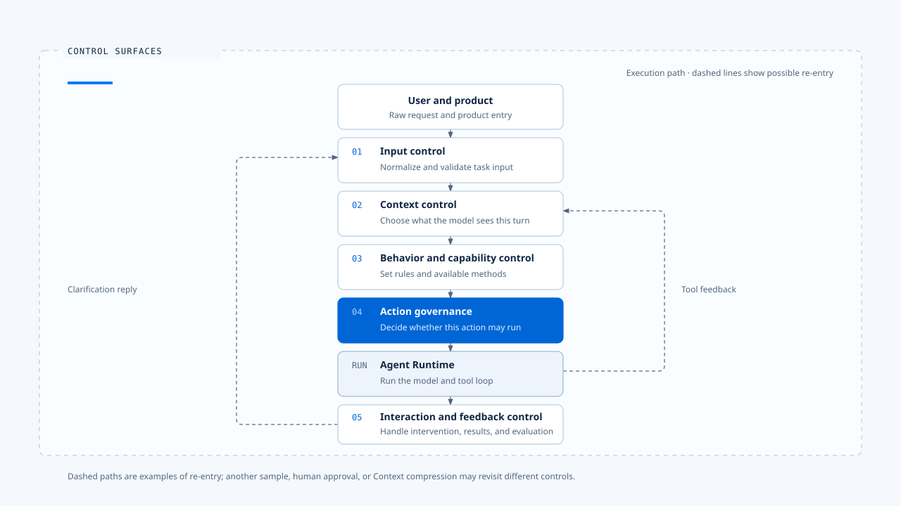
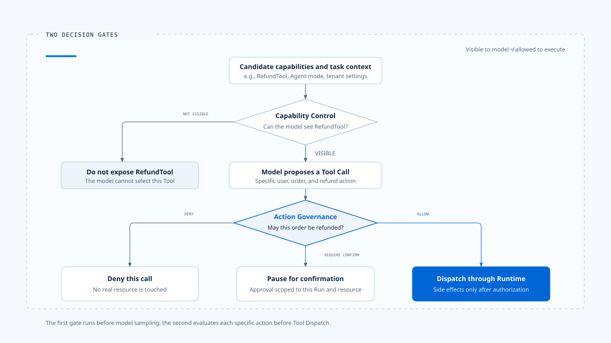
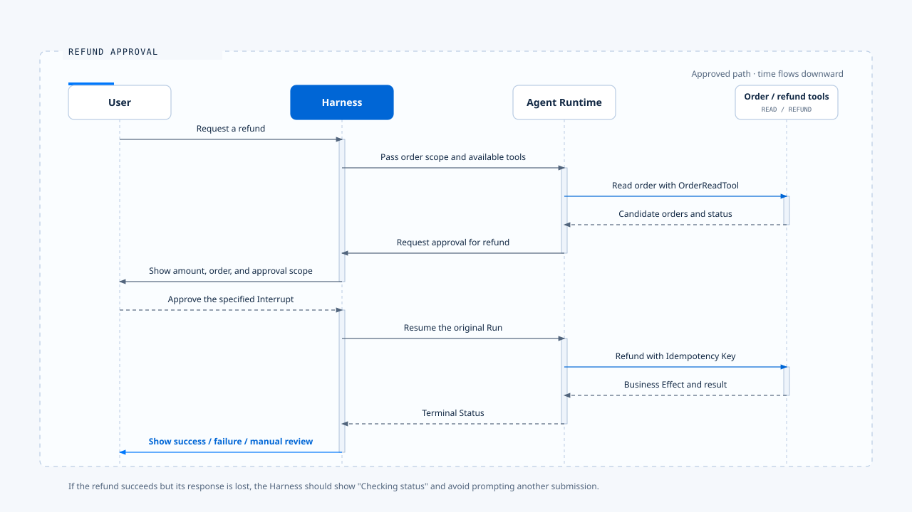

# Harness 的控制层

[English](./02-control-surfaces.md) | [繁體中文](./02-control-surfaces-zh-TW.md) | [简体中文](./02-control-surfaces-zh-CN.md)

> 控制层的价值在于把【产品意图】放到明确的决策点。每个决策都应有输入、有执行位置、有失败处理，也有事后可以查验的结果。

- Harness 的控制层之所以存在，是因为模型权重固定之后，Agent 的实际行为仍会因外围因素而大幅改变。例如:
  - 输入如何被解读
  - 哪些数据进入 Context
  - 哪些 Tool 可选
  - 哪次行动需要批准
  - 用户能否中途改变任务或改变意图

## 控制层怎麽定义

Control Surface（控制层）：

> 产品可以在不修改模型权重的前提下，持续改变 Agent 认知、能力、行动或互动方式的可执行决策点。

一个完整控制层至少包含五个部分：

| 部分 | 要回答的问题 |
|---|---|
| Policy Source | 规则从设置、程序、租户政策、用户选择或其他何处而来？ |
| Decision Input | 决策需要哪些可信数据？ |
| Enforcement Point | 规则在哪一条正式执行路径被套用？ |
| Failure Behavior | 规则无法加载、超时或执行失败时如何处理？ |
| Evidence | 如何证明本次 Run 确实套用了这项规则？ |

- 只有配置文件或 Prompt 文字，还不足以构成可靠的控制层。
- 规则必须走到执行点，影响模型可见内容或 Runtime 行为，并留下可追查的决策结果。

## 五个主要控制层

- 该图是一条便于阅读的顺序展示，实际上执行并非只走一次。
- 每次模型再次取样、工具回灌、人工批准或 Context 压缩，都可能重新经过其中几个控制层。

## 1. 输入控制层

输入控制层把原始互动转成 Runtime 可以接受的命令。它处理的不只是字串格式，也要判断这笔输入的意图与归属。

### 它控制什麽

- 支持文字、图片、附件、命令、远端事件或结构化表单中的哪些形式。
- 一笔输入要开始新 Run、延续目前 Run、回复 Clarification，还是取消既有 Run。
- 空白、过大、重复、互相冲突或格式不完整的输入如何处理。
- 附件、IDE Context 与远端数据如何转成带来源的标准项目。
- 用户在 Dispatch 与 Running 之间再次提交时，如何避免 Concurrent Query Re-entry（并发查询重入）。
- 用户有产生 Double Texting 是要排队等待，还是直接打断当前进行中的任务。

### Claude Code 的落点

- Claude Code 的 processUserInput 会在进入 query() 前处理一般消息、Slash Command、附件与 Hook 补充内容。
- Interactive REPL 和 Headless／SDK 的外层不同，但两条路径都先完成输入处理，再组装一次查询。

> 代表输入控制层属于 Harness。query loop 可以消费已整理的消息，不必理解每个终端如何取得键盘输入、IDE selection 或 SDK stream。

### Chat Gun 的目前证据

- 以 Chat Gun 已有 NormalizedAgentInput、readNormalizedAgentInput 与 GenerationQueryGuard 实现为例子 interaction runtime 会根据输入种类分流一般任务、Cancel 与 Clarification Resume，并以 Active Run Generation 防止旧请求覆盖新执行。

### 失败边界

- 解析失败时，不应把未知输入降级成一般文字后继续执行。
- 较安全的做法是返回结构化错误，保留原始数据的杂凑、长度与来源，再要求用户修正或重新提交。

## 2. Context 控制层

Context 控制层决定模型在某一次推理步骤中能看见什麽。它同时处理数据选取、来源权威、Token 预算与降级策略。

### 它控制什麽

- System Policy、Current Task、Recent Messages、Active State、Memory 与 Tool Output 的优先序。
- 哪些来源可以提供事实，哪些来源只能当作不可信内容。
- 每类 Context 的 Token 配额、硬上限与输出保留量。
- 超出容量时采取压缩、摘要、裁切、拒绝或降级中的哪一种策略。
- Memory 是否符合目前 Principal、Tenant 与 Scope。
- Tool Use 与 Tool Result 是否成对保留，避免形成无效对话。

### Claude Code 的落点

- 短对话会将 System Prompt、CLAUDE.md、对话历史、工具结果、附件与项目状态组进模型请求。
- 长对话则还会再额外加上使用 Tool Result Budget、Microcompact、Autocompact 与其他压缩路径控制 Context。

> 这些机制同时横跨 Harness 与 Runtime。来源选择、权威和保留规则属于 Harness；在正确时机执行压缩、维持消息配对并重试模型请求，属于 Runtime。

### Chat Gun 的目前证据

Chat Gun 的 Agent Context Assembler 已接到 Chatbot，并可由各 Agent 的 Feature Flag 控制。组装器会区分 System Policy、Current Task、Recent Messages、Active State 与 Tool Output，也会依 Canonical Execution Context 将 Memory 限定在对应 Principal、Tenant 与 Scope。

### 失败边界

Context 组装失败时，要区分:
- Hard Limit、Memory Unavailable、Compression Failure 与来源内容异常。
- 超过总硬上限不应照常调用模型；Memory 查询失败则可依产品政策降级，前提是不能悄悄改变安全规则或 Current Task。

## 3. 行为与能力控制层

这个控制层决定 Agent 应遵循哪些行为规则，以及它可以考虑哪些完成任务的方法。

### 行为控制

行为规则可能来自 System Prompt、项目指令、租户政策、Agent Persona、Goal、停止条件或 Hook。Harness 需要建立明确优先序，避免后加载的数据覆盖高权威规则。

建议的基础顺序是：

~~~text
安全與授權政策
  > 使用者目前明確指令
  > 當前任務與有效執行狀態
  > 產品／專案規則
  > 歷史 Memory
  > 檢索內容與 Tool Output
~~~

本库采用的预设判断，不是所有产品都必须照搬。领域法规、组织政策或特定工作流可以增加更高层规则，但低信任内容不能取得指令权威。

### 能力控制

能力控制决定本次任务向模型公开哪些 Tool、Skill、MCP、Command 或 Subagent，也包含 Model／Provider 选择及其能力限制。

Harness 应回答：

- 这项能力是否适合目前 Agent 与模式？
- 用户、租户与部署环境是否允许看见它？
- Tool Schema 是否足以让模型正确选用？
- Provider 是否支持所需的 Tool Calling、Vision、Structured Output 或 Context Window？
- 加载失败时，是中止任务、隐藏单一能力，还是使用替代 Provider？

### Claude Code 的落点

- Claude Code 在启动与查询组装阶段，依模式、设置、Feature Gate、模型能力、目录信任与 Permission mode 建立 Tool、Skill、Command、MCP 与 Subagent 集合。
- Provider 转接发生在 API 边界，使上层 query loop 维持一致的 Message 与 Tool 语意。

### 失败边界

**能力加载失败不能留下【模型看得到但执行器不存在】的 Tool**
- 安全的顺序是先完成加载与验证，再把最终能力清单交给模型。
- 必要能力缺失时，应在取样前停止并说明原因。

## 4. 行动治理控制层

- 行动治理决定某一次模型提出的 Tool Call 是否可以落到真实世界。它处理的是具体行动，不只是 Tool 是否存在。

### 它控制什麽

- Tool 与输入对应的风险等级。
- Principal 是否可以在目前 Tenant 与 Resource Scope 执行这项行动。
- 行动应直接 Allow、Deny，或 Require Confirmation。
- Approval 的 Run、Resource、期限与一次性使用范围。
- Policy、Authorization Store 或确认服务不可用时的处理方式。
- 决策如何与 Run ID、Tool Call ID、Policy Version 及 Audit Event 关联。

### 两阶段判断

- 第一阶段 = 缩小模型可选空间。
- 第二阶段 = 保护真实资源。

> 只做其中一层都不完整：因为完全隐藏能力会失去动态授权，只有执行时授权则会让模型反覆规划永远不可能成功的行动。

### Claude Code 的落点

- Claude Code 将 Tool 可见性与每次 Tool Use 的 Permission 判断分开。
- Runtime 准备执行工具时，透过 canUseTool 等接口向 Harness 请求决策。
- Interactive 路径可以显示 Allow／Deny，Headless／SDK 则由宿主回复。

### Chat Gun 的目前证据

- Chat Gun 的 Tool registry 现在会建立 Runtime Tool Authorization Composition，将 Authorization、Confirmation Store 与 Interrupt Manifest Repository 接入本地 Tool 和 MCP Tool。可信 Principal 与 Scope Header 也已列入 LangGraph Server 的 configurable headers。

### 失败边界

- 身份缺失、Tenant 不一致、Policy Version 缺少或 Authorization Persistence 不可用时，具副作用的 Tool 应 Fail Closed。系统可以为开发环境提供明确 Profile，不能在 Production 以匿名或预设允许作为一般回退。

## 5. 互动与反馈控制层

这个控制层管理人如何在 Agent 执行前后与执行途中介入，也负责把 Runtime 状态转成用户与运营者可理解的信号。

### 执行中互动

常见输入包括：

- 补充目前任务所需数据。
- 回复 Clarification。
- 批准或拒绝高风险行动。
- 取消目前 Run。
- 以新需求取代正在执行的任务。
- 排队等待目前 Run 完成后处理。

> Harness 必须为每一种情况定义 Ownership 与 Generation。否则旧 Run 的晚到结果可能覆盖新任务，或同一笔输入同时被两个执行消费。

### 结果与反馈

- Runtime 产生的内容不只有文字 Token，还包含 Tool Start、Tool Success、Tool Error、Context Build、Structured Card、Terminal Status 与未知事件。
- Harness 则是需要把 Runtime 的产物转成稳定的 UI State，并保留足以重播、去重与评估的识别信息。

### Claude Code 的落点

- Interactive REPL 持有输入、Permission UI、进度与显示状态；Headless／SDK 由 QueryEngine 保存跨 Turn 消息、Abort Controller、Usage 与 Permission Denials，再将内部 Message 转成 SDKMessage。
- 两者消费同一类 Runtime 结果，但互动契约不同。这说明 Harness 可以因产品表面而改变，Runtime 核心仍维持相对稳定。

### Chat Gun 的目前证据

- Chat Gun 的 Interaction Runtime 已处理 Active Run Ownership、Generation、Supersede、Cancel 与 Clarification Resume Authorization，并以 Query Guard 管理 Idle、Dispatching 与 Running 间的重入风险。

### 失败边界

- 取消请求超时、Client Disconnect、旧 Generation 晚到或未知事件格式，都需要明确降级。
- UI 不应因未知事件崩溃，也不应让已进入 Terminal 的 Run 回到 Running。

## 控制层之间如何解决冲突

控制层并非各自独立的设置表。正常在一次任务中，它们会互相限制：

- 输入控制层辨识为 Clarification Resume，互动控制层才知道要寻找哪个 Interrupt。
- Context 控制层准备加入 Memory，行动治理提供的 Principal 与 Scope 会限制可读范围。
- 能力控制层公开 RefundTool，行动治理仍可拒绝某笔订单。
- Runtime 返回 Tool Error，Context 控制层要保留足够信息让模型修复，同时避免把错误文字当成高权威指令。
- 用户要求 Supersede，目前 Tool 已产生副作用时，互动控制层必须等待 Runtime 的 Reconciliation 或 Compensation 判断。

**建议将优先序写成可测试的规则，而非依赖调用顺序碰巧得到结果。至少应固定三条：**

1. Safety 与 Authorization 不被 Prompt、Memory 或 Tool Output 覆盖。
2. Current Explicit Input 优先于历史偏好，但不能绕过资源权限。
3. Terminal State 单向收敛；旧 Generation 的事件不能恢复或覆盖新 Run。

## 真实场景：用户要求退款

假设用户输入：「帮我退掉昨天的订单，原因是重复购买。」

| 阶段 | 控制层 | 决策 |
|---|---|---|
| 接收文字 | 输入 | 解析为新任务，保留原始文字与 Request ID |
| 找出订单 | Context | 只加入目前用户与 Tenant 可见的候选订单 |
| 规划方法 | 行为与能力 | 提供 OrderReadTool 与 RefundTool，禁止模型自行编造订单状态 |
| 查询订单 | 行动治理 | 唯读查询在有效 Scope 下可直接执行 |
| 提出退款 | 行动治理 | 退款属副作用，需要确认或更高等级授权 |
| 等待批准 | 互动 | 将 Run 暂停，显示金额、订单与批准范围 |
| 用户批准 | 输入＋互动 | 辨识为对指定 Interrupt 的 Resume，不建立无关新 Run |
| 执行退款 | Runtime | 以 Idempotency Key 执行，记录 Business Effect |
| 返回结果 | 互动与反馈 | 显示成功、失败或待人工仲裁，保留 Correlation |

**若退款已成功，但回应遗失**
- Runtime 负责问题的 Side Effect Recovery。
- Harness 负责向用户呈现「状态确认中」，并避免提供会诱导重复提交的界面。

## 如何验证控制层真的成立

每个控制层都应该要能提出一组可重现的证据：

| 控制层 | 最小验证 |
|---|---|
| 输入 | 同一语意从 Browser、SDK 与 Remote 入口得到相同 Normalized Input |
| Context | 可列出每个 Block 的来源、权威、Token 与取舍原因 |
| 行为与能力 | 可证明某 Tool 在指定 Agent／Tenant／Flag 下出现或消失 |
| 行动治理 | 同一 Tool 对不同 Principal、Scope 与资源得到可追踪决策 |
| 互动与反馈 | 重复、乱序、晚到与未知事件不破坏 Authoritative Run State |

> 实现文件、类别名称或单元测试只能提供部分证据。完整结论需要从产品入口走到实际 Enforcement Point，再观察 Runtime 与终端产生的结果。

## 常见失败模式

### 设置存在，正式路径没有读取

- 这会产生纸面政策。修正方式是建立 Architecture Test 或 Composition Root Test，禁止正式入口绕过必要控制。

### Prompt 承担所有控制

- Prompt 适合表达行为意图，无法取代身份验证、资源授权、Token Hard Limit、Idempotency 与 Terminal State Machine。

### 每个 Agent 自行组装一套

- 重复实现会让 Chatbot、MCP Agent 与 Deep Research 对相同输入或权限采取不同语意。
- 共用 Contract 与 Composition Root 应固定不变量，各 Agent 只提供自己的政策与能力。

### 失败时静默放宽

- Memory、MCP 或 Policy Service 无法使用时，系统若悄悄改成全量 Context、匿名身份或预设允许，会把可用性问题变成安全问题。
- 每个控制层都需要事先定义 Fail Closed、Degraded 或 Manual 的条件。

### 只有 Log，没有 Correlation

- 事件很多却无法串回 Request、Run、Tool Call 与 Business Effect，事后仍回答不了哪条规则生效。Evidence 必须从设计时就带上 Execution Identity。

## 本篇的工程判断

Harness 的成熟度不应以设置数量衡量，而应看产品能否回答三件事：

1. 哪一条规则改变了 Agent 的选择？
2. 规则在哪个执行点被强制套用？
3. 发生冲突或失败时，系统如何保守收敛？

能回答这三题，控制层才从概念成为工程能力。

## 证据来源

### [claude-code-best](https://github.com/claude-code-best/claude-code)

- claude-code-best：src/utils/processUserInput/processUserInput.ts
- claude-code-best：src/screens/REPL.tsx
- claude-code-best：src/QueryEngine.ts
- claude-code-best：src/query.ts
- claude-code-best：ARCHITECTURE.md

### [chat-gun](https://github.com/HsienW/chat-gun)

- backend/src/runtime/input/normalized-agent-input.ts
- backend/src/runtime/input/read-normalized-agent-input.ts
- backend/src/runtime/input/query-guard.ts
- backend/src/platform/interaction-runtime.ts
- backend/src/agents/context-integration.ts
- backend/src/tools/registry.ts
- backend/src/tools/authorization/tool-authorization.ts
- backend/src/platform/agent-runtime-events.ts
- backend/langgraph.json

## 接续阅读

- [什麽是 Agent Harness](./01-what-is-agent-harness-zh-CN.md)
- [Harness 与 Runtime 的边界](./03-harness-runtime-boundary-zh-CN.md)
- [Agent Harness 设计原则](./04-design-principles-zh-CN.md)
- [一次任务的完整走法](./05-one-turn-walkthrough-zh-CN.md)
