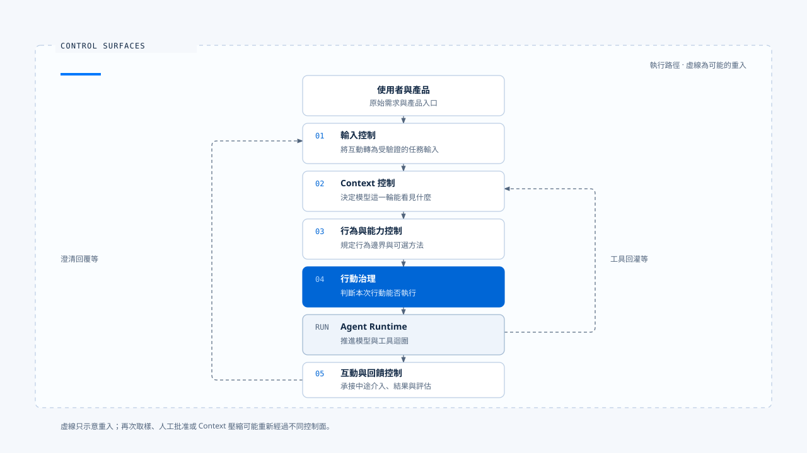
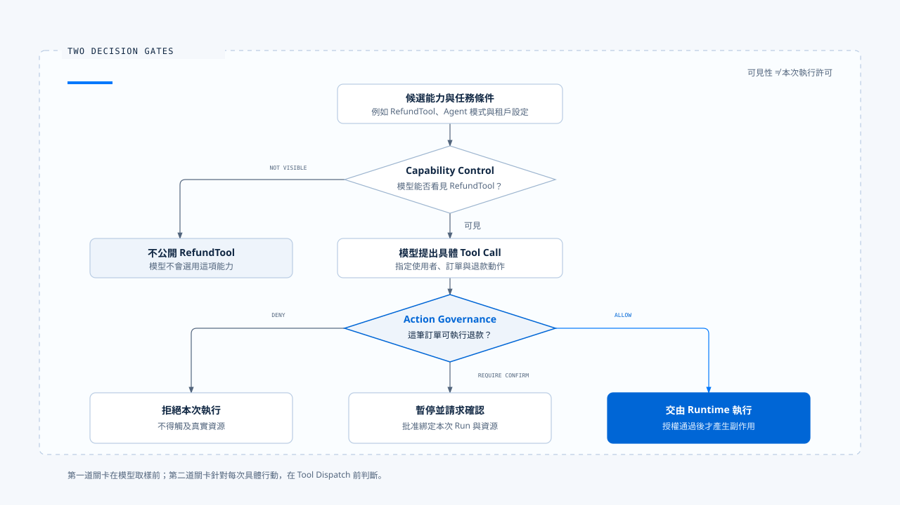
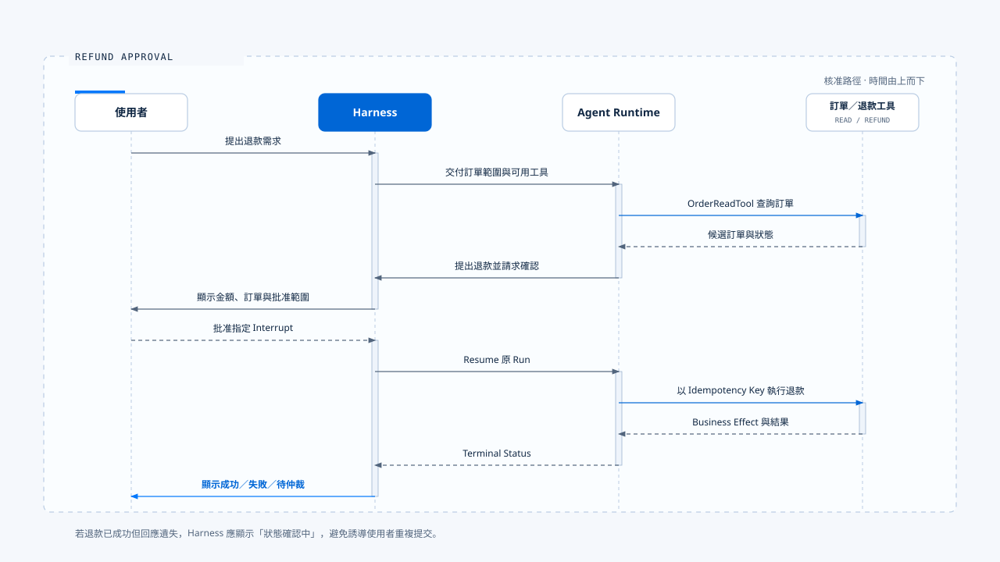

# Harness 的控制層

[English](./02-control-surfaces.md) | [繁體中文](./02-control-surfaces-zh-TW.md)

> 控制層的價值在於把【產品意圖】放到明確的決策點。每個決策都應有輸入、有執行位置、有失敗處理，也有事後可以查驗的結果。

- Harness 的控制層之所以存在，是因為模型權重固定之後，Agent 的實際行為仍會因外圍因素而大幅改變。例如:
  - 輸入如何被解讀
  - 哪些資料進入 Context
  - 哪些 Tool 可選
  - 哪次行動需要批准
  - 使用者能否中途改變任務或改變意圖

## 控制層怎麼定義

Control Surface（控制層）：

> 產品可以在不修改模型權重的前提下，持續改變 Agent 認知、能力、行動或互動方式的可執行決策點。

一個完整控制層至少包含五個部分：

| 部分 | 要回答的問題 |
|---|---|
| Policy Source | 規則從設定、程式、租戶政策、使用者選擇或其他何處而來？ |
| Decision Input | 決策需要哪些可信資料？ |
| Enforcement Point | 規則在哪一條正式執行路徑被套用？ |
| Failure Behavior | 規則無法載入、逾時或執行失敗時如何處理？ |
| Evidence | 如何證明本次 Run 確實套用了這項規則？ |

- 只有設定檔或 Prompt 文字，還不足以構成可靠的控制層。
- 規則必須走到執行點，影響模型可見內容或 Runtime 行為，並留下可追查的決策結果。

## 五個主要控制層

- 該圖是一條便於閱讀的順序展示，實際上執行並非只走一次。
- 每次模型再次取樣、工具回灌、人工批准或 Context 壓縮，都可能重新經過其中幾個控制層。

## 1. 輸入控制層

輸入控制層把原始互動轉成 Runtime 可以接受的命令。它處理的不只是字串格式，也要判斷這筆輸入的意圖與歸屬。

### 它控制什麼

- 支援文字、圖片、附件、命令、遠端事件或結構化表單中的哪些形式。
- 一筆輸入要開始新 Run、延續目前 Run、回覆 Clarification，還是取消既有 Run。
- 空白、過大、重複、互相衝突或格式不完整的輸入如何處理。
- 附件、IDE Context 與遠端資料如何轉成帶來源的標準項目。
- 使用者在 Dispatch 與 Running 之間再次提交時，如何避免 Concurrent Query Re-entry（並發查詢重入）。
- 使用者有產生 Double Texting 是要排隊等待，還是直接打斷當前進行中的任務。

### Claude Code 的落點

- Claude Code 的 processUserInput 會在進入 query() 前處理一般訊息、Slash Command、附件與 Hook 補充內容。
- Interactive REPL 和 Headless／SDK 的外層不同，但兩條路徑都先完成輸入處理，再組裝一次查詢。

> 代表輸入控制層屬於 Harness。query loop 可以消費已整理的訊息，不必理解每個終端如何取得鍵盤輸入、IDE selection 或 SDK stream。

### Chat Gun 的目前證據

- 以 Chat Gun 已有 NormalizedAgentInput、readNormalizedAgentInput 與 GenerationQueryGuard 實作為例子 interaction runtime 會根據輸入種類分流一般任務、Cancel 與 Clarification Resume，並以 Active Run Generation 防止舊請求覆蓋新執行。

### 失敗邊界

- 解析失敗時，不應把未知輸入降級成一般文字後繼續執行。
- 較安全的做法是回傳結構化錯誤，保留原始資料的雜湊、長度與來源，再要求使用者修正或重新提交。

## 2. Context 控制層

Context 控制層決定模型在某一次推理步驟中能看見什麼。它同時處理資料選取、來源權威、Token 預算與降級策略。

### 它控制什麼

- System Policy、Current Task、Recent Messages、Active State、Memory 與 Tool Output 的優先序。
- 哪些來源可以提供事實，哪些來源只能當作不可信內容。
- 每類 Context 的 Token 配額、硬上限與輸出保留量。
- 超出容量時採取壓縮、摘要、裁切、拒絕或降級中的哪一種策略。
- Memory 是否符合目前 Principal、Tenant 與 Scope。
- Tool Use 與 Tool Result 是否成對保留，避免形成無效對話。

### Claude Code 的落點

- 短對話會將 System Prompt、CLAUDE.md、對話歷史、工具結果、附件與專案狀態組進模型請求。
- 長對話則還會再額外加上使用 Tool Result Budget、Microcompact、Autocompact 與其他壓縮路徑控制 Context。

> 這些機制同時橫跨 Harness 與 Runtime。來源選擇、權威和保留規則屬於 Harness；在正確時機執行壓縮、維持訊息配對並重試模型請求，屬於 Runtime。

### Chat Gun 的目前證據

Chat Gun 的 Agent Context Assembler 已接到 Chatbot，並可由各 Agent 的 Feature Flag 控制。組裝器會區分 System Policy、Current Task、Recent Messages、Active State 與 Tool Output，也會依 Canonical Execution Context 將 Memory 限定在對應 Principal、Tenant 與 Scope。

### 失敗邊界

Context 組裝失敗時，要區分: 
- Hard Limit、Memory Unavailable、Compression Failure 與來源內容異常。
- 超過總硬上限不應照常呼叫模型；Memory 查詢失敗則可依產品政策降級，前提是不能悄悄改變安全規則或 Current Task。

## 3. 行為與能力控制層

這個控制層決定 Agent 應遵循哪些行為規則，以及它可以考慮哪些完成任務的方法。

### 行為控制

行為規則可能來自 System Prompt、專案指令、租戶政策、Agent Persona、Goal、停止條件或 Hook。Harness 需要建立明確優先序，避免後載入的資料覆蓋高權威規則。

建議的基礎順序是：

~~~text
安全與授權政策
  > 使用者目前明確指令
  > 當前任務與有效執行狀態
  > 產品／專案規則
  > 歷史 Memory
  > 檢索內容與 Tool Output
~~~

本庫採用的預設判斷，不是所有產品都必須照搬。領域法規、組織政策或特定工作流可以增加更高層規則，但低信任內容不能取得指令權威。

### 能力控制

能力控制決定本次任務向模型公開哪些 Tool、Skill、MCP、Command 或 Subagent，也包含 Model／Provider 選擇及其能力限制。

Harness 應回答：

- 這項能力是否適合目前 Agent 與模式？
- 使用者、租戶與部署環境是否允許看見它？
- Tool Schema 是否足以讓模型正確選用？
- Provider 是否支援所需的 Tool Calling、Vision、Structured Output 或 Context Window？
- 載入失敗時，是中止任務、隱藏單一能力，還是使用替代 Provider？

### Claude Code 的落點

- Claude Code 在啟動與查詢組裝階段，依模式、設定、Feature Gate、模型能力、目錄信任與 Permission mode 建立 Tool、Skill、Command、MCP 與 Subagent 集合。
- Provider 轉接發生在 API 邊界，使上層 query loop 維持一致的 Message 與 Tool 語意。

### 失敗邊界

**能力載入失敗不能留下【模型看得到但執行器不存在】的 Tool**
- 安全的順序是先完成載入與驗證，再把最終能力清單交給模型。
- 必要能力缺失時，應在取樣前停止並說明原因。

## 4. 行動治理控制層

- 行動治理決定某一次模型提出的 Tool Call 是否可以落到真實世界。它處理的是具體行動，不只是 Tool 是否存在。

### 它控制什麼

- Tool 與輸入對應的風險等級。
- Principal 是否可以在目前 Tenant 與 Resource Scope 執行這項行動。
- 行動應直接 Allow、Deny，或 Require Confirmation。
- Approval 的 Run、Resource、期限與一次性使用範圍。
- Policy、Authorization Store 或確認服務不可用時的處理方式。
- 決策如何與 Run ID、Tool Call ID、Policy Version 及 Audit Event 關聯。

### 兩階段判斷

- 第一階段 = 縮小模型可選空間。
- 第二階段 = 保護真實資源。

> 只做其中一層都不完整：因為完全隱藏能力會失去動態授權，只有執行時授權則會讓模型反覆規劃永遠不可能成功的行動。

### Claude Code 的落點

- Claude Code 將 Tool 可見性與每次 Tool Use 的 Permission 判斷分開。
- Runtime 準備執行工具時，透過 canUseTool 等介面向 Harness 請求決策。
- Interactive 路徑可以顯示 Allow／Deny，Headless／SDK 則由宿主回覆。

### Chat Gun 的目前證據

- Chat Gun 的 Tool registry 現在會建立 Runtime Tool Authorization Composition，將 Authorization、Confirmation Store 與 Interrupt Manifest Repository 接入本地 Tool 和 MCP Tool。可信 Principal 與 Scope Header 也已列入 LangGraph Server 的 configurable headers。

### 失敗邊界

- 身份缺失、Tenant 不一致、Policy Version 缺少或 Authorization Persistence 不可用時，具副作用的 Tool 應 Fail Closed。系統可以為開發環境提供明確 Profile，不能在 Production 以匿名或預設允許作為一般回退。

## 5. 互動與回饋控制層

這個控制層管理人如何在 Agent 執行前後與執行途中介入，也負責把 Runtime 狀態轉成使用者與營運者可理解的訊號。

### 執行中互動

常見輸入包括：

- 補充目前任務所需資料。
- 回覆 Clarification。
- 批准或拒絕高風險行動。
- 取消目前 Run。
- 以新需求取代正在執行的任務。
- 排隊等待目前 Run 完成後處理。

> Harness 必須為每一種情況定義 Ownership 與 Generation。否則舊 Run 的晚到結果可能覆蓋新任務，或同一筆輸入同時被兩個執行消費。

### 結果與回饋

- Runtime 產生的內容不只有文字 Token，還包含 Tool Start、Tool Success、Tool Error、Context Build、Structured Card、Terminal Status 與未知事件。
- Harness 則是需要把 Runtime 的產物轉成穩定的 UI State，並保留足以重播、去重與評估的識別資訊。

### Claude Code 的落點

- Interactive REPL 持有輸入、Permission UI、進度與顯示狀態；Headless／SDK 由 QueryEngine 保存跨 Turn 訊息、Abort Controller、Usage 與 Permission Denials，再將內部 Message 轉成 SDKMessage。
- 兩者消費同一類 Runtime 結果，但互動契約不同。這說明 Harness 可以因產品表面而改變，Runtime 核心仍維持相對穩定。

### Chat Gun 的目前證據

- Chat Gun 的 Interaction Runtime 已處理 Active Run Ownership、Generation、Supersede、Cancel 與 Clarification Resume Authorization，並以 Query Guard 管理 Idle、Dispatching 與 Running 間的重入風險。

### 失敗邊界

- 取消請求逾時、Client Disconnect、舊 Generation 晚到或未知事件格式，都需要明確降級。
- UI 不應因未知事件崩潰，也不應讓已進入 Terminal 的 Run 回到 Running。

## 控制層之間如何解決衝突

控制層並非各自獨立的設定表。正常在一次任務中，它們會互相限制：

- 輸入控制層辨識為 Clarification Resume，互動控制層才知道要尋找哪個 Interrupt。
- Context 控制層準備加入 Memory，行動治理提供的 Principal 與 Scope 會限制可讀範圍。
- 能力控制層公開 RefundTool，行動治理仍可拒絕某筆訂單。
- Runtime 回傳 Tool Error，Context 控制層要保留足夠資訊讓模型修復，同時避免把錯誤文字當成高權威指令。
- 使用者要求 Supersede，目前 Tool 已產生副作用時，互動控制層必須等待 Runtime 的 Reconciliation 或 Compensation 判斷。

**建議將優先序寫成可測試的規則，而非依賴呼叫順序碰巧得到結果。至少應固定三條：**

1. Safety 與 Authorization 不被 Prompt、Memory 或 Tool Output 覆蓋。
2. Current Explicit Input 優先於歷史偏好，但不能繞過資源權限。
3. Terminal State 單向收斂；舊 Generation 的事件不能恢復或覆蓋新 Run。

## 真實場景：使用者要求退款

假設使用者輸入：「幫我退掉昨天的訂單，原因是重複購買。」

| 階段 | 控制層 | 決策 |
|---|---|---|
| 接收文字 | 輸入 | 解析為新任務，保留原始文字與 Request ID |
| 找出訂單 | Context | 只加入目前使用者與 Tenant 可見的候選訂單 |
| 規劃方法 | 行為與能力 | 提供 OrderReadTool 與 RefundTool，禁止模型自行編造訂單狀態 |
| 查詢訂單 | 行動治理 | 唯讀查詢在有效 Scope 下可直接執行 |
| 提出退款 | 行動治理 | 退款屬副作用，需要確認或更高等級授權 |
| 等待批准 | 互動 | 將 Run 暫停，顯示金額、訂單與批准範圍 |
| 使用者批准 | 輸入＋互動 | 辨識為對指定 Interrupt 的 Resume，不建立無關新 Run |
| 執行退款 | Runtime | 以 Idempotency Key 執行，記錄 Business Effect |
| 回傳結果 | 互動與回饋 | 顯示成功、失敗或待人工仲裁，保留 Correlation |

**若退款已成功，但回應遺失**
- Runtime 負責問題的 Side Effect Recovery。
- Harness 負責向使用者呈現「狀態確認中」，並避免提供會誘導重複提交的介面。

## 如何驗證控制層真的成立

每個控制層都應該要能提出一組可重現的證據：

| 控制層 | 最小驗證 |
|---|---|
| 輸入 | 同一語意從 Browser、SDK 與 Remote 入口得到相同 Normalized Input |
| Context | 可列出每個 Block 的來源、權威、Token 與取捨原因 |
| 行為與能力 | 可證明某 Tool 在指定 Agent／Tenant／Flag 下出現或消失 |
| 行動治理 | 同一 Tool 對不同 Principal、Scope 與資源得到可追蹤決策 |
| 互動與回饋 | 重複、亂序、晚到與未知事件不破壞 Authoritative Run State |

> 實作檔案、類別名稱或單元測試只能提供部分證據。完整結論需要從產品入口走到實際 Enforcement Point，再觀察 Runtime 與終端產生的結果。

## 常見失敗模式

### 設定存在，正式路徑沒有讀取

- 這會產生紙面政策。修正方式是建立 Architecture Test 或 Composition Root Test，禁止正式入口繞過必要控制。

### Prompt 承擔所有控制

- Prompt 適合表達行為意圖，無法取代身份驗證、資源授權、Token Hard Limit、Idempotency 與 Terminal State Machine。

### 每個 Agent 自行組裝一套

- 重複實作會讓 Chatbot、MCP Agent 與 Deep Research 對相同輸入或權限採取不同語意。
- 共用 Contract 與 Composition Root 應固定不變量，各 Agent 只提供自己的政策與能力。

### 失敗時靜默放寬

- Memory、MCP 或 Policy Service 無法使用時，系統若悄悄改成全量 Context、匿名身份或預設允許，會把可用性問題變成安全問題。
- 每個控制層都需要事先定義 Fail Closed、Degraded 或 Manual 的條件。

### 只有 Log，沒有 Correlation

- 事件很多卻無法串回 Request、Run、Tool Call 與 Business Effect，事後仍回答不了哪條規則生效。Evidence 必須從設計時就帶上 Execution Identity。

## 本篇的工程判斷

Harness 的成熟度不應以設定數量衡量，而應看產品能否回答三件事：

1. 哪一條規則改變了 Agent 的選擇？
2. 規則在哪個執行點被強制套用？
3. 發生衝突或失敗時，系統如何保守收斂？

能回答這三題，控制層才從概念成為工程能力。

## 證據來源

### [claude-code-best](https://github.com/claude-code-best/claude-code)

- claude-code-best：src/utils/processUserInput/processUserInput.ts
- claude-code-best：src/screens/REPL.tsx
- claude-code-best：src/QueryEngine.ts
- claude-code-best：src/query.ts
- claude-code-best：ARCHITECTURE.md

### [chat-gun](https://github.com/HsienW/chat-gun)

- backend/src/runtime/input/normalized-agent-input.ts
- backend/src/runtime/input/read-normalized-agent-input.ts
- backend/src/runtime/input/query-guard.ts
- backend/src/platform/interaction-runtime.ts
- backend/src/agents/context-integration.ts
- backend/src/tools/registry.ts
- backend/src/tools/authorization/tool-authorization.ts
- backend/src/platform/agent-runtime-events.ts
- backend/langgraph.json

## 接續閱讀

- [什麼是 Agent Harness](./01-what-is-agent-harness.md)
- [Harness 與 Runtime 的邊界](./03-harness-runtime-boundary.md)
- [Agent Harness 設計原則](./04-design-principles.md)
- [一次任務的完整走法](./05-one-turn-walkthrough.md)
