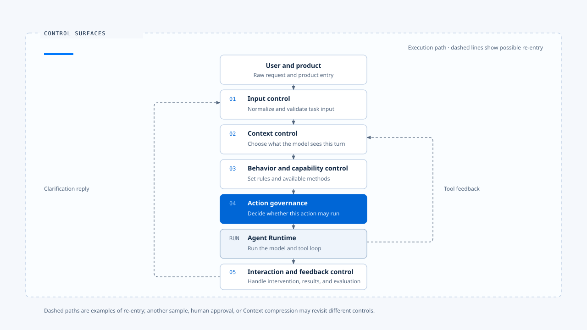
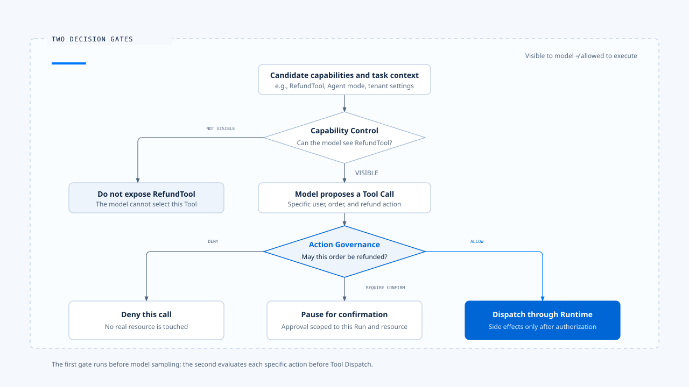
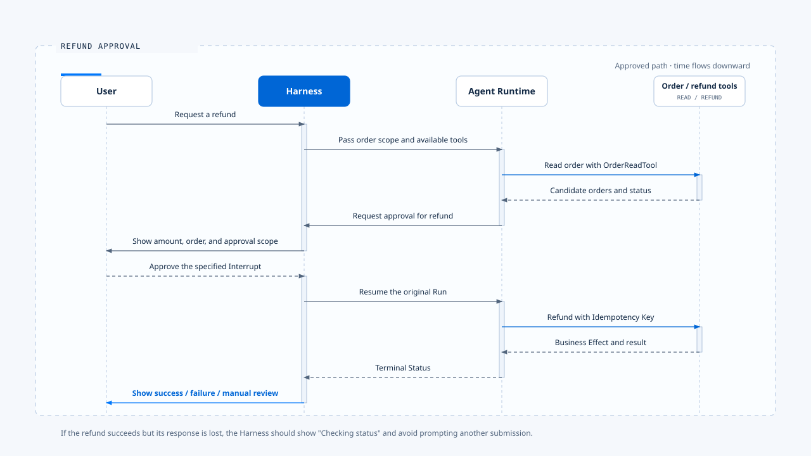

# Harness control surfaces

[English](./02-control-surfaces.md) | [繁體中文](./02-control-surfaces-zh-TW.md)

> The value of a control surface is placing product intent at explicit decision points. Each decision should have inputs, an enforcement location, failure handling, and a result that can be inspected afterward.

- Control surfaces exist because an Agent's actual behavior can change substantially due to peripheral factors even after model weights are fixed. For example:
  - How input is interpreted
  - Which data enters Context
  - Which Tools are available
  - Which actions require approval
  - Whether a user can change a task mid-run or shift intent

## What is a control surface?

Control Surface:

> An executable decision point through which a product can consistently change an Agent's understanding, capabilities, actions, or interactions without modifying model weights.

A complete control surface has at least five parts:

| Part | Question it must answer |
|---|---|
| Policy Source | Where does the rule come from: configuration, code, tenant policy, user choice, or somewhere else? |
| Decision Input | Which trusted data does the decision require? |
| Enforcement Point | Where in the production execution path is the rule applied? |
| Failure Behavior | What happens if the rule cannot be loaded, times out, or fails during execution? |
| Evidence | How can we prove that the rule was applied to this Run? |

- A configuration file or Prompt text alone does not make a reliable control surface.
- The rule must reach an enforcement point, affect what the model can see or how the Runtime behaves, and leave a traceable decision result.

## Five main control surfaces

- This order is useful for reading, but execution does not pass through it only once.
- Each additional model sample, tool feedback, human approval, or Context compression may send work through some of these surfaces again.

## 1. Input control surface

The input control surface turns raw interaction into a command the Runtime can accept. It must determine intent and ownership, not merely validate a string's format.

### What it controls

- Which forms of text, images, attachments, commands, remote events, or structured forms are supported.
- Whether an input starts a new Run, continues the current Run, answers a Clarification, or cancels an existing Run.
- How to handle empty, oversized, duplicate, conflicting, or malformed input.
- How attachments, IDE Context, and remote data become normalized items with provenance.
- How to prevent Concurrent Query Re-entry when a user submits again between Dispatch and Running.
- Whether a user's Double Texting should queue or directly interrupt the current active task.

### Where it sits in Claude Code

- Claude Code's processUserInput handles ordinary messages, Slash Commands, attachments, and content added by Hooks before query().
- The outer layers of the Interactive REPL and Headless/SDK paths differ, but both process input before assembling a query.

> This makes input control a Harness responsibility. The query loop can consume prepared messages without needing to know how each client obtains keyboard input, an IDE selection, or an SDK stream.

### Current evidence in Chat Gun

- Chat Gun has NormalizedAgentInput, readNormalizedAgentInput, and GenerationQueryGuard. The interaction runtime routes ordinary tasks, Cancel, and Clarification Resume according to input type. Active Run Generation prevents an older request from overwriting newer execution.

### Failure boundary

- If parsing fails, the system should not downgrade unknown input to ordinary text and continue.
- A safer response is a structured error that preserves the original data's hash, length, and source, then asks the user to correct or resubmit it.

## 2. Context control surface

The Context control surface decides what the model can see at a particular reasoning step. It covers data selection, source authority, Token budgets, and degradation policy.

### What it controls

- The priority of System Policy, Current Task, Recent Messages, Active State, Memory, and Tool Output.
- Which sources may supply facts and which must remain untrusted content.
- The Token allocation, hard limit, and reserved output capacity for each Context category.
- Whether excess content is compressed, summarized, trimmed, rejected, or handled through a degraded path.
- Whether Memory matches the current Principal, Tenant, and Scope.
- Whether Tool Use and Tool Result remain paired so the conversation stays valid.

### Where it sits in Claude Code

- Short conversations assemble System Prompt, CLAUDE.md, conversation history, tool results, attachments, and project state into a model request.
- Long conversations also use Tool Result Budget, Microcompact, Autocompact, and other compression paths to manage Context.

> These mechanisms span both Harness and Runtime. Source selection, authority, and retention rules belong to the Harness. Running compression at the right time, preserving message pairs, and retrying model requests belong to the Runtime.

### Current evidence in Chat Gun

Chat Gun's Agent Context Assembler is integrated with Chatbot and can be controlled by each Agent's Feature Flag. It distinguishes System Policy, Current Task, Recent Messages, Active State, and Tool Output. Using Canonical Execution Context, it also limits Memory to the corresponding Principal, Tenant, and Scope.

### Failure boundary

When Context assembly fails, distinguish:
- Hard Limit, Memory Unavailable, Compression Failure, and abnormal source content.
- A request above the overall hard limit should not proceed to the model as usual. A failed Memory lookup may degrade according to product policy, provided it does not silently change safety rules or the Current Task.

## 3. Behavior and capability control surface

This surface determines which behavioral rules the Agent follows and which methods it may consider for completing the task.

### Behavior control

Behavioral rules may come from System Prompt, project instructions, tenant policy, Agent Persona, Goal, stopping conditions, or Hooks. The Harness needs an explicit priority order so later-loaded data cannot override higher-authority rules.

The recommended baseline order is:

~~~text
Safety and authorization policy
  > Current explicit user instruction
  > Current task and active execution state
  > Product/project rules
  > Historical Memory
  > Retrieved content and Tool Output
~~~

This is the default judgment used in this knowledge base, not a universal order every product must copy. Domain regulations, organizational policy, or a specific workflow may add higher-level rules. Lower-trust content must not gain instruction authority.

### Capability control

Capability control decides which Tools, Skills, MCPs, Commands, or Subagents the model can see for this task. It also covers Model/Provider selection and capability limits.

The Harness should answer:

- Does this capability fit the current Agent and mode?
- May this user, tenant, and deployment environment see it?
- Is the Tool Schema sufficient for the model to choose it correctly?
- Does the Provider support the required Tool Calling, Vision, Structured Output, or Context Window?
- If loading fails, should the task stop, should one capability be hidden, or should a fallback Provider be used?

### Where it sits in Claude Code

- During startup and query assembly, Claude Code builds its Tool, Skill, Command, MCP, and Subagent sets according to mode, settings, Feature Gates, model capabilities, directory trust, and Permission mode.
- Provider adaptation happens at the API boundary, keeping Message and Tool semantics consistent in the upper query loop.

### Failure boundary

**Failed capability loading must not leave the model seeing a Tool whose executor does not exist.**
- A safer order is to load and validate first, then give the final capability list to the model.
- If a required capability is missing, stop before sampling and explain why.

## 4. Action governance control surface

- Action governance decides whether a specific Tool Call proposed by the model may affect the real world. It governs the proposed action, not merely the existence of a Tool.

### What it controls

- The risk level associated with the Tool and its input.
- Whether the Principal may perform the action within the current Tenant and Resource Scope.
- Whether to Allow, Deny, or Require Confirmation for the action.
- The Run, Resource, expiration, and one-time-use scope of an Approval.
- What happens when Policy, Authorization Store, or the confirmation service is unavailable.
- How the decision is linked to Run ID, Tool Call ID, Policy Version, and Audit Event.

### Two-stage decision

- First stage = narrow the model's choices.
- Second stage = protect real resources.

> Neither stage alone is complete: hiding a capability entirely prevents dynamic authorization, while relying only on execution-time authorization lets the model keep planning actions that can never succeed.

### Where it sits in Claude Code

- Claude Code separates Tool visibility from the Permission decision for each Tool Use.
- When the Runtime is ready to execute a tool, it asks the Harness for a decision through interfaces such as canUseTool.
- The Interactive path can display Allow/Deny; in Headless/SDK, the host responds.

### Current evidence in Chat Gun

- Chat Gun's Tool registry now creates Runtime Tool Authorization Composition, connecting Authorization, Confirmation Store, and Interrupt Manifest Repository to local and MCP Tools. Trusted Principal and Scope Headers are also included in LangGraph Server's configurable headers.

### Failure boundary

- Tools with side effects should Fail Closed when identity is missing, Tenant does not match, Policy Version is absent, or Authorization Persistence is unavailable. The system may provide an explicit development Profile, but Production must not use anonymous identity or default Allow as a general fallback.

## 5. Interaction and feedback control surface

This surface manages how people intervene before, during, and after Agent execution. It also turns Runtime state into signals users and operators can understand.

### Interaction during execution

Common inputs include:

- Add data needed for the current task.
- Answer a Clarification.
- Approve or reject a high-risk action.
- Cancel the current Run.
- Replace an active task with a new request.
- Queue a request until the current Run finishes.

> The Harness must define Ownership and Generation for each case. Otherwise, a late result from an old Run may overwrite a new task, or two executions may consume the same input.

### Results and feedback

- The Runtime produces more than text Tokens. It also emits Tool Start, Tool Success, Tool Error, Context Build, Structured Card, Terminal Status, and unknown events.
- The Harness must turn them into stable UI State and retain enough identifiers for replay, deduplication, and evaluation.

### Where it sits in Claude Code

- The Interactive REPL owns input, Permission UI, progress, and display state. In Headless/SDK, QueryEngine retains messages across Turns, the Abort Controller, Usage, and Permission Denials, then converts internal Messages to SDKMessage.
- Both consume the same kinds of Runtime results but have different interaction contracts. The Harness can vary by product surface while the Runtime core remains relatively stable.

### Current evidence in Chat Gun

- Chat Gun's Interaction Runtime handles Active Run Ownership, Generation, Supersede, Cancel, and Clarification Resume Authorization. Query Guard manages re-entry risks across Idle, Dispatching, and Running.

### Failure boundary

- Cancellation timeouts, Client Disconnects, late events from an old Generation, and unknown event formats all need explicit degradation behavior.
- An unknown event should not crash the UI, and a Run that has reached Terminal must not return to Running.

## Resolving conflicts between control surfaces

Control surfaces are not independent settings lists. They constrain one another during a task:

- Only after input control identifies a Clarification Resume can interaction control know which Interrupt to find.
- When Context control prepares to add Memory, the Principal and Scope supplied by action governance limit what may be read.
- Capability control may expose RefundTool, but action governance can still reject a refund for a particular order.
- When the Runtime returns a Tool Error, Context control must retain enough information for the model to recover without treating the error text as a high-authority instruction.
- If a user requests Supersede after a Tool has already caused a side effect, interaction control must wait for the Runtime's Reconciliation or Compensation decision.

**Priority should be written as testable rules rather than left to incidental call order. At minimum, fix these three rules:**

1. Safety and Authorization cannot be overridden by Prompt, Memory, or Tool Output.
2. Current Explicit Input takes precedence over historical preferences, but cannot bypass resource permissions.
3. Terminal State is monotonic; events from an old Generation cannot restore or overwrite a new Run.

## Real-world scenario: a user requests a refund

Suppose the user says, "Refund yesterday's order for me. I bought it twice."

| Stage | Control surface | Decision |
|---|---|---|
| Receive text | Input | Parse a new task; retain the original text and Request ID |
| Find the order | Context | Include only candidate orders visible to the current user and Tenant |
| Plan the method | Behavior and capability | Provide OrderReadTool and RefundTool; do not let the model invent order status |
| Query the order | Action governance | Allow a read-only query directly when Scope is valid |
| Propose a refund | Action governance | A refund has side effects and needs confirmation or higher-level authorization |
| Await approval | Interaction | Pause the Run; show the amount, order, and approval scope |
| User approves | Input + interaction | Recognize a Resume for the specified Interrupt, not an unrelated new Run |
| Execute the refund | Runtime | Use an Idempotency Key and record the Business Effect |
| Return the result | Interaction and feedback | Show success, failure, or pending manual arbitration; retain Correlation |

**If the refund succeeds but its response is lost**
- The Runtime handles Side Effect Recovery.
- The Harness must still show the user that the status is being checked and avoid an interface that prompts another submission.

## How to verify that a control surface works

Each control surface should produce reproducible evidence:

| Control surface | Minimum verification |
|---|---|
| Input | The same intent produces the same Normalized Input through Browser, SDK, and Remote entry points |
| Context | List each Block's source, authority, Token count, and reason for inclusion or exclusion |
| Behavior and capability | Show that a Tool appears or disappears for a given Agent, Tenant, and Flag |
| Action governance | The same Tool yields traceable decisions for different Principals, Scopes, and resources |
| Interaction and feedback | Duplicate, out-of-order, late, and unknown events do not corrupt Authoritative Run State |

> An implementation file, class name, or unit test provides only partial evidence. A complete conclusion traces the product entry point to the actual Enforcement Point, then observes the results produced by the Runtime and client.

## Common failure modes

### A setting exists, but the production path never reads it

- This creates a policy on paper. Add an Architecture Test or Composition Root Test that prevents a production entry point from bypassing required controls.

### Prompt carries every control

- Prompt can express behavioral intent. It cannot replace identity verification, resource authorization, a Token Hard Limit, Idempotency, or a Terminal State Machine.

### Every Agent assembles its own version

- Duplicate implementations can make Chatbot, MCP Agent, and Deep Research interpret the same input or permission differently.
- A shared Contract and Composition Root should fix the invariants; each Agent supplies only its own policy and capabilities.

### Failure silently loosens a rule

- If Memory, MCP, or Policy Service becomes unavailable and the system silently switches to full Context, anonymous identity, or default Allow, an availability problem becomes a security problem.
- Each control surface needs predefined conditions for Fail Closed, Degraded, or Manual handling.

### Logs without Correlation

- Many events may exist, yet none can be linked back to a Request, Run, Tool Call, and Business Effect. The team still cannot tell which rule applied. Evidence needs Execution Identity from the design stage.

## Engineering judgment in this article

Do not judge Harness maturity by the number of settings. Ask whether the product can answer three questions:

1. Which rule changed the Agent's choice?
2. At which execution point was that rule enforced?
3. When rules conflict or fail, how does the system converge conservatively?

Only then does a control surface become an engineering capability rather than a concept.

## Evidence sources

### [claude-code-best](https://github.com/claude-code-best/claude-code)

- claude-code-avatar: src/utils/processUserInput/processUserInput.ts
- claude-code-avatar: src/screens/REPL.tsx
- claude-code-avatar: src/QueryEngine.ts
- claude-code-avatar: src/query.ts
- claude-code-avatar: ARCHITECTURE.md

### [chat-gun](https://github.com/HsienW/chat-gun)

- backend/src/runtime/input/normalized-agent-input.ts
- backend/src/runtime/input/read-normalized-agent-input.ts
- backend/src/runtime/input/query-guard.ts
- backend/src/platform/interaction-runtime.ts
- backend/src/agents/context-integration.ts
- backend/src/tools/registry.ts
- backend/src/tools/authorization/tool-authorization.ts
- backend/src/platform/agent-runtime-events.ts
- backend/langgraph.json

## Further reading

- [What is an Agent Harness?](./01-what-is-agent-harness.md)
- [The boundary between Harness and Runtime](./03-harness-runtime-boundary.md)
- [Agent Harness design principles](./04-design-principles.md)
- [A complete task walkthrough](./05-one-turn-walkthrough.md)
