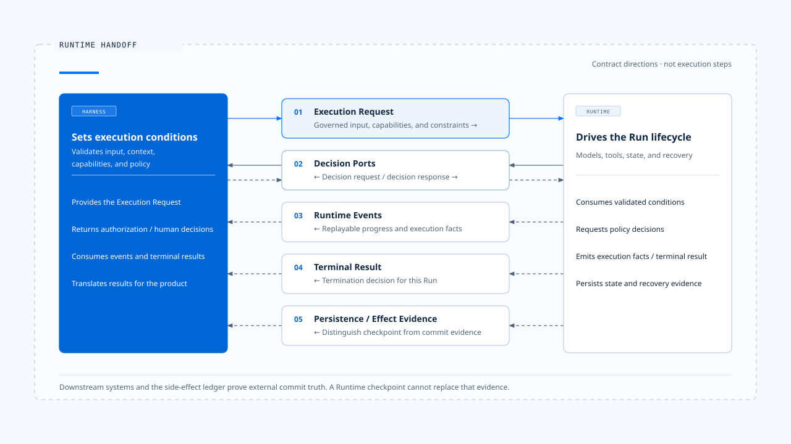
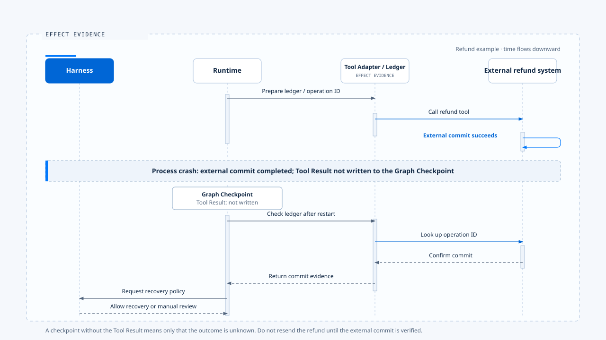
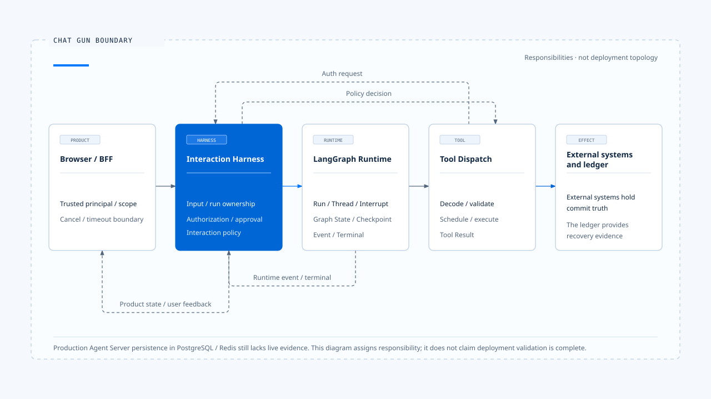

# Harness 与 Runtime 的边界

[English](./03-harness-runtime-boundary.md) | [繁體中文](./03-harness-runtime-boundary-zh-TW.md) | [简体中文](./03-harness-runtime-boundary-zh-CN.md)

[前篇](./02-control-surfaces-zh-CN.md) 说明 Harness 如何通过控制层整理输入、配置能力与约束行动。

> 边界范围：决策如何交给执行、执行如何向外请求决策，以及状态与故障由谁负责

- Harness 与 Runtime 的分界，出现在「产品已经决定任务应在什麽条件下执行」之后，以及「执行核心开始推进状态」之前。
- Harness 准备输入、Context、能力与政策；Runtime 接收这些条件，执行模型与工具循环，直到产生完成、取消、失败或等待人工介入等结果。执行途中若遇到需要产品判断的事情，例如工具授权、人工确认或用户补充，Runtime 会透过预先定义的 Port 回到 Harness，而不是自行创造政策。
- Harness 与 Runtime 两者之间并非一条单向函数调用，而是一组双向契约。

## 边界要解决什麽问题

缺少清楚边界时，系统容易同时出现两种混乱：

- Runtime 开始自行决定用户权限、Context 权威或产品互动政策。
- Harness 开始自行维护 Run state、重试、checkpoint 或 tool execution，逐步复制另一套 Runtime。

边界位置错误时：
- Runtime = 执行核心承担它无法治理的产品与领域责任。
- Harness = 产品端建立重复的 Run、Queue、Checkpoint 或终止状态。当程序崩溃、工具产生副作用或事件晚到时，系统无法判断哪一份状态才是权威。

清楚的边界需要回答四件事：

1. 哪些决策在交接前完成？
2. Runtime 接手后拥有哪些状态与执行权？
3. Runtime 在什麽情况下必须回头请求 Harness 决策？
4. 每种失败由哪一层处理，最后又由谁向用户说明？

## Harness 与 Runtime 的交接不仅是目录切割

> Harness 与 Runtime 是责任分层。它们可能存在于同一个文件，也可能分散在 Client、BFF、Backend、Agent Server 与 Tool Adapter。

判断某段程序属于哪一部分时，可以问：

- 它是在决定任务允许什麽，还是在推进已允许的执行？
- 它持有的是产品政策，还是 Run 的生命周期状态？
- 它改变的是模型可见条件，还是执行中的状态转移？
- 它的失败需要产品选择，还是可以依执行规则自动处理？

例如：
1. Context Source 的权威排序属于 Harness。
2. 在 Token 压力下执行已选定的压缩策略属于 Runtime。
3. Tool Risk Policy 属于 Harness。
4. 依既有规则调度 Tool Call 并收集结果属于 Runtime。

## 五份交接契约

### 1. Execution Request：把产品意图变成可执行输入

**Execution Request 是 Harness 交给 Runtime 的输入契约。它应包含足以开始执行的数据，又不把终端或 UI 细节渗入核心。**

概念上可以表示为：

~~~ts
interface ExecutionRequest {
  context: ExecutionContext;
  input: NormalizedAgentInput;
  contextPack: GovernedContext;
  capabilities: CapabilitySet;
  limits: ExecutionLimits;
  manifest: ExecutionManifest;
  decisionPorts: DecisionPorts;
}
~~~

各字段的责任如下：

| 字段 | Harness 应保证的事 |
|---|---|
| ExecutionContext | Request、Thread、Run、Task、Principal 与 Scope 已建立且一致 |
| NormalizedAgentInput | 输入型别、内容、附件与目标 Run 已通过验证 |
| GovernedContext | 来源、权威、Token 与敏感数据政策已套用 |
| CapabilitySet | 模型看到的能力与实际可执行能力一致 |
| ExecutionLimits | Turn、时间、成本、Token 与重试上限有明确值 |
| ExecutionManifest | 版本、Schema、工具与恢复相容性可判断 |
| DecisionPorts | Runtime 可请求授权、人工确认与互动决策 |

- Runtime 不应重新猜测原始输入的意思，也不应从任意 Header 或 Prompt 文字推导可信身份。必要字段缺少时，应在执行开始前拒绝。

### 2. Decision Ports：Runtime 向 Harness 请求决策

> Runtime 在执行中会遇到只有产品或领域政策能回答的问题。Decision Port 将这些问题变成型别化请求。

~~~ts
interface DecisionPorts {
  authorizeAction(request: ActionAuthorizationRequest): Promise<ActionDecision>;
  requestHumanApproval(request: ApprovalRequest): Promise<ApprovalDecision>;
  classifyInteraction(request: InteractionRequest): Promise<InteractionDecision>;
  resolveClarification(request: ClarificationRequest): Promise<ClarificationDecision>;
}
~~~

- Port 的价值在于隔离决策来源。
- Interactive CLI 可以显示确认对话框。
- SDK 可以将请求交给 Host。
- Web 产品可以建立可持久化的 Approval。
- 企业环境也可以调用外部 Policy Service。
- Runtime 接收 Allow、Deny、Require Confirmation、Queue、Supersede 等结构化结果。

**Decision Port 需要具备：**

- Request ID、Run ID、Tool Call ID 与资源识别。
- Policy Version 与决策理由。
- Timeout、Cancellation 与 Unavailable 的语意。
- Replay 与一次性使用限制。
- 不含敏感原文的 Audit Evidence。

**若 Runtime 直接调用 UI 组件，或 Harness 直接操纵 Runtime 内部变数，这条边界就失去可替换性与可测试性。**

### 3. Runtime Events：回报执行过程

> Runtime Event 是执行核心向 Harness 回报进度的输出契约。事件描述已发生的执行事实，不应要求终端界面猜测内部状态。

常见事件包括：

- Run、Plan 或 Model Request 开始。
- Tool 的准备、执行、成功与失败。
- Context 组装、压缩或降级。
- 等待 Permission、Clarification 或 Human Approval。
- 文字串流与 Structured Artifacts。
- Retry、Fallback、Recovery 与 Terminal Transition。

**支持重新连接与重播的事件封套，至少需要 Schema Version、Event ID、Run-scoped Sequence、Execution Correlation、Emitted At、Type 与 Payload。**

**Harness 消费事件后，可以更新 TUI、Web UI、SDK stream、Metrics 或 Audit Projection。Runtime 不需要知道由哪一种界面呈现这些信息。**

### 4. Terminal Result：宣告一次执行如何结束

> 事件流与终止结果是两个不同概念。事件可以重播、延迟或遗失；Terminal Result 必须表达 Runtime 对本次执行的最终判定。

常见终止状态包括：

- Completed
- Cancelled
- Failed
- Rejected
- Waiting for Human
- Parked for Reconciliation
- Incompatible Resume

**Terminal State 应单向收敛。进入完成、取消或失败后，晚到的 Progress Event 不能使 Run 回到 Running。若等待人工介入被建模为可恢复状态，它也应带着 Interrupt ID、Resume 条件与到期政策。**

**Harness 负责把 Terminal Result 转成用户语言，不能用 UI 显示文案反推 Runtime 的真实状态。**

### 5. Persistence and Effect Evidence：区分对话状态与外部真相

> Runtime 可以储存 Messages、Graph State、Checkpoints、Tasks 与 Tool Executions；这些纪录仍无法单独证明外部系统是否完成了一次副作用。

退款、寄信或建立云端资源时，至少有三项彼此独立的事实：

1. Runtime 是否送出 Tool Call。
2. Checkpoint 是否储存 Tool Result。
3. 外部系统是否 Commit 这项操作。

**这三者可能不一致。Tool 已 Commit、程序却在储存结果前崩溃时，Runtime 只能知道结果不明。恢复流程必须查询 Side-effect Ledger 与下游 Operation ID，再进行 Reconciliation、Compensation 或人工处置。**

Harness 在这里持有产品政策，包括是否允许自动重试或必须进行人工审查。Runtime 持有状态机与恢复流程，Tool Adapter 则提供外部 Commit 的证据。

## 状态所有权

> 边界要稳定，每一种状态只能有一个权威来源。

| 状态或决策 | 权威来源 |
|---|---|
| 用户与租户身份 | 产品 Identity／BFF 边界 |
| 输入种类与目标 Run | Harness Input Contract |
| Context 来源权威与能力集合 | Harness |
| Run ID 与 Run Status | Runtime／Agent Server |
| Thread／Conversation 关联 | Runtime 的 Thread authority；Harness 储存产品对应关系 |
| Graph Checkpoint | Graph Runtime／Checkpointer |
| 业务 Task／Step | 产品 Runtime extension |
| Tool Authorization | Harness Policy／Authorization Service |
| Tool Execution State | Tool Runtime |
| 外部 Business Effect | 下游系统＋Side-effect Ledger |
| 可见 Run Generation | Interaction Harness／Ownership Repository |
| UI State | Client reducer，必须依循 Runtime Event 与 Terminal Contract |

**「只有一个权威来源」不代表只有一份数据。Cache、Projection 与 UI State 可以有多份，但它们必须知道如何从权威来源更新，也不能反向改写权威状态。**

## Claude Code 的真实交接点

在本文分析的 Claude Code 旧版中，最清楚的 Runtime 入口是 query()。

其 QueryParams 包含：

~~~ts
type QueryParams = {
  messages;
  systemPrompt;
  userContext;
  systemContext;
  canUseTool;
  toolUseContext;
  fallbackModel?;
  querySource;
  maxTurns?;
  taskBudget?;
}
~~~

这些字段会跨越 Harness／Runtime 边界：

- messages、systemPrompt、userContext 与 systemContext 描述模型的初始信息条件。
- toolUseContext 带入 Tool、Model、App State、Abort 控制与执行所需的 Ports。
- canUseTool 让 Runtime 在具体 Tool Call 上向外请求 Permission。
- querySource、maxTurns 与 taskBudget 限制执行模式及资源。
- fallbackModel 提供已允许的替代执行策略。

query() 返回 AsyncGenerator。Harness 会持续消费 Messages、Stream Events、Tool Progress 与其他更新，Runtime 最后再返回 Terminal Result。

### Interactive 路径

~~~text
REPL
  → processUserInput
  → 組裝 System Prompt、Context、Tools、canUseTool
  → query(QueryParams)
  → onQueryEvent(event)
  → 更新 AppState、畫面與 transcript
~~~

REPL 直接调用 query()，没有经过 QueryEngine。因此，Interactive Harness 负责跨用户互动的 UI 与 Session 编排。

### Headless／SDK 路径

~~~text
SDK / stdin
  → QueryEngine.submitMessage()
  → processUserInput
  → 組裝 QueryParams
  → query(QueryParams)
  → 轉成 SDKMessage、usage、permission denial 與 result
~~~

QueryEngine 持有 Headless Conversation 的 messages、Abort Controller、Usage、Cache 与 Permission Denials。它是 Headless／SDK 的 Harness fa?ade，不是 query loop 本身。

### Permission 往返

当模型产生 Tool Use 时，query() 把 tool block 交给 runTools，再由 tool execution 调用 canUseTool。这次控制权会暂时回到 Harness：

~~~text
Runtime：準備執行 FileEdit
  → Harness：依設定、Hooks、目錄與使用者選擇作決策
  → Runtime：依 Allow／Deny 結果繼續
~~~

Runtime 负责确保未获准的工具不会执行，Harness 则持有决策权与互动来源。

## 场景一：修改文件

**用户要求把 src/app.ts 的 timeout 改成 30 秒。**

### 第一次交接

1. Harness = 规范化文字与 IDE Context，加入项目规则，提供 FileRead／FileEdit，设置 Permission Port，再建立 QueryParams。
2. Runtime = 开始模型取样，取得 FileRead Tool Use，执行后把 Tool Result 加回 Messages，再次调用模型。

### 第二次交接

1. 模型提出 FileEdit。Runtime 不自行判定是否允许修改文件，而是把 Tool Name、Input、Tool Call ID 与目前 Context 传给 canUseTool。
2. Harness 依目录信任、Permission mode、Hook 与用户选择回复。若需要人工确认，Interactive Harness 显示变更内容；Headless Harness 可以把相同请求送给 SDK Host。

### 最终交接

1. Runtime 执行工具、返回结果并产生完成消息。Harness 消费事件、储存 transcript 并更新画面。
2. 如果 FileEdit 因 EACCES 失败，Tool Runtime 将错误转成 Tool Result 并返回给模型。模型可以改用其他路径或说明限制。是否显示通知、是否允许改用 Shell，仍由 Harness 的能力与权限政策决定。

## Chat Gun 的边界

> Chat Gun 的路径比单机 CLI 多出 Browser、BFF、LangGraph Server、Graph 与业务副作用，因此边界需要拆成几段：

### 产品到 Harness

1. BFF 以可信值覆写 Principal、Tenant、Role 与 Scope Header，也处理 Client Disconnect、Timeout 与 Abort。这些数据进入 Backend 后，Harness 才能建立 Canonical Execution Context。
2. 原始 Client 不能自行宣告内部身份或 Run authority。输入经 NormalizedAgentInput 验证，Interaction Runtime 再根据 Run Ownership、Generation、Query Guard 与 Clarification Resume Policy 决定是否放行。

### Harness 到 Graph Runtime

1. Interaction Governance 通过后，Graph Runtime 开始执行 Agent node。
2. Context Integration 依 Current Task、System Policy、Memory Scope 与 Token Budget 组装模型输入；Tool registry 则提供已治理的本地 Tool 与 MCP Tool。
3. LangGraph 提供 Run、Thread、Graph State、Interrupt 与 Checkpoint 机制。Chat Gun 不应再建立第二套通用 Queue、Worker 或 Graph Checkpoint。

### Harness 到 Tool Runtime

1. 模型提出 Tool Call 后，Tool registry 与 Dispatch Pipeline 套用 Descriptor、Risk、Authorization、Confirmation、Retry、Side-effect 与 Audit 政策。
2. Harness 负责决定是否允许这个 Principal 对这个 Resource 执行这次行动。Tool Runtime 负责 Decode、Validate、Schedule、Execute 与 Result Normalization，外部系统则持有最终的 Commit 真相。

### Runtime 回到 Harness

1. Interaction Runtime 与 Runtime Event 将执行事实向外传递。
2. Harness 依 Correlation、Generation 与 Terminal State 更新用户可见状态。
3. Clarification、Approval、Cancel 与 Supersede 都是新的边界决策，不能只靠前端按钮状态。

## Chat Gun 的权威分配

目前的 Boundary Decision Record 将责任分配给 LangGraph 原生行为与 Chat Gun 扩展功能：

| 能力 | 目前权威与证据 |
|---|---|
| Dev Run／Thread 状态 | LangGraph dev API，已有动态验证 |
| Dev Graph Checkpoint／Interrupt | LangGraph dev runtime，已验证正常停止、重启与 Resume |
| 正式 Agent Server PG／Redis 持久化 | 尚未取得 live Run／Checkpoint 证据 |
| 业务 Task／Step | Chat Gun state machine 与 repository |
| 可见 Run Generation | Chat Gun Interaction Ownership |
| Tool Authorization | Chat Gun Harness policy |
| Tool Execution／Retry | Chat Gun Tool Dispatch Pipeline |
| Business Effect Commit Truth | Tool Adapter、外部系统与 Side-effect Ledger |
| Memory Governance | Chat Gun policy；底层 Store 由 Runtime adapter 提供 |
| Recovery 分类 | Chat Gun policy 使用 Runtime 与 Effect Evidence |

**这项分配保留一项必要限制：LangGraph dev 的验证不能自动升格为正式 Docker Agent Server 的持久化证据。正式 Server 的 worker lease、PostgreSQL checkpoint、Redis 故障，以及强制终止进程后的持久性，仍需各自取得 live 验证。**

## 场景二：退款工具

用户要求退款时，控制权会多次跨越边界：

| 阶段 | Harness 决策 | Runtime 执行 |
|---|---|---|
| 接收请求 | 验证 Principal、Tenant、输入种类与目标 Run | 建立或取得 Run |
| 查询订单 | 提供 OrderReadTool 与有限 Scope | 执行查询并将结果返回给模型 |
| 提出退款 | 判断 Risk 与 Require Confirmation | 建立 Interrupt，等待批准 |
| 用户批准 | 验证 Approval 的 Run、Resource、到期时间与一次性限制 | Resume 原本的 Run |
| 执行退款 | 提供 Idempotency 与 Retry Policy | 准备 Ledger、调用 Tool、储存结果 |
| 回应遗失 | 决定是否允许自动恢复 | 查 Ledger 与外部 Operation，执行 Reconciliation |
| 完成 | 决定用户可见内容 | 产生 Terminal Result 与 Evidence |

若 Runtime 在退款 Commit 后、储存 Tool Result 前崩溃，Graph Checkpoint 无法单独证明退款是否成功。Harness 也不能直接要求「再试一次」。系统必须先查外部真相，再决定要重用结果、进行补偿，或交由人工审查。

## 失败责任归属

边界清楚之后，失败不再全部落到同一个 catch。

| 失败 | 第一处理者 | Harness 的责任 | Runtime 的责任 |
|---|---|---|---|
| 输入 Schema 无效 | Harness | 拒绝并提供可修正的错误消息 | 不启动 Run |
| Principal／Scope 缺失 | Harness | Fail Closed | 不执行受保护 Tool |
| Context 超过 Hard Limit | Harness policy＋Context Runtime | 决定拒绝或采用降级后的用户文案 | 执行选定策略并产生证据 |
| Model API 429／500 | Runtime | 提供 Retry／Fallback 上限 | 退避、重试或终止 |
| Tool business error | Tool Runtime | 决定可用能力与是否允许替代方案 | 将结构化错误返回给模型 |
| Approval timeout | Harness | 定义到期与重新批准政策 | 保留或终止可恢复状态 |
| Client disconnect | Product／Harness | 制定取消或背景执行政策 | 传递 Abort 并收敛状态 |
| 副作用结果不明 | Tool Adapter／Operations | 决定人工或自动恢复政策 | Park、Reconcile、Compensate |
| Checkpoint store unavailable | Runtime／Infrastructure | 显示可理解状态、禁止不安全 Resume | 保留错误并停止错误重播 |

第一处理者负责技术处置，Harness 负责产品政策与对人说明，Runtime 负责状态一致性。一个通用错误字串无法取代这些责任。

## 边界的八条不变量

### 1. 单一状态权威

- Run、Thread、Task、Tool Execution、Business Effect 各自只能有一个权威来源。
- 其他 Projection 只能跟随，不能重新定义。

### 2. 身份连续性

- Request ID、Thread ID、Run ID、Task ID、Step ID 与 Tool Call ID 必须跨 Execution Request、Decision Port、Runtime Event、Audit 与 Terminal Result 传递。

### 3. 政策不由模型产生

- 模型可以提出计画与行动，不能自行批准权限、提高 Scope 或宣告副作用已完成。

### 4. Runtime 不读取未验证身份

- 可信 Principal 应在产品边界建立。Runtime 只消费已验证的 Execution Context。

### 5. 重播期间仍可判读 Decision

- Permission 与 Approval 应包含 Policy Version、Reason、Resource 与到期时间。
- Resume 时必须重新验证必要条件，不能只相信旧 UI 状态。

### 6. Terminal State 单向收敛

- Completed、Cancelled、Failed 与其他终止状态一旦成立，晚到事件不能使 Run 回到 Running。

### 7. Checkpoint 不代表外部 Commit

- 恢复副作用必须同时检查 Ledger 与下游系统，不能只看 Graph State。

### 8. 未验证的能力仍视为未验证

- Static Code、官方文件、Dev Runtime 与正式部署 Live Evidence 是不同证据等级。
- 架构文件应保留这些差异。

## 交接契约的测试方式

### Contract Test

- 验证 Execution Request、Decision、Event 与 Terminal Schema。缺少必要 Identity、未知版本、非法状态转移都应失败。

### Architecture Test

- 检查所有正式 Graph 与 Tool 是否经过共同 Composition Root、Interaction Governance 与 Tool Dispatch Pipeline，防止新 Agent 绕过控制面。

### Mode Parity Test

- 让相同任务分别经过 Browser、SDK、Headless 与 Remote 入口，确认 Normalized Input、权限与 Terminal 语意一致。

### Failure Drill

- 在模型请求、Tool dispatch、外部 Commit、Checkpoint Write、Approval Wait 与 Event Delivery 等位置注入失败，检查责任是否落在预期层。

### Restart and Resume Test

- 重新启动程序时沿用相同的 Thread／Run／Interrupt Identity，再验证 Manifest、Authorization、Checkpoint 与 Side Effect 是否允许安全 Resume。

## 常见边界错误

### 把 QueryEngine 当成全部 Runtime

- 在 Claude Code 样本中，Interactive REPL 直接调用 query()；QueryEngine 主要服务 Headless／SDK。用单一类别名称判断边界会漏掉实际入口。

### Harness 直接修改 Runtime 内部状态

- UI 直接改 Running、Completed 或 Tool Result，会让画面状态与执行权威分裂。
- Harness 应透过 Command、Decision 或 Cancel Contract 影响 Runtime。

### Runtime 自行决定产品政策

- 遇到未知 Tool 或授权服务故障时预设允许，等于让执行器创造政策。这类错误应 Fail Closed 或进入明确的降级模式。

### 建立第二套通用 Runtime

- 产品可能需要 Task、Generation、Side-effect Ledger 与 Recovery Policy，但不需要复制 Agent Server 的 Queue、Worker、Run Store 与 Checkpointer。扩展功能应补足业务语义，并依赖原生 Runtime 的权威信号。

### 用消息文案推断状态

- 「任务完成」只是一段内容，不能代替 Run API 或 Terminal Result。状态必须来自机器可读契约。

## 本篇的工程判断

**Harness 与 Runtime 的边界可以用一句话检查：**

> Harness 决定一次 Agent 执行被允许在什麽条件下发生；Runtime 负责在这些条件内，把执行推进到可证明的结果。

1. 这条边界允许双向沟通，但不允许责任漂移。
2. Runtime 可以请求决策，不能创造政策；Harness 可以取消、批准或限制执行，不能伪造执行状态与外部提交结果。

## 证据来源

### [claude-code-best](https://github.com/claude-code-best/claude-code)

- claude-code-best：src/query.ts 的 QueryParams 与 query AsyncGenerator
- claude-code-best：src/screens/REPL.tsx 的 Interactive query 调用
- claude-code-best：src/QueryEngine.ts 的 Headless／SDK query 调用
- claude-code-best：src/services/tools/toolOrchestration.ts
- claude-code-best：src/services/tools/toolExecution.ts 的 canUseTool 往返
- claude-code-best：ARCHITECTURE.md

### [chat-gun](https://github.com/HsienW/chat-gun)

- backend/src/operations/execution-composition-root.ts
- backend/src/platform/interaction-runtime.ts
- backend/src/runtime/execution-context/
- backend/src/runtime/input/
- backend/src/tools/registry.ts
- backend/src/runtime/tool-dispatch/
- backend/src/runtime/side-effect/
- backend/src/platform/agent-runtime-events.ts
- docs/decisions/current-langgraph-runtime-boundary.md
- backend/langgraph.json

## 接续阅读

- [什麽是 Agent Harness](./01-what-is-agent-harness-zh-CN.md)
- [Harness 的控制面](./02-control-surfaces-zh-CN.md)
- [Agent Harness 设计原则](./04-design-principles-zh-CN.md)
- [一次任务的完整走法](./05-one-turn-walkthrough-zh-CN.md)
