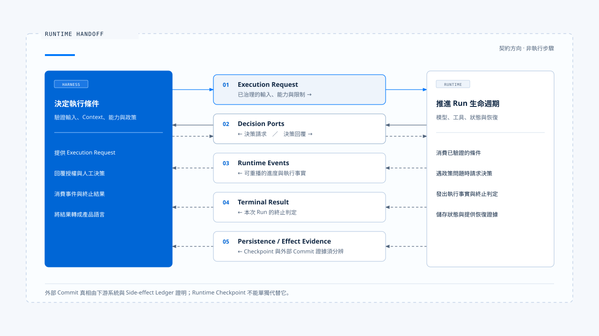
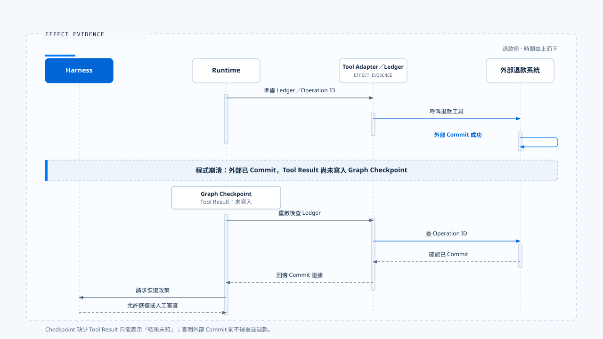
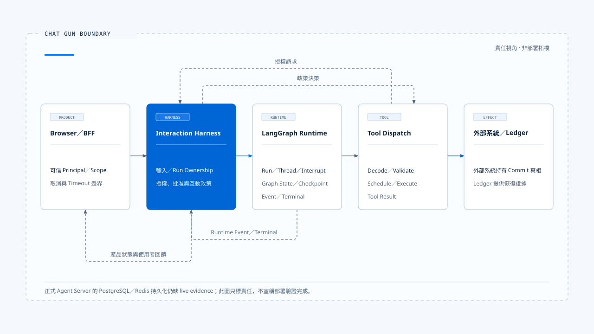

# Harness 與 Runtime 的邊界

[English](./03-harness-runtime-boundary.md) | [繁體中文](./03-harness-runtime-boundary-zh-TW.md)

> 邊界範圍：決策如何交給執行、執行如何向外請求決策，以及狀態與故障由誰負責

- Harness 與 Runtime 的分界，出現在「產品已經決定任務應在什麼條件下執行」之後，以及「執行核心開始推進狀態」之前。
- Harness 準備輸入、Context、能力與政策；Runtime 接收這些條件，執行模型與工具迴圈，直到產生完成、取消、失敗或等待人工介入等結果。執行途中若遇到需要產品判斷的事情，例如工具授權、人工確認或使用者補充，Runtime 會透過預先定義的 Port 回到 Harness，而不是自行創造政策。
- Harness 與 Runtime 兩者之間並非一條單向函式呼叫，而是一組雙向契約。

## 邊界要解決什麼問題

缺少清楚邊界時，系統容易同時出現兩種混亂：

- Runtime 開始自行決定使用者權限、Context 權威或產品互動政策。
- Harness 開始自行維護 Run state、重試、checkpoint 或 tool execution，逐步複製另一套 Runtime。

邊界位置錯誤時：
- Runtime = 執行核心承擔它無法治理的產品與領域責任。
- Harness = 產品端建立重複的 Run、Queue、Checkpoint 或終止狀態。當程式崩潰、工具產生副作用或事件晚到時，系統無法判斷哪一份狀態才是權威。

清楚的邊界需要回答四件事：

1. 哪些決策在交接前完成？
2. Runtime 接手後擁有哪些狀態與執行權？
3. Runtime 在什麼情況下必須回頭請求 Harness 決策？
4. 每種失敗由哪一層處理，最後又由誰向使用者說明？

## Harness 與 Runtime 的交接不僅是目錄切割

> Harness 與 Runtime 是責任分層。它們可能存在於同一個檔案，也可能分散在 Client、BFF、Backend、Agent Server 與 Tool Adapter。

判斷某段程式屬於哪一部分時，可以問：

- 它是在決定任務允許什麼，還是在推進已允許的執行？
- 它持有的是產品政策，還是 Run 的生命週期狀態？
- 它改變的是模型可見條件，還是執行中的狀態轉移？
- 它的失敗需要產品選擇，還是可以依執行規則自動處理？

例如：
1. Context Source 的權威排序屬於 Harness。
2. 在 Token 壓力下執行已選定的壓縮策略屬於 Runtime。
3. Tool Risk Policy 屬於 Harness。
4. 依既有規則排程 Tool Call 並收集結果屬於 Runtime。

## 五份交接契約

### 1. Execution Request：把產品意圖變成可執行輸入

**Execution Request 是 Harness 交給 Runtime 的輸入契約。它應包含足以開始執行的資料，又不把終端或 UI 細節滲入核心。**

概念上可以表示為：

~~~ts
interface ExecutionRequest {
  context: ExecutionContext;
  input: NormalizedAgentInput;
  contextPack: GovernedContext;
  capabilities: CapabilitySet;
  limits: ExecutionLimits;
  manifest: ExecutionManifest;
  decisionPorts: DecisionPorts;
}
~~~

各欄位的責任如下：

| 欄位 | Harness 應保證的事 |
|---|---|
| ExecutionContext | Request、Thread、Run、Task、Principal 與 Scope 已建立且一致 |
| NormalizedAgentInput | 輸入型別、內容、附件與目標 Run 已通過驗證 |
| GovernedContext | 來源、權威、Token 與敏感資料政策已套用 |
| CapabilitySet | 模型看到的能力與實際可執行能力一致 |
| ExecutionLimits | Turn、時間、成本、Token 與重試上限有明確值 |
| ExecutionManifest | 版本、Schema、工具與恢復相容性可判斷 |
| DecisionPorts | Runtime 可請求授權、人工確認與互動決策 |

- Runtime 不應重新猜測原始輸入的意思，也不應從任意 Header 或 Prompt 文字推導可信身分。必要欄位缺少時，應在執行開始前拒絕。

### 2. Decision Ports：Runtime 向 Harness 請求決策

> Runtime 在執行中會遇到只有產品或領域政策能回答的問題。Decision Port 將這些問題變成型別化請求。

~~~ts
interface DecisionPorts {
  authorizeAction(request: ActionAuthorizationRequest): Promise<ActionDecision>;
  requestHumanApproval(request: ApprovalRequest): Promise<ApprovalDecision>;
  classifyInteraction(request: InteractionRequest): Promise<InteractionDecision>;
  resolveClarification(request: ClarificationRequest): Promise<ClarificationDecision>;
}
~~~

- Port 的價值在於隔離決策來源。
- Interactive CLI 可以顯示確認對話框。
- SDK 可以將請求交給 Host。
- Web 產品可以建立可持久化的 Approval。
- 企業環境也可以呼叫外部 Policy Service。
- Runtime 接收 Allow、Deny、Require Confirmation、Queue、Supersede 等結構化結果。

**Decision Port 需要具備：**

- Request ID、Run ID、Tool Call ID 與資源識別。
- Policy Version 與決策理由。
- Timeout、Cancellation 與 Unavailable 的語意。
- Replay 與一次性使用限制。
- 不含敏感原文的 Audit Evidence。

**若 Runtime 直接呼叫 UI 元件，或 Harness 直接操縱 Runtime 內部變數，這條邊界就失去可替換性與可測試性。**

### 3. Runtime Events：回報執行過程

> Runtime Event 是執行核心向 Harness 回報進度的輸出契約。事件描述已發生的執行事實，不應要求終端介面猜測內部狀態。

常見事件包括：

- Run、Plan 或 Model Request 開始。
- Tool 的準備、執行、成功與失敗。
- Context 組裝、壓縮或降級。
- 等待 Permission、Clarification 或 Human Approval。
- 文字串流與 Structured Artifacts。
- Retry、Fallback、Recovery 與 Terminal Transition。

**支援重新連線與重播的事件封套，至少需要 Schema Version、Event ID、Run-scoped Sequence、Execution Correlation、Emitted At、Type 與 Payload。**

**Harness 消費事件後，可以更新 TUI、Web UI、SDK stream、Metrics 或 Audit Projection。Runtime 不需要知道由哪一種介面呈現這些資訊。**

### 4. Terminal Result：宣告一次執行如何結束

> 事件流與終止結果是兩個不同概念。事件可以重播、延遲或遺失；Terminal Result 必須表達 Runtime 對本次執行的最終判定。

常見終止狀態包括：

- Completed
- Cancelled
- Failed
- Rejected
- Waiting for Human
- Parked for Reconciliation
- Incompatible Resume

**Terminal State 應單向收斂。進入完成、取消或失敗後，晚到的 Progress Event 不能使 Run 回到 Running。若等待人工介入被建模為可恢復狀態，它也應帶著 Interrupt ID、Resume 條件與到期政策。**

**Harness 負責把 Terminal Result 轉成使用者語言，不能用 UI 顯示文案反推 Runtime 的真實狀態。**

### 5. Persistence and Effect Evidence：區分對話狀態與外部真相

> Runtime 可以儲存 Messages、Graph State、Checkpoints、Tasks 與 Tool Executions；這些紀錄仍無法單獨證明外部系統是否完成了一次副作用。

退款、寄信或建立雲端資源時，至少有三項彼此獨立的事實：

1. Runtime 是否送出 Tool Call。
2. Checkpoint 是否儲存 Tool Result。
3. 外部系統是否 Commit 這項操作。

**這三者可能不一致。Tool 已 Commit、程式卻在儲存結果前崩潰時，Runtime 只能知道結果不明。恢復流程必須查詢 Side-effect Ledger 與下游 Operation ID，再進行 Reconciliation、Compensation 或人工處置。**

Harness 在這裡持有產品政策，包括是否允許自動重試或必須進行人工審查。Runtime 持有狀態機與恢復流程，Tool Adapter 則提供外部 Commit 的證據。

## 狀態所有權

> 邊界要穩定，每一種狀態只能有一個權威來源。

| 狀態或決策 | 權威來源 |
|---|---|
| 使用者與租戶身分 | 產品 Identity／BFF 邊界 |
| 輸入種類與目標 Run | Harness Input Contract |
| Context 來源權威與能力集合 | Harness |
| Run ID 與 Run Status | Runtime／Agent Server |
| Thread／Conversation 關聯 | Runtime 的 Thread authority；Harness 儲存產品對應關係 |
| Graph Checkpoint | Graph Runtime／Checkpointer |
| 業務 Task／Step | 產品 Runtime extension |
| Tool Authorization | Harness Policy／Authorization Service |
| Tool Execution State | Tool Runtime |
| 外部 Business Effect | 下游系統＋Side-effect Ledger |
| 可見 Run Generation | Interaction Harness／Ownership Repository |
| UI State | Client reducer，必須依循 Runtime Event 與 Terminal Contract |

**「只有一個權威來源」不代表只有一份資料。Cache、Projection 與 UI State 可以有多份，但它們必須知道如何從權威來源更新，也不能反向改寫權威狀態。**

## Claude Code 的真實交接點

在本文分析的 Claude Code 舊版中，最清楚的 Runtime 入口是 query()。

其 QueryParams 包含：

~~~ts
type QueryParams = {
  messages;
  systemPrompt;
  userContext;
  systemContext;
  canUseTool;
  toolUseContext;
  fallbackModel?;
  querySource;
  maxTurns?;
  taskBudget?;
}
~~~

這些欄位會跨越 Harness／Runtime 邊界：

- messages、systemPrompt、userContext 與 systemContext 描述模型的初始資訊條件。
- toolUseContext 帶入 Tool、Model、App State、Abort 控制與執行所需的 Ports。
- canUseTool 讓 Runtime 在具體 Tool Call 上向外請求 Permission。
- querySource、maxTurns 與 taskBudget 限制執行模式及資源。
- fallbackModel 提供已允許的替代執行策略。

query() 回傳 AsyncGenerator。Harness 會持續消費 Messages、Stream Events、Tool Progress 與其他更新，Runtime 最後再回傳 Terminal Result。

### Interactive 路徑

~~~text
REPL
  → processUserInput
  → 組裝 System Prompt、Context、Tools、canUseTool
  → query(QueryParams)
  → onQueryEvent(event)
  → 更新 AppState、畫面與 transcript
~~~

REPL 直接呼叫 query()，沒有經過 QueryEngine。因此，Interactive Harness 負責跨使用者互動的 UI 與 Session 編排。

### Headless／SDK 路徑

~~~text
SDK / stdin
  → QueryEngine.submitMessage()
  → processUserInput
  → 組裝 QueryParams
  → query(QueryParams)
  → 轉成 SDKMessage、usage、permission denial 與 result
~~~

QueryEngine 持有 Headless Conversation 的 messages、Abort Controller、Usage、Cache 與 Permission Denials。它是 Headless／SDK 的 Harness façade，不是 query loop 本身。

### Permission 往返

當模型產生 Tool Use 時，query() 把 tool block 交給 runTools，再由 tool execution 呼叫 canUseTool。這次控制權會暫時回到 Harness：

~~~text
Runtime：準備執行 FileEdit
  → Harness：依設定、Hooks、目錄與使用者選擇作決策
  → Runtime：依 Allow／Deny 結果繼續
~~~

Runtime 負責確保未獲准的工具不會執行，Harness 則持有決策權與互動來源。

## 場景一：修改檔案

**使用者要求把 src/app.ts 的 timeout 改成 30 秒。**

### 第一次交接

1. Harness = 正規化文字與 IDE Context，加入專案規則，提供 FileRead／FileEdit，設定 Permission Port，再建立 QueryParams。
2. Runtime = 開始模型取樣，取得 FileRead Tool Use，執行後把 Tool Result 加回 Messages，再次呼叫模型。

### 第二次交接

1. 模型提出 FileEdit。Runtime 不自行判定是否允許修改檔案，而是把 Tool Name、Input、Tool Call ID 與目前 Context 傳給 canUseTool。
2. Harness 依目錄信任、Permission mode、Hook 與使用者選擇回覆。若需要人工確認，Interactive Harness 顯示變更內容；Headless Harness 可以把相同請求送給 SDK Host。

### 最終交接

1. Runtime 執行工具、回傳結果並產生完成訊息。Harness 消費事件、儲存 transcript 並更新畫面。
2. 如果 FileEdit 因 EACCES 失敗，Tool Runtime 將錯誤轉成 Tool Result 並回傳給模型。模型可以改用其他路徑或說明限制。是否顯示通知、是否允許改用 Shell，仍由 Harness 的能力與權限政策決定。

## Chat Gun 的邊界

> Chat Gun 的路徑比單機 CLI 多出 Browser、BFF、LangGraph Server、Graph 與業務副作用，因此邊界需要拆成幾段：

### 產品到 Harness

1. BFF 以可信值覆寫 Principal、Tenant、Role 與 Scope Header，也處理 Client Disconnect、Timeout 與 Abort。這些資料進入 Backend 後，Harness 才能建立 Canonical Execution Context。
2. 原始 Client 不能自行宣告內部身分或 Run authority。輸入經 NormalizedAgentInput 驗證，Interaction Runtime 再根據 Run Ownership、Generation、Query Guard 與 Clarification Resume Policy 決定是否放行。

### Harness 到 Graph Runtime

1. Interaction Governance 通過後，Graph Runtime 開始執行 Agent node。
2. Context Integration 依 Current Task、System Policy、Memory Scope 與 Token Budget 組裝模型輸入；Tool registry 則提供已治理的本地 Tool 與 MCP Tool。
3. LangGraph 提供 Run、Thread、Graph State、Interrupt 與 Checkpoint 機制。Chat Gun 不應再建立第二套通用 Queue、Worker 或 Graph Checkpoint。

### Harness 到 Tool Runtime

1. 模型提出 Tool Call 後，Tool registry 與 Dispatch Pipeline 套用 Descriptor、Risk、Authorization、Confirmation、Retry、Side-effect 與 Audit 政策。
2. Harness 負責決定是否允許這個 Principal 對這個 Resource 執行這次行動。Tool Runtime 負責 Decode、Validate、Schedule、Execute 與 Result Normalization，外部系統則持有最終的 Commit 真相。

### Runtime 回到 Harness

1. Interaction Runtime 與 Runtime Event 將執行事實向外傳遞。
2. Harness 依 Correlation、Generation 與 Terminal State 更新使用者可見狀態。
3. Clarification、Approval、Cancel 與 Supersede 都是新的邊界決策，不能只靠前端按鈕狀態。

## Chat Gun 的權威分配

目前的 Boundary Decision Record 將責任分配給 LangGraph 原生行為與 Chat Gun 擴充功能：

| 能力 | 目前權威與證據 |
|---|---|
| Dev Run／Thread 狀態 | LangGraph dev API，已有動態驗證 |
| Dev Graph Checkpoint／Interrupt | LangGraph dev runtime，已驗證正常停止、重啟與 Resume |
| 正式 Agent Server PG／Redis 持久化 | 尚未取得 live Run／Checkpoint 證據 |
| 業務 Task／Step | Chat Gun state machine 與 repository |
| 可見 Run Generation | Chat Gun Interaction Ownership |
| Tool Authorization | Chat Gun Harness policy |
| Tool Execution／Retry | Chat Gun Tool Dispatch Pipeline |
| Business Effect Commit Truth | Tool Adapter、外部系統與 Side-effect Ledger |
| Memory Governance | Chat Gun policy；底層 Store 由 Runtime adapter 提供 |
| Recovery 分類 | Chat Gun policy 使用 Runtime 與 Effect Evidence |

**這項分配保留一項必要限制：LangGraph dev 的驗證不能自動升格為正式 Docker Agent Server 的持久化證據。正式 Server 的 worker lease、PostgreSQL checkpoint、Redis 故障，以及強制終止行程後的持久性，仍需各自取得 live 驗證。**

## 場景二：退款工具

使用者要求退款時，控制權會多次跨越邊界：

| 階段 | Harness 決策 | Runtime 執行 |
|---|---|---|
| 接收請求 | 驗證 Principal、Tenant、輸入種類與目標 Run | 建立或取得 Run |
| 查詢訂單 | 提供 OrderReadTool 與有限 Scope | 執行查詢並將結果回傳給模型 |
| 提出退款 | 判斷 Risk 與 Require Confirmation | 建立 Interrupt，等待批准 |
| 使用者批准 | 驗證 Approval 的 Run、Resource、到期時間與一次性限制 | Resume 原本的 Run |
| 執行退款 | 提供 Idempotency 與 Retry Policy | 準備 Ledger、呼叫 Tool、儲存結果 |
| 回應遺失 | 決定是否允許自動恢復 | 查 Ledger 與外部 Operation，執行 Reconciliation |
| 完成 | 決定使用者可見內容 | 產生 Terminal Result 與 Evidence |

若 Runtime 在退款 Commit 後、儲存 Tool Result 前崩潰，Graph Checkpoint 無法單獨證明退款是否成功。Harness 也不能直接要求「再試一次」。系統必須先查外部真相，再決定要重用結果、進行補償，或交由人工審查。

## 失敗責任歸屬

邊界清楚之後，失敗不再全部落到同一個 catch。

| 失敗 | 第一處理者 | Harness 的責任 | Runtime 的責任 |
|---|---|---|---|
| 輸入 Schema 無效 | Harness | 拒絕並提供可修正的錯誤訊息 | 不啟動 Run |
| Principal／Scope 缺失 | Harness | Fail Closed | 不執行受保護 Tool |
| Context 超過 Hard Limit | Harness policy＋Context Runtime | 決定拒絕或採用降級後的使用者文案 | 執行選定策略並產生證據 |
| Model API 429／500 | Runtime | 提供 Retry／Fallback 上限 | 退避、重試或終止 |
| Tool business error | Tool Runtime | 決定可用能力與是否允許替代方案 | 將結構化錯誤回傳給模型 |
| Approval timeout | Harness | 定義到期與重新批准政策 | 保留或終止可恢復狀態 |
| Client disconnect | Product／Harness | 制定取消或背景執行政策 | 傳遞 Abort 並收斂狀態 |
| 副作用結果不明 | Tool Adapter／Operations | 決定人工或自動恢復政策 | Park、Reconcile、Compensate |
| Checkpoint store unavailable | Runtime／Infrastructure | 顯示可理解狀態、禁止不安全 Resume | 保留錯誤並停止錯誤重播 |

第一處理者負責技術處置，Harness 負責產品政策與對人說明，Runtime 負責狀態一致性。一個通用錯誤字串無法取代這些責任。

## 邊界的八條不變量

### 1. 單一狀態權威

- Run、Thread、Task、Tool Execution、Business Effect 各自只能有一個權威來源。
- 其他 Projection 只能跟隨，不能重新定義。

### 2. 身分連續性

- Request ID、Thread ID、Run ID、Task ID、Step ID 與 Tool Call ID 必須跨 Execution Request、Decision Port、Runtime Event、Audit 與 Terminal Result 傳遞。

### 3. 政策不由模型產生

- 模型可以提出計畫與行動，不能自行批准權限、提高 Scope 或宣告副作用已完成。

### 4. Runtime 不讀取未驗證身分

- 可信 Principal 應在產品邊界建立。Runtime 只消費已驗證的 Execution Context。

### 5. 重播期間仍可判讀 Decision

- Permission 與 Approval 應包含 Policy Version、Reason、Resource 與到期時間。
- Resume 時必須重新驗證必要條件，不能只相信舊 UI 狀態。

### 6. Terminal State 單向收斂

- Completed、Cancelled、Failed 與其他終止狀態一旦成立，晚到事件不能使 Run 回到 Running。

### 7. Checkpoint 不代表外部 Commit

- 恢復副作用必須同時檢查 Ledger 與下游系統，不能只看 Graph State。

### 8. 未驗證的能力仍視為未驗證

- Static Code、官方文件、Dev Runtime 與正式部署 Live Evidence 是不同證據等級。
- 架構文件應保留這些差異。

## 交接契約的測試方式

### Contract Test

- 驗證 Execution Request、Decision、Event 與 Terminal Schema。缺少必要 Identity、未知版本、非法狀態轉移都應失敗。

### Architecture Test

- 檢查所有正式 Graph 與 Tool 是否經過共同 Composition Root、Interaction Governance 與 Tool Dispatch Pipeline，防止新 Agent 繞過控制面。

### Mode Parity Test

- 讓相同任務分別經過 Browser、SDK、Headless 與 Remote 入口，確認 Normalized Input、權限與 Terminal 語意一致。

### Failure Drill

- 在模型請求、Tool dispatch、外部 Commit、Checkpoint Write、Approval Wait 與 Event Delivery 等位置注入失敗，檢查責任是否落在預期層。

### Restart and Resume Test

- 重新啟動程式時沿用相同的 Thread／Run／Interrupt Identity，再驗證 Manifest、Authorization、Checkpoint 與 Side Effect 是否允許安全 Resume。

## 常見邊界錯誤

### 把 QueryEngine 當成全部 Runtime

- 在 Claude Code 樣本中，Interactive REPL 直接呼叫 query()；QueryEngine 主要服務 Headless／SDK。用單一類別名稱判斷邊界會漏掉實際入口。

### Harness 直接修改 Runtime 內部狀態

- UI 直接改 Running、Completed 或 Tool Result，會讓畫面狀態與執行權威分裂。
- Harness 應透過 Command、Decision 或 Cancel Contract 影響 Runtime。

### Runtime 自行決定產品政策

- 遇到未知 Tool 或授權服務故障時預設允許，等於讓執行器創造政策。這類錯誤應 Fail Closed 或進入明確的降級模式。

### 建立第二套通用 Runtime

- 產品可能需要 Task、Generation、Side-effect Ledger 與 Recovery Policy，但不需要複製 Agent Server 的 Queue、Worker、Run Store 與 Checkpointer。擴充功能應補足業務語義，並依賴原生 Runtime 的權威訊號。

### 用訊息文案推斷狀態

- 「任務完成」只是一段內容，不能代替 Run API 或 Terminal Result。狀態必須來自機器可讀契約。

## 本篇的工程判斷

**Harness 與 Runtime 的邊界可以用一句話檢查：**

> Harness 決定一次 Agent 執行被允許在什麼條件下發生；Runtime 負責在這些條件內，把執行推進到可證明的結果。

1. 這條邊界允許雙向溝通，但不允許責任漂移。
2. Runtime 可以請求決策，不能創造政策；Harness 可以取消、批准或限制執行，不能偽造執行狀態與外部提交結果。

## 證據來源

### 已觀察：Claude Code 舊版

- claude-code-avatar：src/query.ts 的 QueryParams 與 query AsyncGenerator
- claude-code-avatar：src/screens/REPL.tsx 的 Interactive query 呼叫
- claude-code-avatar：src/QueryEngine.ts 的 Headless／SDK query 呼叫
- claude-code-avatar：src/services/tools/toolOrchestration.ts
- claude-code-avatar：src/services/tools/toolExecution.ts 的 canUseTool 往返
- claude-code-avatar：ARCHITECTURE.md

### 已接入或部分驗證：Chat Gun

- backend/src/operations/execution-composition-root.ts
- backend/src/platform/interaction-runtime.ts
- backend/src/runtime/execution-context/
- backend/src/runtime/input/
- backend/src/tools/registry.ts
- backend/src/runtime/tool-dispatch/
- backend/src/runtime/side-effect/
- backend/src/platform/agent-runtime-events.ts
- docs/decisions/current-langgraph-runtime-boundary.md
- backend/langgraph.json

## 接續閱讀

- [什麼是 Agent Harness](./01-what-is-agent-harness.md)
- [Harness 的控制面](./02-control-surfaces.md)
- [Agent Harness 設計原則](./04-design-principles.md)
- [一次任務的完整走法](./05-one-turn-walkthrough.md)
