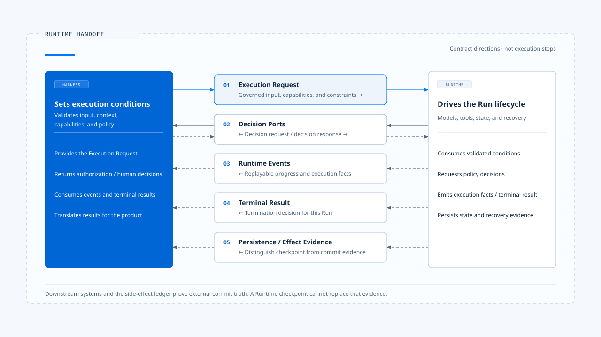
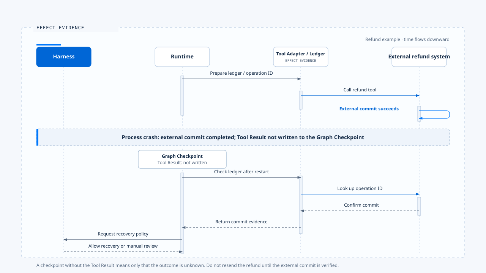

# The Harness-Runtime boundary

[English](./03-harness-runtime-boundary.md) | [繁體中文](./03-harness-runtime-boundary-zh-TW.md)

> Scope: how decisions pass into execution, how execution asks for decisions, and who owns state and failure

- The boundary between the Harness and Runtime sits after the product has decided the conditions under which a task may run, and before the execution core starts advancing state.
- The Harness prepares input, Context, capabilities, and policy. The Runtime accepts those conditions and runs the model and tool loop until it completes, is canceled, fails, or waits for human intervention. If execution reaches a question that requires a product decision, such as tool authorization, human confirmation, or more user input, the Runtime returns to the Harness through a predefined Port instead of inventing policy.
- The Harness-Runtime relationship is a set of bidirectional contracts, not a one-way function call.

## What problem does the boundary solve?

Without a clear boundary, two kinds of confusion appear at once:

- The Runtime starts deciding user permissions, Context authority, or product interaction policy.
- The Harness starts maintaining Run state, retries, checkpoints, or tool execution, gradually duplicating another Runtime.

When the boundary is misplaced:
- Runtime = the execution core takes on product and domain responsibilities it cannot govern.
- Harness = the product creates duplicate Run, Queue, Checkpoint, or terminal state. After a process crash, tool side effect, or late event, the system cannot tell which state is authoritative.

A clear boundary must answer four questions:

1. Which decisions are complete before handoff?
2. Which state and execution authority does the Runtime own after handoff?
3. When must the Runtime return to the Harness for a decision?
4. Which layer handles each failure, and who eventually explains it to the user?

## The Harness-Runtime handoff is more than a directory split

> Harness and Runtime are responsibility layers. They may live in one file or span the Client, BFF, Backend, Agent Server, and Tool Adapter.

To classify a piece of code, ask:

- Does it decide what the task may do, or advance execution that has already been allowed?
- Does it own product policy, or Run lifecycle state?
- Does it change what the model can see, or a state transition during execution?
- Does its failure require a product choice, or can execution rules handle it automatically?

For example:
1. The authority order for Context Sources belongs to the Harness.
2. Running the selected compression strategy under Token pressure belongs to the Runtime.
3. Tool Risk Policy belongs to the Harness.
4. Scheduling a Tool call and collecting its result under existing rules belongs to the Runtime.

## The five handoff contracts

### 1. Execution Request: turn product intent into executable input

**The Execution Request is the inbound contract from the Harness to the Runtime. It should contain enough data to start execution without leaking terminal or UI details into the core.**

Conceptually:

~~~ts
interface ExecutionRequest {
  context: ExecutionContext;
  input: NormalizedAgentInput;
  contextPack: GovernedContext;
  capabilities: CapabilitySet;
  limits: ExecutionLimits;
  manifest: ExecutionManifest;
  decisionPorts: DecisionPorts;
}
~~~

Each field carries a specific responsibility:

| Field | What the Harness must guarantee |
|---|---|
| ExecutionContext | Request, Thread, Run, Task, Principal, and Scope exist and agree |
| NormalizedAgentInput | Input type, content, attachments, and target Run have passed validation |
| GovernedContext | Source, authority, Token, and sensitive-data policies have been applied |
| CapabilitySet | The capabilities visible to the model match the capabilities the system can execute |
| ExecutionLimits | Turn, time, cost, Token, and retry limits have explicit values |
| ExecutionManifest | Version, Schema, tool, and recovery compatibility can be determined |
| DecisionPorts | The Runtime can request authorization, human confirmation, and interaction decisions |

- The Runtime should not reinterpret raw input or derive trusted identity from arbitrary Header or Prompt text. It should reject a request with missing required fields before execution starts.

### 2. Decision Ports: the Runtime asks the Harness for decisions

> During execution, the Runtime encounters questions that only product or domain policy can answer. A Decision Port turns each question into a typed request.

~~~ts
interface DecisionPorts {
  authorizeAction(request: ActionAuthorizationRequest): Promise<ActionDecision>;
  requestHumanApproval(request: ApprovalRequest): Promise<ApprovalDecision>;
  classifyInteraction(request: InteractionRequest): Promise<InteractionDecision>;
  resolveClarification(request: ClarificationRequest): Promise<ClarificationDecision>;
}
~~~

- A Port isolates the source of a decision.
- An Interactive CLI can show a confirmation dialog.
- An SDK can forward the request to its Host.
- A web product can create a durable Approval.
- An enterprise deployment can call an external Policy Service.
- The Runtime receives structured results such as Allow, Deny, Require Confirmation, Queue, or Supersede.

**A Decision Port needs:**

- Request ID, Run ID, Tool Call ID, and resource identity.
- Policy Version and the reason for the decision.
- Timeout, Cancellation, and Unavailable semantics.
- Replay and single-use constraints.
- Audit Evidence that excludes sensitive source text.

**If the Runtime calls a UI component directly, or the Harness manipulates internal Runtime variables, the boundary loses replaceability and testability.**

### 3. Runtime Events: report execution progress

> A Runtime Event is the outbound contract through which the execution core reports progress to the Harness. Events describe execution facts that have occurred. A terminal should not have to infer internal state.

Common events include:

- The start of a Run, Plan, or Model Request.
- Tool preparation, execution, success, and failure.
- Context assembly, compression, or degradation.
- Waiting for Permission, Clarification, or Human Approval.
- Text streaming and Structured Artifacts.
- Retry, Fallback, Recovery, and Terminal Transition.

**An event envelope that supports reconnection and replay needs at least Schema Version, Event ID, Run-scoped Sequence, Execution Correlation, Emitted At, Type, and Payload.**

**After consuming an event, the Harness may update a TUI, Web UI, SDK stream, Metrics, or an Audit Projection. The Runtime does not need to know which interface presents those updates.**

### 4. Terminal Result: declare how an execution ended

> An event stream and a terminal result are different concepts. Events may be replayed, delayed, or lost. The Terminal Result must express the Runtime's final decision for this execution.

Common terminal states include:

- Completed
- Cancelled
- Failed
- Rejected
- Waiting for Human
- Parked for Reconciliation
- Incompatible Resume

**Terminal State must converge in one direction. After the Run completes, is canceled, or fails, a late Progress Event cannot return it to Running. If waiting for human intervention is modeled as a resumable state, it must include an Interrupt ID, Resume conditions, and an expiration policy.**

**The Harness translates the Terminal Result into user-facing language. It must not infer the Runtime's true state from UI copy.**

### 5. Persistence and Effect Evidence: separate conversation state from external truth

> The Runtime may persist Messages, Graph State, Checkpoints, Tasks, and Tool Executions. Those records alone cannot prove whether an external side effect completed.

A refund, email, or cloud resource creation involves at least three distinct facts:

1. Whether the Runtime sent the Tool Call.
2. Whether the Checkpoint saved the Tool Result.
3. Whether the external system committed the operation.

**These facts can disagree. If the Tool commits and the process crashes before saving the result, the Runtime only knows that the outcome is unknown. Recovery must check the Side-effect Ledger and the downstream Operation ID before Reconciliation, Compensation, or manual handling.**

The Harness owns product policy here, including whether automatic retry is allowed or manual review is required. The Runtime owns the state machine and recovery flow. The Tool Adapter provides evidence of the external commit.

## State ownership

> A stable boundary gives each kind of state one authoritative source.

| State or decision | Authoritative source |
|---|---|
| User and tenant identity | Product Identity / BFF boundary |
| Input type and target Run | Harness Input Contract |
| Context source authority and capability set | Harness |
| Run ID and Run Status | Runtime / Agent Server |
| Thread / Conversation relationship | Runtime Thread authority; the Harness stores the product mapping |
| Graph Checkpoint | Graph Runtime / Checkpointer |
| Business Task / Step | Product Runtime extension |
| Tool Authorization | Harness Policy / Authorization Service |
| Tool Execution State | Tool Runtime |
| External Business Effect | Downstream system + Side-effect Ledger |
| Visible Run Generation | Interaction Harness / Ownership Repository |
| UI State | Client reducer, which must follow the Runtime Event and Terminal Contract |

**"One authoritative source" does not mean one copy of the data. The system may have multiple Caches, Projections, and UI States, but each copy must know how to update from the authority and must not overwrite authoritative state.**

## The actual handoff points in Claude Code

In the older Claude Code version analyzed here, the clearest Runtime entry point is query().

Its QueryParams include:

~~~ts
type QueryParams = {
  messages;
  systemPrompt;
  userContext;
  systemContext;
  canUseTool;
  toolUseContext;
  fallbackModel?;
  querySource;
  maxTurns?;
  taskBudget?;
}
~~~

These fields cross the Harness-Runtime boundary:

- messages, systemPrompt, userContext, and systemContext describe the information initially available to the model.
- toolUseContext supplies the Tool, Model, App State, Abort control, and Ports required for execution.
- canUseTool lets the Runtime request Permission for a specific Tool Call.
- querySource, maxTurns, and taskBudget limit the execution mode and resources.
- fallbackModel supplies an allowed alternative execution strategy.

query() returns an AsyncGenerator. The Harness consumes Messages, Stream Events, Tool Progress, and other updates while the Runtime eventually returns a Terminal Result.

### Interactive path

~~~text
REPL
  → processUserInput
  → assemble System Prompt, Context, Tools, canUseTool
  → query(QueryParams)
  → onQueryEvent(event)
  → update AppState, UI, and transcript
~~~

The REPL calls query() directly without going through QueryEngine. The Interactive Harness therefore owns UI and Session orchestration across user interactions.

### Headless / SDK path

~~~text
SDK / stdin
  → QueryEngine.submitMessage()
  → processUserInput
  → assemble QueryParams
  → query(QueryParams)
  → convert to SDKMessage, usage, permission denial, and result
~~~

QueryEngine owns the Headless Conversation's messages, Abort Controller, Usage, Cache, and Permission Denials. It is the Harness façade for Headless / SDK mode, not the query loop itself.

### Permission round trip

When the model produces a Tool Use, query() passes the tool block to runTools, and the tool execution path calls canUseTool. Control temporarily returns to the Harness:

~~~text
Runtime: prepare to execute FileEdit
  → Harness: decide from settings, Hooks, directory, and user choice
  → Runtime: continue according to the Allow / Deny result
~~~

The Runtime ensures that an unauthorized tool does not execute. The Harness owns the decision and the interaction source.

## Scenario one: edit a file

**The user asks to change the timeout in src/app.ts to 30 seconds.**

### First handoff

1. Harness = normalize text and IDE Context, add project rules, provide FileRead / FileEdit, configure the Permission Port, and create QueryParams.
2. Runtime = start model sampling, receive a FileRead Tool Use, execute it, add the Tool Result to the messages, and call the model again.

### Second handoff

1. The model proposes FileEdit. The Runtime does not decide whether editing the file is allowed. It sends the Tool Name, Input, Tool Call ID, and current Context to canUseTool.
2. The Harness responds according to directory trust, Permission mode, Hooks, and user choice. If human confirmation is required, the Interactive Harness shows the change. A Headless Harness can send the same request to the SDK Host.

### Final handoff

1. The Runtime executes the tool, feeds the result back, and produces a completion message. The Harness consumes events, saves the transcript, and updates the UI.
2. If FileEdit fails with EACCES, the Tool Runtime converts the error into a Tool Result and returns it to the model. The model may change the path or explain the limitation. Harness capability and permission policy still decide whether to show a notification or allow Shell as an alternative.

## The Chat Gun boundary

> The Chat Gun path adds Browser, BFF, LangGraph Server, Graph, and business side effects beyond a local CLI, so the boundary has several segments:

### Product to Harness

1. The BFF overwrites Principal, Tenant, Role, and Scope Headers with trusted values. It also handles Client Disconnect, Timeout, and Abort. Once this data reaches the Backend, the Harness can build a Canonical Execution Context.
2. A raw Client cannot declare internal identity or Run authority. The system validates input as NormalizedAgentInput, then the Interaction Runtime applies Run Ownership, Generation, Query Guard, and Clarification Resume Policy to decide whether execution may proceed.

### Harness to Graph Runtime

1. After Interaction Governance passes, the Graph Runtime starts the Agent node.
2. Context Integration assembles model input from Current Task, System Policy, Memory Scope, and Token Budget. The Tool registry supplies governed local Tools and MCP Tools.
3. LangGraph provides Run, Thread, Graph State, Interrupt, and Checkpoint mechanisms. Chat Gun should not create a second general-purpose Queue, Worker, or Graph Checkpoint.

### Harness to Tool Runtime

1. After the model proposes a Tool Call, the Tool registry and Dispatch Pipeline apply Descriptor, Risk, Authorization, Confirmation, Retry, Side-effect, and Audit policies.
2. The Harness owns the decision to let this Principal perform this action on this Resource. The Tool Runtime owns Decode, Validate, Schedule, Execute, and Result Normalization. The external system owns final commit truth.

### Runtime back to Harness

1. The Interaction Runtime and Runtime Events carry execution facts outward.
2. The Harness updates user-visible state according to Correlation, Generation, and Terminal State.
3. Clarification, Approval, Cancel, and Supersede each create a new boundary decision. Front-end button state is not enough.

## Authority allocation in Chat Gun

The current Boundary Decision Record divides responsibility between LangGraph native behavior and Chat Gun extensions:

| Capability | Current authority and evidence |
|---|---|
| Dev Run / Thread state | LangGraph dev API, dynamically verified |
| Dev Graph Checkpoint / Interrupt | LangGraph dev runtime, verified across a normal stop, restart, and resume |
| Production Agent Server PG / Redis persistence | No live Run / Checkpoint evidence yet |
| Business Task / Step | Chat Gun state machine and repository |
| Visible Run Generation | Chat Gun Interaction Ownership |
| Tool Authorization | Chat Gun Harness policy |
| Tool Execution / Retry | Chat Gun Tool Dispatch Pipeline |
| Business Effect Commit Truth | Tool Adapter, external system, and Side-effect Ledger |
| Memory Governance | Chat Gun policy; the Runtime adapter provides the underlying Store |
| Recovery classification | Chat Gun policy using Runtime and Effect Evidence |

**This allocation retains one necessary limit: verification against LangGraph dev does not automatically become persistence evidence for the production Docker Agent Server. The production Server still needs independent live verification of worker leases, PostgreSQL checkpoints, Redis failures, and durability after a forced process kill.**

## Scenario two: refund tool

When a user requests a refund, control crosses the boundary several times:

| Stage | Harness decision | Runtime execution |
|---|---|---|
| Receive request | Validate Principal, Tenant, input type, and target Run | Create or retrieve the Run |
| Read order | Provide OrderReadTool with limited Scope | Execute the query and feed back the result |
| Propose refund | Evaluate Risk and Require Confirmation | Create an Interrupt and wait for approval |
| User approval | Validate the Approval's Run, Resource, expiration, and single-use constraint | Resume the original Run |
| Execute refund | Provide Idempotency and Retry Policy | Prepare the Ledger, call the Tool, and save the result |
| Lost response | Decide whether automatic recovery is allowed | Check the Ledger and external Operation, then run Reconciliation |
| Complete | Decide what the user can see | Produce the Terminal Result and Evidence |

If the Runtime crashes after the refund commits but before it saves the Tool Result, the Graph Checkpoint cannot prove whether the refund succeeded. The Harness cannot simply ask the Runtime to try again. The system must check external truth first, then decide whether it can reuse the result, compensate, or enter manual review.

## Failure ownership

With a clear boundary, failures no longer fall into one catch block.

| Failure | First handler | Harness responsibility | Runtime responsibility |
|---|---|---|---|
| Invalid input Schema | Harness | Reject with a correctable error | Do not start a Run |
| Missing Principal / Scope | Harness | Fail Closed | Do not execute a protected Tool |
| Context exceeds Hard Limit | Harness policy + Context Runtime | Choose rejection or degraded user-facing copy | Execute the selected strategy and produce evidence |
| Model API 429 / 500 | Runtime | Supply Retry / Fallback limits | Back off, retry, or terminate |
| Tool business error | Tool Runtime | Decide which capabilities and alternatives are allowed | Feed a structured error back to the model |
| Approval timeout | Harness | Define expiration and reapproval policy | Preserve or terminate resumable state |
| Client disconnect | Product / Harness | Issue a cancellation or background-execution policy | Propagate Abort and converge state |
| Unknown side-effect outcome | Tool Adapter / Operations | Choose manual or automatic recovery policy | Park, Reconcile, or Compensate |
| Checkpoint store unavailable | Runtime / Infrastructure | Show an understandable state and prohibit unsafe Resume | Preserve the error and stop invalid replay |

The first handler owns technical remediation. The Harness owns product policy and the explanation to people. The Runtime owns state consistency. A single generic error string cannot replace those responsibilities.

## Eight boundary invariants

### 1. One authority for each state

- Run, Thread, Task, Tool Execution, and Business Effect each have one authoritative source.
- Other Projections may follow that source but cannot redefine it.

### 2. Identity continuity

- Request ID, Thread ID, Run ID, Task ID, Step ID, and Tool Call ID must flow across the Execution Request, Decision Port, Runtime Event, Audit, and Terminal Result.

### 3. The model does not create policy

- The model may propose plans and actions. It cannot approve permissions, increase Scope, or declare a side effect complete.

### 4. The Runtime does not read unverified identity

- The product boundary establishes a trusted Principal. The Runtime consumes only a verified Execution Context.

### 5. Decisions remain interpretable during replay

- Permission and Approval should include Policy Version, Reason, Resource, and expiration time.
- Resume must revalidate required conditions instead of trusting old UI state.

### 6. Terminal state converges in one direction

- Once Completed, Cancelled, Failed, or another terminal state takes effect, a late event cannot return the Run to Running.

### 7. A Checkpoint does not prove an external Commit

- Side-effect recovery must check both the Ledger and downstream system, not only Graph State.

### 8. Unverified capabilities remain unverified

- Static Code, official documentation, Dev Runtime, and production Live Evidence are different evidence levels.
- Architecture documentation should preserve those distinctions.

## How to test the handoff contracts

### Contract Test

- Validate the Execution Request, Decision, Event, and Terminal Schemas. Missing required Identity, unknown versions, and illegal state transitions should fail.

### Architecture Test

- Check that every production Graph and Tool passes through the shared Composition Root, Interaction Governance, and Tool Dispatch Pipeline so a new Agent cannot bypass the control plane.

### Mode Parity Test

- Run the same task through Browser, SDK, Headless, and Remote entry points. Confirm that Normalized Input, permissions, and Terminal semantics match.

### Failure Drill

- Inject failures at the model request, Tool dispatch, external Commit, Checkpoint Write, Approval Wait, and Event Delivery stages. Check that responsibility lands in the expected layer.

### Restart and Resume Test

- Restart the process with the same Thread / Run / Interrupt Identity, then verify whether the Manifest, Authorization, Checkpoint, and Side Effect permit a safe Resume.

## Common boundary mistakes

### Treating QueryEngine as the entire Runtime

- In the Claude Code sample, the Interactive REPL calls query() directly. QueryEngine mainly serves Headless / SDK mode. A boundary inferred from one class name misses the actual entry point.

### Letting the Harness modify internal Runtime state

- If the UI writes Running, Completed, or Tool Result directly, display state and execution authority split.
- The Harness should influence the Runtime through a Command, Decision, or Cancel Contract.

### Letting the Runtime decide product policy

- Allowing an unknown Tool or a failed authorization service by default lets the executor create policy. Such failures should Fail Closed or enter an explicit degraded mode.

### Building a second general-purpose Runtime

- A product may need Task, Generation, a Side-effect Ledger, and Recovery Policy. It does not need to copy the Agent Server's Queue, Worker, Run Store, or Checkpointer. An extension should add business semantics and rely on authoritative signals from the native Runtime.

### Inferring state from message copy

- "Task complete" is content, not a substitute for the Run API or a Terminal Result. State must come from a machine-readable contract.

## Engineering judgment

**One sentence tests the Harness-Runtime boundary:**

> The Harness decides the conditions under which an Agent execution may occur. Within those conditions, the Runtime advances execution to a provable result.

1. The boundary allows bidirectional communication but not responsibility drift.
2. The Runtime may request decisions but cannot create policy. The Harness may cancel, approve, or constrain execution but cannot fabricate execution state or external commit results.

## Evidence sources

### Observed: older Claude Code version

- claude-code-avatar: QueryParams and the query AsyncGenerator in src/query.ts
- claude-code-avatar: Interactive query call in src/screens/REPL.tsx
- claude-code-avatar: Headless / SDK query call in src/QueryEngine.ts
- claude-code-avatar: src/services/tools/toolOrchestration.ts
- claude-code-avatar: canUseTool round trip in src/services/tools/toolExecution.ts
- claude-code-avatar: ARCHITECTURE.md

### Integrated or partially verified: Chat Gun

- backend/src/operations/execution-composition-root.ts
- backend/src/platform/interaction-runtime.ts
- backend/src/runtime/execution-context/
- backend/src/runtime/input/
- backend/src/tools/registry.ts
- backend/src/runtime/tool-dispatch/
- backend/src/runtime/side-effect/
- backend/src/platform/agent-runtime-events.ts
- docs/decisions/current-langgraph-runtime-boundary.md
- backend/langgraph.json

## Continue reading

- [What is an Agent Harness?](./01-what-is-agent-harness.md)
- [Harness control surfaces](./02-control-surfaces.md)
- [Agent Harness design principles](./04-design-principles.md)
- [A complete task walkthrough](./05-one-turn-walkthrough.md)
