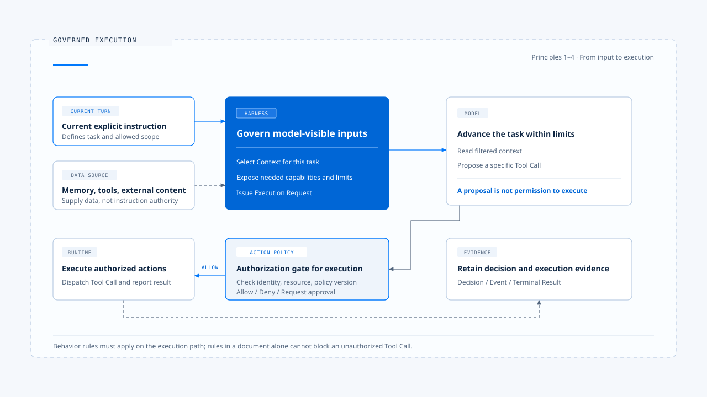
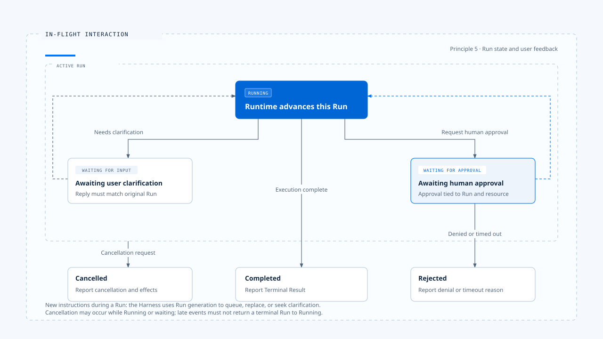

# Agent Harness 设计原则

[English](./04-design-principles.md) | [繁體中文](./04-design-principles-zh-TW.md) | [简体中文](./04-design-principles-zh-CN.md)

> 以下内容所提到的
> CCB 为 [claude-code-best](https://github.com/claude-code-best/claude-code) 的简称。
> Chat Gun 为 [chat-gun](https://github.com/HsienW/chat-gun)。

> 你也许遇过这场景，用户要求「只修改 README」，Agent 却顺手调整了配置文件。检查 Prompt，里面明明写着遵守范围；检查工具，写文件功能也正常。

**其实问题出在系统没有把这次任务的范围，转成执行工具前必须通过的条件。模型读过一句规则，与产品能阻止一次越界操作，两者之间还有一段工程工作。**

[前篇](./03-harness-runtime-boundary-zh-CN.md) 说明 Harness 与 Runtime 如何交接。

**本篇进一步讨论设计时的取舍：哪些事情适合交给模型判断，哪些条件应由程序检查，用户介入之后又该如何改变执行。**
- 这些判断来自 CCB 的分析，以及 Chat Gun 将相关能力接入应用的经验；
- 文中的文件修改、退款等情境用来解释设计，不代表两个项目都已实现全部场景。

## 让每条规则找到执行位置

> 一条行为规则需要说明它改变什麽、在哪里生效，以及失效时会发生什麽。以「本次只可修改 README」为例，Context 组装器应保留这个要求，能力配置应限制无关工具，行动授权则应检查实际目标路径。模型负责理解文字需求；系统仍须在能检查的地方执行约束。

- 图中的路径用来检查设计责任。记忆和工具输出可以补充事实，本次用户指令则界定任务；两者都仍受产品政策、身份与资源权限限制。「本次指令优先」适用于任务意图的冲突，不能用来覆写系统的安全边界。

以下五项原则沿着这条路径展开。每项都包含采用理由、实现落点与代价，方便读者判断它是否适合自己的产品。

## 1. 依当前任务选取上下文与能力

> 把整段历史、全部记忆与所有工具一次交给模型，会增加选错数据与误用能力的机会。假设任务只是整理公开文件，却同时开放账务修改工具，后续授权层便得承担一批原本可以避免的行动提案。Context 太多也会排挤真正需要的内容，例如用户刚补充的限制或尚未处理的工具错误。

**我倾向先建立本次任务的 Context 与能力集合，再随任务进展补入所需数据。选取时至少保留来源、权威与有效范围；工具则依 Agent、模式、身份和资源条件提供。若任务需要扩大搜索或增加能力，系统应有明确的取得方式，让模型能说明缺少什麽，再经政策检查后补入。**

- 在参考的库中
  - claude-code-best 外层会准备 Prompt、Context 与工具条件，再交给 `query()`。
  - chat-gun 的 `context-integration.ts` 则把 Context 组装接入不同 Agent，并保留各 Agent 的 Feature Flag。

这些实现显示，模型可见内容的选择有具体接点，可以从程序路径核对。

- 代价在于选取失误可能让模型缺少完成任务的数据，因此「最小」应以足以完成任务为准。对探索性研究，较宽的读取范围有其用途；对退款或写文件，则应缩小可操作资源。
- Token 预算耗尽时，仍须保留当前任务限制、待处理决策与必要工具结果，不能让截断顺序替产品决定哪些规则可以消失。

## 2. 把任务指令与数据来源分清楚

> 记忆可能记着用户偏好自动处理，但这次用户明确要求「先给方案，确认后再执行」；搜索页面也可能夹带「忽略先前限制」的文字。这两种情况都要求系统保留来源差异。前者是旧偏好与本次意图冲突，后者是外部数据试图取得指令地位。

- 在产品政策允许的范围内，让本次明确指令优先于历史偏好，并将检索内容、文件与工具输出当作待解读数据。
- Context 组装时应标记来源与用途，不能因为把一段文字放进高权威消息，就让它取得改变权限或任务范围的能力。
- 项目指令若属产品认可的规则来源，也应经过加载与信任政策，不能只凭文件名取得权威。

chat-gun 的 Context 组装将当前任务、历史消息、记忆与工具输出分开处理，提供了这类治理的实现位置。身份与资源范围还需要可信的 Execution Context；从文件、模型参数或一般请求内容读到的账号名称，不能直接作为授权身份。

来源标记有助于模型理解，却无法保证模型永远不受恶意内容影响。因此，授权检查仍须使用可信字段，不能要求模型判定自己是否已受提示注入，再以它的回答决定能否执行。代价是系统要维护来源元数据与信任规则；省略这些数据后，后续再补 Prompt 通常也无法还原原先的权威关系。

## 3. 模型提出行动，系统决定执行权

> 模型提出 `FileEdit`，只能说明它认为这个操作有助于完成任务。系统还需要确认目标文件、修改内容与目前政策是否允许。

**例如：退款工具得检查操作人、订单归属、金额与批准条件。因为工具出现在模型的能力清单，并未回答这一次调用能否执行。**

所以要把 **能力可见性** 与 **单次行动授权** 分成两个接点：

- 前者减少无关提案
- 后者检查实际 Tool Call

授权应在进入执行器前套用，必要时要求人工确认；批准要对应具体操作范围。若等待期间参数、资源版本或政策改变，恢复执行前就得重新判定，不能把先前的「同意」扩张到新操作。

- 在参考的库中
  - claude-code-best 由外层提供 `canUseTool`，工具执行路径在调用前取得 Permission 决策；Interactive 与 Headless／SDK 可以用不同方式取得这个决策。
  - chat-gun 则在工具 Registry 组装授权，并在 MCP Agent 的 Graph 中安排授权、确认与实际派送节点。

这些位置都可以用来检查：模型提案到真正执行之间，是否经过治理。

- 人工确认会增加等待时间，过密的询问也容易让人习惯性同意。要依资源风险与既有授权决定是否询问，让确认界面呈现这次操作的范围与后果。
- 读取公开数据、修改工作区文件与对外付款，适合不同的政策；产品应明确定义它们，避免把所有行动交给同一个确认窗口。
- 授权本身也有能力边界。获准执行的工具若能启动任意程序或访问网络，仍需要相应的执行隔离与资源限制；一次授权通过，不能证明工具内部的所有行为都已受控。

## 4. 从正式入口验证规则确实生效

> 一个独立授权模组的测试全部通过，应用仍可能直接调用底层工具；Context 组装器也可能只被某一个 Agent 使用，另一条路径继续沿用旧逻辑。检查模组能做什麽之后，还得沿着用户入口确认应用实际用了什麽。

建议优先追踪一条能走到底的执行路径：
1. 入口接收输入
2. 组装 Context
3. 模型提出工具调用
4. 授权后派送
5. 工具结果回到模型
6. 最后形成用户可见结果

- 共用接点负责政策与契约，各 Agent 保留任务差异。新增入口或工具时，应验证它经过相同的必要关卡，避免重新组装一套略有差异的流程。

- 在参考的库中
  - chat-gun 的 `tools/registry.ts` 说明了这个区别。Registry 会套用工具治理，但完整 Tool Dispatch Pipeline 是否建立，仍依来源对应的 Feature Flag 判断；Context 组装也有各 Agent 的开关。因此即便「模组存在」、「入口已接线」与「部署中已启用」需要分别提出证据。程序里存在预设值，也不足以证明某个环境的实际设置。

**验证应选择具体的绕过风险。例如从 MCP Agent 送出需要批准的调用，确认未批准前底层工具没有被调用；再从 Headless 入口走同一案例，检查语意是否一致。这类测试比只比对函数名称更能发现问题。共用治理路径会增加整合成本，也可能限制特殊工具的调度方式，因而仍需保留清楚的扩展接口。**

## 5. 执行中的用户输入必须有归属

> Agent 正在修改文件时，用户补了一句「先停，不要碰配置文件」。若系统只是把这段话附加到下一个 Prompt，原来的写入可能早已开始；若直接启动新 Run，旧 Run 又可能稍后返回结果，覆盖新任务的画面。这是执行归属与状态转移问题，需要在收到输入时就处理。

- 图中的状态是概念模型，各 Runtime 的实际名称可能不同。等待批准的调用可以恢复，也可能因拒绝而结束；某项工具被拒绝后，Run 也可以依产品政策继续产出不执行工具的答覆。
- 图中的 `Rejected` 应理解为产品选择终止的分支，不能套用成所有工具拒绝都必须终止整个 Run。

**建议让 Harness 先判断输入是新任务、补充、取消，还是对某次等待的回复，再决定排队、取代、拒绝或恢复。**这个决策需要 Run identity、ownership，以及能区分新旧执行的 generation 或等效版本。原 Run 的历史可以保留，旧事件却不能取得新 Run 的控制权；终止后收到的证据也应追加记录，而不把 Run 改回执行中。

- 在参考的库中
  - chat-gun 的 Interaction Runtime 与 Query Guard 提供了 ownership、generation、取消及厘清恢复的接点。排队则需要额外辨认：目前读到的 `enqueue` 分支会拒绝本地派送并回报需要 native queue ownership，不能据此宣称已建立可用的本地持久队列。

- 以 chat-gun 这套控制需要具备状态持久化、竞态处理与额外互动的成本。
- 纯问答产品可以采较简单的「忙碌时拒绝新输入」策略
- 能修改外部资源的 Agent，则需要说清楚取消发生在哪个阶段；已写入的文件或已提交的交易，须另行判断能否修正或补偿，取消信号本身不会撤销这些效果。

## 失败处理也要受同一组原则约束

> 读文件找不到、权限拒绝、模型连接中断与付款超时，适合不同的处理方式。读文件失败可能让模型选择另一条已获准的路径；授权遭拒后，系统应维持拒绝，不能透过重试或换用 Shell 取得相同效果；有副作用的调用超时，则必须保留结果未知的可能。

- 在参考的库中
  - claude-code-best 会将多类工具错误转成 `tool_result` 回灌模型，让模型有机会修正提案。这提供了恢复对话推理的途径，但模型再次提案仍须通过授权；也能由此推论每个工具都有自动重试、幂等性或外部状态回查。
  - chat-gun 的 Tool Dispatch、retry budget 与 side-effect ledger，则提供将这些问题放进执行契约的接点。

**建议为模型循环与工具重试分别设置预算，并指定由哪一层负责重试。否则模型改提案、工具 Adapter 重送、Runtime 自动恢复可能叠加，超过原本预期的尝试次数。当外部效果不明时，应先回查或交由人工处理；需要补偿的操作，也得经过补偿政策与授权。**

Runtime 状态、产品任务状态与外部效果各有权威来源。Harness 可以要求取消，却不能为了让画面一致，就自行宣布外部操作未发生。这些责任沿用 [Harness／Runtime 边界](./03-harness-runtime-boundary-zh-CN.md) 的划分，避免产品在执行核心之外再维护一套互相竞争的状态。

## 用证据检查设计判断

审阅 Harness 时，我会选一个成功案例和一个会被阻挡的案例，沿着相同入口核对。成功案例说明条件如何传递，阻挡案例则能显示规则是否真的改变了执行。

| 要检查的判断 | 适合保留的证据 |
|---|---|
| 本次任务控制了范围 | 规范化输入、Context 来源、所选能力与限制 |
| 执行前检查了具体行动 | 工具调用、资源范围、授权结果与政策版本 |
| 批准对应正确操作 | 批准纪录、调用识别、参数版本与有效条件 |
| 新输入没有被旧 Run 覆盖 | Ownership、generation、互动决策与事件关联 |
| 结束消息符合实际结果 | Runtime 结束结果、工具结果与外部效果证据 |

这些数据需要能串回同一次执行，但不必把所有原始内容写进 Log。文件全文、个人数据与凭证应依数据政策处理，可以使用经遮罩的字段、杂凑或受控参照。重现决策需要足够的来源与版本，逐字重跑模型却未必会得到相同输出；两者应分开验证。

对本篇采取的设计立场，最直接的检查是：模型提出一个越界操作后，系统能否在指定接点阻止它，留下原因，并向用户交代后续结果。这也是下一篇 [一次任务的完整走法](./05-one-turn-walkthrough-zh-CN.md) 采用文件修改案例的原因。

## 实现参照与适用范围

本文以 [Claude Code Best（CCB）](https://github.com/claude-code-best/claude-code) 作为分析样本，观察责任与控制流程，不代表官方现行版本的完整行为。

| 参照 | 可核对的落点 |
|---|---|
| 输入与执行条件 | `src/utils/processUserInput/processUserInput.ts`、`src/query.ts` 的 `QueryParams` |
| Interactive 与 SDK 入口 | `src/screens/REPL.tsx`、`src/QueryEngine.ts` |
| 工具授权与错误返回 | `src/services/tools/toolExecution.ts`、`src/services/tools/toolOrchestration.ts` |
| 文件修改前置检查 | `packages/builtin-tools/src/tools/FileEditTool/FileEditTool.ts` |

[chat-gun](https://github.com/HsienW/chat-gun) 部分以本篇核对的程序接点为范围，实际启用条件与部署结果仍需对应环境的证据。

| 参照 | 可核对的落点 |
|---|---|
| Context 组装与 Feature Flag | `backend/src/agents/context-integration.ts` |
| 工具治理与 Pipeline 开关 | `backend/src/tools/registry.ts`、`backend/src/tools/authorization/tool-authorization.ts` |
| Graph 授权与派送 | `backend/src/agents/mcp-agent.ts`、`backend/src/runtime/authorization/confirmation-graph.ts` |
| 输入归属与取消 | `backend/src/platform/interaction-runtime.ts`、`backend/src/runtime/input/query-guard.ts` |
| 重试与效果证据 | `backend/src/runtime/tool-dispatch/pipeline.ts`、`backend/src/runtime/side-effect/business-effect-ledger.ts` |

源代码接线、开发环境测试与正式部署故障演练能支持的结论不同。例如 `current-langgraph-runtime-boundary.md` 中的开发模式中断、重启与恢复纪录，有其明确验证范围；要主张正式部署的持久化、强制终止恢复或外部效果不重复，还需要相应的部署与故障证据。本篇没有重新执行这些验证。

## 延伸阅读

- [实际落地的 Agent Harness 是什麽](./01-what-is-agent-harness-zh-CN.md)
- [Harness 的控制层](./02-control-surfaces-zh-CN.md)
- [Harness 与 Runtime 的边界](./03-harness-runtime-boundary-zh-CN.md)
- [一次任务的完整走法](./05-one-turn-walkthrough-zh-CN.md)
