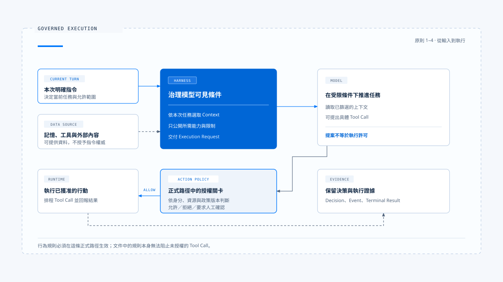
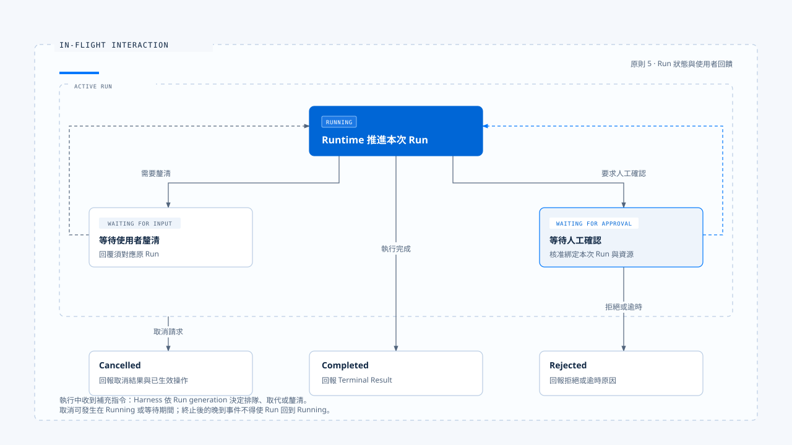

# Agent Harness 設計原則

[English](./04-design-principles.md) | [繁體中文](./04-design-principles-zh-TW.md)

> 你也許遇過這場景，使用者要求「只修改 README」，Agent 卻順手調整了設定檔。檢查 Prompt，裡面明明寫著遵守範圍；檢查工具，寫檔功能也正常。

**其實問題出在系統沒有把這次任務的範圍，轉成執行工具前必須通過的條件。模型讀過一句規則，與產品能阻止一次越界操作，兩者之間還有一段工程工作。**

[前篇](./03-harness-runtime-boundary-zh-TW.md) 說明 Harness 與 Runtime 如何交接。

**本篇進一步討論設計時的取捨：哪些事情適合交給模型判斷，哪些條件應由程式檢查，使用者介入之後又該如何改變執行。**
- 這些判斷來自 claude-code-best 的分析，以及 chat-gun 將相關能力接入應用的經驗；
- 文中的檔案修改、退款等情境用來解釋設計，不代表兩個專案都已實作全部場景。

## 讓每條規則找到執行位置

> 一條行為規則需要說明它改變什麼、在哪裡生效，以及失效時會發生什麼。以「本次只可修改 README」為例，Context 組裝器應保留這個要求，能力配置應限制無關工具，行動授權則應檢查實際目標路徑。模型負責理解文字需求；系統仍須在能檢查的地方執行約束。

- 圖中的路徑用來檢查設計責任。記憶和工具輸出可以補充事實，本次使用者指令則界定任務；兩者都仍受產品政策、身分與資源權限限制。「本次指令優先」適用於任務意圖的衝突，不能用來覆寫系統的安全邊界。

以下五項原則沿著這條路徑展開。每項都包含採用理由、實作落點與代價，方便讀者判斷它是否適合自己的產品。

## 1. 依當前任務選取上下文與能力

> 把整段歷史、全部記憶與所有工具一次交給模型，會增加選錯資料與誤用能力的機會。假設任務只是整理公開文件，卻同時開放帳務修改工具，後續授權層便得承擔一批原本可以避免的行動提案。Context 太多也會排擠真正需要的內容，例如使用者剛補充的限制或尚未處理的工具錯誤。

**我傾向先建立本次任務的 Context 與能力集合，再隨任務進展補入所需資料。選取時至少保留來源、權威與有效範圍；工具則依 Agent、模式、身分和資源條件提供。若任務需要擴大搜尋或增加能力，系統應有明確的取得方式，讓模型能說明缺少什麼，再經政策檢查後補入。**

- 在參考的庫中
  - claude-code-best 外層會準備 Prompt、Context 與工具條件，再交給 `query()`。
  - chat-gun 的 `context-integration.ts` 則把 Context 組裝接入不同 Agent，並保留各 Agent 的 Feature Flag。

這些實作顯示，模型可見內容的選擇有具體接點，可以從程式路徑核對。

- 代價在於選取失誤可能讓模型缺少完成任務的資料，因此「最小」應以足以完成任務為準。對探索性研究，較寬的讀取範圍有其用途；對退款或寫檔，則應縮小可操作資源。
- Token 預算耗盡時，仍須保留當前任務限制、待處理決策與必要工具結果，不能讓截斷順序替產品決定哪些規則可以消失。

## 2. 把任務指令與資料來源分清楚

> 記憶可能記著使用者偏好自動處理，但這次使用者明確要求「先給方案，確認後再執行」；搜尋頁面也可能夾帶「忽略先前限制」的文字。這兩種情況都要求系統保留來源差異。前者是舊偏好與本次意圖衝突，後者是外部資料試圖取得指令地位。

- 在產品政策允許的範圍內，讓本次明確指令優先於歷史偏好，並將檢索內容、檔案與工具輸出當作待解讀資料。
- Context 組裝時應標記來源與用途，不能因為把一段文字放進高權威訊息，就讓它取得改變權限或任務範圍的能力。
- 專案指令若屬產品認可的規則來源，也應經過載入與信任政策，不能只憑檔名取得權威。

chat-gun 的 Context 組裝將當前任務、歷史訊息、記憶與工具輸出分開處理，提供了這類治理的實作位置。身分與資源範圍還需要可信的 Execution Context；從文件、模型參數或一般請求內容讀到的帳號名稱，不能直接作為授權身分。

來源標記有助於模型理解，卻無法保證模型永遠不受惡意內容影響。因此，授權檢查仍須使用可信欄位，不能要求模型判定自己是否已受提示注入，再以它的回答決定能否執行。代價是系統要維護來源中介資料與信任規則；省略這些資料後，後續再補 Prompt 通常也無法還原原先的權威關係。

## 3. 模型提出行動，系統決定執行權

> 模型提出 `FileEdit`，只能說明它認為這個操作有助於完成任務。系統還需要確認目標檔案、修改內容與目前政策是否允許。

**例如：退款工具得檢查操作人、訂單歸屬、金額與批准條件。因為工具出現在模型的能力清單，並未回答這一次呼叫能否執行。**

所以要把 **能力可見性** 與 **單次行動授權** 分成兩個接點：

- 前者減少無關提案
- 後者檢查實際 Tool Call

授權應在進入執行器前套用，必要時要求人工確認；批准要對應具體操作範圍。若等待期間參數、資源版本或政策改變，恢復執行前就得重新判定，不能把先前的「同意」擴張到新操作。

- 在參考的庫中
  - claude-code-best 由外層提供 `canUseTool`，工具執行路徑在呼叫前取得 Permission 決策；Interactive 與 Headless／SDK 可以用不同方式取得這個決策。
  - chat-gun 則在工具 Registry 組裝授權，並在 MCP Agent 的 Graph 中安排授權、確認與實際派送節點。

這些位置都可以用來檢查：模型提案到真正執行之間，是否經過治理。

- 人工確認會增加等待時間，過密的詢問也容易讓人習慣性同意。要依資源風險與既有授權決定是否詢問，讓確認介面呈現這次操作的範圍與後果。
- 讀取公開資料、修改工作區檔案與對外付款，適合不同的政策；產品應明確定義它們，避免把所有行動交給同一個確認視窗。
- 授權本身也有能力邊界。獲准執行的工具若能啟動任意程序或存取網路，仍需要相應的執行隔離與資源限制；一次授權通過，不能證明工具內部的所有行為都已受控。

## 4. 從正式入口驗證規則確實生效

> 一個獨立授權模組的測試全部通過，應用仍可能直接呼叫底層工具；Context 組裝器也可能只被某一個 Agent 使用，另一條路徑繼續沿用舊邏輯。檢查模組能做什麼之後，還得沿著使用者入口確認應用實際用了什麼。

建議優先追蹤一條能走到底的執行路徑：
1. 入口接收輸入
2. 組裝 Context
3. 模型提出工具呼叫
4. 授權後派送
5. 工具結果回到模型
6. 最後形成使用者可見結果

- 共用接點負責政策與契約，各 Agent 保留任務差異。新增入口或工具時，應驗證它經過相同的必要關卡，避免重新組裝一套略有差異的流程。

- 在參考的庫中
  - chat-gun 的 `tools/registry.ts` 說明了這個區別。Registry 會套用工具治理，但完整 Tool Dispatch Pipeline 是否建立，仍依來源對應的 Feature Flag 判斷；Context 組裝也有各 Agent 的開關。因此即便「模組存在」、「入口已接線」與「部署中已啟用」需要分別提出證據。程式裡存在預設值，也不足以證明某個環境的實際設定。

**驗證應選擇具體的繞過風險。例如從 MCP Agent 送出需要批准的呼叫，確認未批准前底層工具沒有被呼叫；再從 Headless 入口走同一案例，檢查語意是否一致。這類測試比只比對函式名稱更能發現問題。共用治理路徑會增加整合成本，也可能限制特殊工具的排程方式，因而仍需保留清楚的擴充介面。**

## 5. 執行中的使用者輸入必須有歸屬

> Agent 正在修改檔案時，使用者補了一句「先停，不要碰設定檔」。若系統只是把這段話附加到下一個 Prompt，原來的寫入可能早已開始；若直接啟動新 Run，舊 Run 又可能稍後回傳結果，覆蓋新任務的畫面。這是執行歸屬與狀態轉移問題，需要在收到輸入時就處理。

- 圖中的狀態是概念模型，各 Runtime 的實際名稱可能不同。等待批准的呼叫可以恢復，也可能因拒絕而結束；某項工具被拒絕後，Run 也可以依產品政策繼續產出不執行工具的答覆。
- 圖中的 `Rejected` 應理解為產品選擇終止的分支，不能套用成所有工具拒絕都必須終止整個 Run。

**建議讓 Harness 先判斷輸入是新任務、補充、取消，還是對某次等待的回覆，再決定排隊、取代、拒絕或恢復。**這個決策需要 Run identity、ownership，以及能區分新舊執行的 generation 或等效版本。原 Run 的歷史可以保留，舊事件卻不能取得新 Run 的控制權；終止後收到的證據也應追加記錄，而不把 Run 改回執行中。

- 在參考的庫中
  - chat-gun 的 Interaction Runtime 與 Query Guard 提供了 ownership、generation、取消及釐清恢復的接點。排隊則需要額外辨認：目前讀到的 `enqueue` 分支會拒絕本地派送並回報需要 native queue ownership，不能據此宣稱已建立可用的本地持久佇列。

- 以 chat-gun 這套控制需要具備狀態持久化、競態處理與額外互動的成本。
- 純問答產品可以採較簡單的「忙碌時拒絕新輸入」策略
- 能修改外部資源的 Agent，則需要說清楚取消發生在哪個階段；已寫入的檔案或已提交的交易，須另行判斷能否修正或補償，取消訊號本身不會撤銷這些效果。

## 失敗處理也要受同一組原則約束

> 讀檔找不到、權限拒絕、模型連線中斷與付款逾時，適合不同的處理方式。讀檔失敗可能讓模型選擇另一條已獲准的路徑；授權遭拒後，系統應維持拒絕，不能透過重試或換用 Shell 取得相同效果；有副作用的呼叫逾時，則必須保留結果未知的可能。

- 在參考的庫中
  - claude-code-best 會將多類工具錯誤轉成 `tool_result` 回灌模型，讓模型有機會修正提案。這提供了恢復對話推理的途徑，但模型再次提案仍須通過授權；也能由此推論每個工具都有自動重試、冪等性或外部狀態回查。
  - chat-gun 的 Tool Dispatch、retry budget 與 side-effect ledger，則提供將這些問題放進執行契約的接點。

**建議為模型迴圈與工具重試分別設定預算，並指定由哪一層負責重試。否則模型改提案、工具 Adapter 重送、Runtime 自動恢復可能疊加，超過原本預期的嘗試次數。當外部效果不明時，應先回查或交由人工處理；需要補償的操作，也得經過補償政策與授權。**

Runtime 狀態、產品任務狀態與外部效果各有權威來源。Harness 可以要求取消，卻不能為了讓畫面一致，就自行宣布外部操作未發生。這些責任沿用 [Harness／Runtime 邊界](./03-harness-runtime-boundary-zh-TW.md) 的劃分，避免產品在執行核心之外再維護一套互相競爭的狀態。

## 用證據檢查設計判斷

審閱 Harness 時，我會選一個成功案例和一個會被阻擋的案例，沿著相同入口核對。成功案例說明條件如何傳遞，阻擋案例則能顯示規則是否真的改變了執行。

| 要檢查的判斷 | 適合保留的證據 |
|---|---|
| 本次任務控制了範圍 | 正規化輸入、Context 來源、所選能力與限制 |
| 執行前檢查了具體行動 | 工具呼叫、資源範圍、授權結果與政策版本 |
| 批准對應正確操作 | 批准紀錄、呼叫識別、參數版本與有效條件 |
| 新輸入沒有被舊 Run 覆蓋 | Ownership、generation、互動決策與事件關聯 |
| 結束訊息符合實際結果 | Runtime 結束結果、工具結果與外部效果證據 |

這些資料需要能串回同一次執行，但不必把所有原始內容寫進 Log。檔案全文、個人資料與憑證應依資料政策處理，可以使用經遮罩的欄位、雜湊或受控參照。重現決策需要足夠的來源與版本，逐字重跑模型卻未必會得到相同輸出；兩者應分開驗證。

對本篇採取的設計立場，最直接的檢查是：模型提出一個越界操作後，系統能否在指定接點阻止它，留下原因，並向使用者交代後續結果。這也是下一篇 [一次任務的完整走法](./05-one-turn-walkthrough.md) 採用檔案修改案例的原因。

## 實作參照與適用範圍

[claude-code-best](https://github.com/claude-code-best/claude-code) 部分取自分析用復刻程式碼樣本，用來觀察責任與控制流程，不代表官方現行版本的完整行為。

| 參照 | 可核對的落點 |
|---|---|
| 輸入與執行條件 | `src/utils/processUserInput/processUserInput.ts`、`src/query.ts` 的 `QueryParams` |
| Interactive 與 SDK 入口 | `src/screens/REPL.tsx`、`src/QueryEngine.ts` |
| 工具授權與錯誤回傳 | `src/services/tools/toolExecution.ts`、`src/services/tools/toolOrchestration.ts` |
| 檔案修改前置檢查 | `packages/builtin-tools/src/tools/FileEditTool/FileEditTool.ts` |

[chat-gun](https://github.com/HsienW/chat-gun) 部分以本篇核對的程式接點為範圍，實際啟用條件與部署結果仍需對應環境的證據。

| 參照 | 可核對的落點 |
|---|---|
| Context 組裝與 Feature Flag | `backend/src/agents/context-integration.ts` |
| 工具治理與 Pipeline 開關 | `backend/src/tools/registry.ts`、`backend/src/tools/authorization/tool-authorization.ts` |
| Graph 授權與派送 | `backend/src/agents/mcp-agent.ts`、`backend/src/runtime/authorization/confirmation-graph.ts` |
| 輸入歸屬與取消 | `backend/src/platform/interaction-runtime.ts`、`backend/src/runtime/input/query-guard.ts` |
| 重試與效果證據 | `backend/src/runtime/tool-dispatch/pipeline.ts`、`backend/src/runtime/side-effect/business-effect-ledger.ts` |

原始碼接線、開發環境測試與正式部署故障演練能支持的結論不同。例如 `current-langgraph-runtime-boundary.md` 中的開發模式中斷、重啟與恢復紀錄，有其明確驗證範圍；要主張正式部署的持久化、強制終止恢復或外部效果不重複，還需要相應的部署與故障證據。本篇沒有重新執行這些驗證。

## 延伸閱讀

- [實際落地的 Agent Harness 是什麼](./01-what-is-agent-harness-zh-TW.md)
- [Harness 的控制層](./02-control-surfaces-zh-TW.md)
- [Harness 與 Runtime 的邊界](./03-harness-runtime-boundary-zh-TW.md)
- [一次任務的完整走法](./05-one-turn-walkthrough.md)
