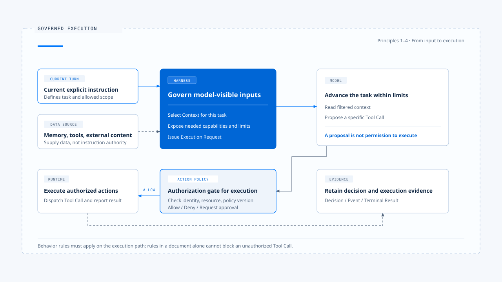
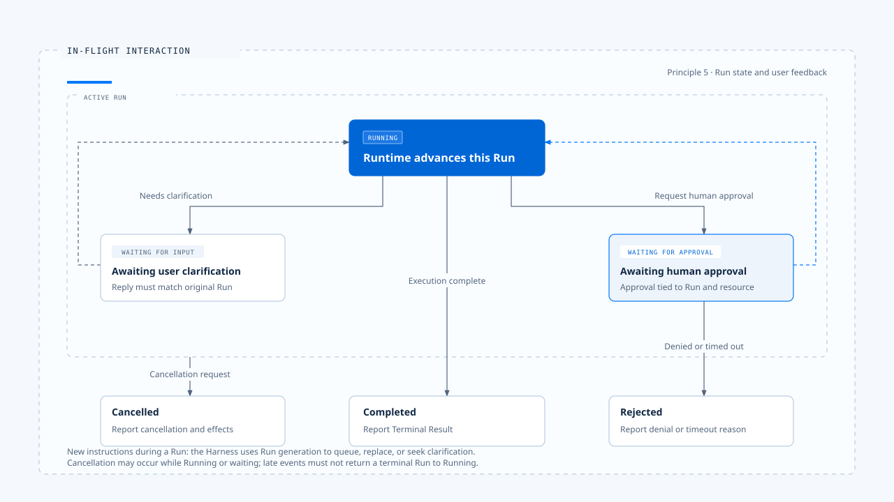

# Agent Harness design principles

[English](./04-design-principles.md) | [繁體中文](./04-design-principles-zh-TW.md)

> You may have encountered this scenario: a user asks the Agent to "modify only the README," but it also adjusts a configuration file. You check the Prompt, which clearly says to stay within scope; you check the tool, and its file-writing function works as expected.

**The problem is that the system has not turned the scope of this task into a condition that must pass before tool execution. There is still engineering work between a model reading a rule and a product being able to block an out-of-scope operation.**

[The previous article](./03-harness-runtime-boundary-zh-TW.md) explains how the Harness and Runtime hand off responsibility.

**This article examines the design tradeoffs: which decisions to leave to the model, which conditions code should check, and how user intervention should change execution.**

- These judgments draw on an analysis of claude-code-best and the experience of integrating related capabilities into chat-gun;
- The file-editing, refund, and other scenarios explain the design. They do not imply that both projects have implemented every scenario.

## Give each rule a place in execution

> A behavioral rule needs to specify what it changes, where it takes effect, and what happens if enforcement fails. For "only the README may be modified in this task," the Context assembler should preserve the requirement, capability configuration should restrict unrelated tools, and action authorization should check the actual target path. The model interprets the written request; the system must still enforce constraints wherever it can check them.

- Use the path in the diagram to check design responsibilities. Memory and tool output can supply facts, while the current user instructions define the task; both remain subject to product policy, identity, and resource permissions. "Current instructions take precedence" applies to conflicts over task intent. It cannot override the system's security boundaries.

The following five principles follow this path. Each includes its rationale, implementation points, and costs so readers can judge whether it fits their product.

## 1. Select Context and capabilities for the current task

> Giving the model the entire history, all memory, and every tool at once increases the chance that it will select the wrong information or misuse a capability. If the task only involves organizing public documents but account-modification tools are also available, the authorization layer must handle action proposals that could have been avoided. Too much Context can also crowd out information the task needs, such as a constraint the user just added or a tool error that remains unresolved.

**I prefer to assemble the Context and capability set for the current task first, then add information as the task progresses. Selection should preserve at least the source, authority, and scope of validity; tools should be made available according to the Agent, mode, identity, and resource conditions. If the task requires a broader search or additional capabilities, the system should provide an explicit way to obtain them: the model can explain what is missing, and the system can add it after a policy check.**

- In the reference repositories
  - The outer layer of claude-code-best prepares the Prompt, Context, and tool conditions before passing them to `query()`.
  - In chat-gun, `context-integration.ts` connects Context assembly to different Agents while retaining each Agent's Feature Flag.

These implementations provide concrete integration points for selecting what the model can see, which can be checked against the code path.

- The cost is that a selection error may leave the model without information it needs to finish the task, so "minimal" should mean sufficient to complete it. A broader read scope can be useful for exploratory research; refunds and file writes call for a narrower set of resources the Agent may act on.
- If the Token budget runs out, the system must still preserve current task constraints, pending decisions, and necessary tool results. Truncation order must not decide which product rules can disappear.

## 2. Distinguish task instructions from data sources

> Memory may record that the user prefers automatic handling, while the current request explicitly says, "give me a plan first, then execute after confirmation." A search page may also contain text saying, "ignore previous restrictions." Both cases require the system to preserve the distinction between sources. The first is a conflict between an old preference and current intent; the second is external data trying to gain the status of an instruction.

- Within product policy, give current explicit instructions precedence over historical preferences, and treat retrieved content, files, and tool output as data to interpret.
- Context assembly should label each source and its purpose. Placing text in a message with higher authority must not grant it the power to change permissions or task scope.
- If the product recognizes project instructions as a source of rules, those instructions must still pass through loading and trust policies. A filename alone must not confer authority.

chat-gun handles the current task, historical messages, memory, and tool output separately during Context assembly, providing an implementation point for this governance. Identity and resource scope also require a trusted Execution Context; an account name read from a document, model parameter, or ordinary request content cannot serve directly as the identity used for authorization.

Source labels help the model interpret content, but cannot guarantee that malicious content will never influence it. Authorization checks must therefore use trusted fields. The system cannot ask the model whether it has been affected by prompt injection and use its answer to decide whether execution may proceed. The cost is maintaining source metadata and trust rules; once that information is omitted, adding more Prompt text usually cannot reconstruct the original authority relationships.

## 3. Let the model propose actions and the system decide execution authority

> When the model proposes `FileEdit`, it only indicates that it considers the operation useful for completing the task. The system must still check whether the target file, proposed changes, and current policy permit it.

**For example, a refund tool must check the operator, order ownership, amount, and approval conditions. The tool's presence in the model's capability list does not answer whether this particular call may execute.**

This requires two separate integration points for **capability visibility** and **authorization of individual actions**:

- The former reduces irrelevant proposals
- The latter checks the actual Tool Call

Apply authorization before the call reaches the executor, and require human confirmation when necessary; approval must correspond to a specific scope of operation. If parameters, resource versions, or policy change while execution waits, reassess before resuming. Do not extend a previous approval to a new operation.

- In the reference repositories
  - The outer layer of claude-code-best supplies `canUseTool`, and the tool execution path obtains a Permission decision before the call. Interactive and Headless/SDK entry points can obtain that decision in different ways.
  - chat-gun assembles authorization in its tool Registry and places authorization, confirmation, and dispatch nodes in the MCP Agent's Graph.

These points allow reviewers to check whether governance applies between the model's proposal and actual execution.

- Human confirmation adds waiting time, and frequent prompts can lead to habitual approval. Decide whether to ask based on resource risk and existing authorization, and make the confirmation interface show the scope and consequences of this operation.
- Reading public data, modifying workspace files, and making external payments call for different policies. The product should define them explicitly rather than route every action through the same confirmation dialog.
- Authorization itself has limits. If an approved tool can launch arbitrary processes or access the network, it still needs appropriate execution isolation and resource limits; passing one authorization check does not prove that all behavior inside the tool is controlled.

## 4. Verify enforcement through the actual entry points

> Every test for a standalone authorization module may pass while the application still calls the underlying tool directly. A Context assembler may serve only one Agent while another path continues to use the old logic. After checking what a module can do, trace the user entry point to confirm what the application actually uses.

Start by tracing one execution path from beginning to end:

1. The entry point receives input
2. The system assembles Context
3. The model proposes a tool call
4. The system dispatches it after authorization
5. The tool result returns to the model
6. Execution produces a user-visible result

- Shared integration points handle policy and contracts, while each Agent retains its task-specific behavior. When adding an entry point or tool, verify that it passes through the same required gates to avoid assembling another flow with slight differences.

- In the reference repositories
  - chat-gun's `tools/registry.ts` illustrates this distinction. The Registry applies tool governance, but whether it builds the full Tool Dispatch Pipeline depends on the Feature Flag for the corresponding source; Context assembly also has switches for each Agent. Thus, "the module exists," "the entry point is wired," and "it is enabled in deployment" each need separate evidence. A default value in the code is also insufficient to prove the actual configuration of a particular environment.

**Choose a concrete bypass risk to verify. For example, submit a call requiring approval through the MCP Agent and confirm that the underlying tool is not called before approval; then run the same case through the Headless entry point and check that the semantics agree. These tests are more likely to uncover problems than checks that only match function names. A shared governance path adds integration cost and may constrain scheduling for specialized tools, so it still needs clear extension interfaces.**

## 5. Assign user input received during execution to the right Run

> While the Agent is modifying files, the user adds, "stop for now; do not touch configuration files." If the system only appends this text to the next Prompt, the original write may already have started. If it starts a new Run instead, the old Run may return a result later and overwrite the new task's display. This is a problem of execution ownership and state transitions, which the system must address when the input arrives.

- The states in the diagram form a conceptual model; their actual names may differ across Runtimes. A call waiting for approval may resume or end after rejection; when a tool is denied, the Run may also continue with a response that does not execute the tool, according to product policy.
- Interpret `Rejected` in the diagram as a branch where the product chooses to terminate. It does not mean that every tool denial must terminate the entire Run.

**The Harness should first determine whether the input is a new task, additional information, cancellation, or a response to a particular waiting interaction, then decide whether to queue, replace, reject, or resume.** This decision requires Run identity, ownership, and a generation or equivalent version that distinguishes old execution from new execution. The original Run's history can remain, but old events must not gain control of the new Run; evidence received after termination should also be appended to the record without returning the Run to the running state.

- In the reference repositories
  - chat-gun's Interaction Runtime and Query Guard provide integration points for ownership, generation, cancellation, and resumption after clarification. Queuing requires a separate distinction: the `enqueue` branch examined here rejects local dispatch and reports that native queue ownership is required. It does not establish that a usable local persistent queue exists.

- A control scheme like chat-gun's incurs the cost of state persistence, race handling, and additional interactions.
- A product limited to question answering can adopt the simpler policy of rejecting new input while busy
- An Agent that can modify external resources must specify the stage at which cancellation takes effect. For files already written or transactions already committed, the system must separately determine whether correction or compensation is possible; the cancellation signal itself does not undo those effects.

## Apply the same principles to failure handling

> A missing file, denied permission, interrupted model connection, and payment timeout call for different responses. A failed file read may let the model choose another authorized path; after an authorization denial, the system should uphold the denial rather than obtain the same effect through retries or Shell. A timeout on a call with side effects must preserve the possibility that the outcome is unknown.

- In the reference repositories
  - claude-code-best converts several categories of tool errors into `tool_result` and feeds them back to the model so it can revise its proposal. This provides a way to resume conversational reasoning, but any new model proposal must still pass authorization; it also supports inferring that every tool has automatic retries, idempotency, or external state queries.
  - chat-gun's Tool Dispatch, retry budget, and side-effect ledger provide integration points for incorporating these concerns into the execution contract.

**Set separate budgets for the model loop and tool retries, and specify which layer owns retries. Otherwise, revised model proposals, resubmissions by the Tool Adapter, and automatic Runtime recovery may compound and exceed the intended number of attempts. If external effects are uncertain, query their status first or refer the case to a human; operations requiring compensation must also pass through compensation policy and authorization.**

Runtime state, product task state, and external effects each have their own authoritative source. The Harness can request cancellation, but cannot declare that an external operation did not happen just to keep the display consistent. These responsibilities follow the division in [the Harness/Runtime boundary](./03-harness-runtime-boundary-zh-TW.md), so the product does not maintain a competing set of states outside the execution core.

## Use evidence to check design judgments

When reviewing a Harness, I choose one successful case and one case that should be blocked, then check both through the same entry point. The successful case shows how conditions propagate; the blocked case shows whether the rules actually change execution.

| Judgment to check | Evidence to retain |
|---|---|
| The current task controlled scope | Normalized input, Context sources, selected capabilities, and constraints |
| The system checked the concrete action before execution | Tool call, resource scope, authorization result, and policy version |
| Approval corresponded to the correct operation | Approval record, call identifier, parameter version, and validity conditions |
| An old Run did not overwrite new input | Ownership, generation, interaction decisions, and event correlation |
| The completion message matched the actual outcome | Runtime terminal outcome, tool results, and evidence of external effects |

These records need to correlate to the same execution, but not every raw detail needs to go into the Log. Handle full file contents, personal data, and credentials according to data policy; masked fields, hashes, or controlled references may suffice. Reconstructing a decision requires sufficient source and version information, while replaying the model verbatim may not produce the same output. Verify these two things separately.

The most direct test of the design position in this article is whether, after the model proposes an out-of-scope operation, the system can block it at the designated integration point, record the reason, and explain the subsequent outcome to the user. This is also why the next article, [a complete task walkthrough](./05-one-turn-walkthrough.md), uses a file-editing example.

## Implementation references and scope

[claude-code-best](https://github.com/claude-code-best/claude-code) discussion draws on a reconstructed code sample used for analysis. It helps examine responsibilities and control flow, and does not represent the complete behavior of the current official version.

| Reference | Implementation points to inspect |
|---|---|
| Input and execution conditions | `src/utils/processUserInput/processUserInput.ts`, `QueryParams` in `src/query.ts` |
| Interactive and SDK entry points | `src/screens/REPL.tsx`, `src/QueryEngine.ts` |
| Tool authorization and error return | `src/services/tools/toolExecution.ts`, `src/services/tools/toolOrchestration.ts` |
| Preflight checks for file edits | `packages/builtin-tools/src/tools/FileEditTool/FileEditTool.ts` |

[chat-gun](https://github.com/HsienW/chat-gun) discussion is limited to the code integration points checked for this article. Actual enablement conditions and deployment results still require evidence from the corresponding environment.

| Reference | Implementation points to inspect |
|---|---|
| Context assembly and Feature Flags | `backend/src/agents/context-integration.ts` |
| Tool governance and Pipeline switches | `backend/src/tools/registry.ts`, `backend/src/tools/authorization/tool-authorization.ts` |
| Graph authorization and dispatch | `backend/src/agents/mcp-agent.ts`, `backend/src/runtime/authorization/confirmation-graph.ts` |
| Input ownership and cancellation | `backend/src/platform/interaction-runtime.ts`, `backend/src/runtime/input/query-guard.ts` |
| Retries and effect evidence | `backend/src/runtime/tool-dispatch/pipeline.ts`, `backend/src/runtime/side-effect/business-effect-ledger.ts` |

Source-code wiring, development-environment tests, and fault drills in production support different conclusions. For example, the development-mode interruption, restart, and recovery records in `current-langgraph-runtime-boundary.md` have a defined scope of verification; claims about persistence in production, recovery after forced termination, or avoiding duplicate external effects require corresponding deployment and failure evidence. This article has not rerun those checks.

## Further reading

- [What an Agent Harness looks like in practice](./01-what-is-agent-harness-zh-TW.md)
- [Harness control surfaces](./02-control-surfaces-zh-TW.md)
- [The Harness/Runtime boundary](./03-harness-runtime-boundary-zh-TW.md)
- [A complete task walkthrough](./05-one-turn-walkthrough.md)
