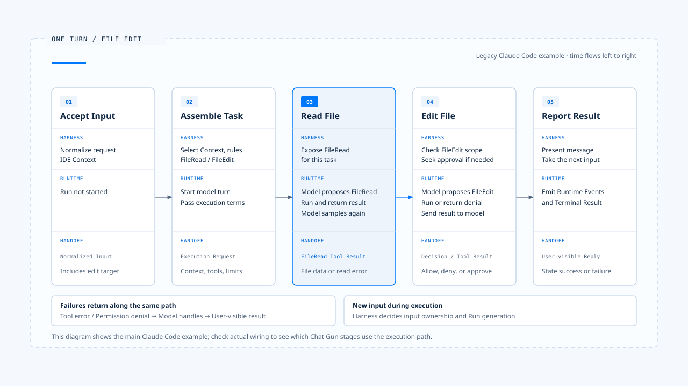

# 一次任务的完整走法

[English](./05-one-turn-walkthrough.md) | [繁體中文](./05-one-turn-walkthrough-zh-TW.md) | [简体中文](./05-one-turn-walkthrough-zh-CN.md)

[前篇](./04-design-principles-zh-CN.md) 说明任务范围、授权、用户介入与故障处理的设计取舍。

用户要求修改一个文件，画面上可能只有一段指令和一则完成回复。两者之间只少有这几步骤：

1. 系统需要辨识输入
2. 挑选上下文
3. 让模型读文件
4. 检查修改权限
5. 执行写入
6. 再确认结果

任一环节出错，都会改变这次任务最后能向用户承诺什麽。

本篇沿着一个文件修改情境，说明 [Harness 的控制层](./02-control-surfaces-zh-CN.md) 与 [Harness／Runtime 边界](./03-harness-runtime-boundary-zh-CN.md) 如何在同一次执行中配合。

- 主流程参照 claude-code-best；需要更强业务保证的地方。
- 对照 Chat Gun 的治理与执行接点；案例中的文件名、指令与回复是教学用设置，没有实际执行这次文件修改。

## 场景与「一次」的范围

假设用户在一个工作区送出以下要求：

「请把 README 的安装方式改成使用 pnpm，只改安装章节，不要调整其他文件。」

- 这里的一次任务，指系统承接这项要求，直到回报完成、失败或取消的产品流程。期间可能有多次模型调用，也可能等待用户批准；一次模型回应结束，未必代表整项任务结束。
- 不同 Runtime 对 `turn`、`run` 的命名各有差异，等待与恢复也可能分属不同 Run，产品需要保留它们与原任务的关联。

本例先假定产品已辨认工作区与操作身份，没有另一项正在竞争写入权的任务；`FileRead`、`FileEdit` 表示工具职责，实际名称依实现而异。用户的要求提供任务意图，执行时仍须遵守产品政策及文件权限。

- 图中把流程整理成五个阶段。Runtime 可能在读文件、模型推理与工具执行之间往返多次；下文再展开其中的授权、失败与完成判定。
- 图上的 `Execution Request`、`Terminal Result` 是本知识库用来说明责任的概念契约，不能据此推论分析样本使用完全相同的型别名称或持久化模型。

## 1. 接收输入，确认这次要做什麽

- Harness 先辨识这是一项新任务，并把文字、附件、IDE 选取范围及工作区信息整理成可供执行的输入。
- 规范化时要保留「只改安装章节」和「不要调整其他文件」；这些条件会影响后续能力与授权，不能因为摘要文字就被省略。

在 claude-code-best 中，`processUserInput` 会处理消息、命令与附件，并返回是否需要进入查询。某些本地命令在这里就会完成，不必启动模型。一般任务则继续进入 Context 与执行条件组装。

产品还要为后续事件保留关联身份。可以使用 Request、Task、Run 与工具调用的识别，实际字段由系统决定；可信的用户与工作区范围应来自受信任的入口。若输入无效、附件读取失败或目标工作区不明，Harness 应在派送前回报，避免启动一项已经缺少必要条件的任务。

## 2. 组装 Context，交付执行条件

- Harness 选入本次指令、适用的项目规则、必要历史与工作区信息，再提供完成任务所需的工具。
- 本例可能需要读文件与编辑能力；是否提供目录搜索或验证命令，要看产品政策与任务需要。工具清单只是可提案的能力集合，修改权限还会在具体调用时检查。

若历史偏好记着「修改后顺手格式化全项目」，本次指令已限制范围，Harness 应保留这个冲突的优先关系。README 或外部内容中出现的新命令也只是数据，不能自行扩大操作范围。Context 的来源、用途与权威处理，可参照 [设计原则](./04-design-principles-zh-CN.md)。

分析样本中，Interactive 由 REPL 路径准备条件后调用 `query()`；Headless／SDK 则经 `QueryEngine` 调用同一个核心。交付内容包括消息、System Prompt、Context、工具执行 Context，以及 `canUseTool` 等决策接口。两个入口的输出与批准方式可以不同，执行中的授权责任仍然存在。

这次交接之后，Runtime 接手模型与工具循环。时间、Token、模型回合与重试预算也应在相应执行设置中有明确限制；本文不假定分析样本已用单一契约实现所有限制。

## 3. 模型提出读文件，Runtime 返回工具结果

### 读文件调用与结果关联

模型先提出读取 README 的 Tool Call。Runtime 解析工具名称与参数，通过适用的检查后执行读取，再把结果关联到这次调用。结果可能是文件内容，也可能是找不到文件、权限不足或内容超出可读范围等错误。

- 读取限制: 读取也受资源范围约束。`FileRead` 虽不修改数据，若目标路径检查有缺口，仍可能读到工作区外的敏感内容。
- 建议读取方式: 先读后改，让模型依文件现况提出修改，也让编辑工具检查写入时所依据的内容是否仍有效。

claude-code-best 会把工具结果组成对应 `tool_use_id` 的 `tool_result`，错误可带有 `is_error`。Runtime 将结果放回对话后，模型才有下一次推理的依据。此时若用户看见「已读取 README」，那只是进度信息，还不能据此判定修改完成。

### 读文件失败后

若找不到 README，模型可以在既有能力与授权范围内提出搜索，也可以回复无法定位文件。Runtime 不能把失败读取当成文件内容交给模型；搜索与重试也须受执行预算限制。

## 4. 模型形成修改提案，Harness 判断能否执行

### 审核这次修改

取得文件内容后，模型提出 `FileEdit`，例如以新的 pnpm 指令替换安装章节中的旧文字。Runtime 将具体目标与参数送进治理路径，由 Harness 判断操作身份、文件范围、风险与既有授权。授权不足时，系统可以拒绝这次操作，或请求人工确认。

分析样本的工具执行路径会取得 `canUseTool` 相关决策。Interactive 可以显示修改差异供用户确认；Headless／SDK 则由对应 host 或政策提供决策。Runtime 在需要批准时等待结果，收到批准后仍须核对这次调用是否落在原批准范围内。

### 章节限制与批准纪录

「只改安装章节」包含两层限制：

- 文件范围可以从目标路径检查，确认写入是否指向 README。
- 章节范围还需要可检查的区段、差异规则或人工审阅。取得 README 的写入权，尚不能证明修改被限制在安装章节。

模型应遵守用户的语意要求；产品若宣称能强制执行章节限制，仍须提供对应的检查。Harness 也要保留 Tool Call、授权结果与必要的决策依据。模型声称「已取得同意」不能代替批准纪录；用户若明确拒绝，Runtime 也不能让模型换一个工具完成同一项被拒操作。

## 5. 执行修改，检查内容是否仍可写入

### 写入前的内容检查

授权通过后，Runtime 才能派送获准的操作。编辑工具仍须检查原文字是否存在、是否有多个匹配，以及文件在读取后有没有变更。这些条件决定修改能否正确套用；授权结果不能代替内容检查。

claude-code-best 的 `FileEditTool` 会验证替换内容，并利用读文件状态等数据检查过时写入。若用户或格式化工具刚改过 README，Agent 应重新读取、形成新提案，必要时重新取得授权；先前显示的差异不能直接套用到更新后的文件。

### 修改结果与验证

工具把修改结果或错误交回 Runtime，模型再依结果继续。工具成功返回可以支持「这次写入已完成」；是否还要读文件或检查差异，取决于工具结果提供多少证据，以及尚有哪些风险。能确认修改范围的收据，与只有一句成功文字的返回，支持的结论并不相同。

本例只更换 README 中的安装指令，应核对变更范围与内容。若没有实际执行安装，回复就不能宣称 pnpm 安装已验证成功；若要执行验证，该操作也须符合任务范围与执行政策。

## 6. 再次推理，直到能交代结果

### 结果回灌后的分流

模型收到修改结果后，可能直接回复，也可能补充读取或处理失败。Runtime 继续管理模型与工具往返；每当模型提出新的 Tool Call，系统都要按该次操作重新检查。前一项工具获准，不会让后续调用自动取得相同权限。

两种失败应分开处理：

- 原文匹配失败时，可以重新读文件，再依目前内容修正提案。
- 权限遭拒时，应保留拒绝结果，依产品政策询问用户、提供建议或结束；不能把拒绝当成可透过重试绕过的工具错误。

分析样本会将错误回灌给模型，使它能理解失败原因；下一步能采取哪些行动，仍由系统限制。

### 重试与未明副作用

模型连接重试、工具自动重试与模型重新提案，分属不同层次。工具超时若可能已写入文件，应先回查文件状态；付款等操作还需要外部幂等键、状态回查或人工仲裁。恢复对话后即使记得曾调用工具，也不能据此判定外部操作是否完成。

## 7. 结束执行，让回复符合证据

### 结束状态与完成回复

Runtime 到达结束条件后，外层 Harness 整理结果并呈现给用户。前篇以 `Terminal Result` 称呼这份结束信息；实现中可能对应 SDK result、查询结束返回值或原生 Run 状态。产品须知道它对应哪一份执行权威，不能只凭模型最后一句话判定成功。

任务完成时，回复应交代修改内容与验证程度。例如：「已将 README 安装章节改为 pnpm 指令，检查过本次差异；未实际执行安装。」每一项陈述都要有工具结果或检查证据；若要说「没有修改其他文件」，还须有足够的变更范围证据。

### 取消或结果不明

任务取消时，Harness 应回报取消前哪些操作已生效；工具结果不明时，则须保留未知状态并说明后续处理。模型与工具对话、Runtime 结束结果及外部资源状态，应能透过关联识别串起来。敏感内容依数据政策遮罩或只保存参照，避免为追踪任务而将整份数据复制进 Log。

## 执行中再收到一句话

### 新输入要归属到哪次执行

上述流程可能在任何阶段收到新输入。例如写入前，用户补充「指令也要保留 npm 范例」；Harness 要先判断这是否修订原任务，再依目前阶段处理。只把这句话加入对话历史，无法处理已排定的旧操作。

| 新输入与时机 | Harness 的决策 | Runtime 与结果处理 |
|---|---|---|
| 等待确认时回答「同意」 | 核对等待识别、操作范围、身份与有效条件 | 通过后恢复指定操作；内容变更时重新判定 |
| 读文件后补充新条件 | 决定并入、取代、排队或拒绝，保留任务关联 | 依受支持策略继续或启动替代执行 |
| 写入前要求取消 | 确认取消目标与是否仍能阻止派送 | 传递取消信号，回报可确认的停止结果 |
| 写入后要求取消 | 决定是否另启修正流程 | 保留已写入事实，不宣称文件自动还原 |
| 新 Run 启动后旧 Run 返回 | 以 ownership 与 generation 判定显示归属 | 保存历史证据，避免覆盖新 Run 状态 |

表中的处理方式要依产品能力选择。系统若只支持忙碌时拒绝，应明确回报；若要排队，还须有机制持有待执行工作，并负责恢复派送。取消与工具提交之间可能发生竞态，因此「取消请求已收到」与「已确认停止且没有产生效果」必须使用不同的状态与文案。

## 失败从哪里回来

下表把失败放回任务时间线，标出各自改变流程的位置。其中有些工具错误可以修复，有些执行问题则须停止；实现仍应返回可判读的结果型别，避免让下游依错误文案猜测。

| 失败位置 | 适合的返回路径 | 用户最后应知道的事 |
|---|---|---|
| 输入或 Context 无效 | Harness 在派送前拒绝，或要求补充 | 尚未开始哪些工作、缺少什麽条件 |
| 模型调用失败 | Runtime 依模型重试预算处理，耗尽后回报 | 任务未完成，是否已有工具产生效果 |
| 读文件或修改前置检查失败 | 工具错误回到 Runtime，再按契约提供给模型 | 无法读取、内容冲突或未完成修改的原因 |
| 行动被拒绝 | 决策回到 Runtime，维持拒绝语意 | 哪项操作未执行，是否还有可提供的结果 |
| 外部提交结果未知 | 进入回查、对账或人工处理 | 状态尚未确认，以及正在采取的处理方式 |
| 程序中断 | 由持久化与恢复机制重建状态，核对未明效果 | 恢复到哪个阶段、哪些结果仍待确认 |

工具错误回灌只处理其中一类失败。授权拒绝、执行预算耗尽与外部效果未明，都要由系统保留对应的控制状态；模型再生成一段流畅文字，也不能将这些任务改判为成功。

## 对照 Chat Gun 的落地接点

- 文件修改主案例来自 [chat-gun](https://github.com/HsienW/chat-gun)。
- Chat Gun 使用的工具与 Graph 不同，下表只对照各阶段的责任接点；它没有证明 Chat Gun 已具备本文的 README 修改场景，也不能推论每个 Graph 都走相同工具路径。

| 流程责任 | 本篇核对到的 Chat Gun 接点 | 判读范围 |
|---|---|---|
| 辨识输入种类 | `runtime/input/normalized-agent-input.ts`、`read-normalized-agent-input.ts` | 定义 prompt、cancel、clarification resume 与 command；支持型别仍须对照消费入口 |
| 判断执行归属 | `platform/interaction-runtime.ts`、`runtime/input/query-guard.ts` | 有 ownership、generation、取消与恢复控制；enqueue 分支要求 native queue ownership |
| 选取 Context | `agents/context-integration.ts` | 接入 Agent 的组装流程，受各 Agent Feature Flag 控制 |
| 工具治理与派送组装 | `tools/registry.ts` | 工具会套用治理；完整 Dispatch Pipeline 依来源开关选择建立 |
| 等待批准后派送 | `agents/mcp-agent.ts`、`runtime/authorization/confirmation-graph.ts` | 可追踪模型提案、授权、确认与 physical dispatch 的 Graph 接线 |
| 重试与副作用证据 | `runtime/tool-dispatch/pipeline.ts`、`runtime/side-effect/business-effect-ledger.ts` | 可核对契约与组装；实际使用情况仍依入口、开关、工具与储存设置确认 |
| 回报结果与关联证据 | `operations/execution-composition-root.ts` | 组装输入、派送、恢复、输出验证与证据；不能由此推论所有用户入口均经过它 |

### 这些接点能证明什麽

表内路径皆以 `backend/src/` 为起点，列出本文从源代码确认的接点。测试、Feature Flag 与部署证据仍须对应到实际入口；共用模组具备某项能力，不等于整个产品都已使用它。

Chat Gun 的 `docs/decisions/current-langgraph-runtime-boundary.md` 记录过开发模式的中断、正常重启与恢复，也将这些证据与正式部署验证分开。若要主张强制终止后不遗失状态、批准可跨部署恢复，或副作用不重复，还须指定部署环境与故障时间点进行实测。本文没有重新执行部署演练。

## 实现参照与接续阅读

### 参考库路径

[claude-code-best](https://github.com/claude-code-best/claude-code) 不能视为官方现行实现。若要核对本文的文件修改路径，可依下表阅读源代码；具体行号会随版本变动。

| 阶段 | claude-code-best 中的位置 |
|---|---|
| 输入处理 | `src/utils/processUserInput/processUserInput.ts` |
| 外层组装与结果消费 | `src/screens/REPL.tsx`、`src/QueryEngine.ts` |
| 模型与工具循环 | `src/query.ts` |
| 工具调度、授权与错误结果 | `src/services/tools/toolOrchestration.ts`、`src/services/tools/toolExecution.ts` |
| 读取与修改的工具契约 | `packages/builtin-tools/src/tools/FileReadTool/FileReadTool.ts`、`packages/builtin-tools/src/tools/FileEditTool/FileEditTool.ts` |

核对各接点时，可以逐次记下模型拿到的数据、系统允许的操作，以及工具实际返回的结果。将三者对照，才能判断最后的完成回复有没有足够依据。

### 接续阅读

- [实际落地的 Agent Harness 是什麽](./01-what-is-agent-harness-zh-CN.md)
- [Harness 的控制层](./02-control-surfaces-zh-CN.md)
- [Harness 与 Runtime 的边界](./03-harness-runtime-boundary-zh-CN.md)
- [Agent Harness 设计原则](./04-design-principles-zh-CN.md)
