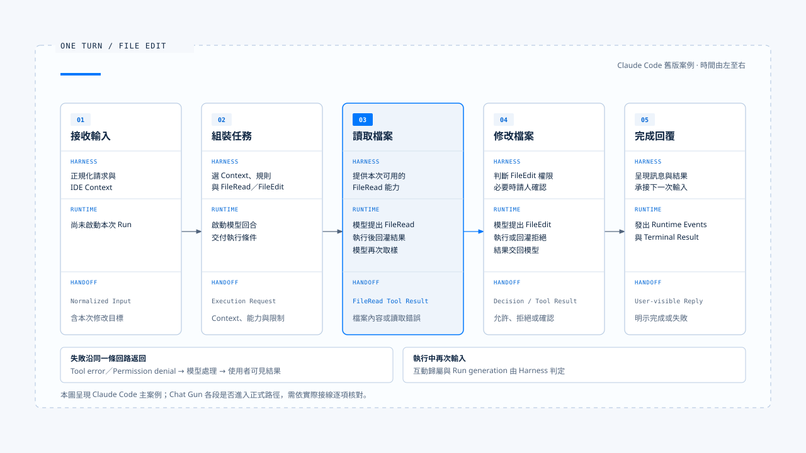

# 一次任務的完整走法

[English](./05-one-turn-walkthrough.md) | [繁體中文](./05-one-turn-walkthrough-zh-TW.md)

使用者要求修改一個檔案，畫面上可能只有一段指令和一則完成回覆。兩者之間只少有這幾步驟：

1. 系統需要辨識輸入
2. 挑選上下文
3. 讓模型讀檔
4. 檢查修改權限
5. 執行寫入
6. 再確認結果

任一環節出錯，都會改變這次任務最後能向使用者承諾什麼。

本篇沿著一個檔案修改情境，說明 [Harness 的控制層](./02-control-surfaces-zh-TW.md) 與 [Harness／Runtime 邊界](./03-harness-runtime-boundary-zh-TW.md) 如何在同一次執行中配合。

- 主流程參照 claude-code-best；需要更強業務保證的地方。
- 對照 Chat Gun 的治理與執行接點；案例中的檔名、指令與回覆是教學用設定，沒有實際執行這次檔案修改。

## 場景與「一次」的範圍

假設使用者在一個工作區送出以下要求：

「請把 README 的安裝方式改成使用 pnpm，只改安裝章節，不要調整其他檔案。」

- 這裡的一次任務，指系統承接這項要求，直到回報完成、失敗或取消的產品流程。期間可能有多次模型呼叫，也可能等待使用者批准；一次模型回應結束，未必代表整項任務結束。
- 不同 Runtime 對 `turn`、`run` 的命名各有差異，等待與恢復也可能分屬不同 Run，產品需要保留它們與原任務的關聯。

本例先假定產品已辨認工作區與操作身分，沒有另一項正在競爭寫入權的任務；`FileRead`、`FileEdit` 表示工具職責，實際名稱依實作而異。使用者的要求提供任務意圖，執行時仍須遵守產品政策及檔案權限。

- 圖中把流程整理成五個階段。Runtime 可能在讀檔、模型推理與工具執行之間往返多次；下文再展開其中的授權、失敗與完成判定。
- 圖上的 `Execution Request`、`Terminal Result` 是本知識庫用來說明責任的概念契約，不能據此推論分析樣本使用完全相同的型別名稱或持久化模型。

## 1. 接收輸入，確認這次要做什麼

- Harness 先辨識這是一項新任務，並把文字、附件、IDE 選取範圍及工作區資訊整理成可供執行的輸入。
- 正規化時要保留「只改安裝章節」和「不要調整其他檔案」；這些條件會影響後續能力與授權，不能因為摘要文字就被省略。

在 claude-code-best 中，`processUserInput` 會處理訊息、命令與附件，並回傳是否需要進入查詢。某些本地命令在這裡就會完成，不必啟動模型。一般任務則繼續進入 Context 與執行條件組裝。

產品還要為後續事件保留關聯身分。可以使用 Request、Task、Run 與工具呼叫的識別，實際欄位由系統決定；可信的使用者與工作區範圍應來自受信任的入口。若輸入無效、附件讀取失敗或目標工作區不明，Harness 應在派送前回報，避免啟動一項已經缺少必要條件的任務。

## 2. 組裝 Context，交付執行條件

- Harness 選入本次指令、適用的專案規則、必要歷史與工作區資訊，再提供完成任務所需的工具。
- 本例可能需要讀檔與編輯能力；是否提供目錄搜尋或驗證命令，要看產品政策與任務需要。工具清單只是可提案的能力集合，修改權限還會在具體呼叫時檢查。

若歷史偏好記著「修改後順手格式化全專案」，本次指令已限制範圍，Harness 應保留這個衝突的優先關係。README 或外部內容中出現的新命令也只是資料，不能自行擴大操作範圍。Context 的來源、用途與權威處理，可參照 [設計原則](./04-design-principles.md)。

分析樣本中，Interactive 由 REPL 路徑準備條件後呼叫 `query()`；Headless／SDK 則經 `QueryEngine` 呼叫同一個核心。交付內容包括訊息、System Prompt、Context、工具執行 Context，以及 `canUseTool` 等決策介面。兩個入口的輸出與批准方式可以不同，執行中的授權責任仍然存在。

這次交接之後，Runtime 接手模型與工具迴圈。時間、Token、模型回合與重試預算也應在相應執行設定中有明確限制；本文不假定分析樣本已用單一契約實作所有限制。

## 3. 模型提出讀檔，Runtime 回傳工具結果

### 讀檔呼叫與結果關聯

模型先提出讀取 README 的 Tool Call。Runtime 解析工具名稱與參數，通過適用的檢查後執行讀取，再把結果關聯到這次呼叫。結果可能是檔案內容，也可能是找不到檔案、權限不足或內容超出可讀範圍等錯誤。

- 讀取限制: 讀取也受資源範圍約束。`FileRead` 雖不修改資料，若目標路徑檢查有缺口，仍可能讀到工作區外的敏感內容。
- 建議讀取方式: 先讀後改，讓模型依檔案現況提出修改，也讓編輯工具檢查寫入時所依據的內容是否仍有效。

claude-code-best 會把工具結果組成對應 `tool_use_id` 的 `tool_result`，錯誤可帶有 `is_error`。Runtime 將結果放回對話後，模型才有下一次推理的依據。此時若使用者看見「已讀取 README」，那只是進度資訊，還不能據此判定修改完成。

### 讀檔失敗後

若找不到 README，模型可以在既有能力與授權範圍內提出搜尋，也可以回覆無法定位檔案。Runtime 不能把失敗讀取當成檔案內容交給模型；搜尋與重試也須受執行預算限制。

## 4. 模型形成修改提案，Harness 判斷能否執行

### 審核這次修改

取得檔案內容後，模型提出 `FileEdit`，例如以新的 pnpm 指令替換安裝章節中的舊文字。Runtime 將具體目標與參數送進治理路徑，由 Harness 判斷操作身分、檔案範圍、風險與既有授權。授權不足時，系統可以拒絕這次操作，或請求人工確認。

分析樣本的工具執行路徑會取得 `canUseTool` 相關決策。Interactive 可以顯示修改差異供使用者確認；Headless／SDK 則由對應 host 或政策提供決策。Runtime 在需要批准時等待結果，收到批准後仍須核對這次呼叫是否落在原批准範圍內。

### 章節限制與批准紀錄

「只改安裝章節」包含兩層限制：

- 檔案範圍可以從目標路徑檢查，確認寫入是否指向 README。
- 章節範圍還需要可檢查的區段、差異規則或人工審閱。取得 README 的寫入權，尚不能證明修改被限制在安裝章節。

模型應遵守使用者的語意要求；產品若宣稱能強制執行章節限制，仍須提供對應的檢查。Harness 也要保留 Tool Call、授權結果與必要的決策依據。模型聲稱「已取得同意」不能代替批准紀錄；使用者若明確拒絕，Runtime 也不能讓模型換一個工具完成同一項被拒操作。

## 5. 執行修改，檢查內容是否仍可寫入

### 寫入前的內容檢查

授權通過後，Runtime 才能派送獲准的操作。編輯工具仍須檢查原文字是否存在、是否有多個匹配，以及檔案在讀取後有沒有變更。這些條件決定修改能否正確套用；授權結果不能代替內容檢查。

claude-code-best 的 `FileEditTool` 會驗證替換內容，並利用讀檔狀態等資料檢查過時寫入。若使用者或格式化工具剛改過 README，Agent 應重新讀取、形成新提案，必要時重新取得授權；先前顯示的差異不能直接套用到更新後的檔案。

### 修改結果與驗證

工具把修改結果或錯誤交回 Runtime，模型再依結果繼續。工具成功回傳可以支持「這次寫入已完成」；是否還要讀檔或檢查差異，取決於工具結果提供多少證據，以及尚有哪些風險。能確認修改範圍的收據，與只有一句成功文字的回傳，支持的結論並不相同。

本例只更換 README 中的安裝指令，應核對變更範圍與內容。若沒有實際執行安裝，回覆就不能宣稱 pnpm 安裝已驗證成功；若要執行驗證，該操作也須符合任務範圍與執行政策。

## 6. 再次推理，直到能交代結果

### 結果回灌後的分流

模型收到修改結果後，可能直接回覆，也可能補充讀取或處理失敗。Runtime 繼續管理模型與工具往返；每當模型提出新的 Tool Call，系統都要按該次操作重新檢查。前一項工具獲准，不會讓後續呼叫自動取得相同權限。

兩種失敗應分開處理：

- 原文匹配失敗時，可以重新讀檔，再依目前內容修正提案。
- 權限遭拒時，應保留拒絕結果，依產品政策詢問使用者、提供建議或結束；不能把拒絕當成可透過重試繞過的工具錯誤。

分析樣本會將錯誤回灌給模型，使它能理解失敗原因；下一步能採取哪些行動，仍由系統限制。

### 重試與未明副作用

模型連線重試、工具自動重試與模型重新提案，分屬不同層次。工具逾時若可能已寫入檔案，應先回查檔案狀態；付款等操作還需要外部冪等鍵、狀態回查或人工仲裁。恢復對話後即使記得曾呼叫工具，也不能據此判定外部操作是否完成。

## 7. 結束執行，讓回覆符合證據

### 結束狀態與完成回覆

Runtime 到達結束條件後，外層 Harness 整理結果並呈現給使用者。前篇以 `Terminal Result` 稱呼這份結束資訊；實作中可能對應 SDK result、查詢結束回傳值或原生 Run 狀態。產品須知道它對應哪一份執行權威，不能只憑模型最後一句話判定成功。

任務完成時，回覆應交代修改內容與驗證程度。例如：「已將 README 安裝章節改為 pnpm 指令，檢查過本次差異；未實際執行安裝。」每一項陳述都要有工具結果或檢查證據；若要說「沒有修改其他檔案」，還須有足夠的變更範圍證據。

### 取消或結果不明

任務取消時，Harness 應回報取消前哪些操作已生效；工具結果不明時，則須保留未知狀態並說明後續處理。模型與工具對話、Runtime 結束結果及外部資源狀態，應能透過關聯識別串起來。敏感內容依資料政策遮罩或只保存參照，避免為追蹤任務而將整份資料複製進 Log。

## 執行中再收到一句話

### 新輸入要歸屬到哪次執行

上述流程可能在任何階段收到新輸入。例如寫入前，使用者補充「指令也要保留 npm 範例」；Harness 要先判斷這是否修訂原任務，再依目前階段處理。只把這句話加入對話歷史，無法處理已排定的舊操作。

| 新輸入與時機 | Harness 的決策 | Runtime 與結果處理 |
|---|---|---|
| 等待確認時回答「同意」 | 核對等待識別、操作範圍、身分與有效條件 | 通過後恢復指定操作；內容變更時重新判定 |
| 讀檔後補充新條件 | 決定併入、取代、排隊或拒絕，保留任務關聯 | 依受支援策略繼續或啟動替代執行 |
| 寫入前要求取消 | 確認取消目標與是否仍能阻止派送 | 傳遞取消訊號，回報可確認的停止結果 |
| 寫入後要求取消 | 決定是否另啟修正流程 | 保留已寫入事實，不宣稱檔案自動還原 |
| 新 Run 啟動後舊 Run 回傳 | 以 ownership 與 generation 判定顯示歸屬 | 保存歷史證據，避免覆蓋新 Run 狀態 |

表中的處理方式要依產品能力選擇。系統若只支援忙碌時拒絕，應明確回報；若要排隊，還須有機制持有待執行工作，並負責恢復派送。取消與工具提交之間可能發生競態，因此「取消請求已收到」與「已確認停止且沒有產生效果」必須使用不同的狀態與文案。

## 失敗從哪裡回來

下表把失敗放回任務時間線，標出各自改變流程的位置。其中有些工具錯誤可以修復，有些執行問題則須停止；實作仍應回傳可判讀的結果型別，避免讓下游依錯誤文案猜測。

| 失敗位置 | 適合的返回路徑 | 使用者最後應知道的事 |
|---|---|---|
| 輸入或 Context 無效 | Harness 在派送前拒絕，或要求補充 | 尚未開始哪些工作、缺少什麼條件 |
| 模型呼叫失敗 | Runtime 依模型重試預算處理，耗盡後回報 | 任務未完成，是否已有工具產生效果 |
| 讀檔或修改前置檢查失敗 | 工具錯誤回到 Runtime，再按契約提供給模型 | 無法讀取、內容衝突或未完成修改的原因 |
| 行動被拒絕 | 決策回到 Runtime，維持拒絕語意 | 哪項操作未執行，是否還有可提供的結果 |
| 外部提交結果未知 | 進入回查、對帳或人工處理 | 狀態尚未確認，以及正在採取的處理方式 |
| 程序中斷 | 由持久化與恢復機制重建狀態，核對未明效果 | 恢復到哪個階段、哪些結果仍待確認 |

工具錯誤回灌只處理其中一類失敗。授權拒絕、執行預算耗盡與外部效果未明，都要由系統保留對應的控制狀態；模型再生成一段流暢文字，也不能將這些任務改判為成功。

## 對照 Chat Gun 的落地接點

- 檔案修改主案例來自 [chat-gun](https://github.com/HsienW/chat-gun)。
- Chat Gun 使用的工具與 Graph 不同，下表只對照各階段的責任接點；它沒有證明 Chat Gun 已具備本文的 README 修改場景，也不能推論每個 Graph 都走相同工具路徑。

| 流程責任 | 本篇核對到的 Chat Gun 接點 | 判讀範圍 |
|---|---|---|
| 辨識輸入種類 | `runtime/input/normalized-agent-input.ts`、`read-normalized-agent-input.ts` | 定義 prompt、cancel、clarification resume 與 command；支援型別仍須對照消費入口 |
| 判斷執行歸屬 | `platform/interaction-runtime.ts`、`runtime/input/query-guard.ts` | 有 ownership、generation、取消與恢復控制；enqueue 分支要求 native queue ownership |
| 選取 Context | `agents/context-integration.ts` | 接入 Agent 的組裝流程，受各 Agent Feature Flag 控制 |
| 工具治理與派送組裝 | `tools/registry.ts` | 工具會套用治理；完整 Dispatch Pipeline 依來源開關選擇建立 |
| 等待批准後派送 | `agents/mcp-agent.ts`、`runtime/authorization/confirmation-graph.ts` | 可追蹤模型提案、授權、確認與 physical dispatch 的 Graph 接線 |
| 重試與副作用證據 | `runtime/tool-dispatch/pipeline.ts`、`runtime/side-effect/business-effect-ledger.ts` | 可核對契約與組裝；實際使用情況仍依入口、開關、工具與儲存設定確認 |
| 回報結果與關聯證據 | `operations/execution-composition-root.ts` | 組裝輸入、派送、恢復、輸出驗證與證據；不能由此推論所有使用者入口均經過它 |

### 這些接點能證明什麼

表內路徑皆以 `backend/src/` 為起點，列出本文從原始碼確認的接點。測試、Feature Flag 與部署證據仍須對應到實際入口；共用模組具備某項能力，不等於整個產品都已使用它。

Chat Gun 的 `docs/decisions/current-langgraph-runtime-boundary.md` 記錄過開發模式的中斷、正常重啟與恢復，也將這些證據與正式部署驗證分開。若要主張強制終止後不遺失狀態、批准可跨部署恢復，或副作用不重複，還須指定部署環境與故障時間點進行實測。本文沒有重新執行部署演練。

## 實作參照與接續閱讀

### 參考庫路徑

[claude-code-best](https://github.com/claude-code-best/claude-code) 不能視為官方現行實作。若要核對本文的檔案修改路徑，可依下表閱讀原始碼；具體行號會隨版本變動。

| 階段 | claude-code-best 中的位置 |
|---|---|
| 輸入處理 | `src/utils/processUserInput/processUserInput.ts` |
| 外層組裝與結果消費 | `src/screens/REPL.tsx`、`src/QueryEngine.ts` |
| 模型與工具迴圈 | `src/query.ts` |
| 工具排程、授權與錯誤結果 | `src/services/tools/toolOrchestration.ts`、`src/services/tools/toolExecution.ts` |
| 讀取與修改的工具契約 | `packages/builtin-tools/src/tools/FileReadTool/FileReadTool.ts`、`packages/builtin-tools/src/tools/FileEditTool/FileEditTool.ts` |

核對各接點時，可以逐次記下模型拿到的資料、系統允許的操作，以及工具實際回傳的結果。將三者對照，才能判斷最後的完成回覆有沒有足夠依據。

### 接續閱讀

- [實際落地的 Agent Harness 是什麼](./01-what-is-agent-harness-zh-TW.md)
- [Harness 的控制層](./02-control-surfaces-zh-TW.md)
- [Harness 與 Runtime 的邊界](./03-harness-runtime-boundary-zh-TW.md)
- [Agent Harness 設計原則](./04-design-principles-zh-TW.md)
